# InternSync – System Design Document

CSC 305 – Software Engineering · Semester 1 – 2026/2027 · Section 5MA1 · Group 3  
Tasks T2 (System design) and T3 (UI design) · Milestone M2 · Version 1.6 · October 28, 2026

| **Version** | **Date** | **Description** | **Author** |
|:--:|:--:|:---|:--:|
| 1.0 | Oct 13, 2026 | First version for Milestone M2: architecture, zero-cost deployment, data model (ERD and data dictionary), behaviour design, security design. The API specification is a separate document. | Salam Alsaour |
| 1.1 | Oct 13, 2026 | Section 8: wireframes (task T3), their mapping to SRS Table 6.1, and the design system. | Salam Alsaour |
| 1.2 | Oct 20, 2026 | CR-05: organizations (universities, colleges, companies), self-registration and verification, Platform Admin; companies publish vacancies directly; CSV import removed. Sections 1, 2, 4, 5, 6, 7, 8, 9, and 10 updated; ERD redrawn in four parts (49 tables). | Salam Alsaour |
| 1.3 | Oct 24, 2026 | CR-07 (Increment 1 implementation): `PATCH /me` usable before consent; purged verification documents keep their file reference; jobs use transaction-level advisory locks; supervisors see the cycles of their placements; permission test described as built. Sections 2, 4, 5, and 7 updated. | Salam Alsaour |
| 1.4 | Oct 26, 2026 | CR-08 (Increment 2 implementation): matching weights as three numeric settings; downloads always streamed by the API, so `files.signed_url_seconds` is removed; attendance rows may hold only an unlock; a final evaluation cannot be reopened while its grade is submitted or Final; row level security on every table; backup retention and GitHub Actions limits for a private repository. Sections 3.2, 3.4, 3.5, 4.3.2, 4.3.6, 5.1, and 5.5 updated. | Salam Alsaour |
| 1.5 | Oct 27, 2026 | CR-09 (Increment 3 implementation): PDF exports with fpdf2 and HarfBuzz shaping instead of WeasyPrint; similarity passages of about one sentence, and a passage compared with the source report's nearby passages taken together; `slot_id` on passages and `attempts` on checks. Sections 1.3, 4.3.5, 5.6, and 6.3 updated. | Salam Alsaour |
| 1.6 | Oct 28, 2026 | CR-10: offline mode with a saved copy of the session and drafts kept on the device (Sections 7.3 and 8.3). CR-11 (Increment 4 implementation): retention period per college, anonymization as built, `anonymized_at` on cycles and users, `purged_at` on files, the certificate page and public answer as built, the idle limit applied on the device. Sections 4.3.1, 4.3.2, 4.3.8, 4.5, 5.6, 5.7, 7.1, 7.3, and 8.3 updated. | Salam Alsaour |

**Related documents**

- [SRS v1.2](../RSR/InternSync_SRS.md): the requirements this design implements. Requirement IDs (FR-…, NFR-…) refer to it.
- [API Specification](InternSync_API_Spec.md): every endpoint, its roles, payloads, and error codes.
- [Diagram pack](../InternSync_Diagrams/README.md): figures referenced below. The ERD figures are generated from `source/06_erd.py`, which must match Section 4.
- [Change requests](../Change_Requests.md): decisions that changed the SRS or SPMP.

## Table of Contents

- [1. Introduction](#1-introduction)
- [2. Architecture](#2-architecture)
- [3. Deployment (zero cost)](#3-deployment-zero-cost)
- [4. Data Design](#4-data-design)
- [5. Behaviour Design](#5-behaviour-design)
- [6. AI Services Design](#6-ai-services-design)
- [7. Security and Privacy Design](#7-security-and-privacy-design)
- [8. User Interface Design](#8-user-interface-design)
- [9. Traceability](#9-traceability)
- [10. Open Issues](#10-open-issues)

## 1. Introduction

### 1.1 Purpose

This document describes how InternSync is built: its components, where they run, how data is stored, how the workflows behave, and how security and privacy requirements are met. It turns SRS v1.2 into decisions a developer can implement directly. The API contract is in the separate [API Specification](InternSync_API_Spec.md).

Since version 1.2 (CR-05), InternSync is one platform for many organizations: a Platform Admin run by the provider; universities, each with colleges; one Coordinator per college with the college's academic supervisors and students; and companies, each with a Company Admin and optional further company supervisors.

### 1.2 Design Principles

| **Principle** | **What it means in the design** | **Requirements** |
|:---|:---|:---|
| One deployable backend | A single FastAPI container holds the REST API, the AI services, and the scheduler. No message broker or separate worker. | C-03, C-10 |
| Server-side authorization | Every endpoint declares its roles and record scope; queries are filtered by scope, never by the client. | FR-AUT-05 |
| Organization isolation | Every query on academic records is filtered by the caller's college, and every query on company records by the caller's company. The Platform Admin has no endpoint that returns academic records. | FR-AUT-05, NFR-PRV-03 |
| Explicit state machines | Vacancies, applications, report slots, evaluations, grades, and certificates change state only through named transitions, each checked and audited. | FR-WFL-01, FR-AUD-01 |
| AI is advisory | AI outputs are stored and displayed with their reason and model version; no AI output changes a status. | NFR-AI-01, FR-MAT-07, FR-SIM-03 |
| Configurable defaults | Every value marked "default" in the SRS is a row in `system_settings` or a cycle field. | NFR-MNT-03 |
| Bilingual by construction | All texts are keys translated in both languages; dates are stored in UTC and shown in Asia/Riyadh time. | FR-LOC-01, FR-LOC-02, NFR-L10N-02 |
| Zero cost | Only free tiers and open-source software; the same containers run locally with Docker Compose. | C-04, NFR-PRT-02 |

### 1.3 Technology Choices

| **Layer** | **Choice** | **Reason** |
|:---|:---|:---|
| Backend language and framework | Python 3.12, FastAPI, Pydantic v2 | Required by C-03; generates the OpenAPI document (NFR-MNT-02). |
| Database access | SQLAlchemy 2.0 (synchronous), psycopg 3, Alembic migrations | Mature and simple; FastAPI runs synchronous endpoints in a thread pool, which is enough for the expected load (NFR-PER-01). |
| Database | PostgreSQL 16 or later with `pgvector` (`halfvec`) and `pg_trgm` | Relational data and embeddings in one place (C-03). `halfvec` halves vector storage to fit the free database size. |
| Passwords | Argon2id (`argon2-cffi`) | NFR-SEC-02. |
| Tokens | JWT (HS256, `PyJWT`) with a server-side session row | Idle timeout and logout revocation (FR-AUT-03). |
| Embedding model | `intfloat/multilingual-e5-small` (384 dimensions) with `sentence-transformers` on CPU | Arabic and English (NFR-L10N-04); small enough for CPU hosting (C-10). |
| Text extraction | `pypdf` for PDF, `python-docx` for DOCX | FR-PRF-04, FR-PRF-05. |
| File type check | Magic-byte detection (`filetype`) plus a DOCX structure check | NFR-SEC-04. |
| Scheduler | APScheduler 3 inside the API process, with Postgres advisory locks | NFR-REL-03. |
| PDF exports | fpdf2 with HarfBuzz text shaping (`uharfbuzz`) and bundled Noto Naskh Arabic and Noto Sans fonts (OFL) | Correct Arabic joining and RTL order (NFR-L10N-03, D-07); installs with pip on every platform, with no system libraries (CR-09). |
| Excel exports | `openpyxl` | FR-EXP-01. |
| QR codes | `qrcode` | FR-CER-01. |
| Email | Python `smtplib` over TLS, Jinja2 templates per language | FR-NOT-01, FR-NOT-06. |
| Web push | `pywebpush` with VAPID keys | FR-PWA-02. |
| Frontend | React 18, Vite, TypeScript, React Router, TanStack Query, react-i18next, Tailwind CSS (logical properties for RTL) | C-03, FR-LOC-01. |
| API client | `openapi-typescript` and `openapi-fetch`, generated from the server's OpenAPI document | NFR-MNT-02. |
| PWA | `vite-plugin-pwa` (Workbox) | FR-PWA-01 – 03. |
| Tests | pytest, pytest-cov, httpx test client; Vitest; Playwright smoke tests; Locust load tests | NFR-MNT-01, NFR-PER-01. |

## 2. Architecture

### 2.1 Overview

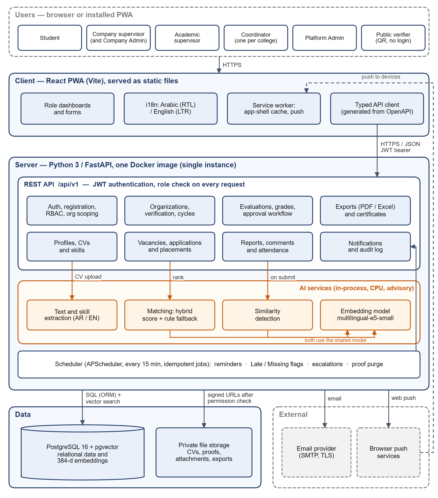

The React PWA is a static build. It calls the REST API under `/api/v1` with a JWT bearer token. The API container holds:

- the **REST API modules** (Section 2.2);
- the **AI services**, in-process: text and skill extraction, matching, similarity detection, and one shared embedding model loaded once at start-up;
- the **scheduler**, which runs reminder, flag, escalation, and delivery jobs every few minutes.

PostgreSQL stores all records and embeddings. A private object store keeps CVs, attachments, exports, and certificates. Email goes out through SMTP and push messages through the browser vendors' push services.

### 2.2 Backend Modules

Each module is a Python package under `backend/app/` with the same files: `router.py` (endpoints), `schemas.py` (Pydantic models), `service.py` (business rules and transitions), `models.py` (SQLAlchemy tables), and `policy.py` (who may do what).

| **Module** | **Responsibility** | **Main tables** | **SRS** |
|:---|:---|:---|:---|
| `core` | Settings, database session, error handling, i18n messages, audit helper, permission helpers, clock (UTC and Asia/Riyadh) | `system_settings`, `audit_log` | NFR-MNT-03, FR-AUD |
| `auth` | Registration, email confirmation, invitations, login, logout, sessions, password reset, lockout, consent | `users`, `user_sessions`, `account_tokens` | FR-AUT-02 – 04, FR-ORG-02, FR-ORG-06, NFR-SEC-02/03, NFR-PRV-01 |
| `orgs` | Universities, colleges, companies, verification requests and documents, role transfer, account deactivation | `universities`, `colleges`, `companies`, `verification_requests`, `verification_documents`, `users` | FR-ORG-01 – 09, FR-AUT-06 |
| `cycles` | Training cycles of a college, weeks, grade components, rubric, enrolments; skill vocabulary and majors (Platform Admin) | `training_cycles`, `cycle_weeks`, `grade_components`, `rubric_criteria`, `enrollments`, `skills`, `skill_resources`, `majors` | FR-CYC-01 – 05, FR-ORG-05 |
| `profiles` | Student profile, CV upload, skill extraction and confirmation | `student_profiles`, `cvs`, `cv_extracted_skills`, `student_skills` | FR-PRF-02 – 05 |
| `vacancies` | Vacancies published by companies, applications, placements | `vacancies`, `vacancy_skills`, `vacancy_majors`, `vacancy_universities`, `applications`, `placements` | FR-VAC-01 – 08 |
| `matching` | Eligibility, fit score, explanation, development plan | `match_scores` | FR-MAT-01 – 07 |
| `reports` | Report slots, versions, attachments, reviews, comments | `report_slots`, `report_versions`, `report_attachments`, `report_reviews`, `report_comments` | FR-REP-01 – 07, FR-WFL-01 |
| `similarity` | Passages, similarity checks, supervisor decisions | `report_passages`, `similarity_checks`, `similarity_matches` | FR-SIM-01 – 03 |
| `attendance` | Weekly attendance, unlocks | `attendance_weeks` | FR-ATT-01 – 04 |
| `evaluations` | Periodic and final evaluations, student evaluation of the company, outcome survey | `evaluations`, `evaluation_scores`, `company_evaluations`, `outcome_surveys` | FR-EVL-01 – 05, FR-DSH-03 |
| `grades` | Grade entry, computation, approval workflow | `grades`, `grade_component_scores` | FR-WFL-02 – 07 |
| `dashboards` | Pending actions, cycle and platform statistics, leniency alerts | (read-only queries) | FR-DSH-01 – 05 |
| `exports` | Grade sheet, term summary, training record | `files` | FR-EXP-01 – 03 |
| `certificates` | Issue, revoke, public verification | `certificates` | FR-CER-01 – 03 |
| `notifications` | In-app list, email and push delivery, push subscriptions | `notifications`, `push_subscriptions` | FR-NOT-01 – 06, FR-PWA-02 |
| `files` | Upload checks, storage adapter (Supabase or local), permission-checked download | `files` | NFR-SEC-04 |
| `jobs` | Scheduler set-up and job functions | `job_runs` | NFR-REL-03, FR-NOT-02 – 04 |
| `ai` | Embedding model wrapper, text normalization, skill extractor, passage splitter | — | FR-PRF-04, FR-MAT, FR-SIM |

### 2.3 Request Pipeline

1. **Transport:** HTTPS is terminated by the hosting provider (NFR-SEC-01). CORS allows only the configured frontend origins.
2. **Authentication:** the `current_user` dependency verifies the JWT signature and expiry, loads the session by its `sid`, rejects it if revoked or idle for more than the idle timeout, and updates `last_seen_at` (at most once per minute).
3. **Consent gate:** until `users.consent_at` is set, every endpoint except `GET /me`, `PATCH /me` (language, so the notice can be read in the other language), `POST /me/consent`, and `POST /auth/logout` returns `403 CONSENT_REQUIRED` (NFR-PRV-01).
4. **Verification gate:** an account whose verification is pending or rejected reaches only `/me`, its own verification requests, and, for students, the profile, CV, and vacancy list. Every other endpoint returns `403 VERIFICATION_REQUIRED` (FR-ORG-02).
5. **Authorization:** the route declares allowed roles; the service loads the record through a scope-filtered query that always includes the caller's college or company (Section 7.2). A record outside the caller's scope returns `403 FORBIDDEN`.
6. **Business rule and transition:** the service checks the state machine (Section 5) and limits, then writes the change.
7. **Audit and notifications:** the audit entry and any notifications are inserted in the **same database transaction** as the change, so either all are saved or none (FR-AUD-01, NFR-REL-04).
8. **Response:** JSON, or `application/problem+json` for errors with a code and a message in the user's language (NFR-USA-05).

### 2.4 Synchronous and Background Work

| **Work** | **How it runs** | **Limit** |
|:---|:---|:---|
| CV text and skill extraction | Synchronous in the upload request (thread pool) | ≤ 30 s (NFR-PER-03) |
| Profile embedding | Synchronous when the student confirms skills | < 1 s |
| Vacancy embedding | Synchronous when a vacancy is published or edited | < 1 s |
| Ranking | Synchronous: one SQL query for eligible vacancies and their vectors, scoring in Python | ≤ 5 s for 300 vacancies (NFR-PER-02) |
| Similarity check | After a report is submitted, a `similarity_checks` row is created as `pending` in the same transaction; a background task processes it right away, and the `similarity_retry` job picks up any check left pending | ≤ 2 min (NFR-PER-04) |
| Email and push delivery | Notifications are written in the business transaction (outbox); the `deliver_notifications` job sends them | Every minute |
| Exports | Synchronous, streamed as a file | ≤ 60 s for 100 students (NFR-PER-05) |

## 3. Deployment (zero cost)

### 3.1 Decision (CR-01)

The SRS v1.0 assumed one Linux VM, and the first diagram pack recommended Railway for the API. Both were replaced because the project must cost nothing (C-04):

- **Railway** is not free for this use. After a 30-day trial, the Free plan gives US$1 of credit per month and at most 0.5 GB RAM and 1 vCPU per service. The API with the embedding model needs about 1–1.5 GB of RAM and must run all the time for the scheduler. The Hobby plan costs US$5 per month.
- **Hugging Face Spaces** offers free CPU Basic hardware with 2 vCPU and 16 GB RAM for Docker containers, which fits the API, the model, and the scheduler with room to spare.

### 3.2 Reference Deployment

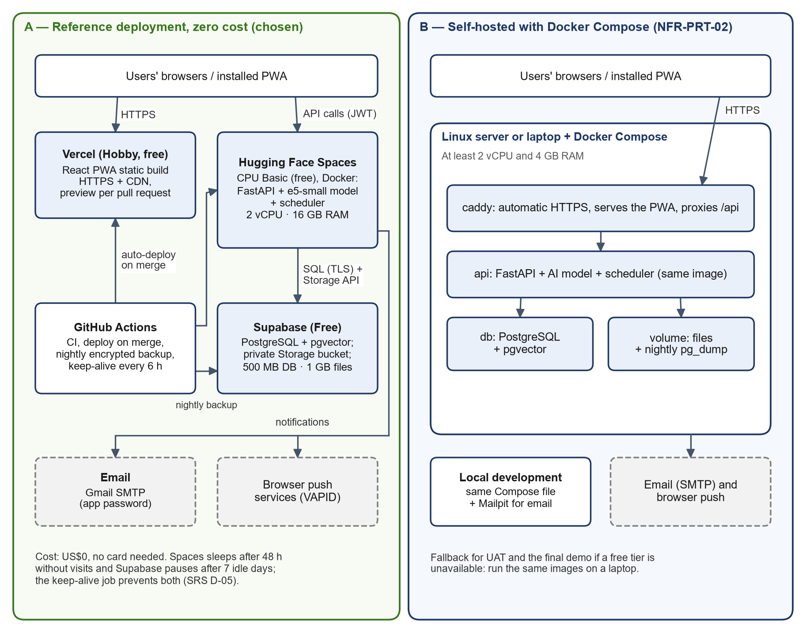

| **Component** | **Service and plan** | **Free-tier limits that matter** | **Notes** |
|:---|:---|:---|:---|
| PWA (static build) | Vercel, Hobby | Personal, non-commercial projects | Auto-deploys from `main`; preview deployment per pull request; HTTPS and CDN. |
| API container (FastAPI, embedding model, scheduler) | Hugging Face Spaces, Docker SDK, CPU Basic | 2 vCPU, 16 GB RAM, 50 GB disk that is **not persistent**; sleeps after 48 h without visits; must be a public Space | Port 7860. The container keeps no state on disk: data in Supabase, files in Supabase Storage. Secrets are stored as Space secrets. |
| Database | Supabase, Free | 500 MB database (read-only above that); pauses after 7 days of low activity | PostgreSQL with `vector` and `pg_trgm`. The Data API is disabled, and row level security is on for every table as a second guard; the API connects as the owner of the tables through the session pooler over TLS. |
| File storage | Supabase Storage, Free (private bucket) | 1 GB of files | Accessed only by the API with the service key; the API streams each download after the permission check, so no bucket link reaches a browser. |
| Email | Gmail SMTP with an app password | About 500 messages per day | A dedicated project Gmail account. |
| Push | Browser push services with VAPID keys | — | Payload holds the event title and a link only (NFR-PRV-03). |
| CI, backups, keep-alive | GitHub Actions | 2,000 minutes a month and 500 MB of artifact storage for a private repository | See Section 3.5. |

**Why the limits are acceptable:** the demonstration uses synthetic data for 2 universities and 4 colleges, about 400 students in total (C-09). With `halfvec(384)`, one embedding takes about 0.8 KB. 400 students × 13 reports × about 15 passages is about 78,000 passage vectors, about 60 MB plus about 80 MB of index, so the whole database stays well under 500 MB. Even the 10,000-report test of NFR-PER-04 (about 150,000 passages) fits in about 250 MB. Demo files are kept small (CVs about 100 KB) so storage stays under 1 GB.

### 3.3 Environments

| **Environment** | **What runs** | **How** |
|:---|:---|:---|
| Local development | `db` (pgvector/pgvector, PostgreSQL 17), `api` (FastAPI with hot reload), `web` (Vite dev server), `mailpit` (catches all email) | `docker compose up` |
| CI | PostgreSQL service container, backend tests with coverage, frontend lint, tests, and build, OpenAPI client check | GitHub Actions on every pull request |
| Reference (demo) | Vercel + Hugging Face Space + Supabase + Gmail SMTP | Deployed on merge to `main` |
| Self-hosted (NFR-PRT-02) | `caddy` (automatic HTTPS, serves the PWA, proxies `/api`), `api`, `db`, a file volume | `docker compose -f compose.prod.yml up -d` on any Linux server with at least 2 vCPU and 4 GB RAM |

The storage adapter is chosen by `STORAGE_BACKEND=supabase|local`. Locally and when self-hosted, files live in a Docker volume outside any web root (NFR-SEC-04).

### 3.4 Configuration and Secrets

All configuration comes from environment variables. Secrets never enter the repository.

| **Variable** | **Purpose** |
|:---|:---|
| `DATABASE_URL` | PostgreSQL connection string (TLS required in the reference deployment) |
| `JWT_SECRET` | Signing key for access tokens (32 random bytes or more); with `ENV=production` the API refuses to start without one |
| `FRONTEND_BASE_URL`, `CORS_ORIGINS` | Links in emails and QR codes; allowed browser origins |
| `STORAGE_BACKEND`, `SUPABASE_URL`, `SUPABASE_SERVICE_KEY`, `STORAGE_BUCKET`, `LOCAL_STORAGE_DIR` | File storage |
| `SMTP_HOST`, `SMTP_PORT`, `SMTP_USER`, `SMTP_PASSWORD`, `MAIL_FROM` | Email |
| `VAPID_PUBLIC_KEY`, `VAPID_PRIVATE_KEY`, `VAPID_SUBJECT` | Web push |
| `EMBEDDING_MODEL` | Model name; default `intfloat/multilingual-e5-small` |
| `AI_ENABLED` | `false` forces the rule-based fallback (FR-MAT-04 test) |
| `SCHEDULER_ENABLED` | `false` in tests and in a second instance |
| `ENV` | `development`, `test`, or `production`; development-only routes and demo accounts are refused in production |
| `PORT`, `FORWARDED_ALLOW_IPS` | Listening port (7860 on the Space) and the proxies whose forwarded client address is trusted (read by uvicorn) |

### 3.5 CI/CD, Backups, and Keep-alive

| **Workflow** | **Trigger** | **Steps** |
|:---|:---|:---|
| `ci.yml` | Every pull request and push | Backend: `ruff`, `pytest` with coverage gate of 70% on business-logic modules (NFR-MNT-01), permission-matrix completeness test. Frontend: `eslint`, `vitest`, `vite build`, i18n missing-key check (FR-LOC-02), and a check that the generated API client matches the server's OpenAPI document. |
| `deploy-api.yml` | Push to `main` that changes `backend/` (merged pull requests have passed CI), or by hand | Copies the settings and secrets into the Hugging Face Space and pushes the files the image is built from, using `HF_TOKEN`. The image already holds the embedding model. The container runs `alembic upgrade head` before starting `uvicorn`. Skipped while the secrets are missing ([Deployment](../Deployment.md)). |
| Vercel Git integration | Push to `main`; pull requests | Builds and deploys `frontend/`. |
| `backup.yml` | Nightly at 02:00 Asia/Riyadh | `pg_dump` of the database plus a download of the storage bucket, each encrypted with a symmetric key from GitHub secrets and kept as a workflow artifact: the database for 30 days, the files for 7 days, to stay within the artifact storage (NFR-REL-02). A restore test is run once before M6. |
| `keepalive.yml` | Every 6 hours | Calls `GET /api/v1/health?deep=true`, which runs `SELECT 1` and reports the scheduler's last run. This keeps the Space awake and Supabase active (D-05) and serves as the uptime log (NFR-REL-01). |

## 4. Data Design

### 4.1 Conventions

- Table names are plural `snake_case`. Primary keys are `id uuid default gen_random_uuid()`, except link tables (composite keys), `audit_log` and `report_passages` and `job_runs` (`bigint` identity), and `system_settings` (`key`).
- Every timestamp is `timestamptz` stored in UTC. Deadlines are computed in Asia/Riyadh time and then stored in UTC (NFR-L10N-02).
- Status and type values are `text` with a `CHECK` constraint listing the allowed values (easier to migrate than PostgreSQL enums). The API uses the same lowercase values.
- Business records are **never deleted**: accounts are deactivated, placements cancelled, certificates revoked. Foreign keys use `ON DELETE RESTRICT`. Only technical rows (sessions, push subscriptions, job runs) may be deleted.
- Mutable tables have `created_at` and `updated_at`. Who changed what is kept in `audit_log`, not in extra columns, unless a column is needed for display or rules.
- Embeddings are `halfvec(384)` with an HNSW index using cosine distance.
- Text search on vacancies uses `ILIKE` with a `pg_trgm` GIN index, because PostgreSQL has no built-in Arabic dictionary.
- **Organization scope:** a student, an academic supervisor, and a coordinator carry `users.college_id`; a company supervisor carries `users.company_id`. Academic records reach their college through `placements.student_id` and their company through `vacancies.company_id`. Every scoped query joins to one of these columns (Section 7.2).

### 4.2 Entity-Relationship Diagrams

The data model has 49 tables in four diagrams. Crow's-foot notation; orange columns are vectors.

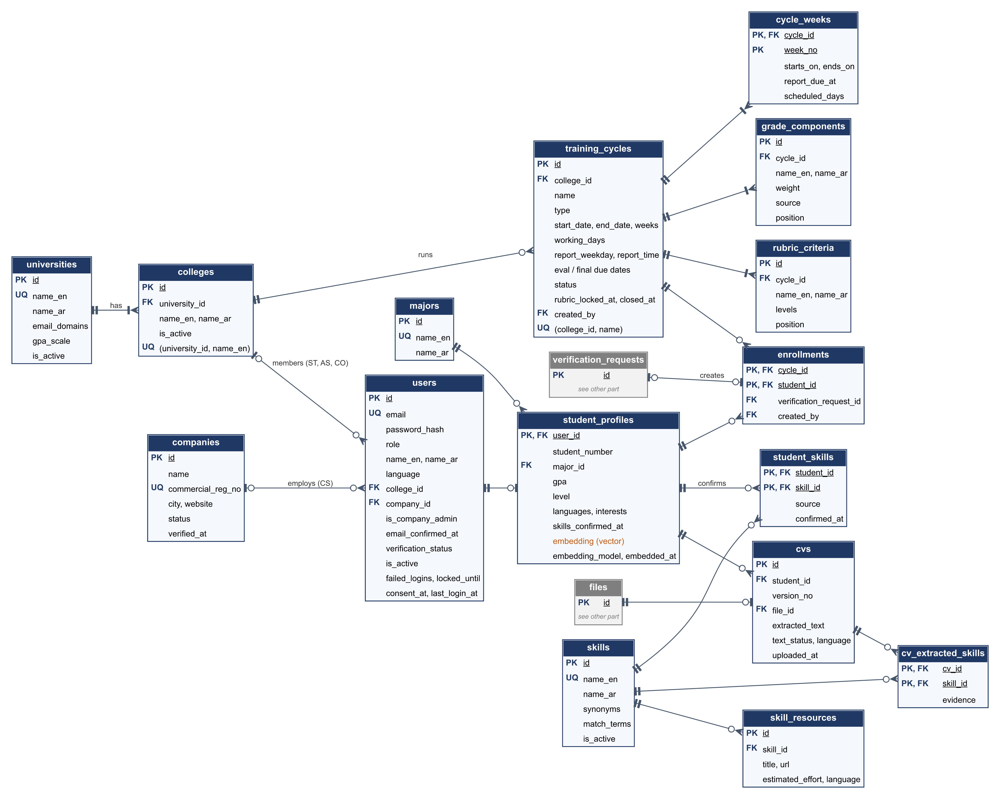

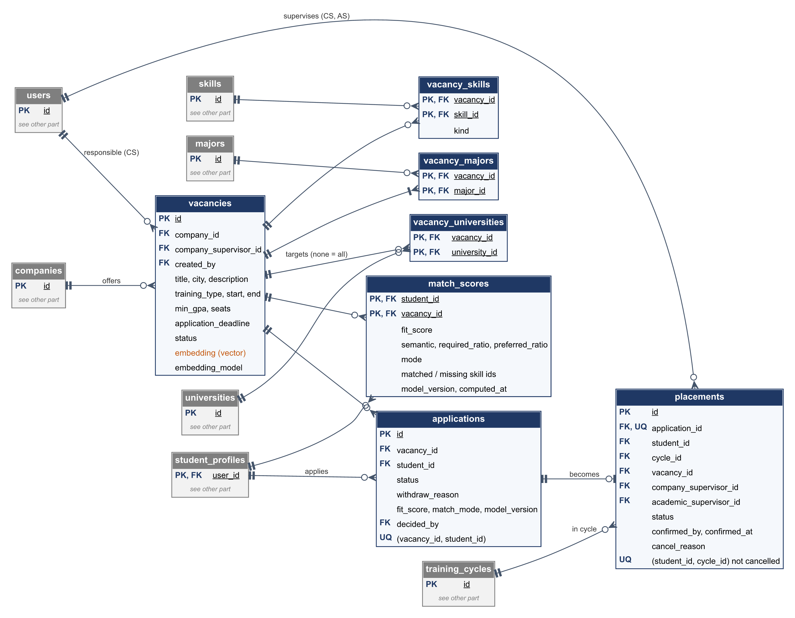

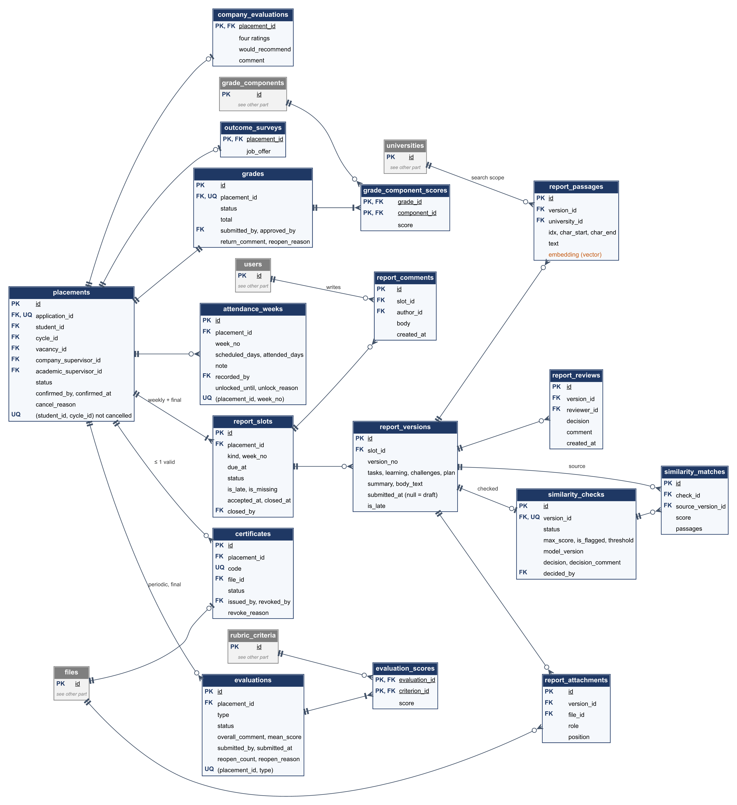

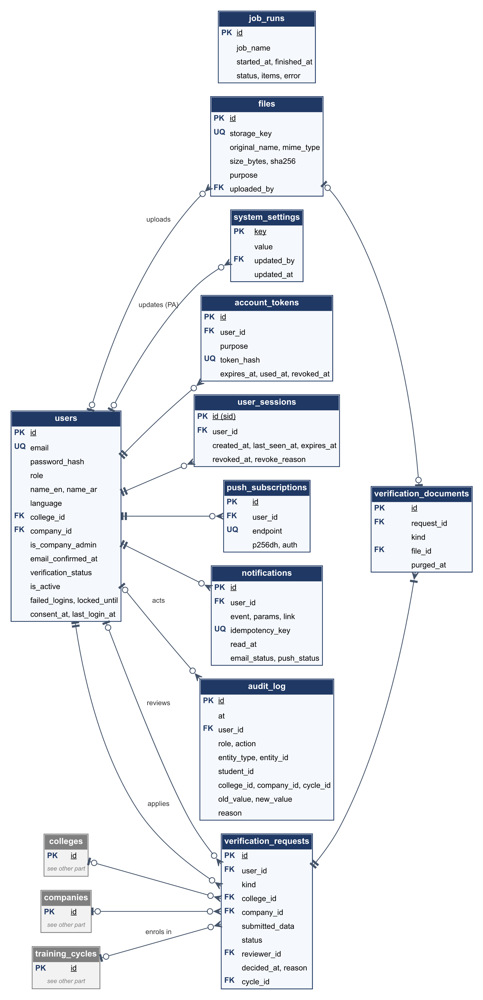

**Changes in version 1.2 (CR-05):** new tables `universities`, `colleges`, `vacancy_universities`, `verification_requests`, and `verification_documents`; `import_batches` removed. `users` gained `college_id`, `is_company_admin`, `email_confirmed_at`, and `verification_status` (and lost `staff_id`, `department`, and `activated_at`); `companies` gained the commercial registration number and a status; `training_cycles` gained `college_id`; `vacancies` lost `cycle_id`, the `pending_review` status, and `return_comment`, and gained the training type and dates; `student_profiles.university_id` became `student_number`; `report_passages` gained `university_id`.

**Changes from the ERD in diagram pack v1.0:** the embedding moved from `CV` to `student_profiles` (the profile text includes confirmed skills and interests). New tables: `account_tokens`, `user_sessions`, `push_subscriptions`, `system_settings`, `cycle_weeks`, `majors`, `vacancy_majors`, `skill_resources`, `cv_extracted_skills`, `match_scores`, `files`, `report_reviews`, `report_passages`, `similarity_checks` (replaces the decision column of `SIMILARITY_FLAG`, renamed `similarity_matches`), `import_batches`, and `job_runs`. `vacancies` gained `company_supervisor_id` and `return_comment`; `training_cycles` gained `working_days` and `rubric_locked_at`.

### 4.3 Data Dictionary

Abbreviations: **PK** primary key, **FK** foreign key, **UQ** unique, **NN** not null. Columns are nullable unless marked NN.

#### 4.3.1 Organizations, accounts, and access

**`universities`** (FR-ORG-01).

| **Column** | **Type** | **Constraints** | **Notes** |
|:---|:---|:---|:---|
| id | uuid | PK | |
| name_en, name_ar | text | NN, UQ on `lower(name_en)` | |
| email_domains | text[] | NN, default `{}` | e.g., `{example.edu.sa}`. A student email in one of these domains is shown to the Coordinator as a hint, not as proof |
| gpa_scale | numeric(3,2) | NN, default 5.00, CHECK in (4.00, 5.00) | Used to check student GPAs |
| is_active | boolean | NN, default true | |
| created_at | timestamptz | NN | |

**`colleges`** (FR-ORG-01, FR-ORG-03). The college's single Coordinator is found in `users` (partial UQ below).

| **Column** | **Type** | **Constraints** | **Notes** |
|:---|:---|:---|:---|
| id | uuid | PK | |
| university_id | uuid | NN, FK `universities` | |
| name_en, name_ar | text | NN; UQ (university_id, `lower(name_en)`) | |
| is_active | boolean | NN, default true | Inactive colleges are not offered at registration |
| retention_months | smallint | NN, default 12, CHECK 0–120 | Months after a cycle closes before its personal data may be anonymized; set by the coordinator (NFR-PRV-04, CR-11) |
| created_at | timestamptz | NN | |

**`companies`** (FR-ORG-04, FR-VAC-01).

| **Column** | **Type** | **Constraints** | **Notes** |
|:---|:---|:---|:---|
| id | uuid | PK | |
| name | text | NN | As entered |
| commercial_reg_no | text | NN, UQ | Commercial registration number |
| city | text | NN | |
| website | text | | Optional |
| status | text | NN, default `pending`, CHECK in (`pending`, `verified`, `rejected`, `suspended`) | Only a verified company can create vacancies or invite supervisors |
| verified_at | timestamptz | | |
| created_at, updated_at | timestamptz | NN | |

**`users`**: one row per account, exactly one role (FR-AUT-01).

| **Column** | **Type** | **Constraints** | **Notes** |
|:---|:---|:---|:---|
| id | uuid | PK | |
| email | text | NN, UQ on `lower(email)` | Login name |
| password_hash | text | | Argon2id; null until an invitation is accepted |
| role | text | NN, CHECK in (`student`, `company_supervisor`, `academic_supervisor`, `coordinator`, `platform_admin`) | |
| name_en, name_ar | text | NN | |
| language | text | NN, default `ar`, CHECK in (`ar`, `en`) | Interface, email, and notification language (FR-LOC-01, FR-NOT-06) |
| college_id | uuid | FK `colleges`; CHECK set if and only if role is `student`, `academic_supervisor`, or `coordinator` | |
| company_id | uuid | FK `companies`; CHECK set if and only if role is `company_supervisor` | |
| is_company_admin | boolean | NN, default false; CHECK true only for `company_supervisor`; partial UQ (company_id) where true | One Company Admin per company (FR-ORG-04) |
| email_confirmed_at | timestamptz | | Set by the confirmation or invitation link (FR-AUT-02) |
| verification_status | text | NN, CHECK in (`pending`, `verified`, `rejected`, `not_required`) | `not_required` for invited users and the Platform Admin |
| is_active | boolean | NN, default true | FR-AUT-06 |
| failed_logins | smallint | NN, default 0 | NFR-SEC-03 |
| locked_until | timestamptz | | NFR-SEC-03 |
| consent_at | timestamptz | | NFR-PRV-01 |
| last_login_at | timestamptz | | |
| anonymized_at | timestamptz | | Set by an anonymization; the account is inactive and its audit entries are masked (NFR-PRV-04, CR-11) |
| created_at, updated_at | timestamptz | NN | |

Partial UQ (college_id) where role = `coordinator`, verification_status = `verified`, and is_active: one Coordinator per college (FR-ORG-03).

**`account_tokens`**: one-time email-confirmation, invitation, and password-reset links (FR-AUT-02, FR-AUT-04, FR-ORG-06).

| **Column** | **Type** | **Constraints** | **Notes** |
|:---|:---|:---|:---|
| id | uuid | PK | |
| user_id | uuid | NN, FK `users` | |
| purpose | text | NN, CHECK in (`email_confirmation`, `invitation`, `password_reset`) | |
| token_hash | text | NN, UQ | SHA-256 of the random token; the token itself is only in the email |
| expires_at | timestamptz | NN | 72 h for confirmation and invitation, 60 min for reset (settings) |
| used_at | timestamptz | | Set on use |
| revoked_at | timestamptz | | Set when a newer token of the same purpose is issued |
| created_at | timestamptz | NN | |

**`verification_requests`**: one request per registration attempt (FR-ORG-03 – 05, FR-ORG-09).

| **Column** | **Type** | **Constraints** | **Notes** |
|:---|:---|:---|:---|
| id | uuid | PK | |
| user_id | uuid | NN, FK `users` | The applicant |
| kind | text | NN, CHECK in (`coordinator`, `company`, `student`) | |
| college_id | uuid | FK `colleges` | Coordinator and student requests |
| company_id | uuid | FK `companies` | Company requests |
| submitted_data | jsonb | NN | Data as submitted (student number, major, GPA, level; or company name, registration number, city), kept for history |
| status | text | NN, default `pending`, CHECK in (`pending`, `approved`, `rejected`) | Partial UQ (user_id) where `pending`: one open request per account |
| reviewer_id | uuid | FK `users` | Platform Admin for coordinators and companies; the college's Coordinator for students |
| decided_at | timestamptz | | |
| reason | text | CHECK required when `rejected` | Shown to the applicant |
| cycle_id | uuid | FK `training_cycles` | Student approvals: the cycle the student is enrolled in |
| created_at | timestamptz | NN | |

**`verification_documents`** (FR-ORG-08).

| **Column** | **Type** | **Constraints** | **Notes** |
|:---|:---|:---|:---|
| id | uuid | PK | |
| request_id | uuid | NN, FK `verification_requests` | |
| kind | text | NN, CHECK in (`appointment_letter`, `commercial_registration`, `authorization_letter`, `course_registration`, `other`) | |
| file_id | uuid | FK `files` | Kept after the retention period: the `files` row stays as the record of what was submitted, while the stored object is deleted |
| purged_at | timestamptz | | Set when the stored object is deleted; the file endpoint then answers `410 FILE_PURGED` |

**`user_sessions`**: server side of each login, for idle timeout and logout (FR-AUT-03).

| **Column** | **Type** | **Constraints** | **Notes** |
|:---|:---|:---|:---|
| id | uuid | PK | The `sid` claim in the JWT |
| user_id | uuid | NN, FK `users` | |
| created_at, last_seen_at | timestamptz | NN | Idle if `now - last_seen_at` > idle timeout |
| expires_at | timestamptz | NN | Absolute limit (12 h default) |
| revoked_at | timestamptz | | |
| revoke_reason | text | CHECK in (`logout`, `idle`, `password_reset`, `deactivated`, `expired`) | |
| user_agent | text | | For the user's own session list only |

**`push_subscriptions`**: browser push endpoints (FR-PWA-02).

| **Column** | **Type** | **Constraints** | **Notes** |
|:---|:---|:---|:---|
| id | uuid | PK | |
| user_id | uuid | NN, FK `users` | |
| endpoint | text | NN, UQ | Deleted when the push service answers 404 or 410 |
| p256dh, auth | text | NN | Subscription keys |
| created_at, last_success_at | timestamptz | | |

#### 4.3.2 Cycles and configuration

**`training_cycles`** (FR-CYC-01, FR-CYC-03, FR-CYC-05).

| **Column** | **Type** | **Constraints** | **Notes** |
|:---|:---|:---|:---|
| id | uuid | PK | |
| college_id | uuid | NN, FK `colleges` | The college that runs the cycle |
| name | text | NN; UQ (college_id, name) | e.g., "Co-op Fall 2026" |
| type | text | NN, CHECK in (`coop`, `summer`) | |
| start_date, end_date | date | NN, CHECK end > start | |
| weeks | smallint | NN, CHECK 1–30 | A-06; must fit between the dates |
| working_days | smallint[] | NN, default `{7,1,2,3,4}` | ISO weekdays (1 = Monday, 7 = Sunday); default Sunday–Thursday (CR-03, A-08) |
| report_weekday | smallint | NN, CHECK 1–7 | Weekly report deadline day |
| report_time | time | NN | Local Asia/Riyadh time, e.g., 23:59 |
| periodic_eval_due_at, final_eval_due_at, final_report_due_at | timestamptz | NN | |
| status | text | NN, CHECK in (`open`, `closed`) | Closed cycles are read-only (FR-CYC-05) |
| rubric_locked_at | timestamptz | | Set when the first evaluation is submitted (FR-CYC-03) |
| closed_at | timestamptz | | |
| anonymized_at, anonymized_by | timestamptz, uuid | FK `users` | Set by the anonymization (Section 4.5); such a cycle cannot be reopened (CR-11) |
| created_by | uuid | NN, FK `users` | |
| created_at, updated_at | timestamptz | NN | |

**`cycle_weeks`**: generated weeks and deadlines (FR-CYC-01, FR-REP-01, FR-ATT-01).

| **Column** | **Type** | **Constraints** | **Notes** |
|:---|:---|:---|:---|
| cycle_id | uuid | PK, FK `training_cycles` | |
| week_no | smallint | PK, CHECK ≥ 1 | |
| starts_on, ends_on | date | NN | Week k covers `start_date + 7(k−1)` to `start_date + 7k − 1` |
| report_due_at | timestamptz | NN | The `report_weekday` inside the week at `report_time` (Section 5.2); can be moved by the Coordinator |
| scheduled_days | smallint | NN, CHECK 0–7 | Working days of the week inside the cycle dates |

**`grade_components`** (FR-CYC-02, FR-WFL-02).

| **Column** | **Type** | **Constraints** | **Notes** |
|:---|:---|:---|:---|
| id | uuid | PK | |
| cycle_id | uuid | NN, FK | |
| name_en, name_ar | text | NN; UQ (cycle_id, name_en) | |
| weight | numeric(5,2) | NN, CHECK > 0 and ≤ 100 | The API replaces the whole list in one transaction and rejects a total other than 100 |
| source | text | NN, CHECK in (`company_final_evaluation`, `academic_supervisor`) | At most one `company_final_evaluation` per cycle (partial UQ) |
| position | smallint | NN | Display order |

**`rubric_criteria`** (FR-CYC-03, FR-EVL-01, FR-EVL-02).

| **Column** | **Type** | **Constraints** | **Notes** |
|:---|:---|:---|:---|
| id | uuid | PK | |
| cycle_id | uuid | NN, FK | |
| name_en, name_ar | text | NN | |
| levels | jsonb | NN | `{"1": {"en": "…", "ar": "…"}, …, "5": {…}}`; all five levels required |
| position | smallint | NN; UQ (cycle_id, position) | |

**`skills`**: the skill vocabulary, shared by all organizations and maintained by the Platform Admin (FR-CYC-04).

| **Column** | **Type** | **Constraints** | **Notes** |
|:---|:---|:---|:---|
| id | uuid | PK | |
| name_en | text | NN, UQ on `lower(name_en)` | Display name in English, e.g., "JavaScript" |
| name_ar | text | NN | |
| synonyms | text[] | NN, default `{}` | e.g., `{JS, جافا سكربت}` |
| match_terms | text[] | NN | Normalized forms of both names and all synonyms (Section 6.1); rebuilt on every edit |
| is_active | boolean | NN, default true | Inactive skills are not extracted |
| created_at, updated_at | timestamptz | NN | |

**`skill_resources`** (FR-CYC-04, FR-MAT-06).

| **Column** | **Type** | **Constraints** | **Notes** |
|:---|:---|:---|:---|
| id | uuid | PK | |
| skill_id | uuid | NN, FK `skills` | |
| title | text | NN | |
| url | text | NN, CHECK starts with `https://` or `http://` | |
| estimated_effort | text | | e.g., "6 hours" |
| language | text | CHECK in (`ar`, `en`) | |
| position | smallint | NN | |

**`majors`** (FR-PRF-02, FR-VAC-01).

| **Column** | **Type** | **Constraints** | **Notes** |
|:---|:---|:---|:---|
| id | uuid | PK | |
| name_en | text | NN, UQ | Maintained by the Platform Admin; chosen by students at registration and by companies for eligibility |
| name_ar | text | NN | |

**`system_settings`**: every SRS default, set by the Platform Admin for the whole platform (NFR-MNT-03).

| **Column** | **Type** | **Constraints** | **Notes** |
|:---|:---|:---|:---|
| key | text | PK | Dotted name, see Table 4.1 |
| value | jsonb | NN | Validated against a schema per key |
| updated_by | uuid | FK `users` | A Platform Admin |
| updated_at | timestamptz | NN | |

**Table 4.1 – Configurable defaults**

| **Key** | **Default** | **Source** |
|:---|:---|:---|
| `auth.email_link_hours` | 72 | FR-AUT-02 (email confirmation and invitations) |
| `auth.reset_link_minutes` | 60 | FR-AUT-04 |
| `auth.idle_timeout_minutes` | 30 | FR-AUT-03 |
| `auth.session_max_hours` | 12 | Design |
| `auth.lockout_attempts` / `auth.lockout_minutes` | 5 / 15 | NFR-SEC-03 |
| `auth.password_min_length` | 8 | NFR-SEC-02 |
| `applications.max_active` | 5 | FR-VAC-04 |
| `files.cv_max_mb` / `files.attachment_max_mb` | 5 / 10 | FR-PRF-03, FR-REP-02 |
| `reports.max_attachments` | 3 | FR-REP-02 |
| `attendance.edit_days` / `attendance.pending_after_days` | 7 / 3 | FR-ATT-02, FR-ATT-04 |
| `notifications.reminder_hours_before` | 24 | FR-NOT-02 |
| `notifications.escalation_days` | 3 | FR-NOT-04 |
| `matching.weight_semantic` / `matching.weight_required` / `matching.weight_preferred` | 0.5 / 0.4 / 0.1 | FR-MAT-02, Figure 8 |
| `matching.semantic_floor` / `matching.semantic_ceiling` | 0.70 / 0.95 | Section 6.2 (tuned on the labelled set) |
| `similarity.threshold` | 0.30 | FR-SIM-02 |
| `similarity.passage_cosine` / `similarity.ngram_size` / `similarity.ngram_containment` | 0.90 / 5 / 0.5 | Section 6.3 |
| `dashboard.leniency_min_evaluations` / `dashboard.leniency_delta` | 5 / 0.8 | FR-DSH-04 |
| `verification.document_retention_days` | 30 | FR-ORG-08 |
| `auth.registrations_per_ip_hour` | 5 | Section 7.1 |

#### 4.3.3 Students and CVs

**`student_profiles`** (FR-PRF-02).

| **Column** | **Type** | **Constraints** | **Notes** |
|:---|:---|:---|:---|
| user_id | uuid | PK, FK `users` | Role must be `student` |
| student_number | text | NN, CHECK length 4–20 | Entered at registration; unique within the university (checked by the service); read-only after verification |
| major_id | uuid | NN, FK `majors` | Entered at registration; read-only after verification |
| gpa | numeric(3,2) | NN, CHECK 0–5 | Entered at registration; must not exceed the university's `gpa_scale`; read-only after verification |
| level | smallint | | |
| languages, interests | text[] | NN, default `{}` | Editable by the student |
| skills_confirmed_at | timestamptz | | Matching needs confirmed skills (FR-MAT-01) |
| embedding | halfvec(384) | | Profile text embedding (Section 6.2) |
| embedding_model | text | | NFR-AI-02 |
| embedded_at | timestamptz | | |
| updated_at | timestamptz | NN | |

**`enrollments`**: which verified students belong to which cycle of their college (FR-ORG-05, FR-VAC-04).

| **Column** | **Type** | **Constraints** | **Notes** |
|:---|:---|:---|:---|
| cycle_id | uuid | PK, FK | The cycle must belong to the student's college |
| student_id | uuid | PK, FK `users` | |
| verification_request_id | uuid | FK `verification_requests` | The approval that created it |
| created_by | uuid | NN, FK `users` | The Coordinator |
| created_at | timestamptz | NN | |

**`cvs`** (FR-PRF-03 – 05).

| **Column** | **Type** | **Constraints** | **Notes** |
|:---|:---|:---|:---|
| id | uuid | PK | |
| student_id | uuid | NN, FK `users` | |
| version_no | smallint | NN; UQ (student_id, version_no) | The highest version is the current CV |
| file_id | uuid | NN, FK `files` | |
| extracted_text | text | | |
| text_status | text | NN, CHECK in (`ok`, `no_text`, `failed`) | `no_text` triggers the FR-PRF-05 message |
| language | text | CHECK in (`ar`, `en`, `mixed`) | Detected from the script of the letters |
| uploaded_at | timestamptz | NN | |

**`cv_extracted_skills`**: skills the extractor proposed for a CV (FR-PRF-04); kept for the evaluation script (NFR-AI-03).

| **Column** | **Type** | **Constraints** | **Notes** |
|:---|:---|:---|:---|
| cv_id | uuid | PK, FK `cvs` | |
| skill_id | uuid | PK, FK `skills` | |
| evidence | text | | The matched text (≤ 120 characters) shown to the student |

**`student_skills`**: confirmed skills only (FR-PRF-02, FR-PRF-04).

| **Column** | **Type** | **Constraints** | **Notes** |
|:---|:---|:---|:---|
| student_id | uuid | PK, FK `users` | |
| skill_id | uuid | PK, FK `skills` | |
| source | text | NN, CHECK in (`extracted`, `manual`) | |
| confirmed_at | timestamptz | NN | |

#### 4.3.4 Vacancies, applications, placements, matching

**`vacancies`** (FR-VAC-01 – 03, FR-VAC-07).

| **Column** | **Type** | **Constraints** | **Notes** |
|:---|:---|:---|:---|
| id | uuid | PK | |
| company_id | uuid | NN, FK `companies` | The company must be `verified` |
| company_supervisor_id | uuid | NN, FK `users` | The supervisor responsible for the vacancy and its applicants ("own vacancies"); the creator by default; the Company Admin can change it |
| created_by | uuid | NN, FK `users` | |
| title, city, description | text | NN | GIN `pg_trgm` index on `title || ' ' || description` |
| training_type | text | NN, CHECK in (`coop`, `summer`) | |
| training_start, training_end | date | NN, CHECK end > start | |
| min_gpa | numeric(3,2) | | |
| seats | smallint | NN, CHECK > 0 | |
| application_deadline | timestamptz | NN | |
| status | text | NN, CHECK in (`draft`, `published`, `closed`) | Section 5.1 |
| published_at, closed_at | timestamptz | | |
| embedding | halfvec(384) | | Computed on publish and on edit |
| embedding_model | text | | |
| created_at, updated_at | timestamptz | NN | |

**`vacancy_skills`**: required and preferred skills.

| **Column** | **Type** | **Constraints** | **Notes** |
|:---|:---|:---|:---|
| vacancy_id | uuid | PK, FK | |
| skill_id | uuid | PK, FK | |
| kind | text | NN, CHECK in (`required`, `preferred`) | |

**`vacancy_majors`**: eligible majors (at least one).

| **Column** | **Type** | **Constraints** | **Notes** |
|:---|:---|:---|:---|
| vacancy_id | uuid | PK, FK | |
| major_id | uuid | PK, FK | |

**`vacancy_universities`**: target universities (FR-VAC-02). No row means the vacancy is open to every university.

| **Column** | **Type** | **Constraints** | **Notes** |
|:---|:---|:---|:---|
| vacancy_id | uuid | PK, FK | |
| university_id | uuid | PK, FK `universities` | |

**`applications`** (FR-VAC-04 – 07, FR-MAT-07).

| **Column** | **Type** | **Constraints** | **Notes** |
|:---|:---|:---|:---|
| id | uuid | PK | |
| vacancy_id | uuid | NN, FK; UQ (vacancy_id, student_id) | No duplicates (FR-VAC-04) |
| student_id | uuid | NN, FK `users` | |
| status | text | NN, CHECK in (`submitted`, `accepted`, `declined`, `withdrawn`, `placed`, `placement_cancelled`) | Active = `submitted` or `accepted` |
| withdraw_reason | text | CHECK in (`student`, `placed_elsewhere`, `vacancy_closed`) | |
| fit_score | numeric(5,2) | | Snapshot at application time |
| match_mode | text | CHECK in (`semantic`, `basic`) | |
| model_version | text | | NFR-AI-02 |
| decided_by | uuid | FK `users` | |
| decided_at, withdrawn_at | timestamptz | | |
| created_at, updated_at | timestamptz | NN | |

**`placements`** (FR-VAC-07, FR-VAC-08).

| **Column** | **Type** | **Constraints** | **Notes** |
|:---|:---|:---|:---|
| id | uuid | PK | |
| application_id | uuid | NN, FK, UQ | |
| student_id | uuid | NN, FK `users` | Partial UQ (student_id, cycle_id) where status ≠ `cancelled` |
| cycle_id | uuid | NN, FK | The student's enrolment cycle |
| vacancy_id | uuid | NN, FK | |
| company_supervisor_id | uuid | NN, FK `users` | A supervisor of the vacancy's company |
| academic_supervisor_id | uuid | NN, FK `users` | An academic supervisor of the student's college; can be changed with a reason (FR-VAC-08) |
| status | text | NN, CHECK in (`active`, `completed`, `cancelled`) | `completed` when the grade becomes Final |
| confirmed_by | uuid | NN, FK `users` | |
| confirmed_at | timestamptz | NN | |
| cancelled_at | timestamptz | | |
| cancel_reason | text | CHECK required when cancelled | |

**`match_scores`**: last computed fit per student and vacancy (FR-MAT-01 – 05, NFR-AI-02).

| **Column** | **Type** | **Constraints** | **Notes** |
|:---|:---|:---|:---|
| student_id | uuid | PK, FK `users` | |
| vacancy_id | uuid | PK, FK | |
| fit_score | numeric(5,2) | NN | 0–100 |
| semantic, required_ratio, preferred_ratio | numeric(5,4) | | Components (Section 6.2) |
| mode | text | NN, CHECK in (`semantic`, `basic`) | `basic` = "Basic matching" (FR-MAT-04) |
| matched_skill_ids, missing_skill_ids | uuid[] | NN | Explanation (FR-MAT-05) |
| model_version | text | | |
| computed_at | timestamptz | NN | Recomputed when older than the profile's `embedded_at` or the vacancy's `updated_at` |

#### 4.3.5 Reports and similarity

**`report_slots`** (FR-REP-01, FR-REP-04, FR-REP-07, FR-WFL-01).

| **Column** | **Type** | **Constraints** | **Notes** |
|:---|:---|:---|:---|
| id | uuid | PK | |
| placement_id | uuid | NN, FK | |
| kind | text | NN, CHECK in (`weekly`, `final`) | |
| week_no | smallint | CHECK set if and only if kind is `weekly`; UQ NULLS NOT DISTINCT (placement_id, kind, week_no) | |
| due_at | timestamptz | NN | Copied from `cycle_weeks` or `final_report_due_at` |
| status | text | NN, default `draft`, CHECK in (`draft`, `submitted`, `revision_requested`, `accepted`, `closed_missing`) | Figure 4.1 |
| is_late | boolean | NN, default false | First submission after the deadline |
| is_missing | boolean | NN, default false | No submission at the deadline; stays true after a late submission |
| missing_flagged_at | timestamptz | | |
| accepted_at, closed_at | timestamptz | | |
| closed_by | uuid | FK `users` | |
| updated_at | timestamptz | NN | Index (status, due_at) for the jobs |

**`report_versions`** (FR-REP-02, FR-REP-03, FR-REP-05).

| **Column** | **Type** | **Constraints** | **Notes** |
|:---|:---|:---|:---|
| id | uuid | PK | |
| slot_id | uuid | NN, FK; UQ (slot_id, version_no) | |
| version_no | smallint | NN | |
| tasks_performed, learning, challenges, next_week_plan | text | | Required on submit for weekly reports |
| summary | text | | Optional for the final report (the main document carries the content) |
| body_text | text | | Plain text compared for similarity: the four fields, or the text extracted from the final report's main document |
| submitted_at | timestamptz | | Null means draft; partial UQ (slot_id) where null, so one draft per slot |
| is_late | boolean | | `submitted_at` after the deadline minute |
| created_at, updated_at | timestamptz | NN | |

**`report_attachments`**.

| **Column** | **Type** | **Constraints** | **Notes** |
|:---|:---|:---|:---|
| id | uuid | PK | |
| version_id | uuid | NN, FK | |
| file_id | uuid | NN, FK `files` | A resubmission copies the rows, so one file can belong to several versions |
| role | text | NN, CHECK in (`main`, `attachment`) | `main` only for the final report |
| position | smallint | NN | |

**`report_reviews`**: the supervisor's decision on each submitted version (FR-REP-05).

| **Column** | **Type** | **Constraints** | **Notes** |
|:---|:---|:---|:---|
| id | uuid | PK | |
| version_id | uuid | NN, FK | |
| reviewer_id | uuid | NN, FK `users` | |
| decision | text | NN, CHECK in (`accepted`, `revision_requested`) | |
| comment | text | CHECK required when `revision_requested` | |
| created_at | timestamptz | NN | |

**`report_comments`** (FR-REP-06).

| **Column** | **Type** | **Constraints** | **Notes** |
|:---|:---|:---|:---|
| id | uuid | PK | |
| slot_id | uuid | NN, FK | |
| author_id | uuid | NN, FK `users` | Student or academic supervisor |
| body | text | NN, CHECK length 1–2000 | |
| created_at | timestamptz | NN | |

**`report_passages`**: passages of submitted versions (FR-SIM-01).

| **Column** | **Type** | **Constraints** | **Notes** |
|:---|:---|:---|:---|
| id | bigint | PK (identity) | |
| version_id | uuid | NN, FK | Index |
| slot_id | uuid | NN, FK `report_slots` | Copied from the version, so the search leaves out every version of the same report without a join |
| university_id | uuid | NN, FK `universities` | Copied from the student's college so the similarity search stays inside one university (FR-SIM-01) |
| idx | smallint | NN | Order in the report |
| char_start, char_end | integer | NN | Position in `body_text` |
| text | text | NN | |
| embedding | halfvec(384) | NN | HNSW index, `halfvec_cosine_ops` |

**`similarity_checks`**: one per submitted version, with the supervisor's decision (FR-SIM-01 – 03).

| **Column** | **Type** | **Constraints** | **Notes** |
|:---|:---|:---|:---|
| id | uuid | PK | |
| version_id | uuid | NN, FK, UQ | |
| status | text | NN, CHECK in (`pending`, `done`, `failed`) | |
| max_score | numeric(5,4) | | Highest score over all sources |
| is_flagged | boolean | NN, default false | `max_score` ≥ threshold |
| threshold | numeric(4,3) | NN | Threshold in force when checked |
| model_version | text | | NFR-AI-02 |
| attempts | smallint | NN, default 0 | The retry job stops after 3 |
| created_at | timestamptz | NN | |
| started_at, finished_at | timestamptz | | |
| error | text | | |
| decision | text | CHECK in (`no_issue`, `overlap_confirmed`) | Advisory only (FR-SIM-03) |
| decision_comment | text | CHECK required with a decision | |
| decided_by | uuid | FK `users` | |
| decided_at | timestamptz | | |

**`similarity_matches`**: overlap with each source report (top 5 sources).

| **Column** | **Type** | **Constraints** | **Notes** |
|:---|:---|:---|:---|
| id | uuid | PK | |
| check_id | uuid | NN, FK; UQ (check_id, source_version_id) | |
| source_version_id | uuid | NN, FK `report_versions` | Author shown only to the Coordinator (FR-SIM-02) |
| score | numeric(5,4) | NN | Overlapping characters ÷ report characters |
| passages | jsonb | NN | `[{"report": [start, end], "source": [start, end], "cosine": 0.94}]` |

#### 4.3.6 Attendance and evaluations

**`attendance_weeks`** (FR-ATT-01 – 04). A row exists once the week is recorded or unlocked; an ended week without recorded days is pending. A check keeps `attended_days`, `recorded_by`, and `recorded_at` all set or all null, so a row may hold only an unlock.

| **Column** | **Type** | **Constraints** | **Notes** |
|:---|:---|:---|:---|
| id | uuid | PK | |
| placement_id | uuid | NN, FK; UQ (placement_id, week_no) | |
| week_no | smallint | NN | |
| scheduled_days | smallint | NN, CHECK 0–7 | From `cycle_weeks` |
| attended_days | smallint | CHECK 0 ≤ attended ≤ scheduled | Null until recorded |
| note | text | | Absence note |
| recorded_by | uuid | FK `users` | Null until recorded |
| recorded_at | timestamptz | | Null until recorded |
| updated_at | timestamptz | NN | |
| unlocked_until | timestamptz | | Set by the Coordinator (FR-ATT-02) |
| unlocked_by | uuid | FK `users` | |
| unlock_reason | text | | |

**`evaluations`** (FR-EVL-01 – 04).

| **Column** | **Type** | **Constraints** | **Notes** |
|:---|:---|:---|:---|
| id | uuid | PK | |
| placement_id | uuid | NN, FK; UQ (placement_id, type) | |
| type | text | NN, CHECK in (`periodic`, `final`) | |
| status | text | NN, CHECK in (`draft`, `submitted`) | |
| overall_comment | text | | Required on submit |
| mean_score | numeric(4,3) | | Computed on submit |
| submitted_by | uuid | FK `users` | |
| submitted_at | timestamptz | | |
| reopen_count | smallint | NN, default 0, CHECK ≤ 1 | Reopened at most once (FR-EVL-04) |
| reopened_at, reopened_by, reopen_reason | | | |
| updated_at | timestamptz | NN | |

**`evaluation_scores`**.

| **Column** | **Type** | **Constraints** | **Notes** |
|:---|:---|:---|:---|
| evaluation_id | uuid | PK, FK | |
| criterion_id | uuid | PK, FK `rubric_criteria` | Must belong to the placement's cycle (FR-EVL-02) |
| score | smallint | NN, CHECK 1–5 | |

**`company_evaluations`**: the student's evaluation of the training entity (FR-EVL-05). Never visible to company supervisors.

| **Column** | **Type** | **Constraints** | **Notes** |
|:---|:---|:---|:---|
| placement_id | uuid | PK, FK | |
| learning_opportunities, supervision_quality, work_environment, relevance_to_major | smallint | NN, CHECK 1–5 | |
| would_recommend | boolean | NN | |
| comment | text | | |
| submitted_at | timestamptz | NN | |

**`outcome_surveys`** (FR-DSH-03).

| **Column** | **Type** | **Constraints** | **Notes** |
|:---|:---|:---|:---|
| placement_id | uuid | PK, FK | |
| job_offer | text | NN, CHECK in (`yes`, `no`, `pending`) | |
| submitted_at, updated_at | timestamptz | NN | |

#### 4.3.7 Grades and certificates

**`grades`** (FR-WFL-02 – 07). Created in `draft` when the placement is confirmed.

| **Column** | **Type** | **Constraints** | **Notes** |
|:---|:---|:---|:---|
| id | uuid | PK | |
| placement_id | uuid | NN, FK, UQ | |
| status | text | NN, default `draft`, CHECK in (`draft`, `submitted`, `final`) | Figure 4.2 |
| total | numeric(5,2) | | Weighted sum (Section 5.4) |
| submitted_by, approved_by | uuid | FK `users` | |
| submitted_at, approved_at | timestamptz | | |
| return_comment | text | | Last return comment |
| reopen_reason | text | | Last reopen reason |
| updated_at | timestamptz | NN | |

**`grade_component_scores`**.

| **Column** | **Type** | **Constraints** | **Notes** |
|:---|:---|:---|:---|
| grade_id | uuid | PK, FK | |
| component_id | uuid | PK, FK `grade_components` | |
| score | numeric(5,2) | NN, CHECK 0–100 | Computed for the company-evaluation component, entered for the others |
| updated_at | timestamptz | NN | |

**`certificates`** (FR-CER-01 – 03).

| **Column** | **Type** | **Constraints** | **Notes** |
|:---|:---|:---|:---|
| id | uuid | PK | |
| placement_id | uuid | NN, FK; partial UQ where status = `valid` | A revoked certificate can be replaced by a new one |
| code | text | NN, UQ | 128 random bits in base32 (26 characters); the public ID in the QR code |
| file_id | uuid | NN, FK `files` | |
| status | text | NN, CHECK in (`valid`, `revoked`) | |
| issued_by | uuid | NN, FK `users` | |
| issued_at | timestamptz | NN | |
| revoked_by | uuid | FK `users` | |
| revoked_at | timestamptz | | |
| revoke_reason | text | CHECK required when revoked | |

#### 4.3.8 Platform services

**`files`** (NFR-SEC-04).

| **Column** | **Type** | **Constraints** | **Notes** |
|:---|:---|:---|:---|
| id | uuid | PK | |
| storage_key | text | NN, UQ | `{purpose}/{yyyy}/{uuid}`; never derived from the user's file name |
| original_name | text | NN | Shown on download |
| mime_type | text | NN | Detected from the content, not the extension |
| size_bytes | integer | NN | |
| sha256 | char(64) | NN | |
| purpose | text | NN, CHECK in (`cv`, `report_document`, `report_attachment`, `verification_document`, `export`, `certificate`) | Verification documents are kept under their own storage prefix |
| uploaded_by | uuid | FK `users` | |
| created_at | timestamptz | NN | |
| purged_at | timestamptz | | Removed from storage by an anonymization; the file answers `410 FILE_PURGED` (CR-11) |

**`notifications`**: in-app list and delivery outbox (FR-NOT-01 – 06).

| **Column** | **Type** | **Constraints** | **Notes** |
|:---|:---|:---|:---|
| id | uuid | PK | |
| user_id | uuid | NN, FK | Index (user_id, read_at) |
| event | text | NN | e.g., `report.reminder`, `grade.final` (Table 5.6) |
| params | jsonb | NN, default `{}` | Values for the text template |
| link | text | | Frontend route |
| idempotency_key | text | UQ | Prevents duplicates (NFR-REL-03) |
| read_at | timestamptz | | |
| email_status, push_status | text | NN, CHECK in (`pending`, `sent`, `failed`, `skipped`) | |
| emailed_at, pushed_at | timestamptz | | |
| email_attempts | smallint | NN, default 0 | Up to 5 retries |
| created_at | timestamptz | NN | |

**`audit_log`**: append-only (FR-AUD-01 – 03).

| **Column** | **Type** | **Constraints** | **Notes** |
|:---|:---|:---|:---|
| id | bigint | PK (identity) | |
| at | timestamptz | NN, default now() | Server time |
| user_id | uuid | FK `users` | Null for the scheduler |
| role | text | NN | The four roles or `system` |
| action | text | NN | e.g., `create`, `update`, `submit`, `approve`, `reopen`, `unlock`, `login`, `deactivate` |
| entity_type | text | NN | e.g., `vacancy`, `report_slot`, `grade` |
| entity_id | text | NN | Index (entity_type, entity_id) |
| student_id | uuid | | The student the record is about, for filtering (FR-AUD-02) |
| college_id, company_id, cycle_id | uuid | | Organization of the record, for scoping the log (FR-AUD-02) |
| old_value, new_value | jsonb | | Changed fields only |
| reason | text | | Mandatory reasons (reopen, cancel, unlock) |

A trigger raises an error on `UPDATE` and `DELETE`, and the application's database role has only `INSERT` and `SELECT` on this table.

**`job_runs`** (NFR-REL-03). Rows older than 30 days are deleted.

| **Column** | **Type** | **Constraints** | **Notes** |
|:---|:---|:---|:---|
| id | bigint | PK (identity) | |
| job_name | text | NN | |
| started_at, finished_at | timestamptz | | |
| status | text | CHECK in (`ok`, `error`) | |
| items | integer | | Number of items handled |
| error | text | | |

### 4.4 Derived Values (not stored)

| **Value** | **Computed from** | **SRS** |
|:---|:---|:---|
| Active applications of a student | `applications` with status `submitted` or `accepted` | FR-VAC-04 |
| Eligibility and its reason | Student verified and enrolled in an open cycle; vacancy published, before its deadline, and open to the student's university (`vacancy_universities`); `vacancy_majors`; `min_gpa`; `training_type` equal to the type of the student's cycle (CR-06) | FR-MAT-03, FR-VAC-02, FR-VAC-04 |
| Attendance percentage | Σ attended_days ÷ Σ scheduled_days over recorded weeks | FR-ATT-03 |
| Dashboard counts and cycle statistics | Live queries (Section 5.7) | FR-DSH-01, FR-DSH-02 |
| History of a record | `audit_log` filtered by entity | FR-AUD-03 |

### 4.5 Data Retention and Anonymization

Records stay for the life of the system. NFR-PRV-04 (Could) is one Coordinator action on a closed cycle, built in Increment 4 ([design, Section 7](../Increments/Increment_4/02_Design.md)):

- **When:** once `closed_at` plus the college's `retention_months` has passed; the coordinator sees the counts and confirms.
- **Removed:** names and contact details of that cycle's students (replaced by placeholders), their CV files, `extracted_text`, skills, embeddings, report text and attachments, comments, and certificate files.
- **Kept:** statistics-bearing columns (statuses, scores, dates, majors, companies, survey answers), so the cycle's figures do not change.
- **Skipped:** a student who is still in another cycle that is open or within its period.
- **Audit log:** append-only and unchanged; when read, the entries of an anonymized student are shown without their values.

Verification documents are deleted from storage 30 days after the decision by the `purge_verification_documents` job; the request, its decision, and its reason stay (FR-ORG-08).

## 5. Behaviour Design

Every transition below is one service function. It checks the actor's role and scope, checks the current state, writes the new state, adds one audit entry, and creates the listed notifications, all in one transaction. A transition that is not listed returns `409 INVALID_TRANSITION` (FR-WFL-01).

### 5.1 State Machines

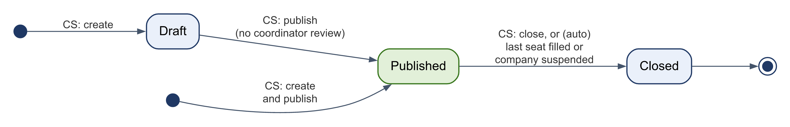

**Table 5.1 – Vacancy transitions (FR-VAC-02, FR-VAC-07)**

| **From** | **Action** | **Actor** | **Guard** | **To** | **Notifications** |
|:---|:---|:---|:---|:---|:---|
| – | create | CS of a verified company | – | `draft` | – |
| – | create and publish | CS of a verified company | All required fields; deadline in the future | `published` | – |
| `draft` | publish | CS (own vacancy) or Company Admin | All required fields; deadline in the future | `published` | – |
| `published` | close | CS (own vacancy) or Company Admin | – | `closed` | – |
| `published` | (automatic) | system | Last seat filled by a placement, or the company suspended (Table 5.5) | `closed` | – |

There is no review by a coordinator (CR-05); the coordinator's control is the placement confirmation (Table 5.2).

When a vacancy closes, its remaining active applications become `withdrawn` with reason `vacancy_closed` so they no longer count against the students' limit; the students are notified. This is a closure rule, not a decision on the applicant, so FR-MAT-07 still holds.

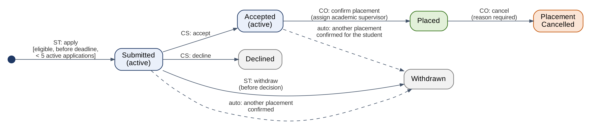

**Table 5.2 – Application and placement transitions (FR-VAC-04 – 08)**

| **From** | **Action** | **Actor** | **Guard** | **To** | **Notifications** |
|:---|:---|:---|:---|:---|:---|
| – | apply | ST | Verified and enrolled in an open cycle; vacancy published, open to the student's university, and before its deadline; eligible; no earlier application; fewer than `applications.max_active` active | `submitted` | CS: new applicant |
| `submitted` | withdraw | ST | – | `withdrawn` | – |
| `submitted` | accept / decline | CS (own vacancy) or Company Admin | – | `accepted` / `declined` | ST: application decided; CO of the student: applicant accepted |
| `accepted` | confirm placement | CO of the student's college | No other non-cancelled placement for the student in the cycle; free seat; AS of the same college; CS of the vacancy's company | `placed` | ST, CS, AS: placement confirmed |
| `submitted`, `accepted` | (automatic) | system | Another placement of the student confirmed, or vacancy closed | `withdrawn` | ST |
| `placed` | cancel placement | CO | Reason required | `placement_cancelled` | ST, CS, AS |

Confirming a placement also creates the report slots (Section 5.2), the grade in `draft`, and closes the vacancy if it was its last seat. Changing the academic supervisor is an update on the placement with a mandatory reason; it does not change the state.

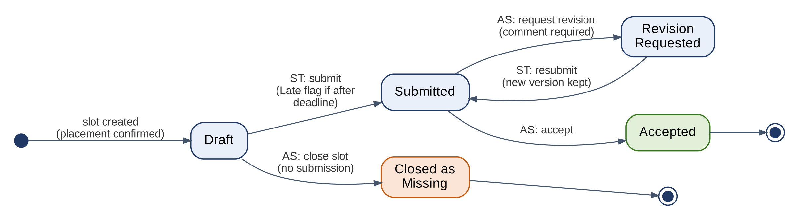

**Table 5.3 – Report slot transitions (Figure 4.1; FR-REP-01 – 07, FR-WFL-01)**

| **From** | **Action** | **Actor** | **Guard** | **To** | **Notifications** |
|:---|:---|:---|:---|:---|:---|
| `draft` | submit | ST | Required fields; attachment limits; slot not closed | `submitted` | AS: report to review |
| `submitted` | accept | AS (assigned) | – | `accepted` | ST: report accepted |
| `submitted` | request revision | AS (assigned) | Comment required | `revision_requested` | ST: revision requested |
| `revision_requested` | resubmit | ST | As for submit | `submitted` | AS: report to review |
| `draft` | close as missing | AS (assigned) | No submitted version; deadline passed | `closed_missing` | ST |

Saving a draft creates or updates the single draft version and does not change the slot's state. On resubmission the new draft starts as a copy of the last submitted version, including its attachments.

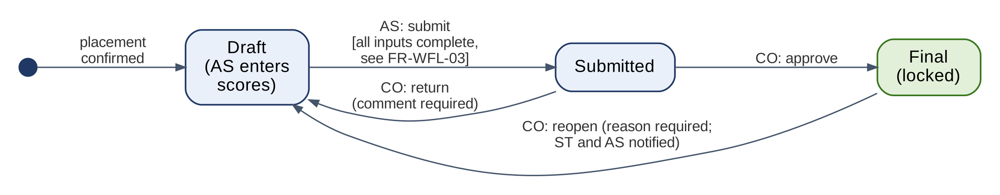

**Table 5.4 – Grade transitions (Figure 4.2; FR-WFL-03 – 07)**

| **From** | **Action** | **Actor** | **Guard** | **To** | **Notifications** |
|:---|:---|:---|:---|:---|:---|
| `draft` | save scores | AS (assigned) | Scores 0–100 | `draft` | – |
| `draft` | submit | AS (assigned) | Final evaluation submitted; final report `accepted`; every weekly slot `accepted` or `closed_missing`; every AS component entered. Otherwise `409 PRECONDITIONS_UNMET` with the list of missing items | `submitted` | CO: grade to approve |
| `submitted` | approve (single or bulk) | CO | – | `final` | ST, AS: grade final; placement becomes `completed` |
| `submitted` | return | CO | Comment required | `draft` | AS: grade returned |
| `final` | reopen | CO | Reason required | `draft` | ST, AS: grade reopened; placement back to `active` |

**Table 5.5 – Other transitions**

| **Record** | **Transitions** | **SRS** |
|:---|:---|:---|
| Evaluation | `draft` → `submitted` (CS; every criterion rated, comment present; locks the cycle rubric); `submitted` → `draft` (CO reopen, reason required, once only; a final evaluation only while its grade is `draft`) | FR-EVL-01, FR-EVL-04, FR-CYC-03 |
| Attendance week | record or edit (CS) while `now ≤ end of week + attendance.edit_days` or `now ≤ unlocked_until`; unlock (CO, reason required) | FR-ATT-01, FR-ATT-02 |
| Certificate | issue (CO; grade `final`) → `valid`; revoke (CO; reason required) → `revoked` | FR-CER-01, FR-CER-03 |
| Training cycle | `open` → `closed` (CO); `closed` → `open` (CO; reason required). While closed, every write to the cycle's records returns `409 CYCLE_CLOSED` | FR-CYC-05 |
| Account | Self-registered: `pending` (email confirmed, request open) → `verified` or `rejected` with its request. active ↔ inactive (Platform Admin: any account; Coordinator: the college's academic supervisors and students; Company Admin: the company's supervisors). Deactivation revokes all sessions | FR-ORG-02, FR-AUT-06 |
| Verification request | `pending` → `approved` or `rejected` (reason required). The Platform Admin decides coordinator and company requests; the college's Coordinator decides student requests and chooses the cycle. Approval sets the user to `verified`; for a company it also sets the company to `verified` and makes the representative its Company Admin; for a student it creates the enrolment. A rejected applicant may submit a new request | FR-ORG-03 – 05, FR-ORG-09 |
| Company | `pending` → `verified` or `rejected` with its request; `verified` ↔ `suspended` (Platform Admin, reason required). Suspension closes the company's published vacancies and stops new ones; running placements continue | FR-ORG-04, FR-AUT-06 |
| Coordinator role, Company Admin right | transfer to another verified member of the same college or company (Platform Admin, reason required); the previous holder keeps a normal account (an academic supervisor or a company supervisor) | FR-ORG-07 |

### 5.2 Deadlines and Time

- Week *k* of a cycle covers `start_date + 7(k−1)` to `start_date + 7k − 1`. Its report deadline is the day in that week whose ISO weekday equals `report_weekday`, at `report_time` in Asia/Riyadh, converted to UTC. The final report deadline is the cycle's `final_report_due_at`.
- `scheduled_days` of a week counts the cycle's working days that fall in the week and inside the cycle dates.
- **On time or late:** the deadline minute is inclusive. A submission is On time when `submitted_at < due_at + 60 seconds`, otherwise Late. With a 23:59 deadline, 23:58 and 23:59:30 are On time and 00:00 is Late (NFR-L10N-02).
- **Missing:** the `flag_missing` job marks a slot missing when `due_at` has passed and no version is submitted (FR-REP-04). It runs every 15 minutes and once 30 seconds after the API starts, so the flag appears within 15 minutes, well inside the 1-hour target, even after a restart.
- The Coordinator may move one week's deadline. The change updates the slots of that week that are still in `draft` and is audited.

### 5.3 Scheduled Jobs

All jobs run inside the API process under APScheduler. Each job runs in one transaction under a transaction-level PostgreSQL advisory lock (`pg_try_advisory_xact_lock`), so two running containers (for example during a redeploy) never run the same job twice, and a failed or crashed run never leaves the lock held. Jobs select work by **state**, not by time window, so a job missed during downtime catches up on its next run (NFR-REL-03).

| **Job** | **Every** | **Selects** | **Does** | **Idempotency key** |
|:---|:---|:---|:---|:---|
| `send_reminders` | 15 min | Slots in `draft` or `revision_requested`, active placement, `now < due_at ≤ now + 24 h` | Notify the student (FR-NOT-02) | `reminder:{slot_id}` |
| `flag_missing` | 15 min, and 30 s after the API starts | Slots in `draft`, `due_at < now`, `is_missing = false` | Set `is_missing`, notify the student and the AS (FR-REP-04, FR-NOT-03) | `missing:{slot_id}:{user_id}` |
| `escalate_overdue` | 15 min | Reports not submitted, attendance weeks not recorded, evaluations not submitted, 3 or more days after their deadline | Notify the Coordinator (FR-NOT-04) | `escalation:{type}:{id}` |
| `similarity_retry` | 5 min | `similarity_checks` still `pending` after 5 minutes, or `failed` fewer than 3 times | Run the check again | – |
| `deliver_notifications` | 1 min | Notifications with email or push `pending` | Send email in the user's language and web push; retry failed email up to 5 times | – |
| `purge_verification_documents` | Daily | Documents of requests decided more than `verification.document_retention_days` ago | Delete the file from storage, set `purged_at` (FR-ORG-08) | – |
| `cleanup` | Daily | Expired sessions and tokens; `job_runs` older than 30 days | Delete technical rows | – |

**Table 5.6 – Notification events (FR-NOT-05)**

| **Event** | **Recipient** |
|:---|:---|
| `verification.submitted` | Platform Admin (coordinator and company requests); the college's CO (student requests) |
| `verification.approved`, `verification.rejected` | The applicant |
| `invitation.sent` | The invited person (email only) |
| `role.transferred` | The new and the previous holder |
| `application.received` | Vacancy's CS |
| `application.accepted` | CO of the student (placement to confirm) |
| `application.decided`, `application.withdrawn_auto` | ST |
| `placement.confirmed`, `placement.cancelled`, `placement.supervisor_changed` | ST, CS, AS |
| `report.reminder`, `report.revision_requested`, `report.accepted` | ST |
| `report.submitted` | AS |
| `report.missing` | ST, AS |
| `evaluation.submitted` | AS; ST for the periodic evaluation only (FR-EVL-03) |
| `grade.submitted` | CO |
| `grade.returned` | AS |
| `grade.final`, `grade.reopened` | ST, AS |
| `escalation.overdue` | CO |
| `certificate.issued` | ST |

### 5.4 Grade Computation (FR-WFL-02)

- The company-evaluation component equals the mean of the final evaluation's criterion scores ÷ 5 × 100.
- The other components are entered by the academic supervisor (0–100).
- `total = Σ (weight × score) ÷ 100`, rounded half-up to two decimals. It is recomputed whenever a score changes and stored on submit and on approval.

### 5.5 File Handling (NFR-SEC-04, NFR-REL-04)

1. **Upload:** the request body is read in a stream with a size cap from the settings; a larger file is rejected with `413` before it is stored.
2. **Type check:** the type is detected from the first bytes. PDF (`%PDF-`), PNG, and JPEG are recognized by magic bytes. DOCX must be a ZIP containing `[Content_Types].xml` and `word/document.xml`. Anything else is rejected with `415`, so an executable renamed to `.pdf` is refused.
3. **Store:** the file is written to storage under a random key, then the `files` row is inserted.
4. **Report submission:** attachments are uploaded to the draft one by one. `submit` checks the limits and changes the state in one transaction, so a failed upload never leaves a half-submitted report.
5. **Download:** `GET /files/{id}` finds the record that owns the file, applies that record's permission rule, and streams the file from either storage (Supabase or local) with `Cache-Control: private, no-store` and `X-Content-Type-Options: nosniff`. No link to the bucket reaches a browser. Without permission it returns `403`.

### 5.6 Exports and Certificates (FR-EXP, FR-CER)

- **PDF:** drawn with fpdf2 and HarfBuzz text shaping. Noto Sans carries Latin text and Noto Naskh Arabic is its fallback, so a line can mix both. The page direction follows the user's language: in Arabic the text is right-aligned and table columns run from the right. Documents: grade sheet, term summary, training record, certificate.
- **Excel:** the grade sheet is built with `openpyxl`, one row per placement. Cell values starting with `=`, `+`, `-`, or `@` are prefixed with `'` to prevent formula injection.
- **Certificate:** one A4 landscape page in English and Arabic with the student name, university and college, cycle, company, training dates, the issue date, the certificate code, and a QR code for `https://<frontend>/verify/<code>`, without the grade. It is built once at issue and stored. The public page calls `GET /public/certificates/{code}` (the code is accepted with or without dashes, in any case) and shows Valid, Revoked, or Not found, without the grade (FR-CER-02). After an anonymization the page still answers, without the name (CR-11).

### 5.7 Dashboards (FR-DSH-01 – 04)

Counts are live queries, so they always equal the database (FR-DSH-01 acceptance).

| **Role** | **Pending actions** |
|:---|:---|
| ST | Reports due in the next 7 days or overdue and not closed; revisions requested; applications by status; evaluation of the company and survey (from the training end date or the Final grade, whichever comes first) |
| CS | Applicants to review on own vacancies (the Company Admin: on all the company's vacancies); ended weeks without attendance (overdue after `attendance.pending_after_days`); evaluations due within 7 days or overdue |
| AS | Submitted reports not yet reviewed; flagged similarity checks without a decision; grades in `draft` whose preconditions are met |
| CO | Student verification requests of the college; accepted applications of the college's students without a placement; grades `submitted`; escalations (items overdue 3 days or more) |
| PA | Coordinator and company verification requests with their age; platform figures (FR-DSH-05) |

Coordinator statistics per cycle and per company: placed and unplaced students, report submission rate and late rate, attendance rate, evaluation completion, and, if built, the job-offer rate (FR-DSH-03) and leniency alerts (FR-DSH-04: a company with at least 5 final evaluations whose mean is at least 0.8 above the cycle mean).

## 6. AI Services Design

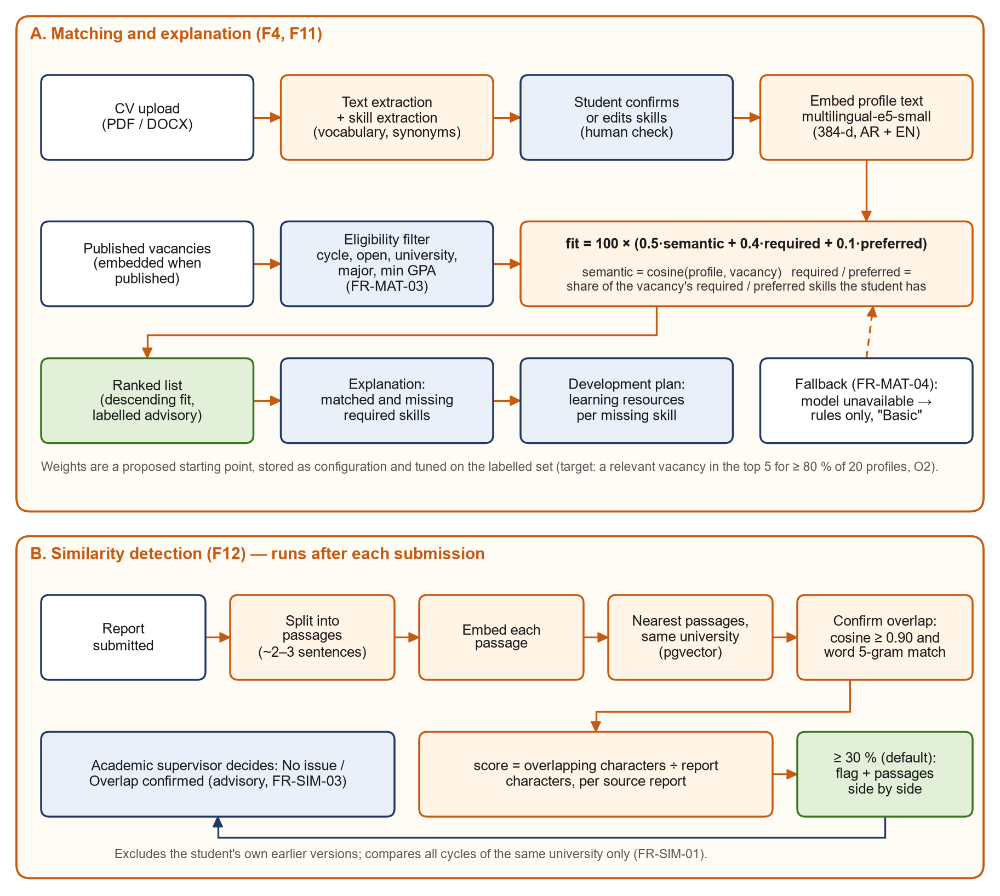

The model `intfloat/multilingual-e5-small` is baked into the Docker image at build time, so the container never downloads it at run time and no text leaves the container (NFR-PRV-02). Every stored AI result records `embedding_model` or `model_version` as `<model name>@<revision>` (NFR-AI-02). If the model fails to load or `AI_ENABLED=false`, the services switch to their rule-based paths.

### 6.1 Text Normalization and Skill Extraction (FR-PRF-04, FR-CYC-04)

1. **Extract text** with `pypdf` or `python-docx`. If fewer than 50 letters come out, mark the CV `no_text` (FR-PRF-05).
2. **Normalize:** lowercase Latin letters; for Arabic, remove diacritics and tatweel, unify أ/إ/آ → ا, ى → ي, ة → ه; collapse spaces and punctuation.
3. **Match** the normalized text against every active skill's `match_terms` (both names and all synonyms, normalized the same way) as whole words or phrases of up to four words. Matching uses a pre-built automaton (Aho–Corasick) that is rebuilt when the vocabulary changes.
4. **Store** the matches in `cv_extracted_skills` with a short evidence snippet. The student then confirms, removes, or adds skills; only confirmed skills go to `student_skills`.

The method is rule-based on purpose: it is fast, explainable, and the student always confirms. Its recall is measured on the 20 labelled CVs (target ≥ 70%); missing synonyms are added to the vocabulary until the target is met.

### 6.2 Matching (FR-MAT-01 – 07)

1. **Eligible vacancies:** published, open to the student's university (no target universities, or the student's among them), before the deadline, the student's major among the eligible majors, GPA ≥ `min_gpa`, and the vacancy's training type equal to the type of the student's cycle (CR-06). The student must be verified and enrolled in an open cycle. Ineligible vacancies are left out of the ranking and show their reason when browsing (FR-MAT-03).
2. **Texts:** the profile text is the confirmed skills (both names), interests, and the start of the current CV text, cut to the model's 512-token limit and prefixed with `query: `. The vacancy text is title, description, and skill names, prefixed with `passage: `, as the e5 model expects.
3. **Score parts:**
   - `semantic = clamp((cos − floor) ÷ (ceiling − floor), 0, 1)`, with floor 0.70 and ceiling 0.95. This spreads the narrow cosine range of e5 over 0–1; both values are settings tuned on the labelled set.
   - `required = |S ∩ R| ÷ |R|` (1 when the vacancy lists no required skill).
   - `preferred = |S ∩ P| ÷ |P|`. When the vacancy has no preferred skills, the preferred weight moves to `required`.
4. **Fit score:** `fit = 100 × (0.5·semantic + 0.4·required + 0.1·preferred)`. Ties are ordered by the required part, then by the earlier deadline.
5. **Fallback:** when there is no profile or vacancy embedding, or the model is unavailable, `fit = 100 × (w_r·required + w_p·preferred) ÷ (w_r + w_p)` and the result is labelled "Basic matching" (FR-MAT-04).
6. **Explanation and plan:** matched skills are `S ∩ R`; missing skills are `R − S` (FR-MAT-05). The development plan lists each missing skill with its `skill_resources`, or "No resource available yet" (FR-MAT-06).
7. **Advisory:** the response carries `advisory: true`; no code path changes an application from a score (FR-MAT-07).

### 6.3 Similarity Detection (FR-SIM-01 – 03)

1. **Body text:** for weekly reports, the four text fields; for the final report, the text extracted from the main document.
2. **Passages:** split into sentences (on `.`, `!`, `?`, `؟`, `؛`, and line breaks); a sentence shorter than 8 words joins the next one, and one longer than 25 words is cut into pieces of 25 words, so a passage is about one sentence. Each passage is embedded with the `query: ` prefix and stored in `report_passages`. Passages of 40–80 words found only 4 of 10 reports that copied about half of their text: copied sentences shared a passage with the student's own words (CR-09).
3. **Candidates:** for each passage, take the 5 nearest passages by cosine (HNSW index) from submitted versions of **other** report slots, across all students and cycles of the same university; the search is filtered on `report_passages.university_id`, so reports of other universities are never compared (FR-SIM-01). Earlier versions of the same slot are excluded.
4. **Confirm:** a passage counts as overlap with a source report when one of that report's candidates reaches cosine ≥ 0.90 **and** at least 50% of the passage's word 5-grams (normalized text) appear in that report's candidates taken together, because the passages of two reports seldom line up. The lexical check stops two passages on the same topic from being flagged. The side-by-side view shows the candidates that share words with the passage.
5. **Score per source report:** characters of the checked report covered by confirmed passages ÷ total characters of the report.
6. **Flag:** when any source reaches the threshold (default 30%), the check is flagged and the top 5 sources are stored with their passage pairs for the side-by-side view (FR-SIM-02).
7. **Decision:** the academic supervisor records No issue or Overlap confirmed with a comment. Nothing else changes (FR-SIM-03).

The method is measured with the evaluation script on 10 copied and 10 original reports (target: at least 9 of 10 flagged, at most 1 false flag); the Increment 3 test report gives the results.

### 6.4 Evaluation Script (NFR-AI-03)

`ai-eval/` in the repository holds the labelled sets (`cvs/` with annotated skills, `profiles.json` with relevant vacancies, `reports/` with copied and original reports) and `evaluate.py`, which prints skill-extraction recall, top-5 hit rate (overall, Arabic, English), and similarity detection rates. The script uses the same service code as the API.

## 7. Security and Privacy Design

### 7.1 Authentication

- **Passwords:** Argon2id. At least 8 characters with letters and digits (NFR-SEC-02).
- **Lockout:** after 5 consecutive failures, `locked_until = now + 15 min`; during the lock every attempt, even with the right password, returns `423 ACCOUNT_LOCKED` (NFR-SEC-03).
- **Email-confirmation, invitation, and reset links:** 32 random bytes, URL-safe; only the SHA-256 hash is stored. Single use and time-limited. A password reset revokes all sessions of the user.
- **Registration:** at most `auth.registrations_per_ip_hour` registrations per IP address per hour. A new account cannot log in before its email is confirmed, and stays behind the verification gate (Section 2.3) until it is verified.
- **Forgot password** always answers `202`, whether or not the email exists, so accounts cannot be discovered.
- **Access token:** JWT HS256 with `sub`, `role`, `sid`, `iat`, and `exp` (12 h maximum). The session row enforces the 30-minute idle timeout and logout (FR-AUT-03). The app applies the same limit on the device, from the last key, click, or touch, online and offline; `GET /me` returns the limit (CR-11). The frontend keeps the token in memory and `sessionStorage` only (never in cookies, so there is no CSRF exposure), and Vercel sends a strict Content-Security-Policy to limit XSS.

### 7.2 Authorization (FR-AUT-05)

Each route declares its allowed roles. Record access then follows these scope rules, applied inside the database query:

| **Role** | **Scope rule** |
|:---|:---|
| ST | `student_id = me` (profile, CVs, applications, placements and everything under them) |
| CS | Vacancies with `company_supervisor_id = me`, their applications and applicant profiles; placements with `company_supervisor_id = me`, their cycles, and their reports (read-only), attendance, and evaluations. The Company Admin also: every vacancy, application, and placement of the company, and the company's users. Never `company_evaluations` |
| AS | Placements with `academic_supervisor_id = me` (always students of the AS's college), their cycles, and their reports, similarity checks, evaluations, and grades. Source report authors are hidden |
| CO | Records whose student belongs to the CO's college (`users.college_id`), the college's cycles and users, and the student verification requests of the college. Applicant profiles of other colleges are never visible |
| PA | Universities, colleges, companies, users (account fields only), coordinator and company verification requests, skills, majors, settings, platform figures, and audit entries about accounts and organizations. No endpoint returns CVs, reports, evaluations, or grades to the PA |
| Public | `POST /auth/register`, `GET /public/certificates/{code}`, `GET /health`, the lists of universities and colleges for the registration form, and the other auth endpoints that need no login |

**Permission tests:** `backend/tests/permissions/matrix.yaml` lists every route with the callers allowed past the role gates (Public, an unverified student, ST, CS, CA, AS, CO, PA). One test calls every route as every caller that is not allowed and expects `401` or `403`, and a second test fails if a route registered in FastAPI is missing from the matrix, so every endpoint is covered for every role (FR-AUT-05 acceptance). Scope cases (own versus another user's record, and across organizations: a coordinator on another college's student, a company user on another company's vacancy) are tested in the module suites, whose test data hold two universities, three colleges, and two companies.

### 7.3 Data Protection

- **Verification documents:** stored under their own private prefix, downloadable only by the uploader and the reviewer, and deleted 30 days after the decision (FR-ORG-08).
- **Supabase:** the Data API (PostgREST) is disabled and Row Level Security is enabled with no policies on every table, so the public `anon` key cannot read anything. The API uses its own database role.
- **Audit log:** append-only by trigger and privileges (FR-AUD-02).
- **Push payloads:** event title and link only (NFR-PRV-03).
- **Logs:** request logs keep method, path, status, duration, and user ID, never request bodies, tokens, or CV text.
- **Responses per role:** shaped by role, for example the similarity source author only for the CO, and a grade for the student only when Final (FR-WFL-06).
- **Secrets:** stored as Space secrets, Vercel environment variables, and GitHub secrets.
- **Backups:** encrypted before upload (Section 3.5).
- **Consent:** a notice in the user's language at first login; `consent_at` is stored (NFR-PRV-01).
- **Offline copy on the device (CR-10):**
  - The saved copy of the pages shown is kept in the window's `sessionStorage` and deleted at sign-out, at the idle limit, and when the window closes.
  - Drafts typed offline are kept in `localStorage` under the user's ID until saved, for 7 days at most, and deleted at sign-out.
  - Files, exports, the audit log, and the Platform Admin's pages are never kept.
- **Anonymization:** Section 4.5 (NFR-PRV-04).
- **Release checks:** OWASP ZAP baseline of the web app and API scan in safe mode (`security-scan.yml`, weekly and on request), plus `pip-audit` and `npm audit` in CI (NFR-SEC-05).

## 8. User Interface Design

### 8.1 Wireframes (task T3)

The wireframes are a clickable prototype made in Claude Design: [InternSync Wireframes](https://claude.ai/artifact/GUCAYYDPvkkBiwntVfJWJA) (private until shared from the canvas's Share menu). Their sources are copied in [`wireframes/`](wireframes/). The screens are in Arabic (RTL) by default; one screen repeats the student dashboard in English (LTR) to show the mirroring. In Play mode, the sidebar links move between screens. Some screens have tweaks that switch between the states a test must cover.

**Table 8.1 – Wireframes against SRS Table 4.1**

| **SRS screen** | **Artboards** | **States shown (tweaks)** | **Requirements** |
|:---|:---|:---|:---|
| Registration, login, email confirmation, password reset | `Register`, `Login`, `Consent` | account type (student, coordinator, company); wrong password, account locked | FR-AUT-02 – 04, FR-ORG-02 – 05, NFR-SEC-03, NFR-PRV-01 |
| Verification status and documents | `Verification_Pending` | pending; rejected with a new request | FR-ORG-02, FR-ORG-08, FR-ORG-09 |
| Dashboard | `Main` (student), `ST_Dashboard_Mobile`, `ST_Dashboard_EN`, `CS_Dashboard`, `AS_Dashboard`, `CO_Dashboard`, `PA_Dashboard` | offline banner (student) | FR-DSH-01, FR-DSH-02, FR-DSH-05, FR-LOC-01, FR-PWA-03, NFR-USA-03 |
| Profile and CV | `ST_Profile` | CV without readable text | FR-PRF-02 – 05 |
| Vacancies (browse and ranked) | `ST_Vacancies` | semantic or basic matching | FR-VAC-03 – 05, FR-MAT-01 – 07 |
| Vacancy editor and applicants | `CS_VacancyEditor`, `CS_Applicants` | company not yet verified | FR-VAC-01, FR-VAC-02, FR-VAC-06, FR-ORG-02 |
| Company team | `CS_Team` | – | FR-ORG-04, FR-ORG-06, FR-AUT-06 |
| Placements | `CO_Placements` | – | FR-VAC-07, FR-VAC-08 |
| Report form and history | `ST_Report`, `AS_ReportReview` | similarity flagged or not | FR-REP-01 – 07, FR-SIM-02, FR-SIM-03 |
| Attendance | `CS_Attendance` | – | FR-ATT-01 – 04 |
| Evaluation form | `CS_Evaluation` | incomplete form with errors | FR-EVL-01 – 03 |
| Grades | `AS_Grade`, `CO_Grades` | preconditions met or not | FR-WFL-02 – 07 |
| Cycle settings | `CO_CycleSettings` | weights not totalling 100 | FR-CYC-01 – 03 |
| Student verification and academic supervisors | `CO_Students`, `CO_Supervisors` | approve and enrol; reject without a reason | FR-ORG-05, FR-ORG-06, FR-ORG-08, FR-AUT-06 |
| Platform administration | `PA_Dashboard`, `PA_Verifications`, `PA_Organizations`, `PA_Settings` | company or coordinator request | FR-ORG-01, FR-ORG-03, FR-ORG-04, FR-ORG-07, FR-CYC-04, FR-DSH-05, NFR-MNT-03 |
| Exports and certificates | `CO_Exports` | – | FR-EXP-01 – 03, FR-CER-01, FR-CER-03 |
| Audit log | `CO_Audit` | – | FR-AUD-02 |
| Certificate verification | `Verify_Mobile` | valid, revoked, not found | FR-CER-02 |

Not yet drawn: the student's evaluation of the company and the outcome survey (FR-EVL-05, FR-DSH-03, both Could), the notification list, and the Platform Admin's audit view (the same layout as `CO_Audit`, limited to accounts, organizations, and verification).

### 8.2 Design System

| **Token** | **Value** | **Use** |
|:---|:---|:---|
| Typeface | IBM Plex Sans Arabic (400, 500, 600, 700), one family for Arabic and Latin | All text |
| Primary | `#1F3864` (navy, as in the diagram pack); active item `#2E4D84` | Sidebar, primary buttons, headings of key figures |
| Ground / surface / border | `#F4F6F9` / `#FFFFFF` / `#DCE2EA` | Page, cards, dividers |
| Text / muted text | `#1A2233` / `#566173` | Body, secondary text (6:1 contrast on white) |
| Advisory (AI) | text `#9A4410` on `#FFF4E8` | Every AI result, labelled "استرشادي" (Advisory) |
| Status chips | Draft `#4A5363`/`#EEF1F5`; Submitted `#1F4E9A`/`#E6EEFB`; Accepted, Final `#1E6B34`/`#E3F3E7`; Late `#8A4B00`/`#FFF1D6`; Missing, error `#A61B1B`/`#FCE8E8`; Revision requested `#6B3FA0`/`#F1EAFB` | Status text always shown with its colour |
| Shape | Cards 12 px radius; inputs and buttons 8 px; chips fully rounded | – |
| Touch targets | 44 px minimum (48 px for main actions) | NFR-USA-04 |
| Layout | Sidebar plus content in one wrapping row; the sidebar stacks above the content on phones | NFR-USA-03 |
| Dates | `DD/MM/YYYY HH:mm`, Western digits | NFR-L10N-02 |

### 8.3 Rules for the Frontend

- **Routes by role**, after login:
  - ST: `/student` (dashboard), `/student/profile`, `/student/vacancies`, `/student/applications`, `/student/reports`.
  - CS: `/company` (dashboard), `/company/vacancies`, `/company/students/:placementId`, `/company/team` (Company Admin only).
  - AS: `/academic` (dashboard), `/academic/students/:placementId`, `/academic/grades`.
  - CO: `/coordinator` (dashboard), `/coordinator/students` (verification), `/coordinator/supervisors`, `/coordinator/cycles`, `/coordinator/placements`, `/coordinator/grades`, `/coordinator/exports`, `/coordinator/audit`.
  - PA: `/platform` (dashboard), `/platform/verifications`, `/platform/organizations`, `/platform/settings`, `/platform/audit`.
  - Public: `/register`, `/verify/:code`.
  - Shared: `/login`, `/confirm/:token`, `/invite/:token`, `/reset/:token`, `/verification` (own request status), `/notifications`.
- **Layout:** `dir` and `lang` on `<html>` follow the selected language. Spacing uses logical properties (`ms-`, `me-`, `ps-`, `pe-`), and directional icons are mirrored in Arabic.
- **Status chips:** text plus colour, never colour alone. AI results sit in a panel labelled "Advisory" (4.1 of the SRS).
- **Task length:** report submission, attendance, and evaluation each fit in at most 3 screens (NFR-USA-02); "Full attendance" is one button.
- **Offline:** the service worker caches the app shell. Offline, a banner is shown with the time of the saved copy, pages opened earlier in the session show that copy, and every submit button is disabled. Report and evaluation drafts typed offline are kept on the device and saved when the connection returns (FR-PWA-03, CR-10).

## 9. Traceability

| **SRS area** | **Module (2.2)** | **Tables (4.3)** | **API section** |
|:---|:---|:---|:---|
| FR-AUT | `auth`, `orgs` | users, user_sessions, account_tokens | 3.1, 3.2 |
| FR-ORG | `orgs`, `auth`, `cycles` | universities, colleges, companies, users, verification_requests, verification_documents, enrollments | 3.1, 3.2 |
| FR-CYC | `cycles` | training_cycles, cycle_weeks, grade_components, rubric_criteria, skills, skill_resources, majors, system_settings | 3.3, 3.4 |
| FR-PRF | `profiles` | student_profiles, cvs, cv_extracted_skills, student_skills | 3.5 |
| FR-VAC | `vacancies` | vacancies, vacancy_skills, vacancy_majors, vacancy_universities, applications, placements | 3.6, 3.7 |
| FR-MAT | `matching` | match_scores | 3.8 |
| FR-REP, FR-WFL-01 | `reports` | report_slots, report_versions, report_attachments, report_reviews, report_comments | 3.9 |
| FR-SIM | `similarity` | report_passages, similarity_checks, similarity_matches | 3.10 |
| FR-ATT | `attendance` | attendance_weeks | 3.11 |
| FR-EVL | `evaluations` | evaluations, evaluation_scores, company_evaluations | 3.12 |
| FR-WFL-02 – 07 | `grades` | grades, grade_component_scores | 3.13 |
| FR-DSH | `dashboards`, `evaluations` | (queries), outcome_surveys | 3.14 |
| FR-EXP | `exports` | files | 3.15 |
| FR-CER | `certificates` | certificates | 3.16 |
| FR-NOT, FR-PWA-02 | `notifications`, `jobs` | notifications, push_subscriptions, job_runs | 3.17 |
| FR-AUD | `core` | audit_log | 3.18 |
| NFR-SEC-04 | `files` | files | 3.19 |

## 10. Open Issues

| **Issue** | **Needed by** | **Plan** |
|:---|:---|:---|
| Wireframes: user walkthrough not yet done | Before Increment 1 ends | Walk through the clickable wireframes (Section 8.1) with at least one student and one faculty member (SRS 6.4.2, prototyping) and record the changes. Add the three screens listed as not yet drawn. |
| Example grade components, weights, and rubric criteria for the demo cycle | Increment 1 | Seed example values (for example: company final evaluation 40%, weekly reports 30%, final report 30%) and confirm them with the course supervisor (SRS 6.4.5). |
| Skill vocabulary content (English and Arabic names, synonyms, resources) | Increment 1 | Seed about 150 skills common in computing majors; extend while labelling the 20 CVs. |
| Labelled AI evaluation sets (20 CVs and profiles, 10 copied and 10 original reports) | Increment 2 | Generate synthetic data now; a second person must label independently (SRS 6.4.2). |
| Calibration of `semantic_floor` and `semantic_ceiling` and the similarity thresholds | Increment 2 – 3 | Tune with `ai-eval/evaluate.py`; record the chosen values and results in the test report. |
| Project Gmail account, Hugging Face account and Space, Supabase project, Vercel project | Before Increment 1 ends | Create the free accounts; store the secrets as in Section 3.4. |
| Platform Admin account and demo organizations | Increment 1 | The seed script creates the Platform Admin, 2 universities with 4 colleges, majors, the skill vocabulary, and sample companies; real Platform Admin accounts are created only by the provider (FR-AUT-02). |
