# InternSync – Software Requirements Specification (SRS)

Based on IEEE 830 – adapted for student projects (CSC 305 SRS template)

**IMAM ABDULRAHMAN BIN FAISAL UNIVERSITY** · College of Computer Science & Information Technology
CSC 305 – Software Engineering \| Semester 1 – 2026/2027 \| Section 5MA1 \| Group 3

| **Item** | **Value** |
|:---|:---|
| Project title | InternSync – Cooperative Training Coordination and Tracking System |
| Team name | Group 3 (Section 5MA1) |
| Advisor | Dr. Sultan Al-Enezi |
| Version | 1.6 |
| Date | 28-10-2026 |

> This Markdown file is the maintained version of the SRS. `InternSync_SRS_v1.3.docx` and `.pdf` in this folder are generated from it on the course template (v1.3 submitted on Oct 23, 2026); `old/InternSync_SRS.docx` and `old/InternSync_SRS.pdf` are the earlier v1.0 draft. Changes are listed in the revision history and in [Change_Requests.md](../Change_Requests.md).

### Team Information

| **Team Member** | **Student ID** | **Project Role** |
|:---|:--:|:---|
| Salam Alsaour (Team Leader) | 2250009168 | Team leader; backend and AI services developer |
| Khalid Alajmi | 2250004309 | Frontend and backend developer |
| Ali Alghafly | 2250002460 | Frontend developer |
| Ahmed Kanaan | 2250009170 | AI services developer; deployment lead |
| Abdullah Abalhareth | 2250005266 | QA and documentation lead |
| Rakan Alzahrani | 2250000631 | UI/UX designer |

### Revision History

| **Version** | **Date** | **Description** | **Author** |
|:--:|:--:|:---|:--:|
| 1.0 | Oct 10, 2026 | First baseline submitted as Project 4 (SRS). | Group 3 |
| 1.1 | Oct 13, 2026 | CR-01: zero-cost reference deployment (3.4, 5, NFR-PER-01, 6.2, 6.3, C-04, C-10, D-05). CR-02: UC-15 added to Table 3.1. CR-03: weekly working days added to FR-CYC-01. CR-04: change requests logged in the repository (10.6). | Salam Alsaour |
| 1.2 | Oct 20, 2026 | CR-05: one platform for many universities and companies. Five roles with a Platform Admin; self-registration with verification of coordinators, companies, and students (new Section 4.17, FR-ORG-01 – 09); one coordinator per college; companies publish vacancies directly (FR-VAC-01 – 03 rewritten); CSV import removed (FR-PRF-01 deleted, Section 6.3.1 removed); FR-DSH-05 added; Table 2.3 rewritten. | Salam Alsaour |
| 1.3 | Oct 23, 2026 | Restructured to the course SRS template (IEEE 830 adapted): sections 1 – 6 renumbered (old Sections 7 – 10 and Appendix A are now 2.5, 2.6, 6.3, 6.4, and 6.5); reader guide (1.3), product functions (2.2), use case specifications (3.2), wireframe figures (4.1), glossary (6.1), and supporting diagrams (6.2) added; NFR-MNT-03 and the glossary name the Platform Admin for platform defaults and the skill vocabulary (CR-05). No requirement added or removed. | Salam Alsaour |
| 1.4 | Oct 23, 2026 | CR-06: the vacancy's training type must equal the type of the student's cycle (FR-VAC-04, FR-MAT-03). Version 1.3 is the submitted version. | Salam Alsaour |
| 1.5 | Oct 26, 2026 | CR-08: the file storage interface (4.3) streams downloads through the API after the permission check instead of issuing signed links. No requirement changed. | Salam Alsaour |
| 1.6 | Oct 28, 2026 | CR-10: offline mode (FR-PWA-03): pages opened earlier stay readable offline, and drafts typed offline are saved when the connection returns. | Salam Alsaour |

## Table of Contents

- [1. Introduction](#1-introduction)
  - [1.1 Purpose](#11-purpose)
  - [1.2 Document Conventions](#12-document-conventions)
  - [1.3 Intended Audience and Reading Suggestions](#13-intended-audience-and-reading-suggestions)
  - [1.4 Scope of the System](#14-scope-of-the-system)
  - [1.5 References](#15-references)
- [2. Overall Description](#2-overall-description)
  - [2.1 Product Perspective](#21-product-perspective)
  - [2.2 Product Functions](#22-product-functions)
  - [2.3 User Classes and Characteristics](#23-user-classes-and-characteristics)
  - [2.4 Operating Environment](#24-operating-environment)
  - [2.5 Design and Implementation Constraints](#25-design-and-implementation-constraints)
  - [2.6 Assumptions and Dependencies](#26-assumptions-and-dependencies)
  - [2.7 User Documentation](#27-user-documentation)
- [3. Specific Requirements](#3-specific-requirements)
  - [3.1 Functional Requirements](#31-functional-requirements)
  - [3.2 Use Case Specifications](#32-use-case-specifications)
- [4. External Interface Requirements](#4-external-interface-requirements)
  - [4.1 User Interfaces](#41-user-interfaces)
  - [4.2 Hardware Interfaces](#42-hardware-interfaces)
  - [4.3 Software Interfaces](#43-software-interfaces)
  - [4.4 Communication Interfaces](#44-communication-interfaces)
- [5. Non-Functional Requirements](#5-non-functional-requirements)
  - [5.1 Performance Requirements](#51-performance-requirements)
  - [5.2 Security Requirements](#52-security-requirements)
  - [5.3 Reliability and Availability](#53-reliability-and-availability)
  - [5.4 Maintainability](#54-maintainability)
  - [5.5 Portability](#55-portability)
  - [5.6 Privacy and Data Protection](#56-privacy-and-data-protection)
  - [5.7 Usability and Accessibility](#57-usability-and-accessibility)
  - [5.8 Localization](#58-localization)
  - [5.9 AI Quality and Transparency](#59-ai-quality-and-transparency)
- [6. Appendices](#6-appendices)
  - [6.1 Glossary](#61-glossary)
  - [6.2 Supporting Diagrams](#62-supporting-diagrams)
  - [6.3 Requirement Prioritization](#63-requirement-prioritization)
  - [6.4 Requirement Validation and Verification](#64-requirement-validation-and-verification)
  - [6.5 Traceability Matrix](#65-traceability-matrix)
  - [6.6 Related Design Documents](#66-related-design-documents)

## 1. Introduction

### 1.1 Purpose

This Software Requirements Specification (SRS) defines what InternSync must do and the qualities it must have. It turns the functions (F1–F19) and objectives (O1–O10) approved in the Project Proposal into numbered, testable requirements. Once approved, it is the baseline for design, implementation, and testing, and the reference for the change control described in the Software Project Management Plan (SPMP). Version 1.2 widens the Proposal's scope from the co-op unit of one college to one platform that serves many universities, their colleges, and companies (CR-05).

**The system being developed.** Cooperative training (Co-op) and summer internships are coordinated today through email, spreadsheets, and paper or PDF forms. Vacancies are circulated informally, weekly reports arrive as attachments, company evaluations are filled in once at the end, and grade sheets are compiled by hand (problems P1–P6 in the Proposal). The result is no single, reliable record of what happened during a training cycle.

InternSync is a role-based web platform, delivered as a responsive Progressive Web App (PWA) in Arabic and English and run by a platform provider. It connects universities (through the co-op unit of each college), companies, and students, and manages the whole co-op life cycle in one place: publishing vacancies and matching students to them, weekly follow-up, standard evaluation, multi-stage grade approval, and official exports. Its purpose is to replace scattered manual work with one auditable record from which the official outputs are generated directly. The AI features (matching, skill gaps, similarity detection) support decisions; people make every final decision.

The intended audience is described in Section 1.3.

### 1.2 Document Conventions

- Every requirement has a unique ID: **FR-\<area\>-\<nn\>** for functional and **NFR-\<category\>-\<nn\>** for non-functional requirements. IDs are never reused; a removed requirement keeps its ID and is marked “Deleted”.

- Each requirement states one behavior using “shall” and has an acceptance criterion from which test cases are derived (Section 6.4).

- Priority is Must, Should, or Could, as defined in Section 6.3.

- Each group of requirements names its source function (F) and objective (O) from the Proposal; Section 6.5 gives the full traceability.

- Role abbreviations: ST student, CS company supervisor, AS academic supervisor, CO coordinator, PA platform admin. In a requirement, “the Coordinator” means the coordinator of the college of the student concerned, and “the Company Admin” the admin of the company concerned.

- Diagrams use UML notation: a use case diagram (Figure 3.3), activity diagrams (Figures 2.2 and 2.3), and state machines (Figures 3.1, 3.2, 6.1, and 6.2). The context diagram (Figure 2.1) shows the system boundary, and the entity-relationship diagrams (Figures 6.4 – 6.7) use crow's foot notation.

- Tables and figures are numbered by section (for example, Table 3.2 is the second table of Section 3).

- Dates are written DD/MM/YYYY and times use the 24-hour clock in Saudi Arabia time (UTC+3).

- Terms and abbreviations are defined in the glossary (Section 6.1).

### 1.3 Intended Audience and Reading Suggestions

Table 1.1 names the readers of this SRS and the sections most relevant to each. Every reader should start with Section 1.4 (scope) and Section 2.2 (product functions).

**Table 1.1 – Readers and suggested sections**

| **Reader** | **What they need from this SRS** | **Suggested sections** |
|:---|:---|:---|
| CSC 305 course supervisor | Completeness, testability, and quality of the specification | 1, 2, 3.2, 5, 6.3, 6.5 |
| Development team (backend, frontend, AI services) | What to build, for whom, and in which increment | 2.3.3, 3.1, 4, 5, 6.3.3 |
| QA and documentation lead | Acceptance criteria to derive test cases; verification methods | 3.1, 5, 6.4 |
| UI/UX designer | Screens, roles, flows, and language rules | 2.3, 3.2, 4.1, 5.7, 5.8 |
| Stakeholder representatives (students, academic supervisors, co-op units, companies) | Whether the system supports their work | 1.4, 2.2, 2.3, 3.2, 4.1 |
| Platform provider (Platform Admin) | Organizations, verification, and platform settings | 2.3, 3.1.2, 5.2, 5.6 |

### 1.4 Scope of the System

This release covers functions F1–F19 of the Proposal. Table 1.2 lists them with their priority and the section of this SRS that specifies them.

**Table 1.2 – Functions in scope**

| **ID** | **Function** | **Priority** | **SRS section** |
|:--:|:---|:--:|:--:|
| F1 | Role-based accounts for five roles with self-registration and verification across universities, colleges, and companies; authentication and authorization | Must | 3.1.1, 3.1.2 |
| F2 | Student profile and CV upload with skill extraction | Must | 3.1.4 |
| F3 | Vacancy catalogue published by verified companies, applications, and placement confirmation by the student's coordinator | Must | 3.1.5 |
| F4 | Matching engine that ranks vacancies against the student profile | Must | 3.1.6 |
| F5 | Weekly and final report submission with deadlines and revision requests | Must | 3.1.7 |
| F6 | Weekly attendance confirmation by the company supervisor | Must | 3.1.8 |
| F7 | Periodic and final evaluations using one standard rubric | Must | 3.1.9 |
| F8 | Multi-stage approval workflow for reports and grades | Must | 3.1.10 |
| F9 | Role-specific dashboards with pending actions and status | Must | 3.1.13 |
| F10 | Arabic/English interface with RTL and LTR support | Must | 3.1.16 |
| F11 | Match explanation, skill-gap analysis, and development plan | Should | 3.1.6 |
| F12 | Similarity detection between reports stored in the system | Should | 3.1.11 |
| F13 | Scheduled notifications: reminders, late flags, escalation | Should | 3.1.12 |
| F14 | Export of grade sheets and summary reports (PDF and Excel) | Should | 3.1.14 |
| F15 | PWA features: installable app, web push, cached app shell | Should | 3.1.16 |
| F16 | Digital completion certificate with QR code and public verification | Could | 3.1.15 |
| F17 | Mutual evaluation: the student evaluates the training entity | Could | 3.1.9 |
| F18 | End-of-term survey and placement-to-job-offer statistics | Could | 3.1.13 |
| F19 | Evaluation-leniency alert for companies with at least 5 evaluations | Could | 3.1.13 |

Supporting requirements that serve several functions — training-cycle configuration (Section 3.1.3) and the audit trail (Section 3.1.17) — are also in scope.

**Out of scope** for this release (the “Won’t” category in Section 6.3):

- Live integration with university student information systems or government registries; users enter their data at registration and people verify it (FR-ORG-03 – 05).

- Payments, subscriptions, or any billing for using the platform.

- Writing grades into the university system; grades leave InternSync as exported files only.

- A native mobile application; the responsive PWA covers phone use.

- Contracts, payroll, insurance, or any legal or HR processing with companies.

- Plagiarism detection against the internet or external databases, and detection of AI-generated text.

- Biometric or GPS-based attendance verification.

- Real-time chat; communication is limited to notifications and comments on submissions.

- Statistical calibration of grades across companies; a standard rubric is used instead.

### 1.5 References

1.  InternSync – Project Proposal, CSC 305 Group 3, Oct 2, 2026.

2.  InternSync – Software Project Management Plan (SPMP), CSC 305 Group 3, Oct 3, 2026.

3.  InternSync – Project Idea Form, CSC 305 Group 3, Sep 5, 2026 (superseded by the Proposal and by this SRS where they differ).

4.  ISO/IEC/IEEE 29148:2018, Systems and software engineering — Life cycle processes — Requirements engineering.

5.  Personal Data Protection Law (PDPL), Kingdom of Saudi Arabia, and its implementing regulations.

6.  W3C, Web Content Accessibility Guidelines (WCAG) 2.1.

7.  IEEE Std 830-1998, IEEE Recommended Practice for Software Requirements Specifications.

8.  CSC 305 Software Requirements Specification template (IEEE 830, adapted for student projects).

9.  InternSync – System Design Document v1.2 and API Specification v1.1 (Section 6.6).

## 2. Overall Description

### 2.1 Product Perspective

InternSync is a new, self-contained system that replaces the current mix of email, spreadsheets, and paper forms. It has no live connection to university or government systems: users enter their own data when they register, the responsible person verifies it (Section 3.1.2), and grades leave as exported PDF and Excel files. One platform serves many universities, their colleges, and many companies, and keeps the records of each organization apart. Figure 2.1 shows the system boundary, its users, and the external services it depends on.

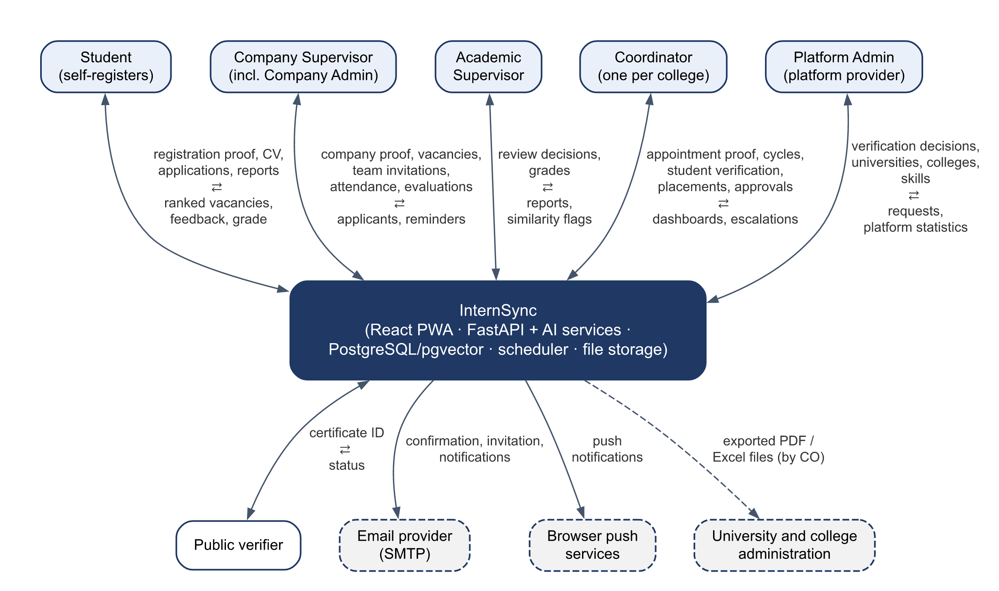

**Figure 2.1 – Context diagram**

Inside the boundary, a React PWA client talks to a single Python/FastAPI backend that also hosts the AI services (skill extraction, matching, similarity). PostgreSQL with pgvector stores relational data and embeddings, a scheduler runs reminder and escalation jobs, and file storage keeps CVs and attachments. These components are named only to show the boundary; their design is described in the design document (task T2).

### 2.2 Product Functions

InternSync provides the functions F1 – F19 of Table 1.2. At a high level they form five groups:

- **Access and organizations (F1):** accounts for five roles; open registration with verification of students, coordinators, and companies; invitations for supervisors; universities, colleges, and companies kept apart.

- **Matching students to vacancies (F2 – F4, F11):** student profile and CV with automatic skill extraction; a catalogue of vacancies published by verified companies; AI ranking of vacancies with matched and missing skills and a development plan; applications and placement confirmation.

- **Training follow-up (F5 – F7, F12, F13):** weekly and final reports with deadlines and revision requests; weekly attendance; periodic and final evaluations with one standard rubric; similarity detection between reports; reminders, late flags, and escalations.

- **Grading and outputs (F8, F9, F14, F16 – F19):** multi-stage approval of reports and grades; role dashboards; grade sheets and summaries in PDF and Excel; completion certificates with public verification; outcome survey and statistics.

- **Platform qualities (F10, F15):** Arabic and English interface with right-to-left and left-to-right layouts; installable PWA with push notifications.

The functions support the co-op life cycle below. Figures 2.2 and 2.3 show it as activity diagrams with one swimlane per role.

1.  The Platform Admin adds universities and colleges, and verifies the coordinator of each college and every company that registers.

2.  The coordinator opens a training cycle for the college and invites the college's academic supervisors.

3.  Students register, upload proof of their registration in the co-op course, and are verified by their coordinator, who enrols them in the cycle.

4.  Verified companies publish vacancies, open to all universities or to selected ones; the Company Admin may invite more company supervisors.

5.  Students build their profiles, upload CVs, confirm the extracted skills, view vacancies ranked by fit with an explanation, and apply.

6.  Company supervisors accept or decline applicants; the student's coordinator confirms the placement and assigns an academic supervisor.

7.  During training, students submit weekly reports, company supervisors record attendance weekly and submit the periodic evaluation, and the system sends reminders and late flags.

8.  Academic supervisors review reports with the similarity indicator and accept them or request revisions.

9.  At the end of training, the student submits the final report, the company supervisor submits the final evaluation, and the grade passes through the approval workflow.

10. The coordinator exports grade sheets and summaries and issues certificates; students evaluate the training entity and answer the outcome survey.

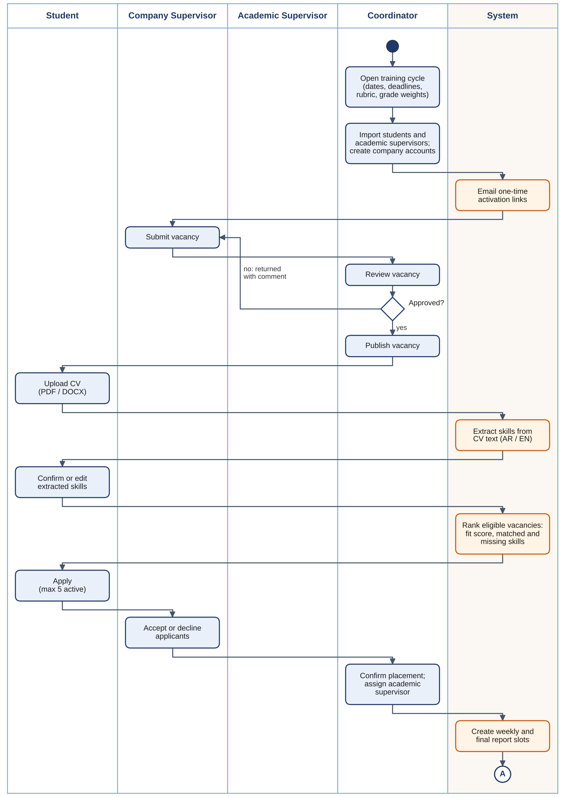

**Figure 2.2 – Activity diagram: registration, setup, and placement**

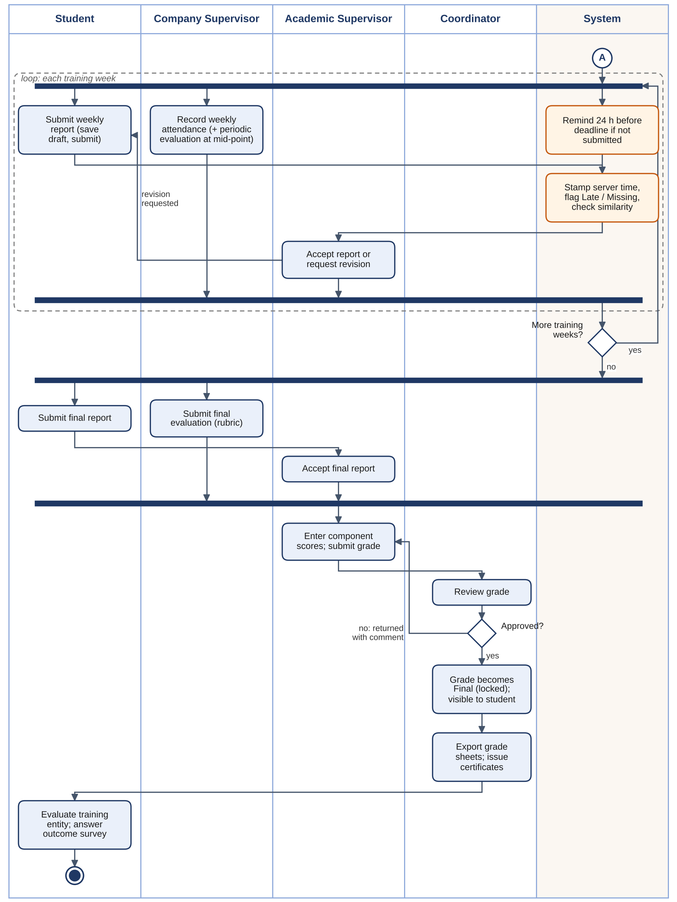

**Figure 2.3 – Activity diagram: training and grading**

### 2.3 User Classes and Characteristics

This section identifies the stakeholders (2.3.1), the user classes with their characteristics (2.3.2), and the access rights of each role (2.3.3).

#### 2.3.1 Stakeholders

Table 2.1 lists the people and groups affected by InternSync, what they need, and how their needs shape the requirements.

**Table 2.1 – Stakeholders**

| **Stakeholder** | **Type** | **Needs and interests** | **Interaction with the system** | **Effect on requirements** |
|:---|:---|:---|:---|:---|
| Student | Primary user | Find suitable vacancies and know which skills are missing; submit reports easily; get feedback during training; see grade and certificate. | Profile and CV, applications, weekly and final reports, evaluation of the company, dashboard. | Mobile-friendly, simple flows (NFR-USA); advisory, explained matching. |
| Company training supervisor and Company Admin | Primary user (external, occasional) | Register the company once; publish vacancies without waiting; confirm attendance and evaluate quickly; reach qualified students from many universities. | Company registration and team, vacancies, applicant review, weekly attendance, periodic and final evaluation. | Company verification (FR-ORG-04); one-action attendance (FR-ATT-01); email reminders; nothing to install. |
| Academic supervisor | Primary user (faculty) | Review reports efficiently, notice copied work, propose grades with a clear record. | Report review, revision requests, similarity flags, grade entry. | Approval workflow (3.1.10); similarity is advisory (FR-SIM-03). |
| Co-op coordinator (one per college) | Primary user | Run the college's cycles without manual work; know that registered students are real and eligible; control deadlines; produce official outputs; handle escalations. | Student verification, academic supervisors, cycles, rubric, placements, grade approval, exports, college audit log. | Verification (3.1.2), configuration (3.1.3), exports (3.1.14), audit trail (3.1.17). |
| Platform provider and Platform Admin | Operator; primary user | Trust in every organization on the platform; little administration effort; no handling of academic records. | Universities and colleges, verification of coordinators and companies, skill vocabulary, platform settings. | Verification (3.1.2), platform dashboard (FR-DSH-05), privacy (5.6). |
| University and college administration | Indirect | Accurate program statistics and placement outcomes. | Receive term summaries exported by the coordinator; no account in this release. | FR-EXP-02, FR-DSH-03. |
| Partner companies and employers | Indirect | A reliable channel to students; verify that a student completed training. | Through company supervisor accounts; public certificate verification. | FR-CER-01 – 03. |
| CSC 305 course supervisor | Project stakeholder | A complete, testable SRS and delivery on schedule. | Reviews deliverables at each milestone. | Constraints (2.5) and prioritization (6.3). |
| Development team (Group 3) | Project stakeholder | A scope that fits about 480 person-hours. | Designs, builds, and tests the system. | Constraints (2.5) and descoping order (6.3.4). |

#### 2.3.2 User Classes

The expected numbers describe one training cycle of one college in the demonstration environment, which holds 2 universities and 4 colleges, and are used as the sizing basis for the performance requirements (Section 5.1).

**Table 2.2 – User classes**

| **User class** | **Expected number per cycle** | **Frequency of use** | **Technical skill** | **Main device** |
|:---|:---|:---|:---|:---|
| Student | Up to 300 | Daily while searching; weekly during training | Medium to high | Phone and laptop |
| Company supervisor | Up to 100 | Weekly, a few minutes | Varies; may be non-technical | Laptop; phone through email links |
| Academic supervisor | Up to 30 | Weekly | Medium | Laptop |
| Coordinator | 1 per college | Daily during setup, verification, and grading | Medium | Laptop |
| Platform Admin | 1 to 2 for the platform | Daily (verification queue) | High | Laptop |
| Public verifier | Not known | Rare | Any | Phone (QR scan) |

#### 2.3.3 Access Rights by Role

Table 2.3 defines which role may perform each action. “Own” means the user’s own records; “Assigned” means the records of students placed under that supervisor. “College” means the records of the coordinator's college, and “Company” the records of the Company Admin's company. FR-AUT-05 requires the server to enforce this table.

**Table 2.3 – Permission matrix**

| **Action** | **ST** | **CS** | **AS** | **CO** | **PA** | **Public** |
|:---|:--:|:--:|:--:|:--:|:--:|:--:|
| Register as a student, a coordinator, or a company | — | — | — | — | — | Yes |
| Manage universities, colleges, majors, skill vocabulary, and platform settings | — | — | — | — | All | — |
| Verify coordinators and companies; transfer the Coordinator or Company Admin role | — | — | — | — | All | — |
| Verify students and enrol them in a cycle | — | — | — | College | — | — |
| Invite academic supervisors | — | — | — | College | — | — |
| Invite company supervisors | — | Company Admin | — | — | — | — |
| Deactivate or reactivate accounts | — | Company Admin (company supervisors) | — | College (academic supervisors, students) | All | — |
| Configure cycles, rubric, and grade weights | — | — | — | College | — | — |
| Edit profile, upload CV, confirm skills | Own | — | — | — | — | — |
| Create, publish, or close a vacancy | — | Own (Company Admin: Company) | — | — | — | — |
| View ranked vacancies and apply | Own (verified) | — | — | — | — | — |
| Review applicants of a vacancy | — | Own vacancies (Company Admin: Company) | — | — | — | — |
| Confirm or cancel a placement | — | — | — | College | — | — |
| Submit weekly and final reports | Own | — | — | — | — | — |
| View reports | Own | Assigned (read) | Assigned | College | — | — |
| Accept a report or request revision | — | — | Assigned | — | — | — |
| Record attendance | — | Assigned | — | Unlock only | — | — |
| Submit periodic and final evaluations | — | Assigned | — | Reopen only | — | — |
| View similarity flags and record a decision | — | — | Assigned | View (college) | — | — |
| Enter and submit a grade | — | — | Assigned | — | — | — |
| Approve, return, or reopen a grade | — | — | — | College | — | — |
| View a final grade | Own | — | Assigned | College | — | — |
| Evaluate the training entity | Own | — | — | View (college) | — | — |
| Export grade sheets and reports | — | — | Assigned (records) | College | — | — |
| Issue or revoke a certificate | — | — | — | College | — | — |
| Verify a certificate | — | — | — | — | — | Yes |
| View the audit log | — | — | — | College | Accounts, organizations, verification | — |

### 2.4 Operating Environment

- **Client:** current versions of Chrome, Edge, Firefox, and Safari on desktop, and Chrome and Safari on phones (NFR-PRT-01); installable as a PWA.

- **Server (reference demonstration deployment, zero cost):** the API container (FastAPI, embedding model, and scheduler) runs on Hugging Face Spaces, free CPU Basic hardware (2 vCPU, 16 GB RAM, no GPU); PostgreSQL with pgvector and the private file storage run on Supabase (Free plan); the PWA static build is served by Vercel (Hobby plan). The same containers also run on any Linux server with Docker Compose (minimum 2 vCPU and 4 GB RAM; NFR-PRT-02). No GPU is required.

- **Software:** Python with FastAPI; React with Vite; PostgreSQL 16 or later with pgvector; an open-source multilingual embedding model (for example, multilingual-e5-small) running inside the API container.

- **Time zone:** all deadlines are defined and evaluated in Saudi Arabia time (Asia/Riyadh, UTC+3).

### 2.5 Design and Implementation Constraints

Constraints limit the design and implementation choices. They come from the course, the Proposal, and the SPMP.

**Table 2.4 – Constraints**

| **ID** | **Constraint** | **Source** |
|:--:|:---|:---|
| C-01 | Fixed schedule: three increments delivered by Nov 1, Nov 15, and Nov 25, testing until Dec 10, and final delivery on Dec 15, 2026. Time is fixed; scope is the flexible variable. | SPMP schedule and milestones |
| C-02 | Effort is limited to about 480 person-hours (6 members × 8 hours × 10 weeks). | SPMP resource plan |
| C-03 | Technology: Python/FastAPI for the backend and AI services, React (Vite) PWA, PostgreSQL with pgvector, Docker, and GitHub. | Proposal 5.3; SPMP |
| C-04 | Zero cost: open-source tools and free hosting tiers only; no licence, paid plan, or paid service. | Proposal 9 (economic feasibility); CR-01 |
| C-05 | AI models run on the project server; CV and report text may not be sent to external AI services. | Proposal 5.3; PDPL |
| C-06 | No live integration with university or government systems: users enter their data at registration and people verify it; grades leave as exported files. | Proposal 7.2; CR-05 |
| C-07 | Processing of personal data must respect the Saudi PDPL (consent, purpose limitation, access control). | Proposal 9 (legal and privacy) |
| C-08 | The interface must support Arabic (RTL) and English (LTR). | F10, O7 |
| C-09 | Only synthetic or sample data is used for development, testing, and demonstration; no real student records. | Proposal 7.3 |
| C-10 | CPU-only hosting (free tier without GPU; self-hosted minimum 4 GB RAM) limits the embedding model to a small multilingual model running on the CPU. | SPMP resource plan; CR-01 |
| C-11 | Requirements are frozen after this SRS is approved; changes follow the change control of Section 6.4.6. | SPMP process model |

### 2.6 Assumptions and Dependencies

#### 2.6.1 Assumptions

Assumptions are conditions taken as true without proof. If one proves false, the effect shown must be handled through change control.

**Table 2.5 – Assumptions**

| **ID** | **Assumption** | **Effect if false** |
|:--:|:---|:---|
| A-01 | Users have internet access and a supported browser (NFR-PRT-01). | Some users cannot use the system; an alternative channel would be needed. |
| A-02 | Each placement has exactly one company supervisor and one academic supervisor. | Data model and permissions would need multi-supervisor support. |
| A-03 | Companies that host students register on the platform, and their supervisors have a working email address. | Attendance and evaluations cannot be collected; the Coordinator would have to enter them. |
| A-04 | Most CVs are text-based PDF or DOCX files, not scans. | More manual skill entry (FR-PRF-05) and weaker matching. |
| A-05 | The co-op unit of each college joins the platform, and its Coordinator reviews student registrations within a few working days. | Students of that college cannot apply until it does. |
| A-06 | A college's cycle has at most 300 students and 30 training weeks; the platform holds at most 1,000 open vacancies and 300 companies in the demonstration. | Performance targets (Section 5.1) must be re-checked. |
| A-07 | Grade components, weights, and rubric criteria are decided by the co-op unit of each college and entered by its Coordinator; the system does not prescribe them. | Fixed values would have to be agreed and built in. |
| A-08 | The weekly working days are the same for all placements in a cycle. | Per-placement work calendars would be needed for attendance. |
| A-09 | Arabic and English are the only languages needed. | Further translation work. |
| A-10 | Coordinators and companies can provide official documents (appointment letter, commercial registration) that a person can check. | Verification would need another proof, such as a call to the organization. |

#### 2.6.2 Dependencies

Dependencies are external factors the project relies on but does not control.

**Table 2.6 – Dependencies**

| **ID** | **Dependency** | **Affects** | **Response if unavailable** |
|:--:|:---|:---|:---|
| D-01 | An open-source multilingual embedding model (e.g., multilingual-e5) with a licence that allows this use | FR-PRF-04, FR-MAT, FR-SIM | Rule-based fallback (FR-MAT-04); switch to another model of similar size. |
| D-02 | The pgvector extension for PostgreSQL | FR-MAT, FR-SIM | Store vectors in a regular table and compare in Python at the demo data size. |
| D-03 | An email provider and its free-tier sending limits | FR-AUT-02, FR-NOT | Send only event emails; in-app notifications remain available. |
| D-04 | Browser support for Web Push (on iOS the app must be installed to the home screen) | FR-PWA-02 | Email fallback (FR-NOT-01). |
| D-05 | Free hosting tiers and their limits: Hugging Face Spaces (sleeps after 48 hours without visits; disk not persistent), Supabase Free (pauses after 7 days of low activity; 500 MB database, 1 GB files), Vercel Hobby | NFR-REL-01, NFR-REL-02 | A scheduled keep-alive check and the nightly backup keep the services active; if a provider is unavailable, run the same containers locally with Docker Compose. |
| D-06 | At least 8 volunteer users from all roles for UAT | NFR-USA-01 | Recruit during the design phase; faculty with industry experience act as company-supervisor proxies. |
| D-07 | An Arabic font with an open licence for PDF exports | FR-EXP, NFR-L10N-03 | Bundle the font in the repository. |
| D-08 | Approval of this SRS by the team and feedback from the course supervisor | All requirements | Requirements stay in draft until the baseline (Milestone M1). |

### 2.7 User Documentation

- A bilingual quick-start guide for each role (PDF, at most 4 pages each).

- Help text on the main forms (report, attendance, evaluation, grade).

- A deployment and setup guide for the technical team (NFR-PRT-02).

## 3. Specific Requirements

### 3.1 Functional Requirements

Functional requirements are grouped by area. In each table, the acceptance criterion states the observable result that a test must confirm. Values marked “default” are configurable (NFR-MNT-03).

#### 3.1.1 Accounts, Authentication, and Access Control

*Source: F1 · Objective O1*

| **ID** | **Requirement** | **Priority** | **Acceptance criterion** |
|:---|:---|:--:|:---|
| **FR-AUT-01** | The system shall support five roles — Student, Company Supervisor, Academic Supervisor, Coordinator, and Platform Admin — and each account shall hold exactly one role. A Company Supervisor may also hold the Company Admin right of the company (FR-ORG-04). | Must | A user of each role logs in and sees only the menu items of that role; a Company Admin also sees the company team menu. |
| **FR-AUT-02** | Students, coordinators, and company representatives shall create their own accounts (FR-ORG-02); academic supervisors and further company supervisors join by invitation (FR-ORG-06); Platform Admin accounts are created only by the platform provider. The system shall email a one-time link valid for 72 hours (default) to confirm the email address or to accept an invitation. | Must | Registration is offered only for the three self-registering roles; a confirmation or invitation link works once; a used or expired link is rejected with a message. |
| **FR-AUT-03** | Users shall log in with email and password. A session shall end after 30 minutes of inactivity (default), and users shall be able to log out at any time. | Must | After 30 idle minutes the next action returns to the login page; after logout the old token is rejected. |
| **FR-AUT-04** | The system shall let a user reset a forgotten password through an emailed one-time link valid for 60 minutes. | Must | The link resets the password once; the old password stops working; an expired link is rejected. |
| **FR-AUT-05** | The system shall enforce the permission matrix of Table 2.3 on the server for every request: supervisors reach only the records of students assigned to them, students only their own records, a coordinator only the records of the college, a company user only the records of the company, and the Platform Admin no academic records. | Must | Automated permission tests cover every API endpoint for every role, with two colleges and two companies in the test data, and show 0 failing tests and no access across organizations (O1). |
| **FR-AUT-06** | The Platform Admin shall be able to deactivate and reactivate any account or organization; a Coordinator, the academic supervisors and students of the college; and a Company Admin, the company's supervisors. A deactivated user cannot log in, and the records that user created remain unchanged. | Must | Login of a deactivated user fails; the user’s past reports and evaluations stay visible to authorized users; a Coordinator cannot deactivate a user of another college. |

#### 3.1.2 Organizations, Registration, and Verification

*Source: F1 · Objective O1 · CR-05*

The platform serves many organizations, arranged as follows: a university has colleges; each college has one Coordinator, who has academic supervisors, who supervise students. Each company has one Company Admin and, if the company wishes, more company supervisors. A company supervisor may supervise students of any university, and they need not share one academic supervisor.

| **ID** | **Requirement** | **Priority** | **Acceptance criterion** |
|:---|:---|:--:|:---|
| **FR-ORG-01** | The Platform Admin shall maintain the list of universities (Arabic and English names, email domains, GPA scale) and their colleges. A registration can choose only a listed, active college. | Must | A college added to a university appears in the registration form; a deactivated college does not. |
| **FR-ORG-02** | Anyone shall be able to register as a Student, a Coordinator, or a company representative with name, email, password, and the data of FR-ORG-03 – 05. After the email is confirmed (FR-AUT-02) the account can log in, but it cannot act in its role until it is verified; meanwhile it sees its verification status, and a student may also complete the profile and browse vacancies. | Must | An unverified student cannot apply; an unverified coordinator sees no student; an unverified company cannot create vacancies. |
| **FR-ORG-03** | A Coordinator shall register for one college and upload an official appointment document; the Platform Admin shall approve or reject the request, giving a reason when rejecting. A college shall have at most one active Coordinator. | Must | A registration for a college that already has a Coordinator is refused with a message; a rejection without a reason is refused. |
| **FR-ORG-04** | A company representative shall register the company (name, commercial registration number, city) and upload the commercial registration and a letter of authorization; the Platform Admin shall approve or reject the request, giving a reason when rejecting. On approval the company is verified and the representative becomes its Company Admin. | Must | A second company with the same commercial registration number is refused; before approval the representative cannot create vacancies or invite supervisors. |
| **FR-ORG-05** | A student shall register for one college with student number, major, GPA, level, and a document proving registration in the co-op course; the college's Coordinator shall approve the request by enrolling the student in an open cycle of the college, or reject it, giving a reason. | Must | After approval the student is enrolled in the chosen cycle and can apply; a rejection without a reason is refused; a Coordinator of another college cannot see the request. |
| **FR-ORG-06** | The Coordinator shall invite the academic supervisors of the college, and the Company Admin the company supervisors of the company, by email. Accepting the invitation (FR-AUT-02) creates an account in that organization without further verification. | Must | An invited academic supervisor belongs to the inviting Coordinator's college; a used or expired invitation is rejected. |
| **FR-ORG-07** | The Platform Admin shall transfer the Coordinator role of a college, or the Company Admin right of a company, to another person of the same organization, giving a reason. | Should | After the transfer the previous holder loses the rights; the transfer appears in the audit log. |
| **FR-ORG-08** | Verification documents shall be visible only to the person who uploaded them and to the reviewer (the Platform Admin or the Coordinator), and shall be deleted 30 days (default) after the decision; the decision and its reason are kept. | Must | Another coordinator who requests the document gets 403; 30 days after the decision the file cannot be retrieved and the decision remains. |
| **FR-ORG-09** | After a rejection, the applicant shall be able to correct the data or documents and submit a new request; every request and decision of an account is kept. | Should | After a rejection a new request can be submitted; the reviewer sees the earlier decisions. |

#### 3.1.3 Training Cycles and Configuration

*Source: supports F3, F5, F7, F8 · Objectives O3, O4*

| **ID** | **Requirement** | **Priority** | **Acceptance criterion** |
|:---|:---|:--:|:---|
| **FR-CYC-01** | The Coordinator shall create a training cycle for the college with a name, type (Co-op or Summer), start and end dates, number of training weeks, weekly working days (used for attendance, A-08), weekly report deadline (weekday and time), and due dates for the periodic evaluation, final evaluation, and final report. | Must | Creating a 12-week cycle generates 12 weekly deadlines on the configured weekday and time; each week's scheduled days equal the configured working days. |
| **FR-CYC-02** | The Coordinator shall define the grade components of a cycle and their weights; the system shall reject weights that do not sum to 100%. | Must | Weights 40/30/20 are rejected; 40/30/30 are saved. |
| **FR-CYC-03** | The Coordinator shall define one evaluation rubric per cycle: a list of criteria, each with a description for every level of a 1–5 scale. After the first evaluation of the cycle is submitted, the rubric shall become read-only. | Must | After one evaluation is submitted, editing the rubric is refused. |
| **FR-CYC-04** | The Platform Admin shall maintain the skill vocabulary, shared by all organizations: each skill has an English name, an Arabic name, synonyms, and optional learning resources (title, link, estimated effort). | Must | A skill with the synonym “JS” is recognized in a CV containing “JS” and is shown as “JavaScript”. |
| **FR-CYC-05** | The Coordinator shall be able to close a cycle, which makes its records read-only; reopening a closed cycle requires a written reason, recorded in the audit log. | Should | Edits in a closed cycle are refused; reopening without a reason is refused. |

#### 3.1.4 Student Profile and CV

*Source: F2 · Objectives O2, O7*

| **ID** | **Requirement** | **Priority** | **Acceptance criterion** |
|:---|:---|:--:|:---|
| **FR-PRF-01** | *Deleted in v1.2 (CR-05).* Students register themselves and are verified by their coordinator (FR-ORG-05); there is no CSV import. | — | — |
| **FR-PRF-02** | A student shall maintain a profile with student number, major, GPA, and level (entered at registration and read-only after verification), confirmed skills, languages, and areas of interest. | Must | After verification the student can edit skills and interests but not the student number, major, or GPA. |
| **FR-PRF-03** | A student shall upload a CV as a PDF or DOCX file of up to 5 MB. The latest CV is used for matching, and earlier versions are kept. | Must | A 6 MB file or another file type is refused; after a second upload both versions appear in the CV history. |
| **FR-PRF-04** | After each CV upload, the system shall extract candidate skills from the CV text (Arabic or English), normalize them with the skill vocabulary, and show them to the student, who can add, edit, or remove skills before confirming. Only confirmed skills shall be used for matching. | Must | On a labelled set of 20 CVs (10 Arabic, 10 English), at least 70% of the skills listed by the annotators appear in the extracted list. |
| **FR-PRF-05** | If no text can be extracted from a CV (for example, a scanned image), the system shall inform the student and allow manual skill entry. | Must | Uploading an image-only PDF shows the message and an empty, editable skill list. |

#### 3.1.5 Vacancies and Placement

*Source: F3 · Objective O1*

| **ID** | **Requirement** | **Priority** | **Acceptance criterion** |
|:---|:---|:--:|:---|
| **FR-VAC-01** | A Company Supervisor of a verified company shall create a vacancy with title, city, description, required skills, preferred skills, eligible majors, optional minimum GPA, number of seats, application deadline, training type (Co-op or Summer), training start and end dates, and optional target universities. | Must | A vacancy missing a required field cannot be saved; a saved vacancy shows all fields; a company that is not verified cannot create one. |
| **FR-VAC-02** | A vacancy has one of the statuses Draft, Published, or Closed. The company publishes it directly, without review by a coordinator, and may close it. A published vacancy is visible to verified students of every university, or only of its target universities when any are set. | Must | Students cannot see a Draft vacancy; a vacancy targeted at university A is visible to students of A and not to students of B. |
| **FR-VAC-03** | Students shall browse the published vacancies open to their university, search by keyword, and filter by city, company, eligible major, skill, and training type. | Must | Each filter returns only vacancies that satisfy it (checked on seeded data). |
| **FR-VAC-04** | A verified student enrolled in a cycle shall apply to an open vacancy for which they are eligible, before its deadline; the vacancy's training type (Co-op or Summer) must equal the type of the student's cycle. The system shall prevent duplicate applications and limit active applications to 5 per student (default). | Must | A second application to the same vacancy, an application after the deadline, an application by a Summer-cycle student to a Co-op vacancy, and a sixth active application are each refused with a message. |
| **FR-VAC-05** | A student shall be able to withdraw an application until a decision has been made on it. | Should | The withdrawn application leaves the applicant list and frees an application slot. |
| **FR-VAC-06** | A Company Supervisor shall view the applicants to their own vacancies, and the Company Admin those of all the company's vacancies (profile, confirmed skills, CV), and mark each applicant Accepted or Declined. | Must | A supervisor sees applicants of own vacancies only and the Company Admin those of the whole company; the decision is visible to the student and the Coordinator. |
| **FR-VAC-07** | The Coordinator of the student's college shall confirm the placement of an accepted applicant by assigning the student to the vacancy, a Company Supervisor of the company, and an Academic Supervisor of the college, within the student's cycle. A student shall have at most one confirmed placement per cycle; confirming it withdraws the student’s other active applications, and a vacancy closes automatically when its seats are filled. | Must | A second placement for the same student is refused; filling the last seat changes the vacancy to Closed. |
| **FR-VAC-08** | The Coordinator shall be able to change a student’s Academic Supervisor or cancel a placement, giving a mandatory reason. | Should | The action without a reason is refused; the change appears in the audit log. |

#### 3.1.6 Matching and Explanation

*Source: F4, F11 · Objectives O2, O7*

| **ID** | **Requirement** | **Priority** | **Acceptance criterion** |
|:---|:---|:--:|:---|
| **FR-MAT-01** | For a student with confirmed skills, the system shall rank the open vacancies available to the student’s university for which the student is eligible by a fit score from 0 to 100, in descending order. | Must | On a labelled set of at least 20 student profiles, at least one relevant vacancy is in the top 5 for at least 80% of profiles (O2). |
| **FR-MAT-02** | The fit score shall combine the semantic similarity between the student’s CV and profile and the vacancy text (multilingual embeddings) with rule-based criteria: required-skill overlap, eligible major, and minimum GPA. | Must | Of two otherwise identical vacancies, the one whose required skills the student has scores higher (unit test). |
| **FR-MAT-03** | Vacancies for which the student is not eligible (major not listed, GPA below the minimum, or a training type other than that of the student's cycle) shall not appear in the ranked list; they stay visible in browsing with the reason. Vacancies not open to the student's university are neither ranked nor shown (FR-VAC-02). | Must | A vacancy with a minimum GPA above the student’s GPA is absent from the ranking and shows “GPA below minimum” when browsing. |
| **FR-MAT-04** | If the embedding model is unavailable or a text has no embedding, the system shall rank with the rule-based score only and label the results “Basic matching”. | Must | With the model service stopped, the ranking is still returned within the limit of NFR-PER-02 and carries the label. |
| **FR-MAT-05** | For each ranked vacancy, the system shall show the student’s matched skills and the missing required skills. | Should | In every test case the lists equal the set comparison of the student’s confirmed skills and the vacancy’s required skills after normalization. |
| **FR-MAT-06** | For a vacancy selected by the student, the system shall produce a development plan listing each missing skill with the learning resources linked to it in the skill vocabulary, or “No resource available yet”. | Should | Every missing skill appears in the plan; skills with linked resources show at least one resource. |
| **FR-MAT-07** | Matching results shall be labelled advisory. The ranking shall not prevent a student from applying to any eligible vacancy and shall never accept or decline applicants automatically. | Must | A student can apply to the lowest-ranked eligible vacancy; no application status changes without a human action. |

#### 3.1.7 Weekly and Final Reports

*Source: F5 · Objective O3*

| **ID** | **Requirement** | **Priority** | **Acceptance criterion** |
|:---|:---|:--:|:---|
| **FR-REP-01** | For each confirmed placement, the system shall create one report slot per training week and one final report slot, each with the deadline set in the cycle. | Must | A placement in a 12-week cycle has 12 weekly slots and 1 final slot with the correct deadlines. |
| **FR-REP-02** | A student shall submit a weekly report with tasks performed, what was learned, challenges, and the plan for next week, and up to 3 attachments (PDF, DOCX, PNG, or JPG, up to 10 MB each). The final report accepts one main document and up to 3 attachments. | Must | A fourth attachment or an 11 MB file is refused; a valid submission is stored with all its files. |
| **FR-REP-03** | A student shall be able to save a report as a draft. After submission the report is read-only for the student unless a revision is requested. | Must | Editing after submission is refused; supervisors cannot see drafts. |
| **FR-REP-04** | The system shall record the server time of every submission. A report submitted after its deadline is flagged Late, and a slot with no submission at its deadline is flagged Missing; both flags stay in the record. Late submission remains possible until the Academic Supervisor closes the slot (FR-REP-07). | Must | Submissions 1 minute before and 1 minute after the deadline are flagged On time and Late; an empty slot shows Missing within 1 hour after the deadline (O3). |
| **FR-REP-05** | The Academic Supervisor shall accept a submitted report or request a revision with a mandatory comment. The student then resubmits, and every version is kept. | Must | A revision request without a comment is refused; after resubmission both versions can be viewed. |
| **FR-REP-06** | The student and the Academic Supervisor shall be able to exchange comments on a report; the student’s Company Supervisor shall be able to read the student’s reports. | Must | A comment appears to the other party with author and time; the Company Supervisor has read-only access. |
| **FR-REP-07** | The Academic Supervisor shall be able to close a report slot that has no submission, which makes it final as Missing and ends late submission for that slot. | Must | After closing, the student cannot submit to that slot. |

#### 3.1.8 Attendance

*Source: F6 · Objective O1*

| **ID** | **Requirement** | **Priority** | **Acceptance criterion** |
|:---|:---|:--:|:---|
| **FR-ATT-01** | For each training week, the Company Supervisor shall record the days the student attended out of the scheduled working days, with an optional note on absences. A single action shall record full attendance. | Must | “Full attendance” records attended days equal to scheduled days in one action. |
| **FR-ATT-02** | Attendance for a week shall be editable by the Company Supervisor until 7 days after the week ends (default); later changes require the Coordinator to unlock the week. | Should | An edit on day 8 is refused until the week is unlocked; the unlock is in the audit log. |
| **FR-ATT-03** | The system shall show the attendance record and attendance percentage of a student to the student, both supervisors, and the Coordinator. | Must | The percentage equals attended days divided by scheduled days for seeded data. |
| **FR-ATT-04** | A week whose attendance is not recorded within 3 days after it ends (default) shall appear as a pending action on the Company Supervisor’s dashboard. | Must | A seeded unrecorded week appears on the dashboard on day 4. |

#### 3.1.9 Evaluations

*Source: F7, F17 · Objective O4*

| **ID** | **Requirement** | **Priority** | **Acceptance criterion** |
|:---|:---|:--:|:---|
| **FR-EVL-01** | The Company Supervisor shall submit a periodic evaluation and a final evaluation for each assigned student using the cycle rubric: every criterion rated 1–5 against its level descriptions, plus a mandatory overall comment. | Must | The form cannot be submitted while any criterion is unrated or the comment is empty. |
| **FR-EVL-02** | All evaluations in a cycle shall use the same rubric version; the system shall not allow company-specific criteria. | Must | 100% of the evaluations in a test cycle reference one rubric version (O4). |
| **FR-EVL-03** | A periodic evaluation shall be visible to the student and the Academic Supervisor as soon as it is submitted; a final evaluation becomes visible to the student when the grade is Final. | Must | The student sees the periodic evaluation immediately and the final evaluation only after the grade is Final. |
| **FR-EVL-04** | A submitted evaluation shall be read-only. At the Company Supervisor’s request, the Coordinator may reopen it once with a written reason. | Should | Editing a submitted evaluation is refused; the reopening is in the audit log. |
| **FR-EVL-05** | At the end of the placement, the student shall be able to evaluate the training entity (learning opportunities, supervision quality, work environment, relevance to the major, and whether they would recommend it). Responses are visible to the Coordinator only, never to the Company Supervisor. | Could | A Company Supervisor account cannot access any student evaluation of a company (permission test). |

#### 3.1.10 Approval Workflow and Grades

*Source: F8 · Objective O6*

Reports and grades are controlled by explicit state machines. Figure 3.1 shows the life cycle of a report slot, and Figure 3.2 the life cycle of a grade. Late and Missing are flags set by the deadline check (FR-REP-04), not separate states.

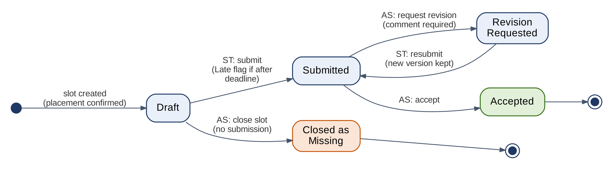

**Figure 3.1 – Report state machine**

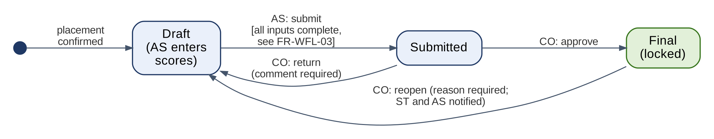

**Figure 3.2 – Grade approval state machine**

| **ID** | **Requirement** | **Priority** | **Acceptance criterion** |
|:---|:---|:--:|:---|
| **FR-WFL-01** | Weekly and final reports shall follow the state machine of Figure 3.1 (Draft, Submitted, Revision Requested, Accepted, Closed as Missing). Any transition not shown shall be rejected. | Must | An automated test exists for every allowed transition and for at least one disallowed transition from each state; all pass. |
| **FR-WFL-02** | The grade of a placement shall be the weighted sum of the cycle’s grade components (FR-CYC-02). The company-evaluation component is computed from the final evaluation as the mean rubric score ÷ 5 × 100; the other components are entered by the Academic Supervisor. | Must | For seeded inputs the computed grade equals a hand calculation to two decimal places. |
| **FR-WFL-03** | Grades shall follow the state machine of Figure 3.2. The Academic Supervisor can submit a grade only when the final evaluation is submitted, the final report is Accepted, and every weekly slot is Accepted or Closed as Missing. | Must | Submitting with any condition unmet is refused with a list of the missing items. |
| **FR-WFL-04** | The Coordinator shall approve a submitted grade, which makes it Final, or return it to the Academic Supervisor with a mandatory comment. | Must | Returning without a comment is refused; approval sets the status to Final with a timestamp. |
| **FR-WFL-05** | A Final grade shall be locked. Only the Coordinator may reopen it, with a mandatory reason; reopening returns it to Draft and notifies the student and the Academic Supervisor. | Must | Editing a Final grade is refused; reopening without a reason is refused; reopening is in the audit log. |
| **FR-WFL-06** | A student shall see their grade only when it is Final. | Must | The grade is hidden from the student in the Draft and Submitted states. |
| **FR-WFL-07** | The Coordinator shall be able to approve several submitted grades in one action; each approval is recorded separately. | Should | A bulk approval of 10 grades creates 10 audit entries. |

#### 3.1.11 Similarity Detection

*Source: F12 · Objective O5*

| **ID** | **Requirement** | **Priority** | **Acceptance criterion** |
|:---|:---|:--:|:---|
| **FR-SIM-01** | When a report is submitted, the system shall compare it with all reports stored for the same university (all its colleges, students, and cycles), excluding earlier versions of the same report by the same student. Reports of other universities are never compared or shown. | Should | A report copied from a previous cycle’s report of the same university is flagged; an identical report stored for another university is not shown. |
| **FR-SIM-02** | If the similarity score with any stored report reaches the threshold (default 30%), the system shall flag the report and show the Academic Supervisor the score, the source report reference (cycle and week), and the matching passages side by side. The identity of the source report’s author is shown only to the Coordinator of the author's college. | Should | Of 10 seeded reports with 40% or more copied text, at least 9 are flagged with passages shown; at most 1 of 10 independently written reports is flagged (O5). |
| **FR-SIM-03** | A similarity flag shall be advisory: the Academic Supervisor records a decision (No issue or Overlap confirmed) with a comment, and the system shall never change a report status or a grade because of a similarity score. | Should | A flagged report’s status changes only through the actions of FR-REP-05. |

#### 3.1.12 Notifications

*Source: F13 · Objective O3*

| **ID** | **Requirement** | **Priority** | **Acceptance criterion** |
|:---|:---|:--:|:---|
| **FR-NOT-01** | Each user shall have an in-app notification list with an unread count; event notifications are also sent by email. | Should | Each event of FR-NOT-05 produces one in-app notification and one email. |
| **FR-NOT-02** | The system shall remind a student 24 hours before a report deadline (default) if the report has not been submitted. | Should | Reminders are sent only for unsubmitted slots, between 24 and 23 hours before the deadline. |
| **FR-NOT-03** | Within 1 hour after a deadline, the system shall notify the student and the Academic Supervisor of each Missing report. | Should | Notifications for all seeded missing reports arrive within 1 hour (O3). |
| **FR-NOT-04** | The system shall escalate to the Coordinator any report, attendance week, or evaluation still outstanding 3 days after its deadline (default). | Should | An escalation appears for each seeded overdue item on day 4. |
| **FR-NOT-05** | The system shall notify the user who must act, or whose record changed, when: a registration is verified or rejected, an application is decided, a placement is confirmed, a revision is requested, a report is accepted, an evaluation is submitted, or a grade is returned, made Final, or reopened. | Should | Each listed event produces a notification to the right user in a scripted test. |
| **FR-NOT-06** | Notifications and emails shall be sent in the recipient’s chosen language. | Should | A user with Arabic selected receives the Arabic email. |

#### 3.1.13 Dashboards and Statistics

*Source: F9, F18, F19 · Objectives O1, O4, O10*

| **ID** | **Requirement** | **Priority** | **Acceptance criterion** |
|:---|:---|:--:|:---|
| **FR-DSH-01** | Each role shall have a home dashboard listing its pending actions with counts and direct links — ST: verification status, reports due, revisions requested, application status; CS: applicants to review, attendance to record, evaluations due; AS: reports to review, open similarity flags, grades to submit; CO: students to verify, placements to confirm, grades to approve, escalations; PA: coordinators and companies to verify. | Must | For a seeded scenario, every count equals the number of pending items in the database. |
| **FR-DSH-02** | The Coordinator dashboard shall show the status of the college's cycle: students placed and not placed, report submission and late rates, attendance rate, and evaluation completion, overall and per company. | Must | Every figure equals the value computed directly from seeded data. |
| **FR-DSH-03** | At the end of a cycle, the system shall offer students a short survey (job offer from the training company: Yes, No, or Pending), and the Coordinator dashboard shall show the placement-to-job-offer rate per cycle and per company. | Could | The rate equals Yes answers divided by survey answers for seeded data (O10). |
| **FR-DSH-04** | For each company with at least 5 final evaluations, the system shall alert the Coordinator when the company’s mean rubric score is at least 0.8 points above the cycle mean (default). The alert is informational only. | Could | A seeded company with 5 evaluations averaging 4.8 against a cycle mean of 3.6 raises the alert; a company with 4 evaluations does not. |
| **FR-DSH-05** | The Platform Admin dashboard shall show platform figures: universities, colleges with and without a coordinator, verified companies, users by role, pending verification requests and their age, and published vacancies. It shall show no academic records. | Should | Every figure equals the value computed from seeded data; no report, evaluation, or grade is reachable from it. |

#### 3.1.14 Exports

*Source: F14 · Objective O6*

| **ID** | **Requirement** | **Priority** | **Acceptance criterion** |
|:---|:---|:--:|:---|
| **FR-EXP-01** | The Coordinator shall export the grade sheet of a cycle as Excel (.xlsx) and PDF, listing student ID, name, company, academic supervisor, each component score, total, and grade status. | Should | Exported values match stored values in 100% of rows; Arabic names display correctly in both files. |
| **FR-EXP-02** | The Coordinator shall export a term summary report (PDF) with the cycle statistics of FR-DSH-02, for the college administration. | Should | The PDF figures equal the dashboard figures. |
| **FR-EXP-03** | The Coordinator and the student’s Academic Supervisor shall export a student’s training record (PDF): placement details, weekly report statuses, attendance, evaluations, and final grade. | Should | The record matches the stored data for a seeded student. |

#### 3.1.15 Completion Certificates

*Source: F16 · Objective O9*

| **ID** | **Requirement** | **Priority** | **Acceptance criterion** |
|:---|:---|:--:|:---|
| **FR-CER-01** | When a grade is Final, the Coordinator shall issue a completion certificate (PDF) with a unique, unguessable certificate ID and a QR code linking to the public verification page. | Could | A certificate cannot be issued for a grade that is not Final; the QR code opens the correct verification page. |
| **FR-CER-02** | The public verification page shall require no login and shall show only the certificate status (Valid, Revoked, or Not found), student name, university and college, cycle, company, and training dates. | Could | Valid, revoked, and altered IDs show Valid, Revoked, and Not found respectively (O9); no grade is shown. |
| **FR-CER-03** | The Coordinator shall be able to revoke a certificate with a mandatory reason. | Could | After revocation the verification page shows Revoked. |

#### 3.1.16 Language and PWA Features

*Source: F10, F15 · Objectives O7, O1*

| **ID** | **Requirement** | **Priority** | **Acceptance criterion** |
|:---|:---|:--:|:---|
| **FR-LOC-01** | Users shall switch the interface between Arabic and English at any time, and the choice is saved per user. Arabic uses a right-to-left layout and English a left-to-right layout. | Must | Switching the language mirrors the layout on every screen of Table 4.1. |
| **FR-LOC-02** | All interface text, validation messages, notification texts, and email templates shall exist in both languages; user-entered content is shown as entered. | Must | An automated check finds no missing translation keys in either language. |
| **FR-PWA-01** | The application shall be installable as a PWA on supported browsers. | Should | The app installs from Chrome on Android and from Safari on iOS (Add to Home Screen) and opens full screen. |
| **FR-PWA-02** | Users who grant permission shall receive web push notifications for the events of FR-NOT-05; email remains the fallback. | Should | With permission the push arrives; with permission denied the email still arrives. |
| **FR-PWA-03** | The app shell shall be cached so the application opens offline and shows an offline message. While offline, pages opened earlier in the same signed-in session shall show their saved copy with its time, and text typed into a report or evaluation draft shall be kept on the device and saved to the server as a draft when the connection returns. Submissions and other changes are not accepted offline (CR-10). | Should | In airplane mode the app opens with the offline message; a page opened before shows its saved copy; a draft typed offline is saved after reconnecting; submit buttons are disabled; after sign-out nothing is left on the device. |

#### 3.1.17 Audit Trail

*Source: Proposal opportunity statement (auditable record) · Objective O6*

| **ID** | **Requirement** | **Priority** | **Acceptance criterion** |
|:---|:---|:--:|:---|
| **FR-AUD-01** | The system shall record an audit entry for every creation, change, and state transition of accounts, organizations, verification requests, vacancies, placements, reports, attendance, evaluations, grades, and certificates: user, role, server time, action, and old and new values. | Must | Each action in the UAT script produces exactly one matching audit entry. |
| **FR-AUD-02** | Audit entries shall be append-only: no role can edit or delete them through the system. The Coordinator shall be able to filter the audit log of the college, and the Platform Admin the entries about accounts, organizations, and verification, by student, user, record type, and date. | Must | No API endpoint updates or deletes audit entries (permission test); filters return the correct entries. |
| **FR-AUD-03** | Each report, evaluation, and grade shall show its history (state changes with user and time) to users allowed to view the record. | Should | The history shown matches the audit entries. |

### 3.2 Use Case Specifications

Figure 3.3 shows the actors and the 20 use cases; Table 3.1 links each use case to its requirements. Tables 3.2 – 3.21 specify each use case: actors, preconditions, main flow, alternative flows, and postconditions. Step numbers in the alternative flows refer to the main-flow step where the alternative starts (for example, 3a starts at step 3).

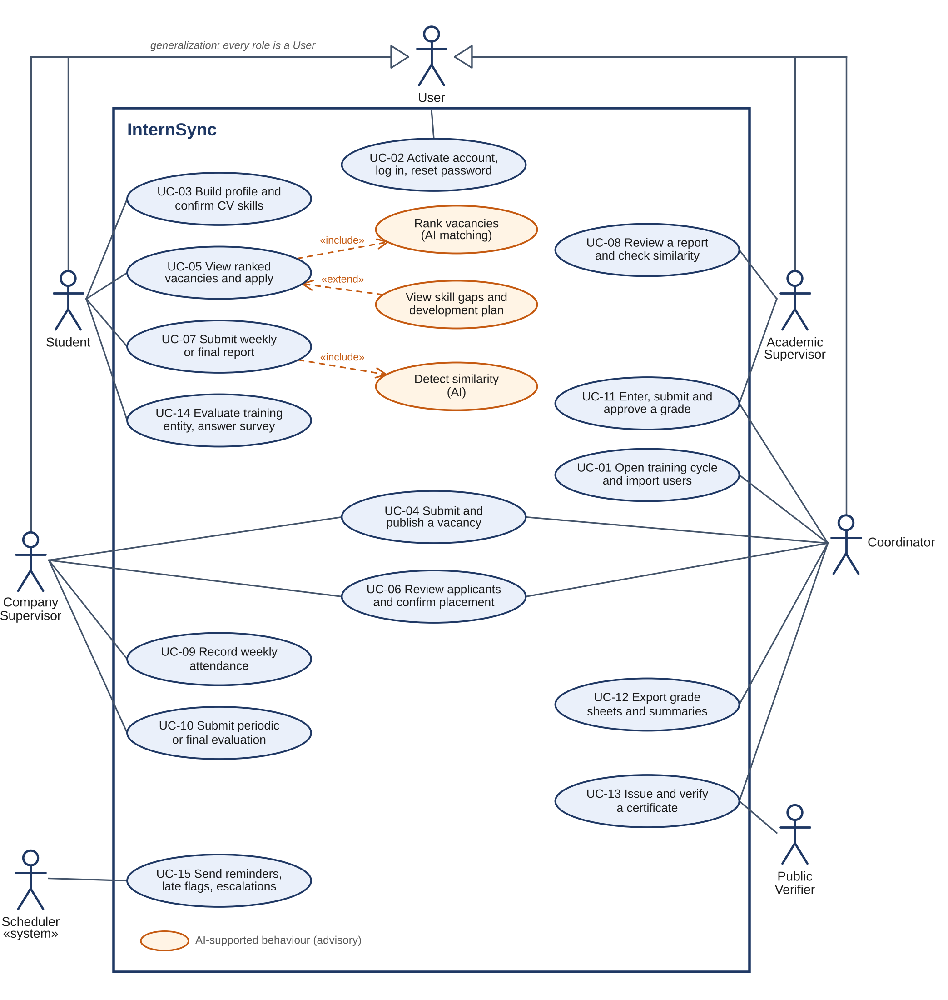

**Figure 3.3 – Use case diagram**

**Table 3.1 – Use cases**

| **UC** | **Use case** | **Primary actor** | **Requirements** |
|:--:|:---|:--:|:---|
| UC-01 | Open a training cycle | CO | FR-CYC-01 – 03, FR-CYC-05 |
| UC-02 | Register, confirm email, log in, reset password | All roles | FR-AUT-01 – 04, FR-ORG-02 |
| UC-03 | Build profile and confirm CV skills | ST | FR-PRF-02 – 05 |
| UC-04 | Publish a vacancy | CS | FR-VAC-01, FR-VAC-02 |
| UC-05 | View ranked vacancies and apply | ST | FR-VAC-03 – 05, FR-MAT-01 – 07 |
| UC-06 | Review applicants and confirm placement | CS, CO | FR-VAC-06 – 08 |
| UC-07 | Submit a weekly or final report | ST | FR-REP-01 – 04 |
| UC-08 | Review a report and check similarity | AS | FR-REP-05 – 07, FR-SIM-01 – 03 |
| UC-09 | Record weekly attendance | CS | FR-ATT-01 – 04 |
| UC-10 | Submit a periodic or final evaluation | CS | FR-EVL-01 – 04 |
| UC-11 | Enter, submit, and approve a grade | AS, CO | FR-WFL-02 – 07 |
| UC-12 | Export grade sheets and summaries | CO | FR-EXP-01 – 03 |
| UC-13 | Issue and verify a certificate | CO, Public | FR-CER-01 – 03 |
| UC-14 | Evaluate the training entity and answer the survey | ST | FR-EVL-05, FR-DSH-03 |
| UC-15 | Send reminders, late flags, and escalations | Scheduler (system timer) | FR-REP-04, FR-NOT-02 – 04 |
| UC-16 | Verify a coordinator or a company | PA | FR-ORG-03, FR-ORG-04, FR-ORG-07 – 09 |
| UC-17 | Verify a student and enrol them in a cycle | CO | FR-ORG-05, FR-ORG-08, FR-ORG-09 |
| UC-18 | Invite and manage academic supervisors | CO | FR-ORG-06, FR-AUT-06 |
| UC-19 | Invite and manage company supervisors | CS (Company Admin) | FR-ORG-06, FR-AUT-06 |
| UC-20 | Manage universities, colleges, and the skill vocabulary | PA | FR-ORG-01, FR-CYC-04, FR-DSH-05 |

**Table 3.2 – UC-01 Open a training cycle**

| **Use case** | **UC-01 Open a training cycle** |
|:---|:---|
| Actors | Coordinator |
| Related requirements | FR-CYC-01 – 03, FR-CYC-05 |
| Preconditions | The Coordinator is verified for the college and logged in. |
| Main flow | 1. The Coordinator opens Cycle settings and chooses New cycle. 2. The Coordinator enters the name, type, start and end dates, number of weeks, weekly working days, weekly report deadline, and the due dates of the evaluations and the final report. 3. The Coordinator defines the grade components and their weights. 4. The Coordinator defines the rubric criteria with a description for each level from 1 to 5. 5. The system validates the data, creates the cycle and its weekly deadlines, and records the action in the audit log. |
| Alternative flows | 3a. The weights do not sum to 100%: the system refuses to save and shows the current total. 4a. An evaluation of the cycle has already been submitted: the rubric is read-only. 5a. At the end of training the Coordinator closes the cycle, which becomes read-only; reopening it requires a written reason. |
| Postconditions | The cycle is open: verified students of the college can be enrolled in it, and its deadlines drive reports and reminders. |

**Table 3.3 – UC-02 Register, confirm email, log in, reset password**

| **Use case** | **UC-02 Register, confirm email, log in, reset password** |
|:---|:---|
| Actors | Student, Coordinator, or company representative (registration); invited supervisor (invitation); every role (login and password reset) |
| Related requirements | FR-AUT-01 – 04, FR-ORG-02, NFR-SEC-02, NFR-SEC-03, NFR-PRV-01 |
| Preconditions | For registration, the user's college is listed and active, or the company is not yet registered. |
| Main flow | 1. The user opens the registration page and chooses Student, College coordinator, or Company. 2. The user enters name, email, password, and the data and documents of the chosen type. 3. The system validates the data, creates the account and its verification request, and emails a confirmation link valid for 72 hours. 4. The user opens the link and the email is confirmed. 5. The user logs in with email and password and acknowledges the privacy notice at first login. 6. The system shows the verification status until the responsible person decides (UC-16, UC-17). |
| Alternative flows | 1a. Invited supervisor: the user opens the invitation link and sets a password; the account is active without verification. 3a. The email is already registered, the college already has a coordinator, or the commercial registration number is already used: the system refuses and explains why. 4a. The link is used or expired: the system rejects it and offers to send a new one. 5a. Five wrong passwords in a row: the account is locked for 15 minutes. 5b. Forgotten password: the user requests a reset link valid for 60 minutes and sets a new password. |
| Postconditions | The account exists with a confirmed email. It acts in its role only after verification. |

**Table 3.4 – UC-03 Build profile and confirm CV skills**

| **Use case** | **UC-03 Build profile and confirm CV skills** |
|:---|:---|
| Actors | Student |
| Related requirements | FR-PRF-02 – 05, NFR-PER-03 |
| Preconditions | The student is logged in (verification may still be pending). |
| Main flow | 1. The student opens the profile and completes languages and areas of interest. 2. The student uploads a CV (PDF or DOCX, up to 5 MB). 3. The system extracts the text and the candidate skills, normalizes them with the skill vocabulary, and shows them within 30 seconds. 4. The student adds, edits, or removes skills and confirms the list. 5. The system saves the confirmed skills and keeps the earlier CV versions. |
| Alternative flows | 1a. After verification, the student number, major, and GPA are read-only. 2a. Wrong file type or size: the upload is refused with a message. 3a. No text can be extracted (for example, a scanned CV): the system says so and shows an empty skill list for manual entry. |
| Postconditions | The profile has confirmed skills that matching can use (UC-05). |

**Table 3.5 – UC-04 Publish a vacancy**

| **Use case** | **UC-04 Publish a vacancy** |
|:---|:---|
| Actors | Company Supervisor (including the Company Admin) |
| Related requirements | FR-VAC-01, FR-VAC-02 |
| Preconditions | The company is verified and the supervisor is logged in. |
| Main flow | 1. The supervisor chooses New vacancy. 2. The supervisor enters title, city, description, required and preferred skills, eligible majors, optional minimum GPA, seats, application deadline, training type and dates, and optional target universities. 3. The supervisor publishes the vacancy. 4. The system checks the required fields and the deadline, sets the status to Published, and shows the vacancy to verified students of the target universities, or of all universities when none is set. |
| Alternative flows | 1a. The company is not verified: no vacancy can be created. 3a. The supervisor saves a draft and publishes it later. 4a. A required field is missing or the deadline has passed: the system refuses and marks the fields. 4b. The supervisor closes the vacancy, or it closes automatically when its last seat is filled or the company is suspended. |
| Postconditions | The vacancy is Published (or Draft); the action is in the audit log. |

**Table 3.6 – UC-05 View ranked vacancies and apply**

| **Use case** | **UC-05 View ranked vacancies and apply** |
|:---|:---|
| Actors | Student |
| Related requirements | FR-VAC-03 – 05, FR-MAT-01 – 07, NFR-PER-02 |
| Preconditions | The student is verified, enrolled in an open cycle, and has confirmed skills. |
| Main flow | 1. The student opens Vacancies and chooses Best for me. 2. The system ranks the eligible vacancies open to the student's university by fit score and shows matched and missing skills, labelled advisory. 3. The student opens a vacancy and, if wanted, its development plan. 4. The student applies. 5. The system checks eligibility, the deadline, duplicates, and the limit of 5 active applications, and records the application. |
| Alternative flows | 1a. Browse all: the student searches and filters; vacancies the student is not eligible for show the reason. 2a. The embedding model is unavailable: the ranking uses the rule-based score and is labelled Basic matching. 5a. A check fails: the application is refused with the reason. 5b. The student withdraws an application that has no decision yet. |
| Postconditions | The application is Submitted and the company supervisor is notified. |

**Table 3.7 – UC-06 Review applicants and confirm placement**

| **Use case** | **UC-06 Review applicants and confirm placement** |
|:---|:---|
| Actors | Company Supervisor; Coordinator of the student's college |
| Related requirements | FR-VAC-06 – 08 |
| Preconditions | The vacancy has submitted applications. |
| Main flow | 1. The supervisor opens the applicants of own vacancies (the Company Admin: of all the company's vacancies). 2. The supervisor reviews profile, confirmed skills, and CV, and marks each applicant Accepted or Declined. 3. The system notifies the student and, for accepted applicants, the student's Coordinator. 4. The Coordinator confirms the placement, choosing the company supervisor and an academic supervisor of the college. 5. The system creates the placement, the report slots, and the draft grade, withdraws the student's other active applications, and closes the vacancy if its last seat is filled. |
| Alternative flows | 4a. The student already has a placement in the cycle, or no seat is left: the confirmation is refused. 4b. Later, the Coordinator changes the academic supervisor or cancels the placement, giving a mandatory reason. |
| Postconditions | The student is placed; the student, the company supervisor, and the academic supervisor are notified. |

**Table 3.8 – UC-07 Submit a weekly or final report**

| **Use case** | **UC-07 Submit a weekly or final report** |
|:---|:---|
| Actors | Student |
| Related requirements | FR-REP-01 – 04, NFR-REL-04 |
| Preconditions | The student has a confirmed placement and the report slot is open. |
| Main flow | 1. The student opens the report of the week. 2. The student writes the tasks performed, what was learned, the challenges, and next week's plan, and attaches up to 3 files. 3. The student submits (or saves a draft). 4. The system stores the report with the server time, flags it Late if it is after the deadline, and starts the similarity check. 5. The system notifies the academic supervisor. |
| Alternative flows | 1a. A revision was requested: the student edits and resubmits; every version is kept. 2a. Too many or too large attachments: refused with a message. 4a. An attachment fails to upload: nothing is submitted and the draft is kept. 4b. No submission by the deadline: the slot is flagged Missing (UC-15). |
| Postconditions | The report is Submitted and read-only for the student. |

**Table 3.9 – UC-08 Review a report and check similarity**

| **Use case** | **UC-08 Review a report and check similarity** |
|:---|:---|
| Actors | Academic Supervisor |
| Related requirements | FR-REP-05 – 07, FR-SIM-01 – 03 |
| Preconditions | A report of an assigned student is Submitted. |
| Main flow | 1. The supervisor opens the report with its versions and comments. 2. If the report is flagged, the supervisor views the similarity score and the matching passages and records a decision (No issue or Overlap confirmed) with a comment. 3. The supervisor accepts the report. 4. The system sets the status to Accepted and notifies the student. |
| Alternative flows | 1a. A slot has no submission: the supervisor closes it as Missing, which ends late submission. 2a. The similarity flag is advisory and never changes the status by itself. 3a. The supervisor requests a revision with a mandatory comment; the student resubmits (UC-07). |
| Postconditions | The report is Accepted, Revision Requested, or Closed as Missing. |

**Table 3.10 – UC-09 Record weekly attendance**

| **Use case** | **UC-09 Record weekly attendance** |
|:---|:---|
| Actors | Company Supervisor |
| Related requirements | FR-ATT-01 – 04 |
| Preconditions | The supervisor has an assigned student and the training week has ended. |
| Main flow | 1. The supervisor opens Attendance for the week. 2. The supervisor records the attended days, or chooses Full attendance, with an optional note. 3. The system saves the week and updates the attendance percentage. |
| Alternative flows | 1a. The week is not recorded within 3 days: it appears as a pending action, and after 3 more days it is escalated to the Coordinator. 2a. More than 7 days after the week: the week is locked until the Coordinator unlocks it. |
| Postconditions | The attendance record is visible to the student, both supervisors, and the Coordinator. |

**Table 3.11 – UC-10 Submit a periodic or final evaluation**

| **Use case** | **UC-10 Submit a periodic or final evaluation** |
|:---|:---|
| Actors | Company Supervisor |
| Related requirements | FR-EVL-01 – 04 |
| Preconditions | The evaluation is due for an assigned student and the cycle rubric is defined. |
| Main flow | 1. The supervisor opens the evaluation form. 2. The supervisor rates every rubric criterion from 1 to 5 against its level descriptions and writes the overall comment. 3. The supervisor submits. 4. The system locks the evaluation and, for a periodic evaluation, shows it to the student and the academic supervisor. |
| Alternative flows | 3a. A criterion is unrated or the comment is empty: the submission is refused. 4a. Final evaluation: the student sees it only when the grade is Final. 4b. A correction is needed: the Coordinator reopens the evaluation once, with a reason. |
| Postconditions | The evaluation is submitted; the first submission of the cycle makes the rubric read-only. |

**Table 3.12 – UC-11 Enter, submit, and approve a grade**

| **Use case** | **UC-11 Enter, submit, and approve a grade** |
|:---|:---|
| Actors | Academic Supervisor; Coordinator |
| Related requirements | FR-WFL-02 – 07 |
| Preconditions | The final evaluation is submitted, the final report is Accepted, and every weekly slot is Accepted or Closed as Missing. |
| Main flow | 1. The academic supervisor enters the component scores; the system computes the company component and the total. 2. The academic supervisor submits the grade. 3. The Coordinator reviews and approves the grade. 4. The system makes the grade Final and locked and shows it to the student. |
| Alternative flows | 2a. A precondition is not met: the submission is refused with the list of missing items. 3a. The Coordinator returns the grade with a mandatory comment; the academic supervisor corrects and resubmits. 3b. The Coordinator approves several submitted grades in one action. 4a. Reopening a Final grade requires a reason and returns it to Draft. |
| Postconditions | The grade is Final; every step is in the audit log. |

**Table 3.13 – UC-12 Export grade sheets and summaries**

| **Use case** | **UC-12 Export grade sheets and summaries** |
|:---|:---|
| Actors | Coordinator (all exports); Academic Supervisor (training records of assigned students) |
| Related requirements | FR-EXP-01 – 03, NFR-PER-05, NFR-L10N-03 |
| Preconditions | The cycle has grades and the user is logged in. |
| Main flow | 1. The Coordinator opens Exports and chooses the cycle and the export: grade sheet, term summary, or student record. 2. The Coordinator chooses Excel or PDF. 3. The system generates the file with an embedded Arabic font and offers it for download. |
| Alternative flows | 1a. The academic supervisor exports the training record of an assigned student. |
| Postconditions | The file matches the stored data. |

**Table 3.14 – UC-13 Issue and verify a certificate**

| **Use case** | **UC-13 Issue and verify a certificate** |
|:---|:---|
| Actors | Coordinator; public verifier |
| Related requirements | FR-CER-01 – 03 |
| Preconditions | The student's grade is Final. |
| Main flow | 1. The Coordinator issues the certificate. 2. The system generates the PDF with a unique certificate ID and a QR code. 3. A verifier scans the QR code. 4. The public page shows, without login, the status, student name, university and college, cycle, company, and training dates. |
| Alternative flows | 1a. The grade is not Final: issuing is refused. 4a. The certificate was revoked: the page shows Revoked. 4b. The ID is unknown or altered: the page shows Not found. |
| Postconditions | The certificate can be verified publicly; no grade is shown. |

**Table 3.15 – UC-14 Evaluate the training entity and answer the survey**

| **Use case** | **UC-14 Evaluate the training entity and answer the survey** |
|:---|:---|
| Actors | Student |
| Related requirements | FR-EVL-05, FR-DSH-03 |
| Preconditions | The student's placement has ended. |
| Main flow | 1. The student opens the evaluation of the training entity. 2. The student rates learning opportunities, supervision quality, work environment, relevance to the major, and whether they would recommend it. 3. The student answers the survey question on a job offer (Yes, No, or Pending). 4. The system stores the answers. |
| Alternative flows | 3a. The student skips the survey: the student is not counted in the job-offer rate. |
| Postconditions | The responses are visible to the Coordinator only, never to the company; the dashboard shows the job-offer rate. |

**Table 3.16 – UC-15 Send reminders, late flags, and escalations**

| **Use case** | **UC-15 Send reminders, late flags, and escalations** |
|:---|:---|
| Actors | Scheduler (system timer) |
| Related requirements | FR-REP-04, FR-NOT-02 – 04, NFR-REL-03 |
| Preconditions | The cycle has deadlines; the scheduler runs every 15 minutes. |
| Main flow | 1. 24 hours before a deadline, the system reminds the students who have not submitted. 2. At the deadline, empty report slots are flagged Missing, and the student and the academic supervisor are notified within 1 hour. 3. Reports, attendance weeks, and evaluations still outstanding 3 days after their deadline are escalated to the Coordinator. |
| Alternative flows | 1a. The server was down: missed jobs run within 1 hour after restart, and no reminder or escalation is sent twice. |
| Postconditions | The flags and notifications are recorded. |

**Table 3.17 – UC-16 Verify a coordinator or a company**

| **Use case** | **UC-16 Verify a coordinator or a company** |
|:---|:---|
| Actors | Platform Admin |
| Related requirements | FR-ORG-03, FR-ORG-04, FR-ORG-07 – 09 |
| Preconditions | A coordinator or company registration has a confirmed email and a pending verification request. |
| Main flow | 1. The Platform Admin opens the verification queue, oldest request first. 2. The Platform Admin checks the data and the documents (an appointment letter; or the commercial registration and a letter of authorization). The system shows its own checks: no other coordinator for the college; no company with the same commercial registration number. 3. The Platform Admin approves the request. 4. The system activates the role: the coordinator for the college, or the company as verified with the applicant as its Company Admin; the applicant is notified. |
| Alternative flows | 3a. The Platform Admin rejects the request with a mandatory reason; the applicant may correct the data or documents and submit a new request, and the earlier decision stays visible. 1a. The Platform Admin transfers the Coordinator role of a college, or the Company Admin right of a company, to another person of the same organization, giving a reason. |
| Postconditions | The decision and its reason are recorded; the documents are deleted 30 days after the decision. |

**Table 3.18 – UC-17 Verify a student and enrol them in a cycle**

| **Use case** | **UC-17 Verify a student and enrol them in a cycle** |
|:---|:---|
| Actors | Coordinator |
| Related requirements | FR-ORG-05, FR-ORG-08, FR-ORG-09 |
| Preconditions | A student of the college has a confirmed email and a pending request, and the college has an open cycle. |
| Main flow | 1. The Coordinator opens the student requests of the college, oldest first. 2. The Coordinator checks the student number, major, GPA, level, and the course-registration document. 3. The Coordinator approves the request and chooses the open cycle. 4. The system verifies the student, enrols them in the cycle, and notifies them. |
| Alternative flows | 1a. A Coordinator of another college cannot see the request. 3a. The Coordinator rejects the request with a mandatory reason; the student may correct and resubmit. |
| Postconditions | The student is verified and enrolled and can apply to vacancies. |

**Table 3.19 – UC-18 Invite and manage academic supervisors**

| **Use case** | **UC-18 Invite and manage academic supervisors** |
|:---|:---|
| Actors | Coordinator |
| Related requirements | FR-ORG-06, FR-AUT-06 |
| Preconditions | The Coordinator is verified. |
| Main flow | 1. The Coordinator enters the name and email of an academic supervisor and sends the invitation. 2. The system emails an invitation link valid for 72 hours. 3. The supervisor opens the link, sets a password, and joins the college. |
| Alternative flows | 2a. The invitation expires: the Coordinator resends it. 3a. Later, the Coordinator deactivates or reactivates the supervisor; past reviews and grades stay unchanged. |
| Postconditions | The academic supervisor belongs to the college and can be assigned at placement (UC-06). |

**Table 3.20 – UC-19 Invite and manage company supervisors**

| **Use case** | **UC-19 Invite and manage company supervisors** |
|:---|:---|
| Actors | Company Admin |
| Related requirements | FR-ORG-06, FR-AUT-06 |
| Preconditions | The company is verified. |
| Main flow | 1. The Company Admin enters the name and email of a colleague and sends the invitation. 2. The system emails an invitation link valid for 72 hours. 3. The colleague opens the link, sets a password, and joins the company as a company supervisor. |
| Alternative flows | 2a. The invitation expires: the Company Admin resends it. 3a. Later, the Company Admin deactivates or reactivates the supervisor; past attendance and evaluations stay unchanged. |
| Postconditions | The supervisor belongs to the company, sees only own vacancies and trainees, and may supervise students of any university. |

**Table 3.21 – UC-20 Manage universities, colleges, and the skill vocabulary**

| **Use case** | **UC-20 Manage universities, colleges, and the skill vocabulary** |
|:---|:---|
| Actors | Platform Admin |
| Related requirements | FR-ORG-01, FR-CYC-04, FR-DSH-05, NFR-MNT-03 |
| Preconditions | The Platform Admin is logged in. |
| Main flow | 1. The Platform Admin adds a university with its Arabic and English names, email domains, and GPA scale. 2. The Platform Admin adds the colleges of the university. 3. The Platform Admin maintains the skill vocabulary: names, synonyms, and learning resources. 4. The Platform Admin changes platform defaults when needed. 5. The platform dashboard shows the platform figures, without any academic record. |
| Alternative flows | 2a. The Platform Admin deactivates a college: it is no longer offered at registration. |
| Postconditions | Registration offers the active colleges; skill extraction and matching use the updated vocabulary. |

## 4. External Interface Requirements

### 4.1 User Interfaces

- After login, each role lands on its dashboard (FR-DSH-01); navigation shows only the functions of that role.

- Every screen has a header with the language switch (العربية / English), the notification list, and the user menu.

- Arabic mode mirrors the whole layout (navigation, tables, directional icons) and uses an Arabic web font.

- Statuses (Draft, Submitted, Late, Missing, Accepted, Final, and so on) appear as labelled chips with text and color, never color alone.

- Forms validate fields inline and keep entered data when an error occurs.

- AI results appear in a separate panel labelled “Advisory”, together with their reason.

- The visual design follows the design system produced in Claude Design and Figma Make during task T3 (SPMP).

**Table 4.1 – Main screens**

| **Screen** | **Roles** | **Purpose (requirements)** |
|:---|:--:|:---|
| Registration, login, email confirmation, password reset | All | Access the system (FR-AUT-02 – 04, FR-ORG-02) |
| Verification status and documents | ST, CO, CS | Upload documents, see the decision, resubmit (FR-ORG-03 – 05, FR-ORG-09) |
| Dashboard | All | Pending actions and status (FR-DSH-01 – 04) |
| Profile and CV | ST | Profile, CV upload, skill confirmation (FR-PRF-02 – 05) |
| Vacancies (browse and ranked) | ST | Browse, filter, ranked list with explanation, apply (FR-VAC-03 – 05, FR-MAT-01 – 07) |
| Vacancy editor and applicants | CS | Create and publish vacancies, review applicants (FR-VAC-01, FR-VAC-02, FR-VAC-06) |
| Company team | CS (Company Admin) | Company profile, invite and deactivate supervisors (FR-ORG-04, FR-ORG-06, FR-AUT-06) |
| Placements | CO | Confirm placements, assign supervisors (FR-VAC-07, FR-VAC-08) |
| Report form and history | ST, AS, CS | Submit, review, comment, similarity panel (FR-REP-01 – 07, FR-SIM-02) |
| Attendance | CS | Weekly attendance (FR-ATT-01 – 03) |
| Evaluation form | CS, ST | Rubric evaluation; student evaluation of the company (FR-EVL-01 – 05) |
| Grades | AS, CO | Enter, submit, approve, reopen grades (FR-WFL-02 – 07) |
| Cycle settings | CO | Cycle, rubric, weights (FR-CYC-01 – 03, FR-CYC-05) |
| Student verification and academic supervisors | CO | Verify and enrol students, invite and deactivate supervisors (FR-ORG-05, FR-ORG-06, FR-AUT-06) |
| Platform administration | PA | Dashboard, verification queue, universities and colleges, companies, skill vocabulary, settings (FR-ORG-01, FR-ORG-03, FR-ORG-04, FR-ORG-07, FR-CYC-04, FR-DSH-05, NFR-MNT-03) |
| Exports and certificates | CO, AS | Grade sheets, summaries, records, certificates (FR-EXP-01 – 03, FR-CER-01, FR-CER-03) |
| Audit log | CO, PA | Search audit entries (FR-AUD-02) |
| Certificate verification | Public | Verify a certificate (FR-CER-02) |

The wireframes (task T3) are a clickable prototype of the screens of Table 4.1, made in Claude Design: [InternSync Wireframes](https://claude.ai/artifact/GUCAYYDPvkkBiwntVfJWJA). Their sources and images are in [`docs/Design/wireframes`](../Design/wireframes/), and Section 8 of the design document maps every screen to its requirements. Figures 4.1 – 4.10 show the main screens; the interface is in Arabic by default and mirrors to English.

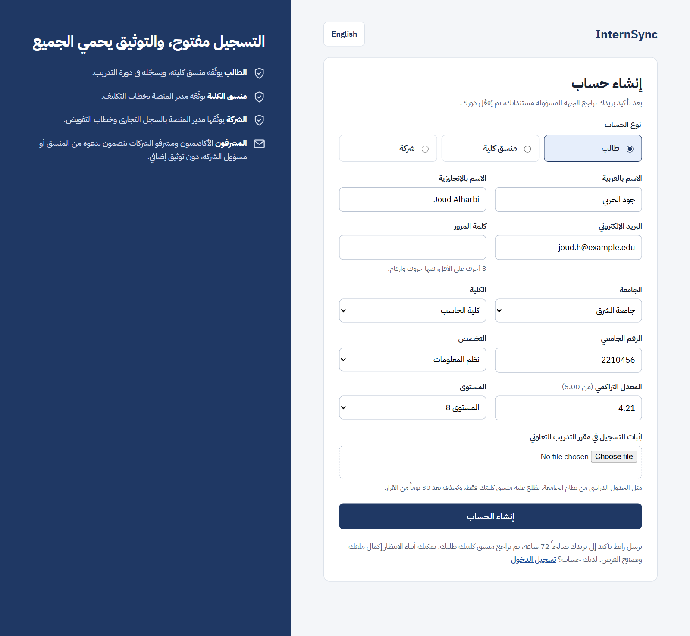

**Figure 4.1 – Registration (student account type)**

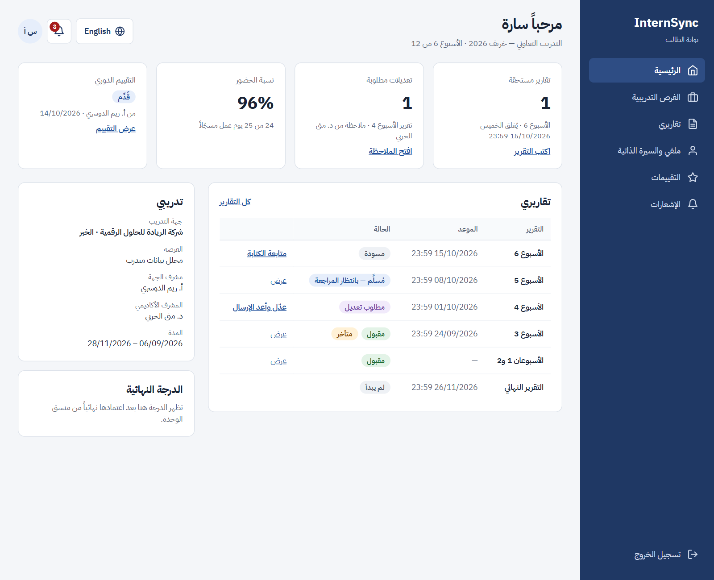

**Figure 4.2 – Student dashboard (Arabic, right to left)**

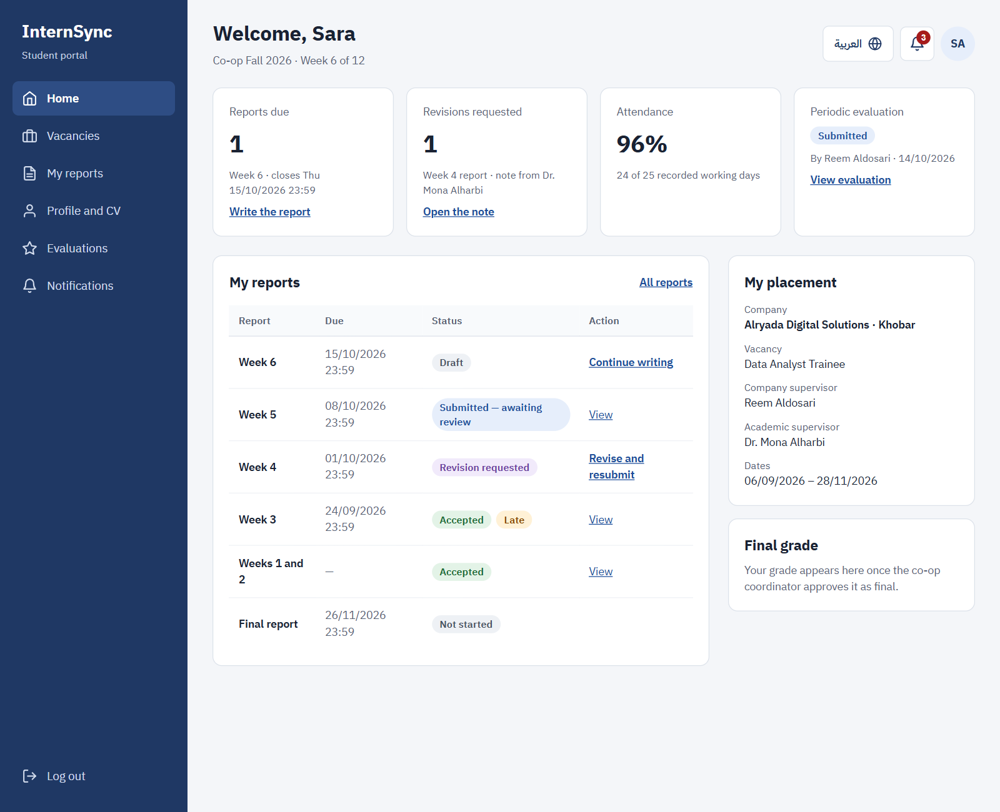

**Figure 4.3 – Student dashboard (English, left to right)**

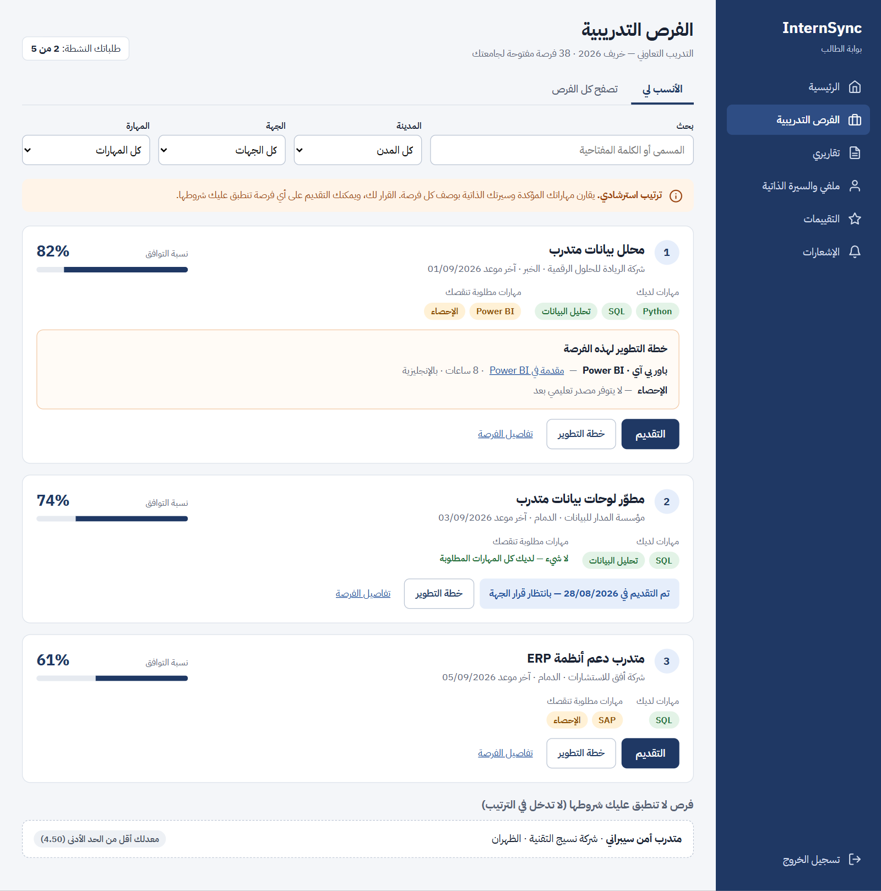

**Figure 4.4 – Ranked vacancies with matched and missing skills (advisory)**

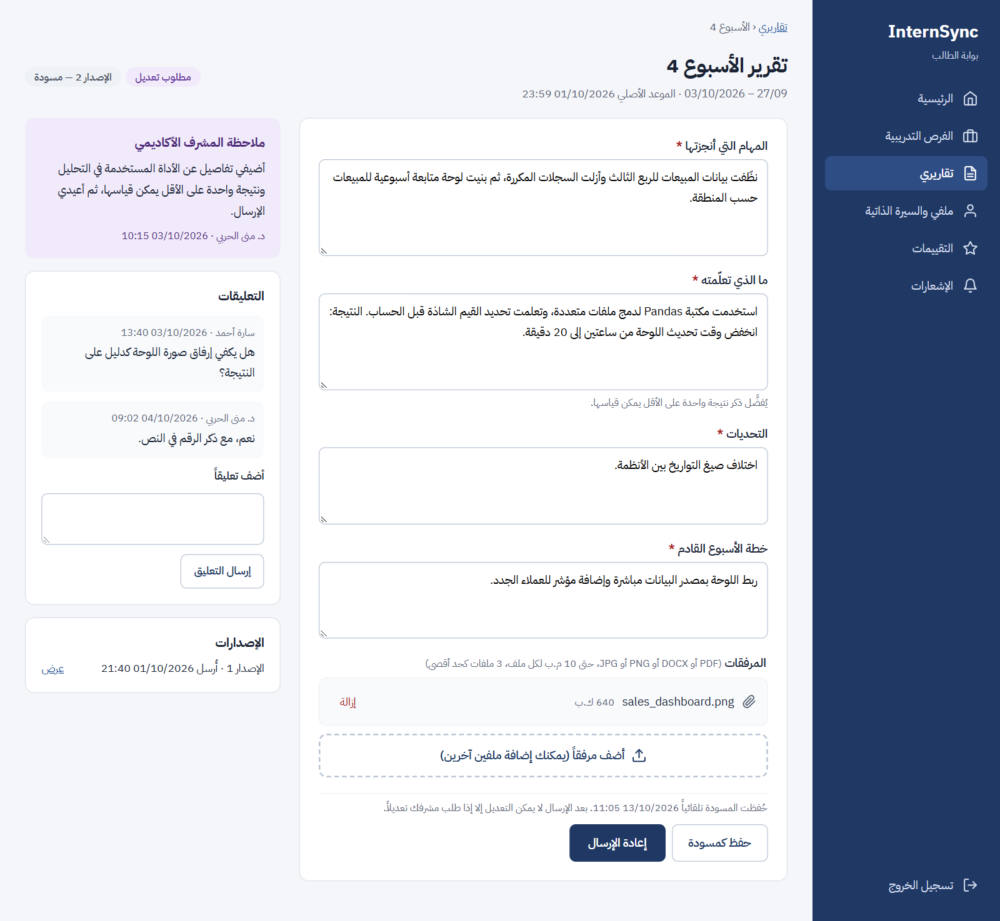

**Figure 4.5 – Weekly report with a revision request**

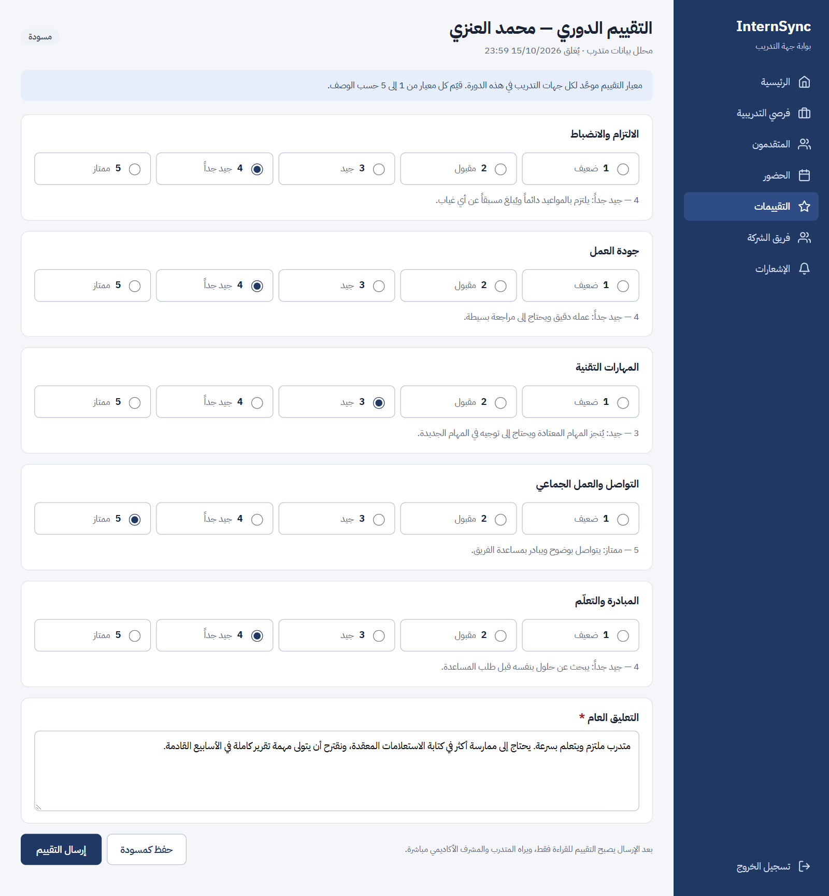

**Figure 4.6 – Company supervisor: evaluation with the standard rubric**

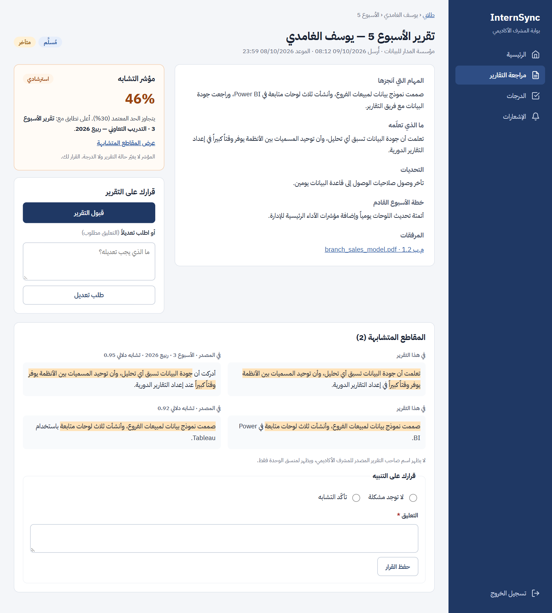

**Figure 4.7 – Academic supervisor: report review with the similarity indicator**

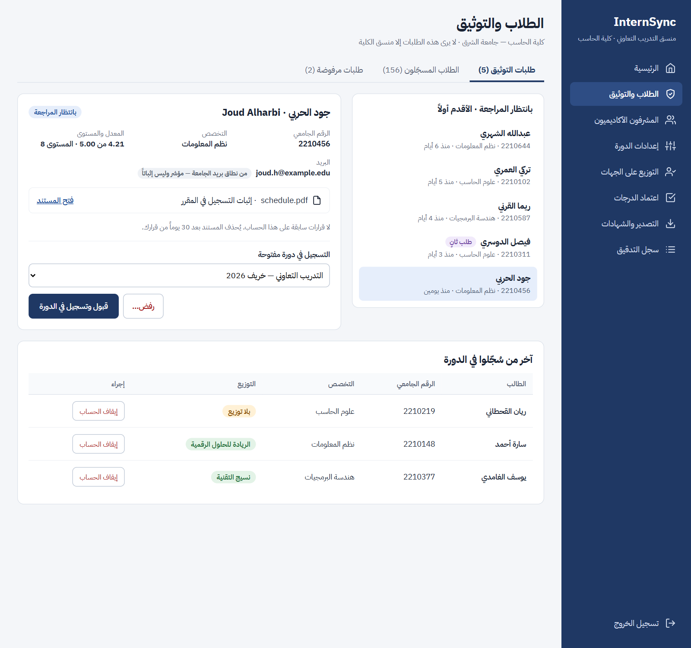

**Figure 4.8 – Coordinator: student verification and enrolment**

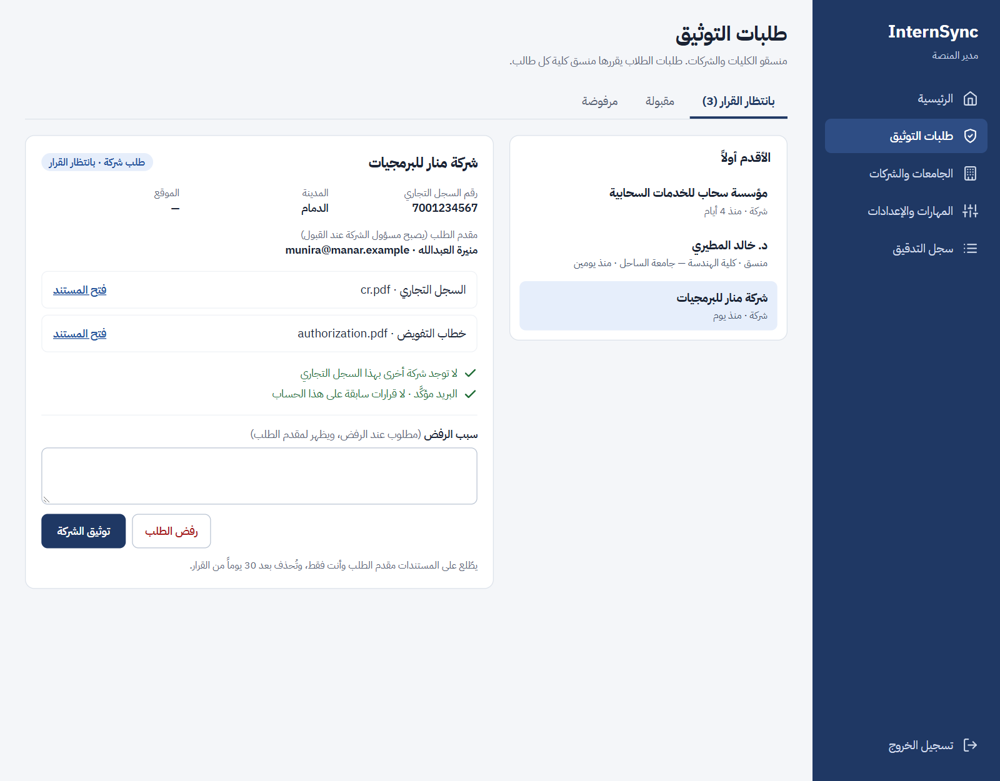

**Figure 4.9 – Platform Admin: verification of a company**

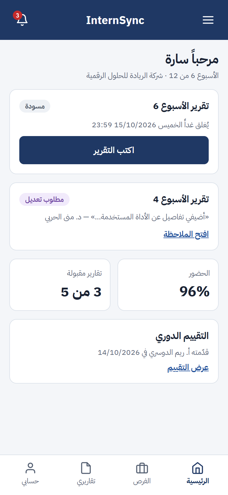

**Figure 4.10 – Student dashboard on a phone**

### 4.2 Hardware Interfaces

InternSync has no direct hardware interface. Users work from standard desktops, laptops, and phones. A certificate is verified by scanning its QR code with any phone camera, which opens the verification URL. The server side runs on hosted free tiers (Section 2.4) or on any Linux server with Docker (minimum 2 vCPU and 4 GB RAM); no GPU is needed because the embedding model is small enough to run on the CPU.

### 4.3 Software Interfaces

**Table 4.2 – Software interfaces**

| **Interface** | **Purpose** | **Data exchanged** | **Notes** |
|:---|:---|:---|:---|
| PostgreSQL 16 or later with pgvector (Supabase in the reference deployment) | Store relational data and text embeddings | SQL over TLS | Reached only by the API with a dedicated database role; the Supabase auto-generated Data API is disabled. |
| File storage (Supabase Storage private bucket; a local volume under Docker Compose) | Store CVs, report attachments, verification documents, exports, and certificates | Files in and out | Reached only by the API; each download is streamed by the API after a permission check, so no storage link is given out (NFR-SEC-04). |
| Multilingual embedding model (e.g., multilingual-e5-small via sentence-transformers) | Embeddings for matching and similarity | Text in, vector out | Runs on the server (NFR-PRV-02); fallback in FR-MAT-04. |
| PDF/DOCX text extraction library | Read CV and report text | File in, text out | Image-only files handled by FR-PRF-05. |
| Email provider (SMTP over TLS) | Activation, password reset, notifications | Outgoing email messages | Free provider (Gmail SMTP with an app password in the reference deployment); sending limits are dependency D-03. |
| Browser push services (Web Push with VAPID keys) | Push notifications | Event title and link | No personal data in the payload (NFR-PRV-03). |
| Export files | Grade sheets, summaries, records, certificates | .xlsx (Office Open XML) and PDF | Embedded Arabic font (NFR-L10N-03). |

### 4.4 Communication Interfaces

- **Client–server:** HTTPS (TLS 1.2 or later) REST API with JSON bodies, versioned under /api/v1 and described by OpenAPI 3; requests are authenticated with JWT bearer tokens.

- **Email:** SMTP with TLS to the email provider.

- **Push:** Web Push protocol through the browser vendors’ push services.

- **Certificate verification:** public URL of the form https://\<host\>/verify/\<certificate-id\>, encoded in the certificate’s QR code.

- **Dates and times:** exchanged in ISO 8601 format with the UTC offset.

## 5. Non-Functional Requirements

Non-functional requirements state measurable qualities. Performance targets apply to the reference demonstration deployment (Section 2.4) loaded with the data volumes of Table 2.2.

### 5.1 Performance Requirements

| **ID** | **Requirement** | **Priority** | **Acceptance criterion** |
|:---|:---|:--:|:---|
| **NFR-PER-01** | For ordinary operations (open a dashboard, open or submit a form, list vacancies), 95% of requests shall complete within 2 seconds with 50 concurrent users. | Must | Load test (e.g., Locust) on the reference deployment with seeded data. |
| **NFR-PER-02** | The ranked vacancy list for one student shall be returned within 5 seconds for up to 1,000 open vacancies, also when the rule-based fallback is used. | Must | Timed test, 20 runs, 95th percentile. |
| **NFR-PER-03** | Extracted skills shall be shown within 30 seconds after uploading a CV of up to 5 MB. | Must | Timed test on the 20 labelled CVs. |
| **NFR-PER-04** | The similarity result of a submitted report shall be available within 2 minutes with up to 10,000 stored reports. | Should | Timed test with seeded reports. |
| **NFR-PER-05** | Grade sheets for a 100-student cohort shall be exported to PDF and to Excel in under 60 seconds each (O6). | Should | Timed export test. |

### 5.2 Security Requirements

| **ID** | **Requirement** | **Priority** | **Acceptance criterion** |
|:---|:---|:--:|:---|
| **NFR-SEC-01** | All traffic shall use HTTPS (TLS 1.2 or later); HTTP requests are redirected to HTTPS. | Must | Configuration inspection; an HTTP request is redirected. |
| **NFR-SEC-02** | Passwords shall be stored only as salted hashes with an adaptive algorithm (bcrypt or Argon2) and must have at least 8 characters with letters and digits. | Must | Database inspection shows no plain passwords; a weak password is refused. |
| **NFR-SEC-03** | After 5 consecutive failed login attempts, the account shall be locked for 15 minutes. | Must | The 6th attempt is refused even with the correct password; login works after 15 minutes. |
| **NFR-SEC-04** | Uploaded files shall be checked by content type and size, stored outside the public web root, and served only through links that check the requester’s permission. | Must | An executable renamed to .pdf is refused; a file URL requested without permission returns 403. |
| **NFR-SEC-05** | At release, an OWASP ZAP baseline scan shall report no high-risk findings, and dependency audits (pip-audit, npm audit) shall report no known critical vulnerabilities. | Should | Scan and audit reports attached to the test report. |

### 5.3 Reliability and Availability

| **ID** | **Requirement** | **Priority** | **Acceptance criterion** |
|:---|:---|:--:|:---|
| **NFR-REL-01** | During the testing phase, unplanned downtime of the demo server shall not exceed 1 hour per week, and the system shall be available for every scheduled UAT session and the final demonstration. | Must | Uptime monitor log. |
| **NFR-REL-02** | The database and uploaded files shall be backed up automatically every day; a restore shall be tested at least once before final delivery (maximum data loss: 24 hours). | Should | Restore test recorded in the test report. |
| **NFR-REL-03** | Scheduled jobs shall run at least every 15 minutes, shall not send the same reminder or escalation twice, and jobs missed while the server was down shall run within 1 hour after restart. | Should | Restart test during a deadline window. |
| **NFR-REL-04** | A submission shall be saved completely or not at all: if any attachment fails, the report is not marked Submitted and the draft is kept. | Must | Fault-injection test during upload. |

### 5.4 Maintainability

| **ID** | **Requirement** | **Priority** | **Acceptance criterion** |
|:---|:---|:--:|:---|
| **NFR-MNT-01** | Automated tests shall run on every pull request and cover at least 70% of the lines of the backend business-logic modules; a pull request with failing tests is not merged. | Must | CI coverage report. |
| **NFR-MNT-02** | The API shall be documented by an OpenAPI specification generated from the code, from which the frontend client is generated. | Must | Specification published by the server matches the implemented endpoints. |
| **NFR-MNT-03** | Every value marked “default” in this SRS (deadlines, limits, thresholds, reminder times) shall be changeable without changing code: platform values by the Platform Admin, and cycle values (deadlines, weights, rubric) by the Coordinator. | Must | Each default is changed during testing and takes effect without a code change. |

### 5.5 Portability

| **ID** | **Requirement** | **Priority** | **Acceptance criterion** |
|:---|:---|:--:|:---|
| **NFR-PRT-01** | The application shall work on the two latest major versions of Chrome, Edge, Firefox, and Safari on desktop, and of Chrome on Android and Safari on iOS. | Must | Smoke test of the main tasks on each browser. |
| **NFR-PRT-02** | The whole system shall be deployable with one Docker Compose command on a Linux server, following a written setup guide. | Must | A team member who did not write the guide deploys it on a clean machine. |

### 5.6 Privacy and Data Protection

| **ID** | **Requirement** | **Priority** | **Acceptance criterion** |
|:---|:---|:--:|:---|
| **NFR-PRV-01** | At first login, each user shall see a consent notice in their language explaining what personal data is processed and why; the system stores the time of acknowledgement. | Must | First login cannot continue until the notice is acknowledged; the timestamp is stored. |
| **NFR-PRV-02** | CV and report text shall be processed only by models running on the system’s own server; no personal data is sent to external AI services. | Must | Code and network-configuration inspection shows no outbound calls to AI services. |
| **NFR-PRV-03** | Each role shall see only the personal data needed for its tasks (Table 2.3); the Platform Admin sees account and verification data but no CV, report, evaluation, or grade; push notification payloads shall contain no personal data beyond the event title. | Must | Permission tests; inspection of push payloads. |
| **NFR-PRV-04** | The Coordinator shall be able to anonymize the personal data (names, contact details, CV files) of a closed cycle after the retention period set by the college, keeping anonymized statistics. | Could | After anonymization no name or CV of that cycle can be retrieved, and the statistics are unchanged. |

### 5.7 Usability and Accessibility

| **ID** | **Requirement** | **Priority** | **Acceptance criterion** |
|:---|:---|:--:|:---|
| **NFR-USA-01** | In user acceptance testing with at least 8 participants covering all five roles, at least 80% of the test scenarios shall be completed without help (O8). | Must | UAT results in the test report. |
| **NFR-USA-02** | Every pending action on a dashboard shall open with one click, and submitting a report, recording attendance, or submitting an evaluation shall take no more than 3 screens. | Must | Walkthrough of the main tasks against the screen flow. |
| **NFR-USA-03** | All screens shall be usable at widths from 360 px to 1920 px without horizontal scrolling. | Must | Each screen of Table 4.1 checked at 360, 768, 1366, and 1920 px. |
| **NFR-USA-04** | Text shall have a contrast ratio of at least 4.5:1, and the main tasks shall be operable with the keyboard alone (WCAG 2.1 AA subset). | Should | Automated contrast check (e.g., Lighthouse) and a keyboard walkthrough. |
| **NFR-USA-05** | Error messages shall state what went wrong and how to correct it, in the user’s language, next to the field concerned. | Should | Review of all form validation messages. |

### 5.8 Localization

| **ID** | **Requirement** | **Priority** | **Acceptance criterion** |
|:---|:---|:--:|:---|
| **NFR-L10N-01** | 100% of screens shall be available in Arabic and English with correct RTL and LTR layout (O7). | Must | Screen checklist reviewed in both languages. |
| **NFR-L10N-02** | Deadlines shall be defined and evaluated in Saudi Arabia time (UTC+3); timestamps are stored in UTC and displayed in local time as DD/MM/YYYY HH:mm. | Must | With a 23:59 deadline, a submission at 23:58 is On time and one at 00:00 is Late. |
| **NFR-L10N-03** | Arabic text in PDF exports shall render with correct letter joining and right-to-left order, using an embedded Arabic font. | Should | Visual check of exported PDFs containing Arabic names. |
| **NFR-L10N-04** | Skill extraction, matching, and similarity shall support Arabic, English, and mixed-language text; the target of FR-MAT-01 shall be met on the Arabic and the English test profiles separately (O7). | Must | Evaluation results reported per language subset. |

### 5.9 AI Quality and Transparency

| **ID** | **Requirement** | **Priority** | **Acceptance criterion** |
|:---|:---|:--:|:---|
| **NFR-AI-01** | Every AI output (fit score, matched and missing skills, extracted skills, similarity flag) shall be labelled advisory and shown with its reason, and no AI output shall change the status of an application, placement, report, or grade without a human action. | Must | Inspection of every screen showing AI output; state-transition tests (FR-WFL-01). |
| **NFR-AI-02** | The model name and version shall be stored with each fit score and similarity result so that results can be reproduced. | Should | Inspection of stored results. |
| **NFR-AI-03** | The labelled evaluation sets (20 CVs and student profiles, 10 copied and 10 original reports) and the evaluation script shall be kept in the repository so the measurements of FR-PRF-04, FR-MAT-01, and FR-SIM-02 can be repeated. | Must | Running the script reproduces the reported numbers. |

## 6. Appendices

The appendices hold the glossary (6.1), supporting diagrams (6.2), the prioritization of the requirements (6.3), their validation and verification (6.4), the traceability matrix (6.5), and the related design documents (6.6).

### 6.1 Glossary

**Table 6.1 – Definitions**

| **Term** | **Definition** |
|:---|:---|
| Co-op | Cooperative training: a supervised training period at a company that is part of the degree plan. |
| Training cycle | One term’s run of co-op or summer training, with its own dates, deadlines, rubric, and grade weights. |
| Placement | Confirmed assignment of a student to a vacancy, a company supervisor, and an academic supervisor. |
| Company supervisor (CS) | Company employee who supervises the student during training. |
| Academic supervisor (AS) | Faculty member who follows the student’s progress and proposes the grade. |
| Coordinator (CO) | Head of the co-op unit of one college; each college has exactly one. |
| Platform Admin (PA) | Staff member of the platform provider who manages universities and colleges and verifies coordinators and companies. Has no access to academic records. |
| Company Admin | The Company Supervisor who registered the company and was verified with it; can invite other Company Supervisors and sees all of the company's vacancies and trainees. |
| University, college | A university on the platform and its colleges. Students, academic supervisors, and coordinators belong to one college. |
| Verification | Review of a registration and its documents by the responsible person (FR-ORG-03 – 05) before the account can act in its role. |
| Student (ST) | Student enrolled in a training cycle. |
| Rubric | Fixed set of evaluation criteria, each rated on a 1–5 scale with a description for every level. |
| Skill vocabulary | List of normalized skills with English and Arabic names and synonyms, maintained by the Platform Admin and shared by all organizations. |
| Embedding | Numeric vector representation of text, used to compare meaning (CV with vacancy, report with report). |
| Fit score | Value from 0 to 100 used to rank vacancies for a student. |
| Similarity score | Percentage of a report’s text that overlaps with another stored report. |
| Default | Value set by this SRS that can be changed without code changes: platform values by the Platform Admin, cycle values by the Coordinator (NFR-MNT-03). |
| MoSCoW | Prioritization into Must, Should, Could, and Won’t. |
| PWA | Progressive Web App: a web application that can be installed and can work partly offline. |
| RTL / LTR | Right-to-left (Arabic) / left-to-right (English) layout. |
| RBAC | Role-based access control. |
| JWT | JSON Web Token, used to authenticate API requests. |
| PDPL | Saudi Personal Data Protection Law. |
| UAT | User acceptance testing. |
| FR / NFR | Functional requirement / non-functional requirement. |
| SPMP | Software Project Management Plan. |

### 6.2 Supporting Diagrams

The diagrams below support the requirements. The use case diagram (Figure 3.3), the activity diagrams (Figures 2.2 and 2.3), and the report and grade state machines (Figures 3.1 and 3.2) are in the sections they explain. The design document describes these models in detail.

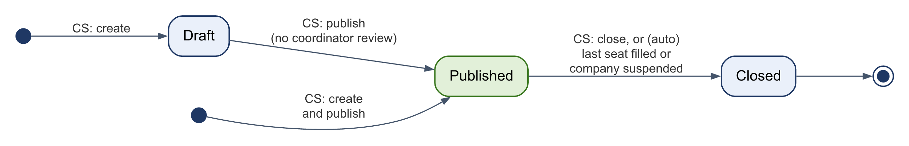

**Figure 6.1 – Vacancy states (FR-VAC-02)**

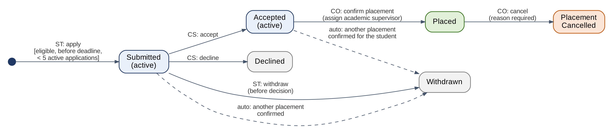

**Figure 6.2 – Application and placement states (FR-VAC-04 – 08)**

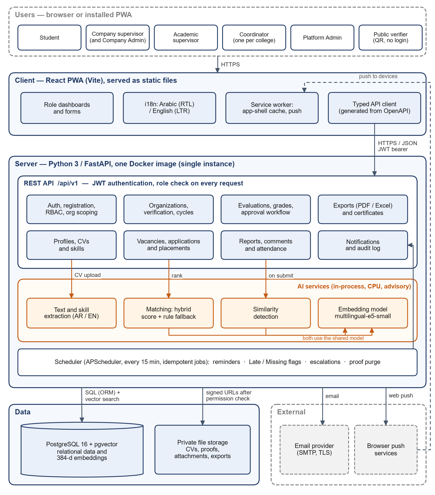

**Figure 6.3 – System architecture (component view)**

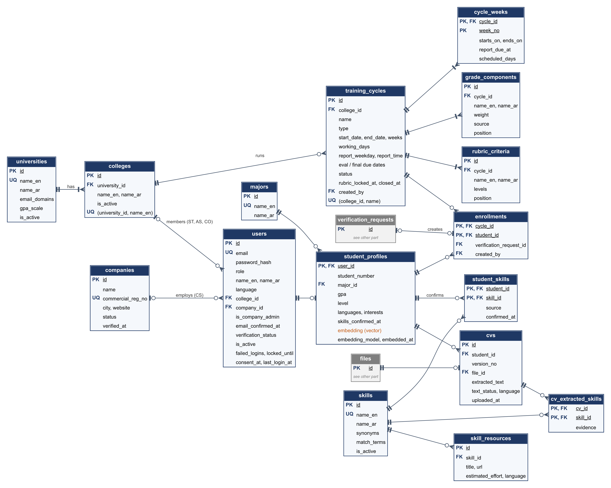

**Figure 6.4 – ERD: organizations, accounts, cycles, and student profiles**

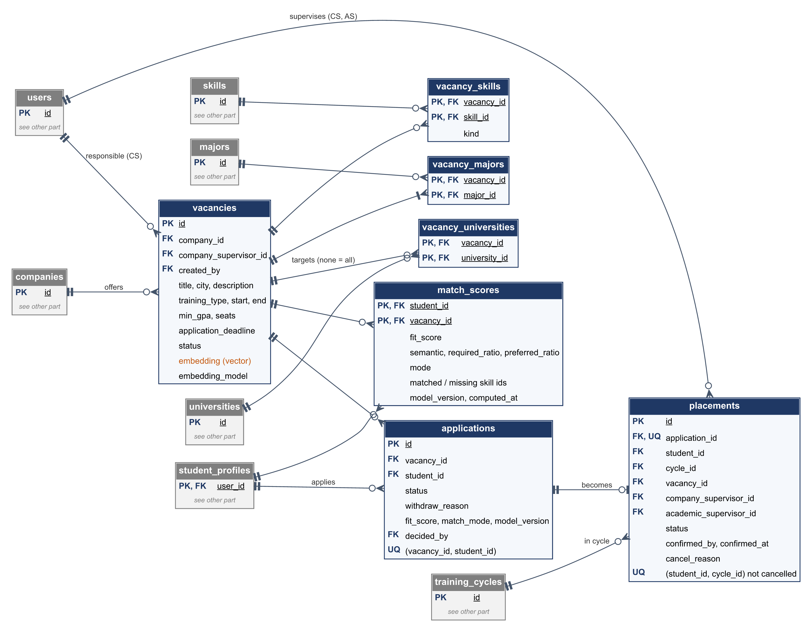

**Figure 6.5 – ERD: vacancies, matching, applications, and placements**

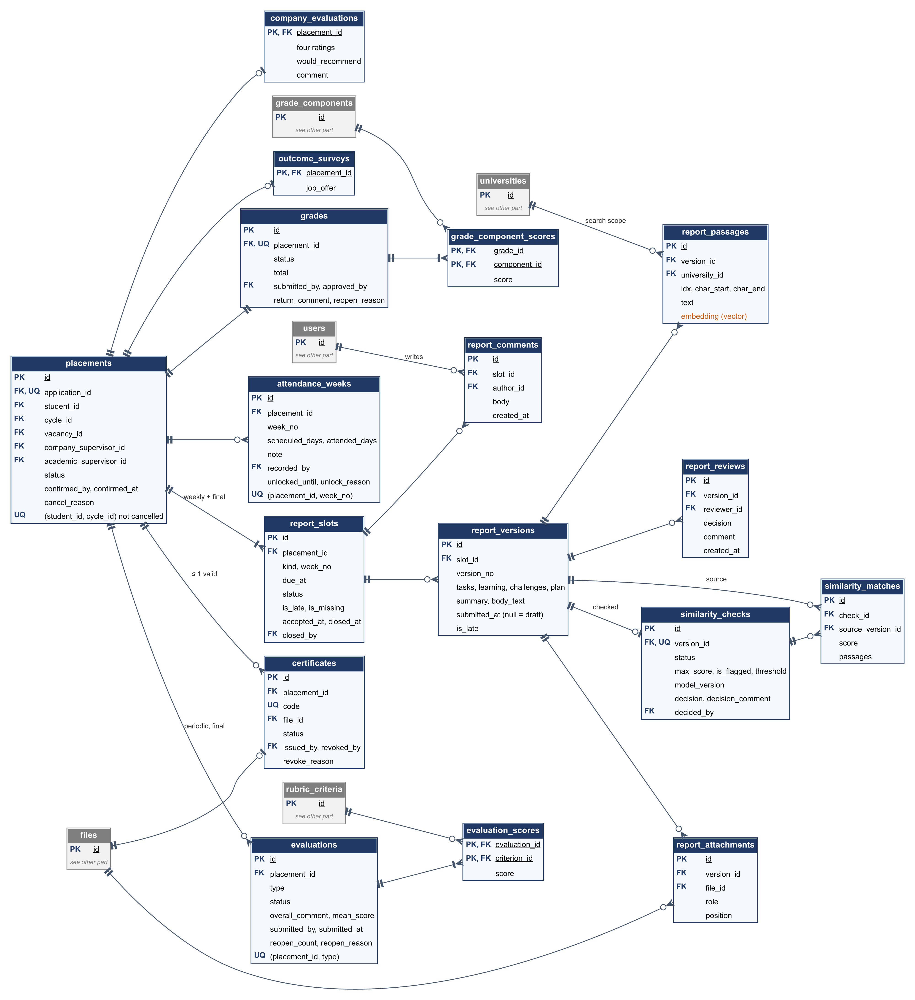

**Figure 6.6 – ERD: reports, similarity, attendance, evaluations, grades, and certificates**

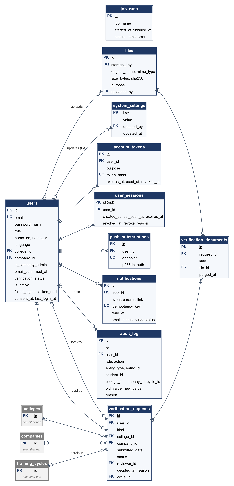

**Figure 6.7 – ERD: verification and platform services**

### 6.3 Requirement Prioritization

#### 6.3.1 Method

InternSync uses MoSCoW prioritization, carried over from the Proposal so that scope, schedule, and priorities stay consistent.

**Table 6.2 – Priority levels**

| **Priority** | **Meaning** |
|:--:|:---|
| Must | Committed baseline. The system is not acceptable without it. Delivered in Increments 1 and 2. |
| Should | Planned and important. Delivered in Increment 3; dropped only if the schedule slips after all Could items are dropped. |
| Could | Desirable. Built during the testing phase only if time allows. |
| Won’t (this release) | The out-of-scope items of Section 1.4. |

Priorities were assigned to functions with four criteria:

1.  **Contribution** to the problems P1–P6 and objectives O1–O10 of the Proposal.

2.  **Dependency:** functions that other functions rely on (accounts, cycles, reports, workflow) are Must.

3.  **Risk and effort:** AI-heavy or uncertain features that have a simpler working alternative are Should (for example, the explanation in F11 builds on the basic ranking in F4).

4.  **Visibility** to stakeholders and in the course demonstrations.

Each requirement inherits the priority of its function, except convenience requirements inside a Must function, which are marked Should (FR-CYC-05, FR-VAC-05, FR-VAC-08, FR-ATT-02, FR-EVL-04, FR-WFL-07, FR-AUD-03, FR-ORG-07, FR-ORG-09, FR-DSH-05).

#### 6.3.2 Priority Summary

**Table 6.3 – Number of requirements by priority**

| **Category**               | **Must** | **Should** | **Could** | **Total** |
|:---------------------------|:--------:|:----------:|:---------:|:---------:|
| Functional (Section 3.1)     |    57    |     27     |     6     |    90     |
| Non-functional (Section 5) |    25    |     9      |     1     |    35     |
| **Total**                  |    82    |     36     |     7     |    125    |

FR-PRF-01, deleted in v1.2, is not counted.

#### 6.3.3 Mapping to Increments

**Table 6.4 – Requirements by increment (SPMP schedule)**

| **Increment** | **Dates (2026)** | **Functions** | **Requirement groups** |
|:---|:---|:---|:---|
| Increment 1 | Oct 16 – Nov 1 | F1, F2, F3, F5, F10 | FR-AUT, FR-ORG, FR-CYC, FR-PRF-02 – 05, FR-VAC, FR-REP, FR-LOC, FR-AUD-01 – 02 |
| Increment 2 | Nov 2 – Nov 15 | F4, F6, F7, F8, F9 | FR-MAT-01 – 04 and 07, FR-ATT, FR-EVL-01 – 04, FR-WFL, FR-DSH-01 – 02 and 05 |
| Increment 3 | Nov 16 – Nov 25 | F11 – F15 | FR-MAT-05 – 06, FR-SIM, FR-NOT, FR-EXP, FR-PWA, FR-AUD-03 |
| Testing phase (if time allows) | Nov 26 – Dec 10 | F16 – F19 | FR-CER, FR-EVL-05, FR-DSH-03 – 04 |

Should requirements inside Must groups are built at the end of their increment. Must non-functional requirements are checked at every increment demo (in particular FR-AUT-05 and NFR-SEC); the remaining ones are verified in the testing phase.

#### 6.3.4 Descoping Order

If the schedule slips, items are removed in the order below, and each removal is recorded through change control. The order keeps longest the functions that remove the most manual work (deadline tracking and grade exports).

1.  Could functions: F19 (leniency alert), then F18 (outcome survey), then F17 (mutual evaluation), then F16 (certificates).

2.  F15 PWA features — the responsive web application still works on phones.

3.  FR-MAT-06 development plan — matched and missing skills (FR-MAT-05) are kept.

4.  F12 similarity detection.

5.  PDF format of FR-EXP-01 – 03 — the Excel grade sheet is kept.

6.  Email channel of F13 — in-app notifications and dashboard pending actions are kept.

Must requirements are never dropped. If a Must requirement is at risk, the Team Leader raises it with the course supervisor at the next milestone.

### 6.4 Requirement Validation and Verification

#### 6.4.1 Validation and Verification

**Validation** checks that the requirements describe what the stakeholders actually need (building the right system). **Verification** checks, during testing, that the system meets each requirement (building the system right). This section describes how this SRS is validated before the baseline and how each requirement will be verified.

#### 6.4.2 Validation Techniques

**Table 6.5 – Validation activities**

| **Technique** | **How it is applied** | **When** | **Owner** |
|:---|:---|:---|:---|
| Requirements review (inspection) | Every member reviews the SRS against the checklist of Table 6.6; defects are logged as GitHub issues and fixed before the baseline. | Before the baseline (M1) | Abdullah (lead), all members |
| Stakeholder walkthrough | The use cases of Table 3.1 are walked through with representatives: students, an academic who supervises co-op students, and, if available, a co-op unit staff member. A faculty member with industry experience acts as the company-supervisor proxy. | Design phase (T2–T3) | Salam, Abdullah |
| Prototyping | Clickable wireframes of the screens in Table 4.1 confirm the flows, especially the RTL layout, dashboards, and evaluation form. | T3 (Oct 4–15) | Rakan, Ali |
| Test-case derivation | At least one acceptance test is written for every Must and Should requirement before its increment starts; a requirement that cannot be turned into a test is rewritten. | Before each increment | Abdullah |
| Model validation | The state machines of Figures 3.1 and 3.2 are checked with scenario tables covering every transition, including returns and reopenings. | T2 | Khalid, Salam |
| AI evaluation sets | 20 CVs and profiles (10 Arabic, 10 English) are labelled by two members independently and disagreements are resolved together; 10 copied and 10 original reports are prepared for similarity. | T2 to Increment 2 | Ahmed, Salam |

#### 6.4.3 Requirement Quality Checklist

The assignment requires requirements to be clear, consistent, and testable. Each requirement in Sections 3.1 and 5 is checked against Table 6.6 during the review.

**Table 6.6 – Quality checklist**

| **Attribute** | **Check applied to every requirement** |
|:---|:---|
| Clear | States one behavior with “shall”; avoids vague words such as “fast”, “easy”, or “user-friendly” unless a number defines them. |
| Testable | Has an acceptance criterion with a measurable result or an observable outcome. |
| Consistent | Does not conflict with other requirements, the Proposal, or the SPMP; uses the terms defined in Table 6.1. |
| Complete | Every function F1–F19 and objective O1–O10 is covered (Section 6.5); every action in Table 2.3 is covered by a requirement. |
| Traceable | Has a unique ID and a source function or objective. |
| Feasible | Fits the constraints of Section 2.5 and the effort budget. |
| Prioritized | Has a Must, Should, or Could priority. |

#### 6.4.4 Verification Methods

Each requirement is verified mainly by one of four methods; Section 6.5 gives the method for each function.

- **Test (T):** automated or manual test with a pass/fail result.

- **Demonstration (D):** shown working at a milestone demonstration.

- **Inspection (I):** review of code, configuration, or documents.

- **Analysis (A):** measurement on a labelled dataset or in a load test.

The measurable targets from the Proposal are verified as follows: 0 failing permission tests (O1, FR-AUT-05); a relevant vacancy in the top 5 for at least 80% of profiles (O2, FR-MAT-01); late flags within 1 hour (O3, FR-REP-04); one rubric for all evaluations (O4, FR-EVL-02); at least 9 of 10 copied reports flagged (O5, FR-SIM-02); export in under 60 seconds (O6, NFR-PER-05); 100% bilingual screens (O7, NFR-L10N-01); at least 80% of UAT scenarios completed without help (O8, NFR-USA-01).

#### 6.4.5 Validation Risks and Open Issues

**Table 6.7 – Validation risks and open issues**

| **Issue** | **Effect** | **How it is handled** |
|:---|:---|:---|
| No direct access to real company supervisors | Company-side needs may be guessed | Faculty proxy in the walkthrough; company flows kept minimal (FR-ATT-01); checked again in UAT. |
| Grade components, weights, and rubric criteria not yet confirmed by the co-op unit | Wrong default values | Made configurable (FR-CYC-02, FR-CYC-03); the demo uses example values agreed with the course supervisor. |
| AI targets measured on small labelled sets (20 profiles, 20 reports) | Results are indicative, not statistically strong | Measurements reported with their dataset; AI stays advisory (NFR-AI-01). |
| Synthetic data may not reflect real CVs and reports | Matching and similarity may perform worse on real data | Mix Arabic, English, and mixed-language samples with realistic formatting. |
| Web push on iOS requires installing the app | Some users miss push notifications | Email fallback (FR-NOT-01). |
| Default values (limits, thresholds, reminder times) chosen by the team | May not match co-op unit practice | Configurable (NFR-MNT-03); confirmed in the stakeholder walkthrough. |
| Forged or wrong verification documents | A fake company, coordinator, or student gains access | Documents checked by the responsible person; rejection with a reason; deactivation of accounts and organizations (FR-AUT-06); every decision in the audit trail. |

#### 6.4.6 Baseline and Change Control

After the review of Section 6.4.2 and the course supervisor’s feedback, this SRS becomes baseline version 1.0 (Milestone M1). From then on:

- Each change request is recorded in the change log of the repository (`docs/Change_Requests.md`), and optionally as a GitHub issue labelled “change-request”, with the requested change, the affected requirement IDs, the effect on the schedule and on other requirements, and the decision.

- Changes are decided by team vote with the Team Leader’s approval and are accepted only if they fit the schedule (SPMP).

- Approved changes raise the SRS version (1.1, 1.2, …) and are listed in the revision history; requirement IDs are never reused.

### 6.5 Traceability Matrix

Table 6.8 traces each function of the Proposal to its requirements, objectives, problems, increment, and main verification methods. Table 6.9 traces each objective to the requirements that verify its measure of success.

**Table 6.8 – Functions to requirements**

| **F** | **Requirements** | **Objective** | **Problem** | **Priority** | **Increment** | **Verification** |
|:--:|:---|:--:|:--:|:--:|:--:|:--:|
| F1 | FR-AUT-01 – 06, FR-ORG-01 – 09 | O1 | All | Must | 1 | T |
| F2 | FR-PRF-02 – 05 | O2, O7 | P1 | Must | 1 | T, A |
| F3 | FR-VAC-01 – 08 | O1 | P1 | Must | 1 | T, D |
| F4 | FR-MAT-01 – 04, FR-MAT-07 | O2 | P1 | Must | 2 | A, T |
| F5 | FR-REP-01 – 07 | O3 | P2 | Must | 1 | T |
| F6 | FR-ATT-01 – 04 | O1 | P3 | Must | 2 | T |
| F7 | FR-EVL-01 – 04 | O4 | P3 | Must | 2 | T, I |
| F8 | FR-WFL-01 – 07 | O6 | P5 | Must | 2 | T |
| F9 | FR-DSH-01 – 02, FR-DSH-05 | O1 | P2, P5 | Must | 2 | T, D |
| F10 | FR-LOC-01 – 02 | O7 | — | Must | 1 | I, T |
| F11 | FR-MAT-05 – 06 | O2 | P1 | Should | 3 | T |
| F12 | FR-SIM-01 – 03 | O5 | P4 | Should | 3 | A |
| F13 | FR-NOT-01 – 06 | O3 | P2 | Should | 3 | T |
| F14 | FR-EXP-01 – 03 | O6 | P5 | Should | 3 | T, A |
| F15 | FR-PWA-01 – 03 | O1 | — | Should | 3 | D |
| F16 | FR-CER-01 – 03 | O9 | P6 | Could | Testing | T |
| F17 | FR-EVL-05 | — | P3 | Could | Testing | T |
| F18 | FR-DSH-03 | O10 | P6 | Could | Testing | T |
| F19 | FR-DSH-04 | O4 | P3 | Could | Testing | T |
| Supp. | FR-CYC-01 – 05 | O3, O4, O6 | P2, P3 | Must | 1 | T |
| Supp. | FR-AUD-01 – 03 | O6 | P2, P5 | Must | 1 | T, I |

**Table 6.9 – Objectives to requirements**

| **O** | **Measure of success (Proposal)** | **Verified by** |
|:--:|:---|:---|
| O1 | All Must functions implemented; 0 failing permission tests | Requirements of F1–F10; FR-AUT-05 |
| O2 | A relevant vacancy in the top 5 for at least 80% of 20 profiles; matched and missing skills listed | FR-MAT-01, FR-MAT-05, NFR-L10N-04 |
| O3 | All weekly deadlines tracked; reminders before the deadline; late flags within 1 hour | FR-REP-04, FR-NOT-02, FR-NOT-03 |
| O4 | All periodic and final evaluations use one rubric | FR-CYC-03, FR-EVL-01, FR-EVL-02 |
| O5 | At least 9 of 10 seeded copied reports flagged with passages shown | FR-SIM-02 |
| O6 | No grade final without every required approval; 100-student export in under 60 s | FR-WFL-03, FR-WFL-04, NFR-PER-05 |
| O7 | 100% of screens in both languages; Arabic and English CVs matched | FR-LOC-01, FR-LOC-02, NFR-L10N-01, NFR-L10N-04 |
| O8 | UAT with at least 8 participants; at least 80% of scenarios completed without help | NFR-USA-01 |
| O9 | Valid certificates confirmed; tampered or revoked ones rejected | FR-CER-02, FR-CER-03 |
| O10 | Placement-to-job-offer rate per cycle and per company | FR-DSH-03 |

### 6.6 Related Design Documents

- InternSync – Software Project Management Plan (SPMP), version 1.2: [`docs/Project_3_SPMP/InternSync_SPMP.md`](../Project_3_SPMP/InternSync_SPMP.md).

- InternSync – System Design Document, version 1.2 (architecture, data dictionary, behaviour, AI services, security, user interface): [`docs/Design/InternSync_Design.md`](../Design/InternSync_Design.md).

- InternSync – API Specification, version 1.1: [`docs/Design/InternSync_API_Spec.md`](../Design/InternSync_API_Spec.md).

- InternSync – Diagram pack, version 1.2, with editable sources: [`docs/InternSync_Diagrams`](../InternSync_Diagrams/README.md).

- InternSync – Wireframes (clickable prototype): [InternSync Wireframes](https://claude.ai/artifact/GUCAYYDPvkkBiwntVfJWJA).

- Change log: [`docs/Change_Requests.md`](../Change_Requests.md).
