# InternSync – Software Design Description (SDD)

Based on IEEE 1016 – adapted for student projects (CSC 305 SDD template)

**IMAM ABDULRAHMAN BIN FAISAL UNIVERSITY** · College of Computer Science & Information Technology
CSC 305 – Software Engineering \| Semester 1 – 2026/2027 \| Section 5MA1 \| Group 3

| **Item** | **Value** |
|:---|:---|
| Project title | InternSync – Cooperative Training Coordination and Tracking System |
| Team name | Group 3 (Section 5MA1) |
| Advisor | Dr. Sultan Al-Enezi |
| Version | 1.0 |
| Date | 01-11-2026 |

> This Markdown file is the maintained version of the SDD (Project 6). `InternSync_SDD_v1.0.docx` and `.pdf` in this folder are generated from it on the course SDD template ([build](build/README.md)). The design itself is maintained in the [System Design Document](../Design/InternSync_Design.md); this document presents it in the order of the course template.

### Team Information

| **Team Member** | **Student ID** | **Project Role** |
|:---|:--:|:---|
| Salam Alsaour (Team Leader) | 2250009168 | Team leader; backend and AI services developer |
| Khalid Alajmi | 2250004309 | Frontend and backend developer |
| Ali Alghafly | 2250002460 | Frontend developer |
| Ahmed Kanaan | 2250009170 | AI services developer; deployment lead |
| Abdullah Abalhareth | 2250005266 | QA and documentation lead |
| Rakan Alzahrani | 2250000631 | UI/UX designer |

### Revision History

| **Version** | **Date** | **Description** | **Author** |
|:--:|:--:|:---|:--:|
| 1.0 | Nov 1, 2026 | First version for Project 6 (SDD) on the course template (IEEE 1016 adapted), from System Design Document 1.7, API Specification 1.5, and the diagram pack; adds a class diagram of the report review module. | Group 3 |

## Table of Contents

- [1. Introduction](#1-introduction)
- [2. System Overview](#2-system-overview)
- [3. Design Considerations](#3-design-considerations)
- [4. Architectural Design](#4-architectural-design)
- [5. Detailed Design](#5-detailed-design)
- [6. Data Design](#6-data-design)
- [7. External Interfaces](#7-external-interfaces)
- [8. Appendices](#8-appendices)

## 1. Introduction

### 1.1 Purpose

This Software Design Description (SDD) describes how InternSync is built: its components and how they interact, where they run, how data is stored, how the workflows behave, and how the security and privacy requirements are met. It turns the requirements of the SRS into decisions a developer can implement and a tester can check. It follows IEEE Std 1016 as adapted in the CSC 305 template.

### 1.2 Scope

InternSync is one web platform for cooperative and summer training. Universities and their colleges, training companies, and students take part. Students register and are verified, build a profile from their CV, apply to vacancies, and submit weekly and final reports; companies publish vacancies, review applicants, record attendance, and evaluate trainees; academic supervisors review reports and enter grades; one coordinator per college runs the training cycles and confirms placements; a Platform Admin approves coordinators and companies. AI services rank vacancies for a student, explain the match, and flag similar reports, always as advice. The interface is in Arabic (right to left) and English.

This document covers the whole system as built in Increments 1 to 5: the React web app (an installable PWA), the FastAPI backend with its in-process AI services and scheduler, the PostgreSQL database, the file storage, and the zero-cost reference deployment.

### 1.3 Intended Audience

| **Reader** | **What to read** |
|:---|:---|
| Developers | Sections 4 to 7: components, modules, state machines, algorithms, data, and interfaces |
| Testers | Sections 5.3 (state machines and their guards), 5.6 (algorithms and thresholds), and 7.2 (API and error format); the STS uses them for its test cases |
| Instructor | Sections 2 and 3 for the design strategy and trade-offs, then the figures of Sections 4 and 5 |
| Maintainers and the deployment lead | Sections 4.5 (deployment) and 7.3 (external services) |

### 1.4 References

| **Document** | **Content** |
|:---|:---|
| [SRS 1.6](../Project_4_SRS/InternSync_SRS.md) | The requirements this design implements; FR-… and NFR-… IDs refer to it |
| [SPMP 1.7](../Project_3_SPMP/InternSync_SPMP.md) | Process, schedule, roles, and risks |
| [System Design Document 1.7](../Design/InternSync_Design.md) | The maintained design, including the full data dictionary of all 49 tables |
| [API Specification 1.5](../Design/InternSync_API_Spec.md) | Every endpoint, its roles, payloads, and error codes |
| [Diagram pack 1.2](../InternSync_Diagrams/README.md) | The figures used in this document, with their sources |
| [Interactive code diagrams](../diagrams.html) | Architecture, workflow, sequence, data flow, lifecycle, and database diagrams traced from the code, in English and Arabic |
| [Change requests](../Change_Requests.md) | CR-01 to CR-11, the decisions that changed the design |
| IEEE Std 1016-1998 | IEEE Recommended Practice for Software Design Descriptions |

## 2. System Overview

### 2.1 System Description

InternSync replaces the spreadsheets, emails, and paper forms that colleges and companies use to run cooperative training. One platform serves many organizations: a university has colleges, each college has one coordinator, its academic supervisors, and its students; a company has a Company Admin and optional further company supervisors. Every academic record is visible only inside its college, and every company record only inside its company.

The main flow is: a student registers and is verified by the college's coordinator, uploads a CV from which skills are extracted, sees vacancies ranked by fit, and applies; the company accepts the applicant; the coordinator confirms the placement, which creates the weekly report slots, the final report slot, and the grade; during the training the student submits reports, the company records attendance and evaluations, and the academic supervisor reviews reports; at the end the supervisor submits the grade, the coordinator approves it, and a certificate with a QR code can be issued.

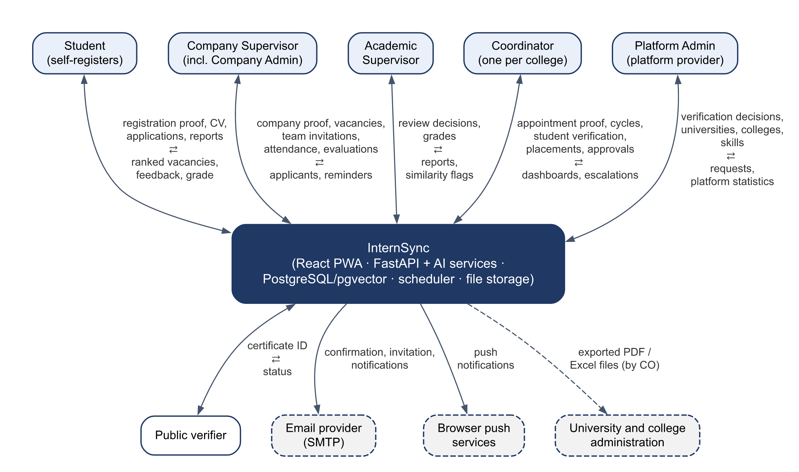

**Figure 2.1 – Context diagram: the five roles, the public verifier, and the external services**

### 2.2 Design Strategy and Architectural Style

- **Client–server with a layered backend.** The client is a static React PWA. The server is one FastAPI application organized in layers: routers (HTTP and validation), services (business rules and state transitions), and models (SQLAlchemy tables). Cross-cutting concerns (authentication, scope, audit, errors, language) sit in a shared `core` package.
- **Modular monolith.** One deployable backend holds the REST API, the AI services, and the scheduler. The modules are separated by package and by table ownership, not by network calls, so there is no message broker and no separate worker to run or pay for.
- **Contract first.** The API was specified before the code; FastAPI generates the OpenAPI document from the code, and the frontend's TypeScript client is generated from it. CI fails if either copy is out of date.
- **Explicit state machines.** Vacancies, applications, report slots, evaluations, grades, and certificates change state only through named transitions, each checked, audited, and tested.
- **AI as advice.** AI results are stored with their reason and model version and shown in an "Advisory" panel; no AI output changes a status.

### 2.3 Users and Roles

| **Role** | **Main tasks** |
|:---|:---|
| Student (ST) | Registers, completes the profile and CV, applies, submits weekly and final reports, evaluates the company |
| Company supervisor (CS) and Company Admin (CA) | Publish vacancies, review applicants, record attendance, submit evaluations; the Company Admin also manages the company's team |
| Academic supervisor (AS) | Reviews reports, decides on similarity flags, enters and submits grades |
| Coordinator (CO), one per college | Verifies students, runs training cycles, confirms placements, approves grades, issues certificates, exports |
| Platform Admin (PA) | Approves coordinators and companies, manages universities, colleges, the skill vocabulary, and settings |
| Public verifier | Checks a certificate from its QR code, without signing in |

## 3. Design Considerations

### 3.1 Assumptions and Dependencies

- Users have a current browser (Chrome, Edge, Safari, or Firefox) on a computer or phone; the app is installable as a PWA.
- Each college has one coordinator who verifies its students; companies are verified by the Platform Admin from their commercial registration.
- The demonstration uses synthetic data: 2 universities, 4 colleges, and about 400 students (SRS C-09).
- The reference deployment depends on free tiers (Vercel, Hugging Face Spaces, Supabase, Gmail SMTP). If one is unavailable, the same containers run with Docker Compose on a laptop.
- The embedding model `intfloat/multilingual-e5-small` is bundled in the API image, so the running system does not depend on the model hub.

### 3.2 Constraints

| **Constraint** | **Effect on the design** |
|:---|:---|
| Python with FastAPI, React, and PostgreSQL (SRS C-03) | Backend, frontend, and database choices in Section 3.4 |
| Zero cost (C-04, CR-01) | Free tiers only; one container holds API, AI, and scheduler; `halfvec` vectors to fit the 500 MB database |
| CPU-only hosting (C-10) | A small embedding model (384 dimensions) that runs on CPU in under a second per text |
| Privacy (NFR-PRV-02, NFR-PRV-03) | AI runs inside the API, so no text leaves it; push messages carry only a title and a link |
| Arabic and English (FR-LOC-01, NFR-L10N-01 – 04) | Every text is a translation key; logical CSS properties for right-to-left; PDF exports with Arabic shaping |
| Course schedule | Plan-driven, incremental delivery: Must functions first, then Should, then Could |

### 3.3 Design Goals

| **Goal** | **What it means in the design** | **Requirements** |
|:---|:---|:---|
| One deployable backend | A single FastAPI container holds the REST API, the AI services, and the scheduler | C-03, C-10 |
| Server-side authorization | Every endpoint declares its roles and record scope; queries are filtered by scope on the server, never by the client | FR-AUT-05 |
| Organization isolation | Academic records are filtered by the caller's college, company records by the caller's company; the Platform Admin has no endpoint that returns academic records | FR-AUT-05, NFR-PRV-03 |
| Correct workflows | State machines with guards; every change, its audit entry, and its notifications saved in one transaction | FR-WFL-01, FR-AUD-01, NFR-REL-04 |
| AI is advisory and explainable | Matched and missing skills shown with every score; model version stored; rule-based fallback | NFR-AI-01 – 03, FR-MAT-04 – 07 |
| Configurable defaults | Every "default" value of the SRS is a row in `system_settings` or a cycle field | NFR-MNT-03 |
| Bilingual by construction | Dates stored in UTC and shown in Asia/Riyadh time; errors in the user's language | FR-LOC-02, NFR-L10N-02 |
| Testable | Each acceptance test has a named automated test; a permission matrix covers every endpoint for every role | NFR-MNT-01 |

### 3.4 Technology Choices

| **Layer** | **Choice** | **Reason** |
|:---|:---|:---|
| Backend | Python, FastAPI, Pydantic v2 | Required by C-03; generates the OpenAPI document (NFR-MNT-02) |
| Database access | SQLAlchemy 2.0, psycopg 3, Alembic migrations | Mature and simple; synchronous endpoints in a thread pool are enough for the load (NFR-PER-01) |
| Database | PostgreSQL 16+ with `pgvector` (`halfvec`) and `pg_trgm` | Relational data and embeddings in one place; `halfvec` halves vector storage |
| Passwords and tokens | Argon2id; JWT (HS256) with a server-side session row | NFR-SEC-02; idle timeout and logout revocation (FR-AUT-03) |
| AI | `multilingual-e5-small` with `sentence-transformers` on CPU; `pypdf` and `python-docx` for text | Arabic and English (NFR-L10N-04); small enough for CPU hosting |
| Scheduler | APScheduler inside the API process, PostgreSQL advisory locks | NFR-REL-03 without a separate worker |
| Exports | fpdf2 with HarfBuzz shaping and Noto fonts; `openpyxl`; `qrcode` | Correct Arabic joining in PDFs (CR-09); Excel grade sheets; certificate QR codes |
| Email and push | `smtplib` over TLS; `pywebpush` with VAPID keys | FR-NOT-01, FR-PWA-02 |
| Frontend | React 18, Vite, TypeScript, React Router, TanStack Query, react-i18next, Tailwind CSS | C-03; logical properties for right-to-left |
| Tests | pytest, httpx, Vitest, Playwright, Locust, OWASP ZAP | NFR-MNT-01, NFR-PER-01, NFR-SEC-05 |

### 3.5 Trade-offs

| **Decision** | **Alternative considered** | **Why this choice** |
|:---|:---|:---|
| Modular monolith in one container | Microservices, or a separate AI service and worker | One free container fits the API, the model, and the scheduler; no network calls between modules; simpler to test and deploy. Cost: the API and AI scale together, which is enough for about 400 students |
| Scheduler in the API process with advisory locks | A message broker and worker (Celery, Redis) | No extra service to host. Jobs select work by state, so a run missed during downtime catches up on the next one |
| Notification outbox table | Sending email inside the request | A notification exists exactly when its change was saved; delivery retries without slowing the request |
| Rule-based skill extraction with the student's confirmation | A trained extraction model | Fast, explainable, and the student confirms; recall measured on labelled CVs |
| Hybrid matching (semantic score plus required and preferred skills) | Embeddings only | Embeddings alone cannot say which skills are missing; the hybrid score explains itself and has a rule-based fallback |
| Similarity on sentence-sized passages with a lexical check | Whole-report comparison | Finds a copied paragraph inside an original report; the lexical check stops same-topic text from being flagged |
| Files streamed by the API after the permission check (CR-08) | Signed links to the bucket | No bucket link reaches a browser, so access always follows the record's permission rule |
| Hugging Face Spaces for the API (CR-01) | Railway or a VM | Free 2 vCPU and 16 GB RAM for a Docker container; Railway's free plan has 0.5 GB RAM, too little for the model |
| Status values as `text` with `CHECK` constraints | PostgreSQL enums | Easier to migrate when a state is added |

## 4. Architectural Design

### 4.1 Overall Architecture

The React PWA is a static build. It calls the REST API under `/api/v1` with a JWT bearer token. The API container holds the REST API modules, the AI services (text and skill extraction, matching, similarity detection, and one shared embedding model loaded once), and the scheduler. PostgreSQL stores all records and embeddings; a private object store keeps CVs, attachments, exports, and certificates. Email goes out through SMTP and push messages through the browser vendors' push services.

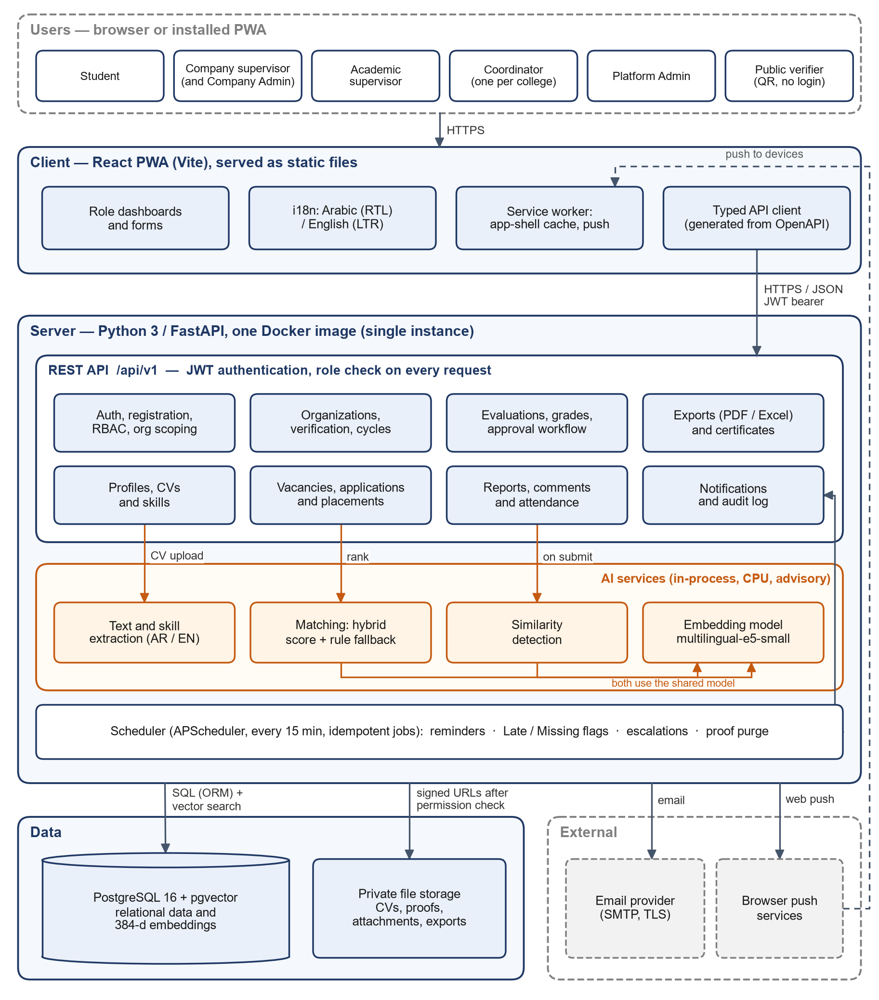

**Figure 4.1 – Component diagram (diagram pack Figure 5). Since CR-08 the API streams files after the permission check instead of issuing signed links**

Figure 4.2 shows the same system traced from the code for its main request, the submission of a weekly report, with the trust boundaries: the browser is not trusted, every request passes the authentication and scope gate, and only the API process holds the database and storage credentials.

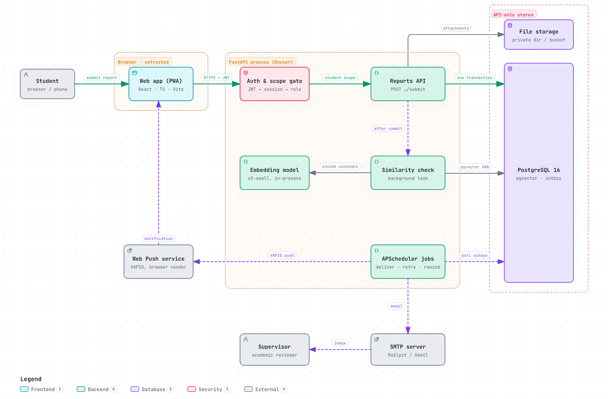

**Figure 4.2 – Runtime components, the report submission path, and the trust boundaries**

### 4.2 Components and Their Interactions

| **Component** | **Responsibility** | **Interacts with** |
|:---|:---|:---|
| Web app (React PWA) | Role dashboards and forms in Arabic and English; offline copy of opened pages and drafts; push notifications | REST API over HTTPS with a bearer token; service worker for the app shell |
| Auth and scope gate (`core/deps.py`, `core/scope.py`) | Checks the token, the session row and its idle limit, consent, verification, role, and record scope on every request | All routers; `users`, `user_sessions` |
| REST API modules (`backend/app/<module>`) | Business rules and state transitions per area (Section 5.1) | PostgreSQL, file storage, AI services, notification outbox |
| AI services (`app/ai`, `matching`, `similarity`) | Skill extraction, fit score and explanation, development plan, similarity detection | Embedding model in memory; `pgvector` search in PostgreSQL |
| Scheduler (`app/jobs`) | Reminders, missing flags, escalations, notification delivery, similarity retries, purges, clean-up | PostgreSQL (with advisory locks), SMTP, Web Push |
| PostgreSQL with pgvector | All records, embeddings, audit log, notification outbox | API and scheduler only |
| File storage (local volume or Supabase Storage) | CVs, report files, verification documents, exports, certificates | API only, under random keys |
| SMTP server and Web Push services | Deliver email in the user's language and push notifications | Called by the deliver job |

### 4.3 Request Pipeline

1. **Transport:** HTTPS is terminated by the hosting provider; CORS allows only the configured web app origin.
2. **Authentication:** the JWT signature and expiry are checked, the session is loaded by its ID, and a session idle for more than 30 minutes is ended.
3. **Consent gate:** until the user accepts the privacy notice, only `/me`, consent, and logout answer; everything else returns `403 CONSENT_REQUIRED`.
4. **Verification gate:** an account whose verification is pending or rejected reaches only its own pages; other endpoints return `403 VERIFICATION_REQUIRED`.
5. **Authorization:** the route declares its roles; the service loads the record through a query that always includes the caller's college or company. A record outside the scope returns `403 FORBIDDEN`.
6. **Business rule and transition:** the service checks the state machine and the limits, then writes the change.
7. **Audit and notifications:** the audit entry and any notifications are inserted in the same transaction as the change, so either all are saved or none.
8. **Response:** JSON, or `application/problem+json` with a stable code and a message in the user's language.

### 4.4 Synchronous and Background Work

| **Work** | **How it runs** | **Limit** |
|:---|:---|:---|
| CV text and skill extraction | In the upload request | ≤ 30 s (NFR-PER-03) |
| Profile and vacancy embedding | When skills are confirmed or a vacancy is published | < 1 s |
| Ranking of vacancies | One SQL query for eligible vacancies and their vectors, scoring in Python | ≤ 5 s for 300 vacancies (NFR-PER-02) |
| Similarity check | Created as `pending` with the submission, run in a background task after the response; a retry job picks up any check left pending | ≤ 2 min (NFR-PER-04) |
| Email and push | Written to the outbox in the business transaction; sent by the deliver job | Every minute |
| Exports | Built in the request and streamed as a file | ≤ 60 s for 100 students (NFR-PER-05) |

### 4.5 Deployment

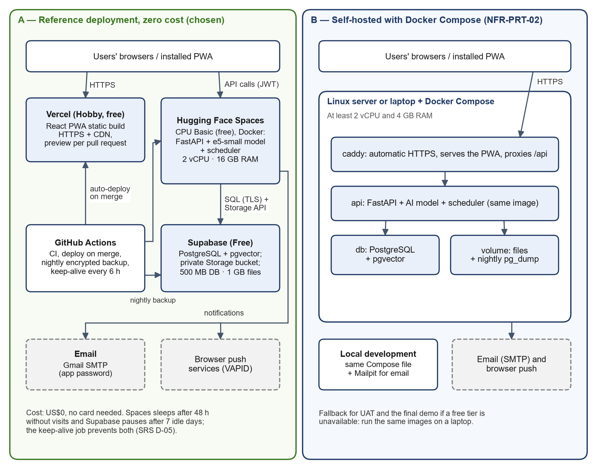

**Figure 4.3 – Deployment diagram of the zero-cost reference deployment**

| **Node** | **Service and plan** | **Runs** |
|:---|:---|:---|
| Web app | Vercel Hobby | The static build of `frontend/` behind HTTPS and a CDN; the domain `internsync.tech` points at it |
| API container | Hugging Face Spaces, Docker, CPU Basic (2 vCPU, 16 GB RAM) | FastAPI, the embedding model baked into the image, and the scheduler; port 7860; no state on disk |
| Database | Supabase Free | PostgreSQL with `vector` and `pg_trgm`; the Data API is off and row level security is on as a second guard |
| File storage | Supabase Storage, one private bucket | Reached only by the API with the service key |
| Email | Gmail SMTP with an app password | About 500 emails a day |
| Operations | GitHub Actions | CI on every pull request, API deployment on merge, keep-alive every 6 hours, nightly encrypted backups |

Locally and for the demonstrations, `docker compose up` runs the database, the API, the web app, and Mailpit (which catches every email). The same image runs in both places.

## 5. Detailed Design

### 5.1 Modules

Each backend module is a Python package under `backend/app/` with a router (endpoints), schemas (Pydantic models), a service (rules and transitions), and models (tables).

| **Module Name** | **Responsibilities** | **Inputs/Outputs** | **Notes / Diagrams** |
|:---|:---|:---|:---|
| `core` | Settings, database session, errors, language, audit helper, auth and scope dependencies, clock (UTC and Asia/Riyadh) | Input: every request. Output: `Actor` (user and session) or `401`/`403` | Section 4.3; NFR-MNT-03, FR-AUD |
| `auth` | Registration, email confirmation, invitations, login and logout, sessions, password reset, lockout, consent | Input: email and password, one-time link tokens. Output: access token, session, emails | FR-AUT-02 – 04, NFR-SEC-02/03; Section 5.8 |
| `orgs` | Universities, colleges, companies, verification requests and documents, role transfer, deactivation | Input: registration forms and documents. Output: verified accounts and organizations, notifications | FR-ORG-01 – 09, FR-AUT-06 |
| `cycles` | Training cycles, weeks and deadlines, grade components, rubric, enrolments; skill vocabulary and majors | Input: cycle settings. Output: weekly deadlines, enrolments | FR-CYC-01 – 05; Section 5.6.5 |
| `profiles` | Student profile, CV upload, skill extraction and confirmation | Input: PDF or DOCX CV. Output: candidate skills with evidence, confirmed skills, profile embedding | FR-PRF-02 – 05; Figure 5.6 |
| `vacancies` | Vacancies, applications, placements | Input: vacancy forms, applications, decisions. Output: placements, report slots, grade rows | FR-VAC-01 – 08; Figures 5.4, 5.5 |
| `matching` | Eligibility, fit score, explanation, development plan | Input: student profile and vacancies. Output: ranked vacancies with matched and missing skills | FR-MAT-01 – 07; Section 5.6.2 |
| `reports` | Report slots, versions, attachments, reviews, comments | Input: drafts, files, submit, accept, revision. Output: slot states, audit entries, notifications | FR-REP-01 – 07, FR-WFL-01; Figures 5.1, 5.2 |
| `similarity` | Passages, similarity checks, supervisor decisions | Input: submitted version. Output: score, flag, passage pairs | FR-SIM-01 – 03; Section 5.6.3 |
| `attendance` | Weekly attendance and unlocks | Input: attended days per week. Output: attendance rate | FR-ATT-01 – 04 |
| `evaluations` | Periodic and final evaluations, evaluation of the company, outcome survey | Input: rubric scores and comments. Output: company evaluation component of the grade | FR-EVL-01 – 05 |
| `grades` | Grade entry, computation, approval workflow | Input: component scores. Output: total, Final grade, completed placement | FR-WFL-02 – 07; Figure 5.3 |
| `dashboards` | Pending actions, cycle and platform statistics, leniency alerts | Input: role and scope. Output: live counts | FR-DSH-01 – 05 |
| `exports`, `certificates` | Grade sheet, term summary, training record; certificates with a QR code and public verification | Input: cycle or placement. Output: PDF and Excel files; certificate status | FR-EXP-01 – 03, FR-CER-01 – 03 |
| `notifications`, `jobs` | Notification outbox, in-app list, email and push delivery; scheduled jobs | Input: events from the services. Output: emails, push messages, job runs | FR-NOT-01 – 06, NFR-REL-03; Section 5.7 |
| `files` | Upload checks, storage adapter, permission-checked download | Input: uploaded bytes. Output: stored file under a random key; streamed download | NFR-SEC-04 |

### 5.2 Class Design: Report Review

Figure 5.1 shows the classes of the report review module. The model classes are SQLAlchemy tables; `reports.service` and `similarity.service` are Python modules of functions, drawn as utility classes. A report slot owns its versions and comments; a version owns its attachments and reviews; a similarity check refers to one submitted version.

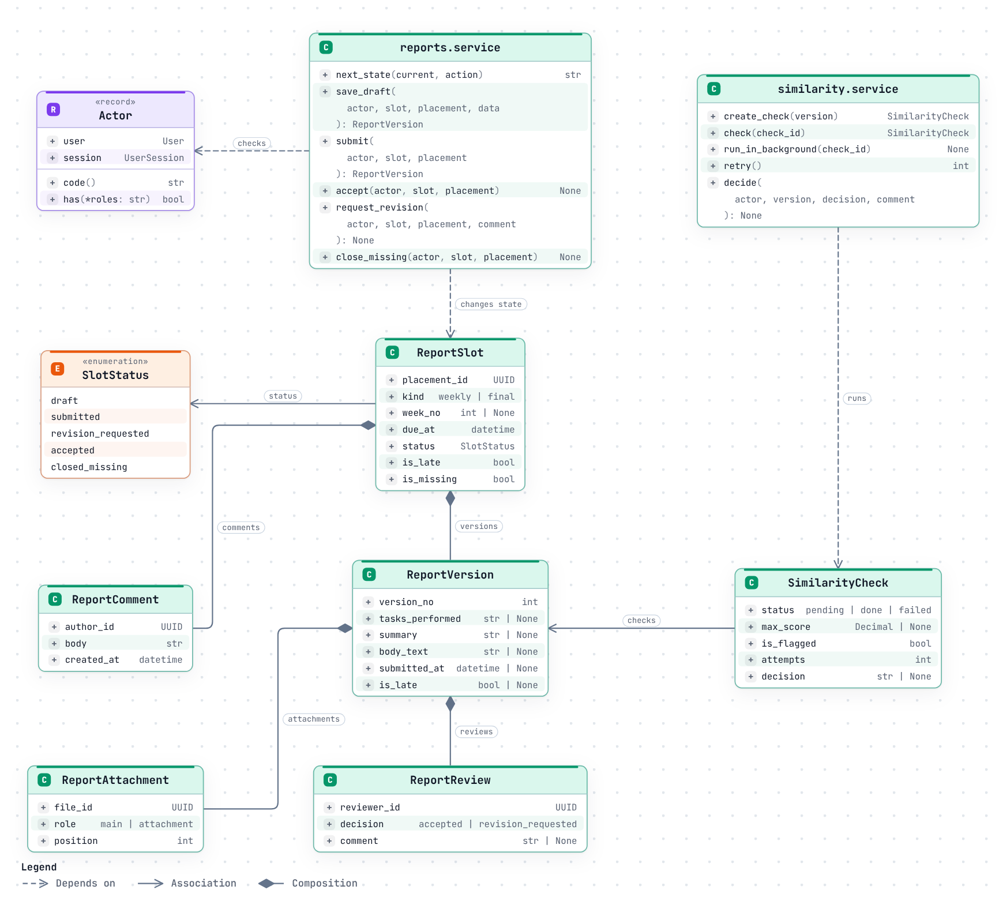

**Figure 5.1 – Class diagram of the report review module, from `backend/app/models` and the two services**

| **Function** | **Input** | **Output and rule** |
|:---|:---|:---|
| `next_state(current, action)` | Current slot status and an action | The new status from Table 5.1, or `409 INVALID_TRANSITION` (`SLOT_CLOSED` for a closed slot) |
| `save_draft(actor, slot, placement, data)` | The student's text fields | Creates or updates the single draft version; the slot status does not change |
| `submit(actor, slot, placement)` | The draft | Checks the four text fields (weekly) or the main document (final) and the attachment limit, sets `submitted_at` and lateness, moves the slot to `submitted`, writes the audit entry and the `report.submitted` notification |
| `accept(…)`, `request_revision(…, comment)` | The assigned academic supervisor's decision | A review row on the last version, the new status, an audit entry, and a notification to the student; a revision needs a comment |
| `close_missing(actor, slot, placement)` | A draft past its deadline with no submitted version | `closed_missing` and the missing flag |
| `create_check(version)`, `check(check_id)` | A submitted version | A pending check in the same transaction; after the response, the score, the flag, and the passage pairs (Section 5.6.3) |

### 5.3 State Machines

Every transition is one service function. It checks the actor's role and scope and the current state, writes the new state, adds one audit entry, and creates the listed notifications, all in one transaction. A transition that is not listed returns `409 INVALID_TRANSITION`.

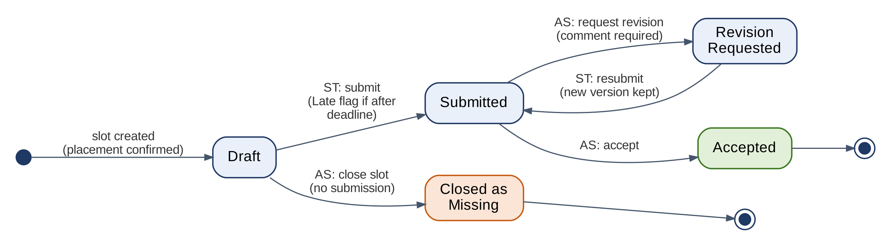

**Figure 5.2 – Report slot states**

**Table 5.1 – Report slot transitions (FR-REP-01 – 07, FR-WFL-01)**

| **From** | **Action** | **Actor** | **Guard** | **To** | **Notifications** |
|:---|:---|:---|:---|:---|:---|
| `draft` | submit | ST | Required fields; attachment limits; slot not closed | `submitted` | AS: report to review |
| `submitted` | accept | AS (assigned) | – | `accepted` | ST: report accepted |
| `submitted` | request revision | AS (assigned) | Comment required | `revision_requested` | ST: revision requested |
| `revision_requested` | resubmit | ST | As for submit | `submitted` | AS: report to review |
| `draft` | close as missing | AS (assigned) | No submitted version; deadline passed | `closed_missing` | ST |

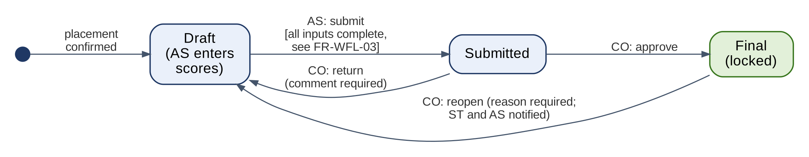

**Figure 5.3 – Grade states**

**Table 5.2 – Grade transitions (FR-WFL-03 – 07)**

| **From** | **Action** | **Actor** | **Guard** | **To** |
|:---|:---|:---|:---|:---|
| `draft` | submit | AS (assigned) | Final evaluation submitted; final report accepted; every weekly slot accepted or closed missing; every component entered. Otherwise `409 PRECONDITIONS_UNMET` with the missing items | `submitted` |
| `submitted` | approve (single or bulk) | CO | – | `final`; the placement becomes `completed` |
| `submitted` | return | CO | Comment required | `draft` |
| `final` | reopen | CO | Reason required | `draft`; the placement is active again |

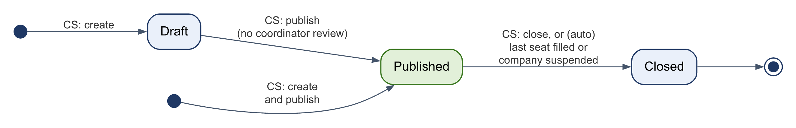

**Figure 5.4 – Vacancy states: draft, published, closed (by the company, the last seat, or a company suspension)**

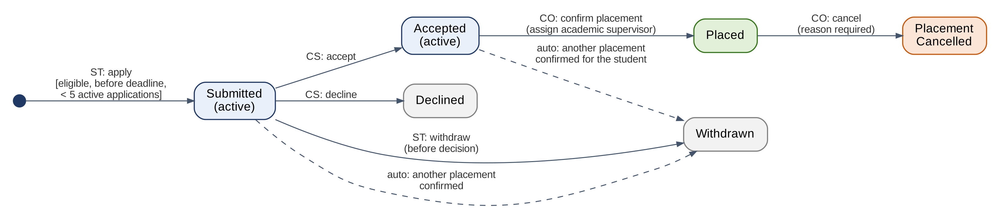

**Figure 5.5 – Application states: submitted, accepted or declined, placed, withdrawn, placement cancelled**

Other records follow the same pattern: an evaluation goes from `draft` to `submitted` and can be reopened once by the coordinator; a certificate is `valid` until revoked with a reason; a training cycle is `open` or `closed`, and while closed every write to its records returns `409 CYCLE_CLOSED`; a verification request is approved or rejected with a reason.

### 5.4 Key Interactions

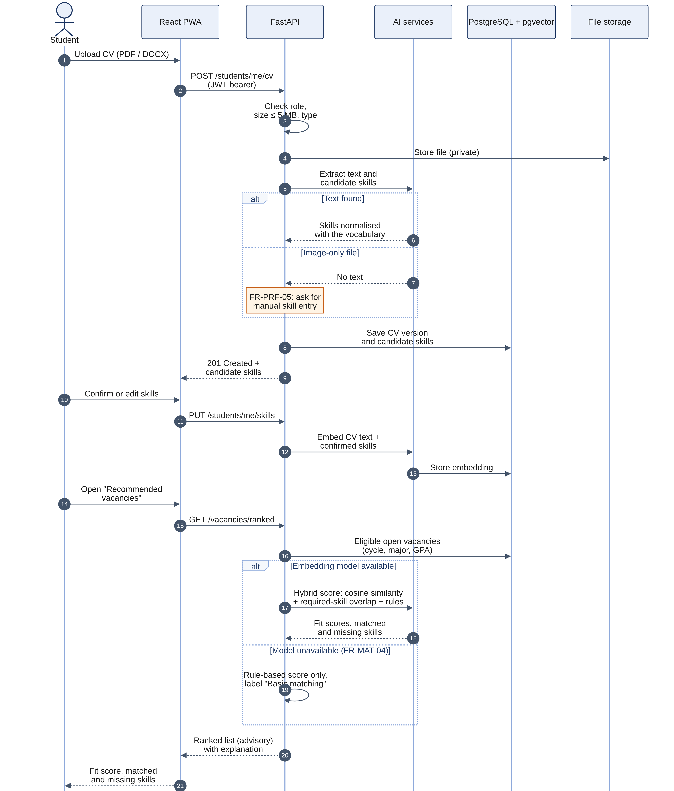

**Figure 5.6 – Sequence: CV upload, skill extraction, and ranked vacancies**

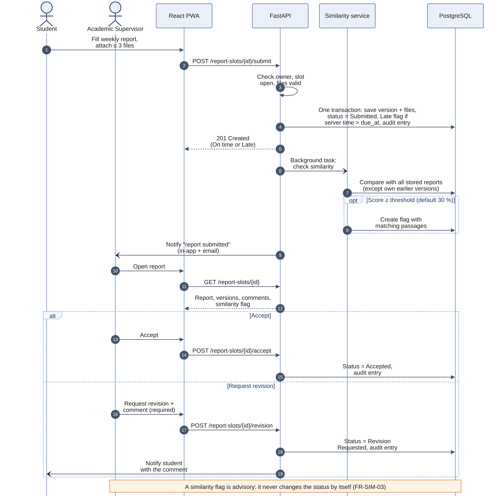

**Figure 5.7 – Sequence: weekly report submission, similarity check, and review**

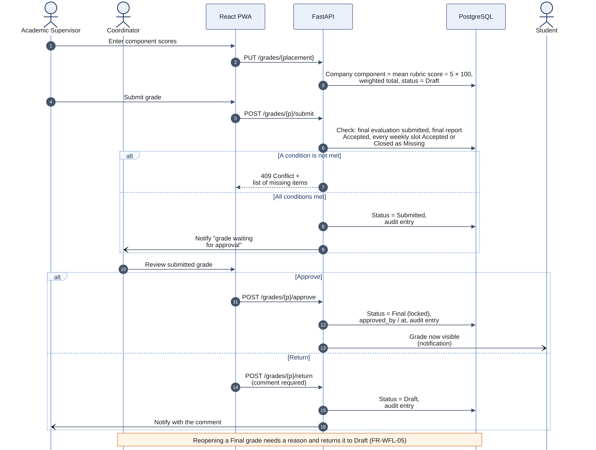

**Figure 5.8 – Sequence: grade submission and approval**

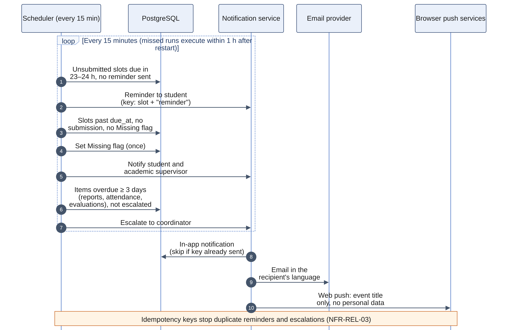

**Figure 5.9 – Sequence: the scheduler's reminders, missing flags, and escalations**

### 5.5 Activities

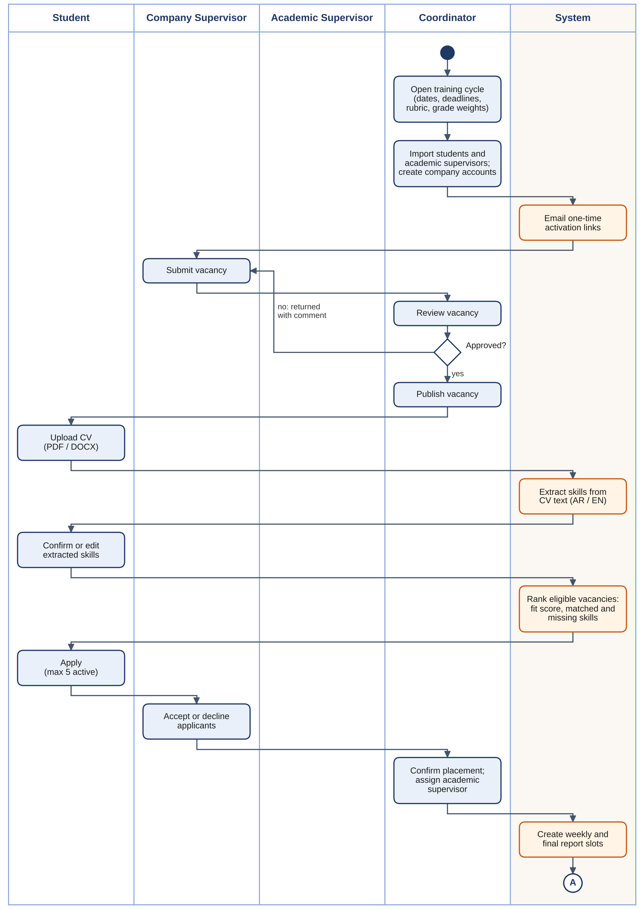

**Figure 5.10 – Activity: from registration and verification to a confirmed placement**

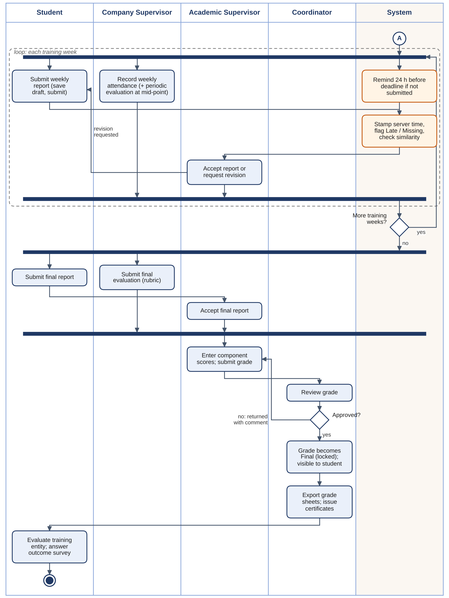

**Figure 5.11 – Activity: from the first weekly report to the Final grade and the certificate**

### 5.6 Algorithms

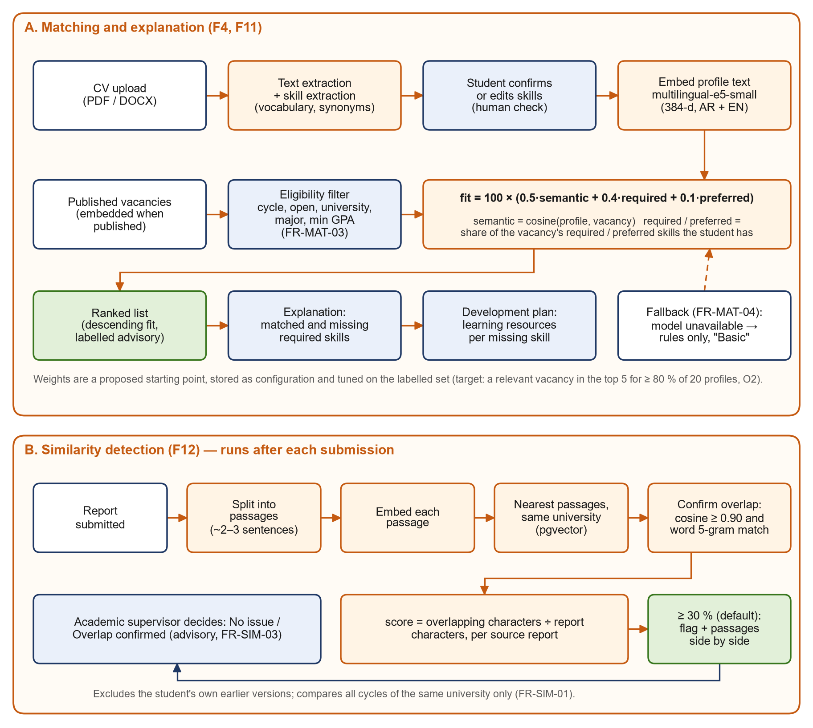

**Figure 5.12 – AI pipelines: skill extraction, matching, and similarity detection**

#### 5.6.1 Skill Extraction (FR-PRF-04)

1. Extract the text with `pypdf` (PDF) or `python-docx` (DOCX). With fewer than 50 letters, the CV is marked "no text" and the student adds skills by hand (FR-PRF-05).
2. Normalize: lowercase Latin letters; for Arabic, remove diacritics and tatweel, unify أ/إ/آ to ا, ى to ي, and ة to ه.
3. Scan the normalized words with a dictionary of every skill's names and synonyms as phrases of one to four words; at each position the longest phrase wins.
4. Store the matches with an evidence snippet; only the skills the student confirms become profile skills.

#### 5.6.2 Matching (FR-MAT-01 – 07)

1. **Eligibility:** the vacancy is published, before its deadline, open to the student's university, for the student's major, with GPA ≥ the minimum, and of the same training type as the student's cycle. Ineligible vacancies show their reason.
2. **Semantic part:** cosine similarity of the profile and vacancy embeddings, spread over 0–1: `semantic = clamp((cos − 0.70) ÷ (0.95 − 0.70), 0, 1)`.
3. **Skill parts:** `required = |S ∩ R| ÷ |R|` and `preferred = |S ∩ P| ÷ |P|`, where S are the student's confirmed skills.
4. **Fit score:** `fit = 100 × (0.5·semantic + 0.4·required + 0.1·preferred)`. Without embeddings, the score uses the skill parts only and is labelled "Basic matching" (FR-MAT-04).
5. **Explanation:** matched skills `S ∩ R` and missing skills `R − S`; the development plan lists a learning resource for each missing skill (FR-MAT-05, FR-MAT-06). The weights, floor, and ceiling are settings.

#### 5.6.3 Similarity Detection (FR-SIM-01 – 03)

1. Split the report into passages of about one sentence (8 to 25 words) and embed each one.
2. For each passage, take the 5 nearest passages (HNSW index, cosine) from submitted reports of other slots of the same university.
3. A passage counts as overlap when a candidate reaches cosine ≥ 0.90 and at least 50% of its word 5-grams appear in that source's candidates.
4. The score for a source report is the share of the checked report's characters covered by confirmed passages. At 30% or more the check is flagged and the top 5 sources are kept with their passage pairs.
5. The academic supervisor records "No issue" or "Overlap confirmed" with a comment; nothing else changes.

#### 5.6.4 Grade Computation (FR-WFL-02)

The company evaluation component is the mean of the final evaluation's criterion scores ÷ 5 × 100; the other components are entered by the academic supervisor (0–100). `total = Σ (weight × score) ÷ 100`, rounded half-up to two decimals. The weights of a cycle must total 100.

#### 5.6.5 Deadlines (FR-CYC-01, FR-REP-04)

Week *k* covers `start_date + 7(k−1)` to `start_date + 7k − 1`; its report deadline is the configured weekday and time in Asia/Riyadh, stored in UTC. A submission is on time when `submitted_at < due_at + 60 s`: with a 23:59 deadline, 23:59:30 is on time and 00:00 is late.

### 5.7 Scheduled Jobs

All jobs run inside the API process under APScheduler. Each job runs in one transaction under a PostgreSQL advisory lock, so two containers never run the same job twice, and each selects work by state, so a run missed during downtime catches up on the next one (NFR-REL-03).

| **Job** | **Every** | **Does** |
|:---|:---|:---|
| `send_reminders` | 15 min | Reminds students of reports due in the next 24 hours (FR-NOT-02) |
| `flag_missing` | 15 min, and 30 s after start | Flags drafts past their deadline as missing; notifies the student and the supervisor (FR-REP-04, FR-NOT-03) |
| `escalate_overdue` | 15 min | Tells the coordinator about reports, attendance, and evaluations 3 or more days overdue (FR-NOT-04) |
| `deliver_notifications` | 1 min | Sends pending notifications by email (up to 5 attempts) and web push |
| `similarity_retry` | 5 min | Re-runs checks still pending after 5 minutes, or failed fewer than 3 times |
| `purge_verification_documents` | Daily | Deletes verification documents 30 days after the decision (FR-ORG-08) |
| `cleanup` | Daily | Deletes expired sessions, tokens, and old job runs |

### 5.8 Security Design

| **Area** | **Design** |
|:---|:---|
| Passwords | Argon2id; at least 8 characters with letters and digits; 5 failures lock the account for 15 minutes (NFR-SEC-02, NFR-SEC-03) |
| Links | Confirmation, invitation, and reset links are 32 random bytes; only their SHA-256 hash is stored; single use and time-limited |
| Sessions | JWT with a session ID; the session row enforces the 30-minute idle limit and logout; the token is kept in memory and `sessionStorage`, never in cookies |
| Authorization | Roles declared per route; record scope applied inside every query (own records for ST; own vacancies and placements for CS, the whole company for CA; assigned placements for AS; the college for CO; accounts and organizations only for PA) |
| Permission tests | A matrix lists all 163 endpoints with the callers allowed; a test calls every endpoint as every other caller and expects `401` or `403` |
| Files | Type detected from the content, size capped, stored under random keys outside any web root, downloaded only through the API after the permission check |
| Data protection | Audit log append-only by trigger; AI runs in the API; push payloads hold a title and a link; backups encrypted; verification documents purged; closed cycles can be anonymized after the retention period (NFR-PRV-04) |
| Web | Strict Content-Security-Policy, `X-Frame-Options`, `nosniff`; OWASP ZAP scan weekly; `pip-audit` and `npm audit` in CI |

### 5.9 User Interface Design

The screens follow the clickable wireframes made in task T3 (32 artboards). The interface is Arabic first (right to left) with an English mirror; spacing uses logical properties so one layout serves both directions. Status is always shown as text with a colour, never colour alone, and every AI result sits in a panel labelled "Advisory". Report submission, attendance, and evaluation each take at most three screens, and touch targets are at least 44 px. On phones the menu folds behind a "Main menu" button. Offline, a banner shows the time of the saved copy, opened pages stay readable, submit buttons are disabled, and drafts typed offline are saved when the connection returns.

## 6. Data Design

### 6.1 Conventions

- 49 tables with plural `snake_case` names. Primary keys are UUIDs, except link tables (composite keys), `audit_log`, `report_passages`, and `job_runs` (`bigint` identity), and `system_settings` (`key`).
- Every timestamp is `timestamptz` in UTC; deadlines are computed in Asia/Riyadh time and stored in UTC.
- Status values are `text` with a `CHECK` constraint listing the allowed values.
- Business records are never deleted: accounts are deactivated, placements cancelled, certificates revoked. Foreign keys use `ON DELETE RESTRICT`.
- Embeddings are `halfvec(384)` with an HNSW index on cosine distance; vacancy text search uses a `pg_trgm` index because PostgreSQL has no Arabic dictionary.
- Organization scope: students, academic supervisors, and coordinators carry `users.college_id`; company supervisors carry `users.company_id`; every scoped query joins to one of them.

### 6.2 Entity-Relationship Diagrams

The data model is drawn in four parts in crow's-foot notation; orange columns are vectors.

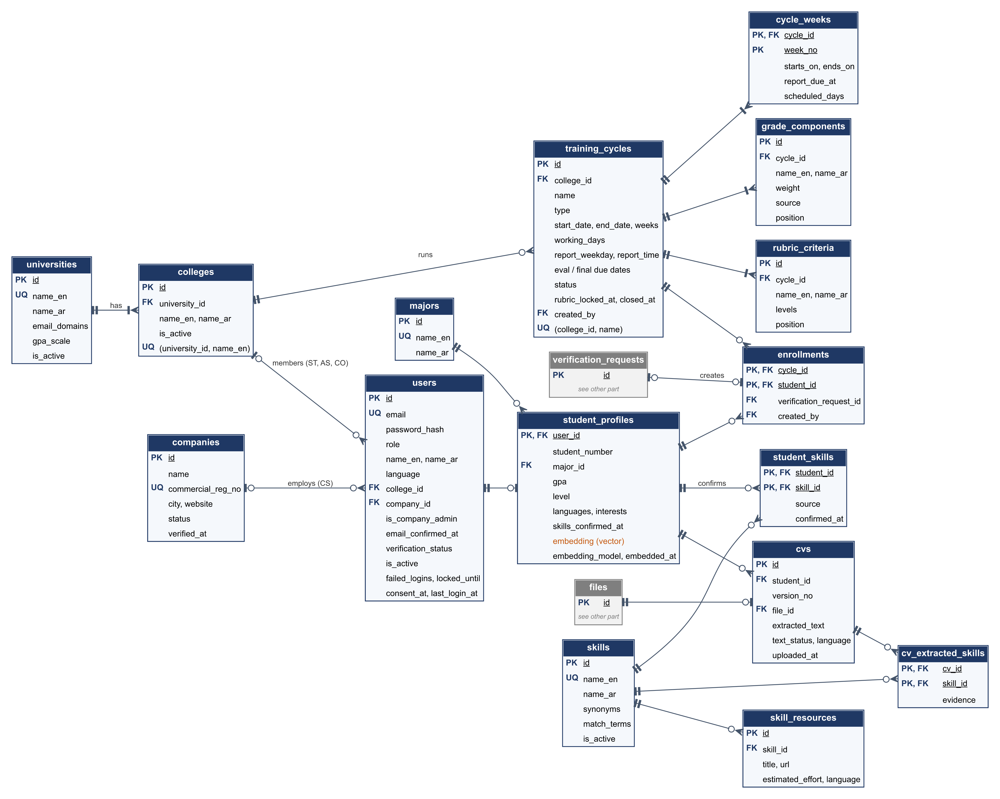

**Figure 6.1 – ERD: organizations, accounts, cycles, and student profiles**

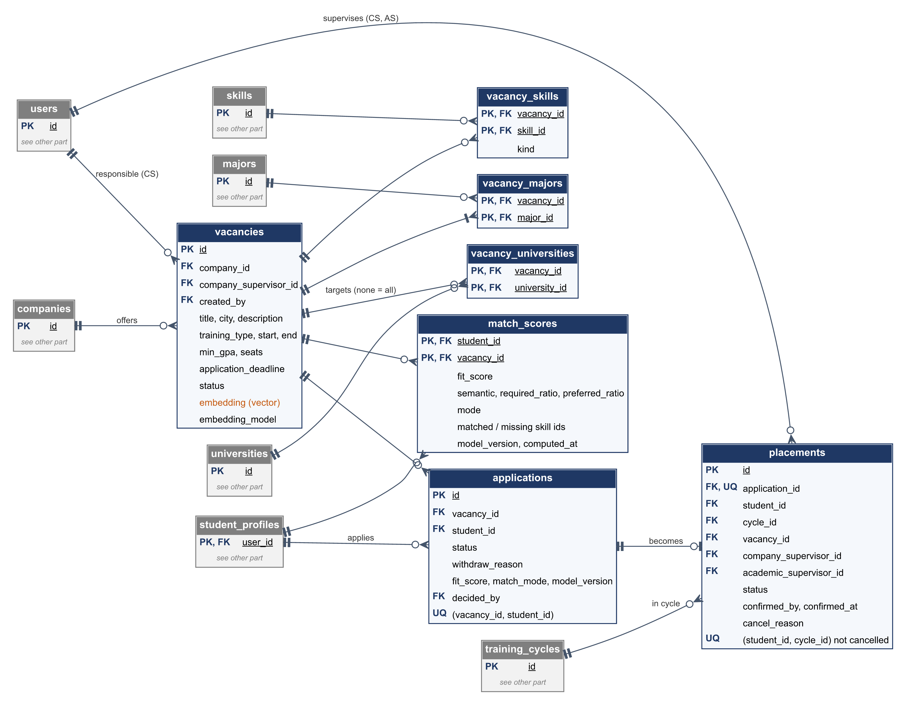

**Figure 6.2 – ERD: vacancies, matching, applications, and placements**

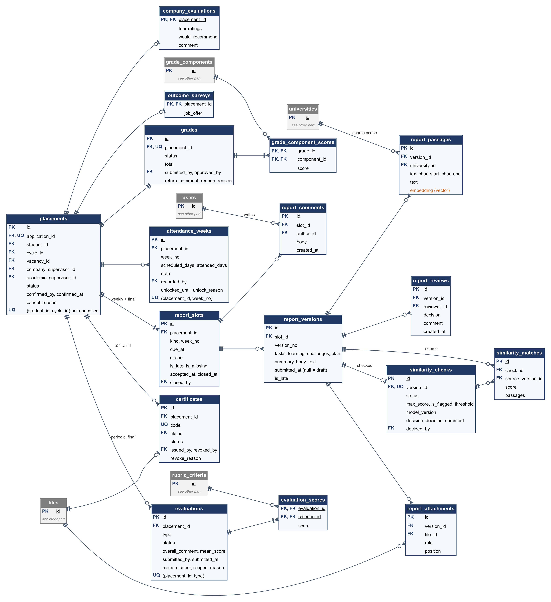

**Figure 6.3 – ERD: reports, similarity, attendance, evaluations, grades, and certificates**

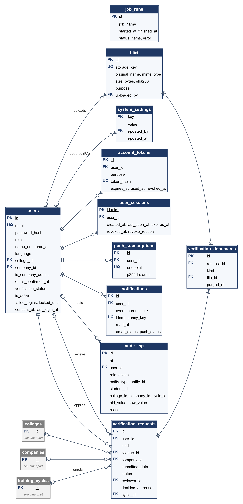

**Figure 6.4 – ERD: verification and platform services (tokens, sessions, files, notifications, audit, settings, jobs)**

### 6.3 Tables by Area

**Table 6.1 – The 49 tables by area**

| **Area** | **Tables** | **Key relationships** |
|:---|:---|:---|
| Organizations and accounts | `universities`, `colleges`, `companies`, `users`, `verification_requests`, `verification_documents`, `account_tokens`, `user_sessions` | A college belongs to a university; a user belongs to a college or a company; a verification request has documents |
| Cycles and configuration | `training_cycles`, `cycle_weeks`, `grade_components`, `rubric_criteria`, `enrollments`, `majors`, `skills`, `skill_resources`, `system_settings` | A cycle belongs to a college and has weeks, grade components, and rubric criteria; an enrolment links a student to a cycle |
| Students and CVs | `student_profiles`, `cvs`, `cv_extracted_skills`, `student_skills` | A profile has CV versions; extracted skills are candidates, student skills are confirmed |
| Vacancies and placement | `vacancies`, `vacancy_skills`, `vacancy_majors`, `vacancy_universities`, `applications`, `placements`, `match_scores` | A vacancy belongs to a company; an application links a student to a vacancy; a placement comes from one accepted application |
| Reports and similarity | `report_slots`, `report_versions`, `report_attachments`, `report_reviews`, `report_comments`, `report_passages`, `similarity_checks`, `similarity_matches` | A placement has report slots; a slot has versions and comments; a version has attachments, reviews, passages, and at most one similarity check |
| Attendance and evaluations | `attendance_weeks`, `evaluations`, `evaluation_scores`, `company_evaluations`, `outcome_surveys` | Per placement: one row per week, periodic and final evaluations with a score per rubric criterion |
| Grades and certificates | `grades`, `grade_component_scores`, `certificates` | One grade per placement with a score per component; certificates per placement |
| Platform services | `files`, `notifications`, `push_subscriptions`, `audit_log`, `job_runs` | Files are referenced by CVs, attachments, documents, exports, and certificates; notifications and subscriptions belong to users |

The full data dictionary, with every column, key, and constraint, is in Section 4.3 of the System Design Document. The report side (13 tables with every column) is also drawn in the interactive diagrams (Appendix 8.2).

### 6.4 Derived Values and Retention

- Not stored but computed: a student's active applications, eligibility and its reason, the attendance percentage, dashboard counts, and the history of a record (from `audit_log`).
- Records stay for the life of the system. After the college's retention period, a coordinator can anonymize a closed cycle: names, contact details, CVs, report text, and certificate files are removed, while statuses, scores, and dates stay, so the cycle's statistics do not change.

## 7. External Interfaces

### 7.1 User Interface

The web app runs in current browsers on computers and phones and can be installed as a PWA. It offers role dashboards, forms, and lists in Arabic and English, a notification bell, and a public certificate page (`/verify/<code>`) reached from the QR code.

### 7.2 REST API

**Table 7.1 – API conventions**

| **Topic** | **Rule** |
|:---|:---|
| Base URL | `https://<api-host>/api/v1`; locally `http://localhost:8000/api/v1` |
| Format | JSON in UTF-8; file uploads as `multipart/form-data`; `snake_case` fields |
| Authentication | `Authorization: Bearer <token>` from `POST /auth/login`; public endpoints need no token |
| Language | Errors and generated texts in the user's saved language, or `Accept-Language` before login |
| Dates | ISO 8601; the server returns UTC and the client shows Asia/Riyadh time as `DD/MM/YYYY HH:mm` |
| Lists | `?page=1&page_size=20` (maximum 100); answers carry `items`, `page`, `page_size`, `total` |
| Errors | `application/problem+json` with `status`, a stable `code` (for example `INVALID_TRANSITION`, `FORBIDDEN`, `CYCLE_CLOSED`), a `detail` in the user's language, and field `errors` |
| Contract | FastAPI generates the OpenAPI 3.1 document at `/api/v1/openapi.json`; the frontend client is generated from it |

**Table 7.2 – Endpoint groups (163 endpoints)**

| **Group** | **Examples** |
|:---|:---|
| Authentication and session | `POST /auth/register`, `POST /auth/login`, `POST /auth/logout`, `GET /me`, `POST /me/consent` |
| Organizations, verification, accounts | `POST /me/verification`, `GET /verification-requests`, `POST /companies/{id}/suspend`, invitations, role transfer |
| Cycles, skills, majors, settings | `POST /cycles`, `PUT /cycles/{id}/grade-components`, `GET /skills` |
| Profile and CV | `PATCH /students/me/profile`, `POST /students/me/cvs`, `PUT /students/me/skills` |
| Vacancies, applications, placements, matching | `POST /vacancies`, `POST /vacancies/{id}/applications`, `POST /placements`, `GET /students/me/matches`, `GET /students/me/matches/{id}/plan` |
| Reports and similarity | `PUT /report-slots/{id}/draft`, `POST /report-slots/{id}/submit`, `POST /report-slots/{id}/accept`, `GET /report-versions/{id}/similarity` |
| Attendance, evaluations, grades | Attendance weeks, evaluation forms, `PUT /placements/{id}/grade`, `POST /grades/{id}/submit`, `POST /grades/{id}/approve` |
| Dashboards, exports, certificates | Pending actions, statistics, grade sheet, certificate issue, `GET /public/certificates/{code}` |
| Notifications, audit, files, system | `GET /notifications`, push subscriptions, `GET /audit-log`, `GET /files/{id}`, `GET /health` |

### 7.3 External Services and Protocols

| **External system** | **Protocol** | **Used for** |
|:---|:---|:---|
| Browsers | HTTPS, JSON; service worker | The web app and the API |
| PostgreSQL (Supabase or local) | PostgreSQL protocol over TLS | All records and vector search |
| Supabase Storage (or a local volume) | HTTPS REST with the service key | Private file storage |
| SMTP server (Gmail, or Mailpit locally) | SMTP with STARTTLS | Account emails and notifications |
| Browser push services | Web Push with VAPID keys | Push notifications (title and link only) |
| GitHub Actions, Vercel, Hugging Face | Git and HTTPS | CI, deployment, keep-alive, backups |

### 7.4 Libraries

| **Library** | **Use** |
|:---|:---|
| FastAPI, Pydantic, SQLAlchemy, Alembic, psycopg | API, validation, database access, migrations |
| sentence-transformers, pgvector, pypdf, python-docx, filetype | Embeddings, vector search, text extraction, file type detection |
| argon2-cffi, PyJWT | Passwords and tokens |
| APScheduler | Scheduled jobs |
| fpdf2, uharfbuzz, openpyxl, qrcode | PDF and Excel exports, certificate QR codes |
| pywebpush | Web push |
| React, React Router, TanStack Query, react-i18next, openapi-fetch, Tailwind CSS | Web app |

## 8. Appendices

### 8.1 Glossary

| **Term** | **Meaning** |
|:---|:---|
| Placement | A student's confirmed training at a company, created by the coordinator from an accepted application |
| Report slot | One weekly or final report a student owes for a placement, with its deadline and status |
| Training cycle | A college's training period (for example a summer term) with its weeks, deadlines, grade components, and rubric |
| Embedding | A list of 384 numbers that represents the meaning of a text, used to compare texts |
| Fit score | The 0–100 match between a student and a vacancy (Section 5.6.2) |
| Similarity check | The comparison of a submitted report with earlier reports of the same university (Section 5.6.3) |
| Outbox | The `notifications` table: notifications are written with the change and sent later by a job |
| Advisory lock | A PostgreSQL lock that lets only one process run a given job at a time |
| PWA | Progressive web app: a web app that can be installed and keeps working with a weak connection |
| RTL / LTR | Right to left (Arabic) / left to right (English) |
| Scope | The set of records a user may see: their own, their college's, or their company's |

### 8.2 Supporting Diagrams

- The diagram pack ([`InternSync_Diagrams`](../InternSync_Diagrams/README.md)): use case, context, activity, state, architecture, ERD, sequence, AI pipeline, deployment, and schedule diagrams, with their sources.
- The interactive code diagrams ([`diagrams.html`](../diagrams.html)): architecture, the report submit and review workflow, the submit request sequence, the notification data flow, the report slot lifecycle, and the report-side database, each linked to the code lines it shows.
- The class diagram of Figure 5.1, made with the same tool from the models and services.

### 8.3 Traceability

| **SRS area** | **Module** | **Tables** | **API section** |
|:---|:---|:---|:---|
| FR-AUT | `auth`, `orgs` | users, user_sessions, account_tokens | 3.1, 3.2 |
| FR-ORG | `orgs`, `auth`, `cycles` | universities, colleges, companies, users, verification_requests, verification_documents, enrollments | 3.1, 3.2 |
| FR-CYC | `cycles` | training_cycles, cycle_weeks, grade_components, rubric_criteria, skills, skill_resources, majors, system_settings | 3.3, 3.4 |
| FR-PRF | `profiles` | student_profiles, cvs, cv_extracted_skills, student_skills | 3.5 |
| FR-VAC | `vacancies` | vacancies, vacancy_skills, vacancy_majors, vacancy_universities, applications, placements | 3.6, 3.7 |
| FR-MAT | `matching` | match_scores | 3.8 |
| FR-REP, FR-WFL-01 | `reports` | report_slots, report_versions, report_attachments, report_reviews, report_comments | 3.9 |
| FR-SIM | `similarity` | report_passages, similarity_checks, similarity_matches | 3.10 |
| FR-ATT | `attendance` | attendance_weeks | 3.11 |
| FR-EVL | `evaluations` | evaluations, evaluation_scores, company_evaluations | 3.12 |
| FR-WFL-02 – 07 | `grades` | grades, grade_component_scores | 3.13 |
| FR-DSH | `dashboards`, `evaluations` | (queries), outcome_surveys | 3.14 |
| FR-EXP, FR-CER | `exports`, `certificates` | files, certificates | 3.15, 3.16 |
| FR-NOT, FR-PWA-02 | `notifications`, `jobs` | notifications, push_subscriptions, job_runs | 3.17 |
| FR-AUD | `core` | audit_log | 3.18 |

### 8.4 References

1. IEEE Std 1016-1998, *IEEE Recommended Practice for Software Design Descriptions*, IEEE Computer Society, 1998.
2. IEEE Std 830-1998, *IEEE Recommended Practice for Software Requirements Specifications*, IEEE Computer Society, 1998.
3. I. Sommerville, *Software Engineering*, 10th ed., Pearson, 2016.
4. Group 3, *InternSync – Software Requirements Specification*, version 1.6, Oct 28, 2026.
5. Group 3, *InternSync – System Design Document*, version 1.7, Oct 29, 2026, and *API Specification*, version 1.5, Oct 28, 2026.
6. L. Wang et al., "Multilingual E5 Text Embeddings: A Technical Report," arXiv:2402.05672, 2024.
