# InternSync – Software Design Description (SDD)

Based on IEEE Std 1016-1998 (Recommended Practice for Software Design Descriptions) – CSC 305 SDD template

**IMAM ABDULRAHMAN BIN FAISAL UNIVERSITY** · College of Computer Science & Information Technology
CSC 305 – Software Engineering \| Semester 1 – 2026/2027 \| Section 5MA1 \| Group 3

| **Item** | **Value** |
|:---|:---|
| Project title | InternSync – Cooperative Training Coordination and Tracking System |
| Team name | Group 3 (Section 5MA1) |
| Advisor | Dr. Sultan Al-Enezi |
| Version | 1.1 |
| Date | 14-11-2026 |

> This Markdown file is the maintained version of the SDD (Project 6). `InternSync_SDD_v1.1.docx` and `.pdf` in this folder are generated from it on the official 2026 course SDD template ([build](build/README.md)); version 1.0, made on the earlier template, is kept in [old](old/). The SDD presents the design in the order of the course template and traces it to the approved SRS. The full data dictionary and every endpoint stay in the [System Design Document](../Design/InternSync_Design.md) and the [API Specification](../Design/InternSync_API_Spec.md), which this SDD summarizes and references.

### Team Information

| **Team Member** | **Student ID** | **Project Role** |
|:---|:--:|:---|
| Salam Alsaour (Team Leader) | 2250009168 | Team leader; backend and AI services developer |
| Khalid Alajmi | 2250004309 | Frontend and backend developer |
| Ali Alghafly | 2250002460 | Frontend developer |
| Ahmed Kanaan | 2250009170 | AI services developer; deployment lead |
| Abdullah Abalhareth | 2250005266 | QA and documentation lead |
| Rakan Alzahrani | 2250000631 | UI/UX designer |

### Revision History

| **Version** | **Date** | **Description** | **Author** |
|:--:|:--:|:---|:--:|
| 1.0 | Nov 1, 2026 | First version for Project 6 (SDD) on the course template (IEEE 1016 adapted), from System Design Document 1.7, API Specification 1.5, and the diagram pack; adds a class diagram of the report review module. | Group 3 |
| 1.1 | Nov 14, 2026 | CR-12: moved to the official 2026 SDD template (university cover with the team table) and expanded for the 2026 rubric: scope and design views (1.2, 1.6), architectural styles with their reasons (2.4), assumptions and constraints with their effect on the design, design goals with measured results, and fifteen design decisions with the options considered (3.1 – 3.5), the layered architecture (Figure 2.2), the module table of the template (Table 5.1), two class diagrams of the whole domain model (Figures 5.1, 5.2), a description of every module with its inputs, outputs, and algorithm (5.3), the sign-in sequence (Figure 5.4), the main table definitions (6.4), the interfaces and protocols (7), and traceability of every requirement area (Appendix B). Design as built at the end of Increment 5, traced to SRS 1.6. | Salam Alsaour |

## 1. Introduction

### 1.1 Purpose

This Software Design Description (SDD) describes how InternSync is structured to satisfy the requirements of the approved Software Requirements Specification (SRS v1.6). It translates the requirements into the system's architecture, components, interfaces, and data, and records the design decisions with their reasons. In the words of IEEE Std 1016, it is the blueprint for implementation: every requirement of the SRS can be traced to one or more design entities in this document (Appendix B).

The design described here is the design **as built** at the end of Increment 5 (October 29, 2026). Where the implementation changed an earlier design decision, the change was approved through change control and is listed in the project's change requests (CR-01 to CR-12).

### 1.2 Scope

InternSync is one web platform for cooperative and summer training shared by many universities and companies. It covers the whole training life cycle:

- registration and verification of students, coordinators, and companies, with a Platform Admin run by the provider;
- training cycles of each college, with deadlines, grade components, and an evaluation rubric;
- student profiles built from the CV, with AI skill extraction;
- vacancies published by companies, AI matching of students to vacancies with an explanation and a development plan, applications, and placements confirmed by the college's coordinator;
- weekly and final reports with review, AI similarity detection, attendance, and company evaluations;
- grades with an approval workflow, completion certificates with a public QR check, exports, dashboards, notifications, and an audit trail;
- an Arabic (right to left) and English (left to right) interface, installable as a Progressive Web App (PWA) that stays readable offline.

The SDD covers the client (React PWA), the server (FastAPI with the AI services and the scheduler), the database (PostgreSQL with pgvector), file storage, and the interfaces to email, web push, and hosting. Integration with university or government systems is out of scope (SRS C-06).

### 1.3 Intended Audience and Reading Suggestions

**Table 1.1 – Readers of this SDD**

| **Reader** | **Use of this SDD** | **Suggested sections** |
|:---|:---|:---|
| Developers | Build and change modules within the agreed structure | 4, 5, 6, 7 |
| Testers and QA | Derive tests from transitions, rules, and interfaces; check traceability | 5.3, 5.4, 7.2, Appendix B |
| Course instructor and advisor | Assess the architecture, the decisions, and the traceability to the SRS | 2, 3, 4, Appendix B |
| Project manager | Relate the design to the plan, risks, and constraints | 2.3, 3, 4.6 |
| Maintainers and operators | Deploy, configure, back up, and extend the system | 4.6, 6.7, 7 |

Readers new to the project should start with Section 2 (overview) and Figure 2.1 (context), then read Section 3 (why the design is as it is) before the details in Sections 4 to 7.

### 1.4 Definitions, Acronyms, and Abbreviations

The full glossary is in Appendix A. The role abbreviations are used throughout: **ST** student, **CS** company supervisor, **CA** Company Admin, **AS** academic supervisor, **CO** coordinator (one per college), **PA** Platform Admin. Requirement IDs (FR-…, NFR-…, C-…, A-…, D-…) refer to the SRS; CR-… refers to an approved change request.

### 1.5 References

**Table 1.2 – Related documents**

| **Document** | **Version** | **Relation to this SDD** |
|:---|:--:|:---|
| [Software Requirements Specification](../Project_4_SRS/InternSync_SRS.md) (IEEE 830 adapted) | 1.6 | The approved requirements this design implements |
| [Software Project Management Plan](../Project_3_SPMP/InternSync_SPMP.md) | 1.7 | Process model, schedule, increments, risks |
| [System Design Document](../Design/InternSync_Design.md) | 1.8 | Full data dictionary (all columns of the 49 tables), every transition table, and the configuration variables |
| [API Specification](../Design/InternSync_API_Spec.md) | 1.6 | Every endpoint with roles, payloads, and error codes |
| [Diagram pack](../InternSync_Diagrams/README.md) | 1.3 | Sources of all figures in this SDD |
| [Change requests](../Change_Requests.md) | CR-01 – CR-12 | Approved changes to requirements and design |
| [Increment documents](../README.md) | 1 – 5 | Requirements, design notes, and test reports of each increment |
| [Key results](../Key_Results.md) | Oct 29, 2026 | Measured results quoted in Section 3.3 |
| [Interactive code diagrams](../diagrams.html) | Nov 14, 2026 | One tab per diagram, in English and Arabic: architecture, workflow, sequence, data flow, lifecycle, and database diagrams traced from the code, the report review classes (Figure 5.3), and Figures 2.2, 5.1, 5.2, and 5.4 of this SDD with zoom |

Standards and books are listed in Appendix D.

### 1.6 Document Organization and Design Views

The SDD follows the eight sections of the course template. IEEE Std 1016-1998 asks for four design views; Table 1.3 shows where each one is described.

**Table 1.3 – IEEE 1016 design views in this SDD**

| **IEEE 1016 view** | **Question it answers** | **Where** |
|:---|:---|:---|
| Decomposition description | Which design entities (subsystems, modules, data) make up the system? | 4.2, 4.3, 5.1, 6.3 |
| Dependency description | How do the entities depend on and use each other? | 2.4, 4.4, 5.2, 5.3 |
| Interface description | What must a user of an entity know to use it? | 5.1, 7 |
| Detail description | How does each entity work inside (data, algorithms, states)? | 5.3, 5.4, 6 |

Figures and tables are numbered by section. Diagrams use UML where a UML form exists (class, sequence, activity, state, component, deployment) and crow's-foot notation for the ER diagrams.

## 2. System Overview

### 2.1 System Description

InternSync replaces the spreadsheets, emails, and paper forms that colleges and companies use to run cooperative training. It is a single platform operated by a provider and used by many organizations at once:

- **Universities and colleges.** Each college has exactly one **Coordinator**, who runs its training cycles, verifies its students, invites its **Academic Supervisors**, confirms placements, and approves grades.
- **Companies.** A company registers through its representative, who becomes its **Company Admin** once verified. The Company Admin publishes vacancies, invites further **Company Supervisors**, and sees all of the company's trainees.
- **Students** register, are verified by their college's coordinator, build a profile from their CV, receive a ranked list of vacancies, apply, and submit weekly and final reports during training.
- The **Platform Admin** manages universities, colleges, the shared skill vocabulary, and platform settings, and verifies coordinators and companies. The Platform Admin never sees academic records.
- A **public verifier** (for example an employer) checks a completion certificate by scanning its QR code, without logging in.

Two AI services support people's decisions without making them: **matching** ranks vacancies for a student and explains matched and missing skills, and **similarity detection** flags reports that overlap with earlier reports of the same university. Both run on the project's own server, and both are advisory (NFR-AI-01).

### 2.2 System Context

Figure 2.1 shows InternSync as one system with its users and the external services it depends on.

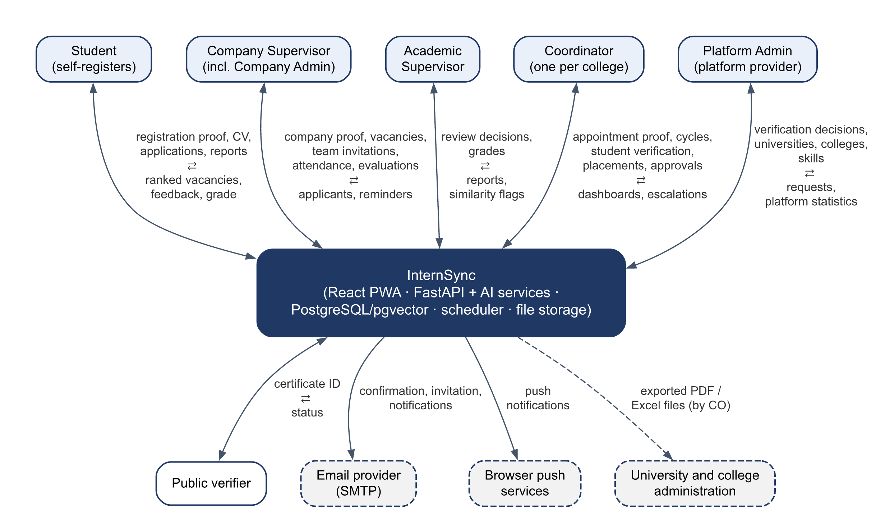

**Figure 2.1 – System context: users and external services**

**Table 2.1 – External entities**

| **External entity** | **Exchanges with InternSync** | **Interface (Section)** |
|:---|:---|:---|
| Users of the five roles | Forms, files, decisions in; dashboards, lists, results, notifications out | Web UI over HTTPS (7.1, 7.2) |
| Public verifier | Certificate code in; Valid, Revoked, or Not found out | Public page and endpoint (7.7) |
| Email provider (SMTP) | Confirmation, invitation, reset, and notification emails | SMTP over TLS (7.5) |
| Browser push services | Push messages with a title and a link only | Web Push with VAPID keys (7.5) |
| University and college administration | Grade sheets and summaries as files exported by the coordinator | PDF and Excel files (5.3.13) |
| Hosting providers | Run the containers, the database, and the static web app | Section 4.6, 7.8 |

### 2.3 Design Strategy

The design follows a small set of strategies that come from the constraints of the project (SRS 2.5) and the incremental process of the SPMP:

- **Incremental delivery.** The system was built in five increments (registration and core records; matching, attendance, evaluations, grades, dashboards; similarity, notifications, exports, offline app; certificates and Could features; final delivery). The architecture was fixed first, so each increment added modules without changing the structure.
- **Contract first.** The REST API was specified before coding. FastAPI generates the OpenAPI document from the code, and the frontend's typed client is generated from it; a CI check fails if the two differ (NFR-MNT-02).
- **Explicit state machines.** Vacancies, applications, report slots, evaluations, grades, and certificates change state only through named transitions. Each transition is one service function that checks role, scope, and current state, and writes the change, its audit entry, and its notifications in one database transaction (FR-WFL-01, FR-AUD-01).
- **Organization isolation in the query.** Every query on academic records is filtered by the caller's college, and every query on company records by the caller's company. Authorization is enforced on the server, never by the client (FR-AUT-05, NFR-PRV-03).
- **AI as advice with a fallback.** AI results are stored with their reason and model version and are labelled advisory; no AI output changes a status. If the model is unavailable, matching falls back to a rule-based score (FR-MAT-04, NFR-AI-02).
- **One deployable backend, zero cost.** A single Docker image holds the API, the AI services, and the scheduler, and runs on free hosting tiers or on any Linux server with Docker Compose (C-04, NFR-PRT-02).
- **Bilingual by construction.** Every text is a translation key in Arabic and English; the layout mirrors with the language; dates are stored in UTC and shown in Saudi time (FR-LOC-01, NFR-L10N-02).

### 2.4 Architectural Style

InternSync combines three architectural styles:

1. **Client–server.** The client is a React PWA served as static files; the server is a REST API. They communicate only through HTTPS and JSON, so the client can be replaced or a mobile app added without changing the server.
2. **Layered architecture inside each tier.** The server is organized in strict layers: interface (routers), business logic (services and AI services), data access (ORM models), and core infrastructure. A layer calls only the layer below it (Figure 2.2). The client is layered in the same way: pages, shared components, and libraries above a generated API client.
3. **Modular monolith.** The server is one process divided into modules by business area (Table 4.2). Modules share one database and one transaction, which keeps workflows that span modules (for example, confirming a placement creates report slots and a draft grade) atomic and simple. Background work runs in the same process: a scheduler with idempotent jobs and an outbox of notifications written in the business transaction.

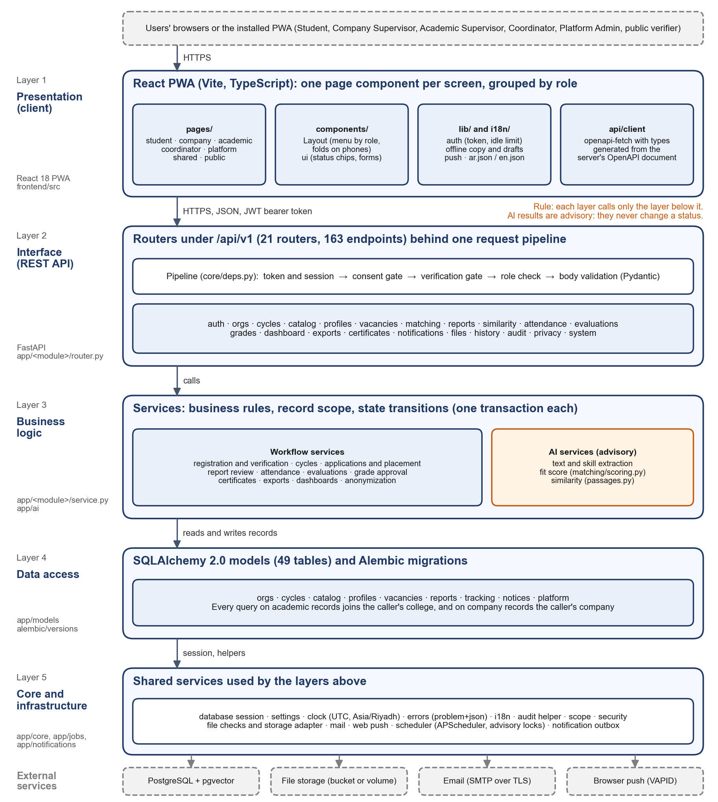

**Figure 2.2 – Layered architecture of the client and the server, as built**

**Table 2.2 – Why these styles**

| **Style** | **Reason** | **Alternative considered** |
|:---|:---|:---|
| Client–server with a REST API | The PWA, the public certificate page, and the tests all use one documented contract; the OpenAPI document generates the client | Server-rendered pages: simpler at first, but no offline app and no typed contract |
| Layered server | Business rules sit in one place (services) that both the API and the scheduler call; routers stay thin and testable | Logic in the routers: faster to write, but rules would be repeated in jobs and harder to test |
| Modular monolith | One developer, a fixed schedule, and free hosting with one container; workflows need one transaction | Microservices: independent scaling, but a broker, several deployments, and distributed transactions, far beyond C-02 and C-04 |
| In-process scheduler with an outbox | Reliable reminders and email without a separate worker or message broker | Celery with Redis: a second service to host and pay for |

## 3. Design Considerations

### 3.1 Assumptions

**Table 3.1 – Assumptions and their effect on the design**

| **ID** | **Assumption (SRS 2.6.1)** | **Design consequence** |
|:--:|:---|:---|
| A-02 | Each placement has exactly one company supervisor and one academic supervisor | `placements` holds one `company_supervisor_id` and one `academic_supervisor_id`; scope rules join on them (7.2 of the design document) |
| A-04 | Most CVs are text-based PDF or DOCX | Text extraction with `pypdf` and `python-docx`; a CV with fewer than 50 letters is marked `no_text` and the student enters skills by hand (FR-PRF-05) |
| A-06 | At most 300 students per cycle, 30 weeks, 1,000 open vacancies, 300 companies | Ranking scores all eligible vacancies in one query plus Python scoring, without a search engine; synchronous exports |
| A-07 | Grade components, weights, and rubric are decided by each college | They are rows of each cycle (`grade_components`, `rubric_criteria`), not code |
| A-08 | Working days are the same for all placements of a cycle | `training_cycles.working_days` drives `cycle_weeks.scheduled_days` for attendance |
| A-09 | Arabic and English are the only languages | Two translation files (`ar.json`, `en.json`) and two name columns (`name_en`, `name_ar`) on reference data |
| A-10 | Coordinators and companies can provide official documents | Verification requests store documents that only the uploader and the reviewer can download, deleted 30 days after the decision |
| D-01 | An open multilingual embedding model with a suitable licence is available (SRS dependency D-01) | The model is baked into the image; every result stores its model version so a later model can be compared |

### 3.2 Constraints

**Table 3.2 – Constraints and their effect on the design**

| **ID** | **Constraint (SRS 2.5)** | **Effect on the design** |
|:--:|:---|:---|
| C-01, C-02 | Fixed schedule with three increments; about 480 person-hours, built in practice by one developer | Modular monolith, one language on the server, generated API client, and automated tests that let each increment be added safely |
| C-03 | Python/FastAPI, React (Vite) PWA, PostgreSQL with pgvector, Docker, GitHub | The technology stack of Table 3.4 |
| C-04 | Zero cost: open-source tools and free tiers only | Hugging Face Spaces, Supabase, Vercel, Gmail SMTP, GitHub Actions (CR-01); no paid API |
| C-05 | AI runs on the project server; no text sent to external AI services | The embedding model runs inside the API container and is downloaded at build time, never at run time |
| C-06 | No integration with university or government systems | Self-registration with human verification (CR-05); grades leave as files |
| C-07 | Saudi PDPL: consent, purpose limitation, access control | Consent gate in the request pipeline, scope filtering, minimal push payloads, anonymization of closed cycles |
| C-08 | Arabic (RTL) and English (LTR) | Logical CSS properties, `dir` and `lang` on the page, Arabic-capable PDF fonts and shaping |
| C-09 | Synthetic data only | Seed and demo scripts create the organizations and records; the AI evaluation sets are synthetic |
| C-10 | CPU-only hosting, 2 vCPU | A 384-dimension model (about 470 MB), `halfvec` vectors, and HNSW indexes |

### 3.3 Design Goals

**Table 3.3 – Design goals, how the design meets them, and the measured result**

| **Goal** | **How the design achieves it** | **Measured result (Key Results)** |
|:---|:---|:---|
| Security and isolation (O1, FR-AUT-05) | Request pipeline with consent, verification, and role gates; scope filter in every query; permission matrix test of every endpoint | 810 refused calls over 163 endpoints, 0 got through; OWASP ZAP: 0 high findings |
| Performance (NFR-PER-01 – 05) | Synchronous SQLAlchemy in a thread pool; one query for ranking; HNSW vector indexes; streamed exports | 95th percentile 0.21 s with 50 users; ranking of 1,000 vacancies 0.83 s; similarity with 10,000 reports 0.42 s |
| AI quality and transparency (O2, O5, NFR-AI) | Hybrid fit score with explanation; similarity with a meaning check and a word check; model version stored | Top-5 hit rate 100% (target 80%); skills found 97.2%; 0 of 10 original reports flagged |
| Reliability (NFR-REL-03, NFR-REL-04) | Each transition in one transaction; jobs select work by state under advisory locks; outbox for notifications | Missed jobs catch up on the next run; a failed upload never leaves a half-submitted report |
| Maintainability (NFR-MNT) | Same file layout in every module; settings instead of constants; generated client; CI on every pull request | 202 backend tests, 95% coverage (target 70%) |
| Usability and localization (O7, NFR-USA) | One design system, status text with colour, 3 screens per main task, mirrored layout | 839 texts in both languages; 34 browser tests on four engines and sizes |
| Portability and cost (NFR-PRT-02, C-04) | Same containers locally, in CI, on free tiers, and self-hosted | Running cost 0 |

### 3.4 Technology Choices

**Table 3.4 – Technology choices**

| **Layer** | **Choice** | **Reason** |
|:---|:---|:---|
| Backend | Python 3.11, FastAPI, Pydantic v2, uvicorn | Required by C-03; generates the OpenAPI document (NFR-MNT-02); one language for API and AI |
| Data access | SQLAlchemy 2.0 (synchronous), psycopg 3, Alembic migrations | Mature and simple; FastAPI runs synchronous endpoints in a thread pool, enough for NFR-PER-01 |
| Database | PostgreSQL 16 or later with `pgvector` (`halfvec`, HNSW) and `pg_trgm` | Relational data and embeddings in one place; `halfvec` halves the size to fit the free tier |
| Passwords and tokens | Argon2id (`argon2-cffi`); JWT HS256 (`PyJWT`) with a server-side session row | NFR-SEC-02; idle timeout and logout revocation (FR-AUT-03) |
| AI | `intfloat/multilingual-e5-small` (384 dimensions) with `sentence-transformers` on CPU | Arabic and English (NFR-L10N-04); fits CPU hosting (C-10) |
| Text extraction and file checks | `pypdf`, `python-docx`, magic-byte detection plus a DOCX structure check | FR-PRF-04, NFR-SEC-04 |
| Scheduler | APScheduler 3 inside the API process, PostgreSQL advisory locks | NFR-REL-03 without a separate worker |
| Exports | fpdf2 with HarfBuzz shaping (`uharfbuzz`) and Noto fonts; `openpyxl`; `qrcode` | Correct Arabic in PDF (NFR-L10N-03) with no system libraries (CR-09) |
| Messaging | `smtplib` over TLS with Jinja2 templates; `pywebpush` with VAPID | FR-NOT-01, FR-PWA-02 |
| Frontend | React 18, Vite, TypeScript, React Router, TanStack Query, react-i18next, Tailwind CSS | C-03; logical properties for RTL (FR-LOC-01) |
| API client | `openapi-typescript` types and `openapi-fetch` | Typed calls generated from the server's contract |
| PWA | Web app manifest and a hand-written service worker (`public/sw.js`) | App-shell cache and push; API answers never cached (FR-PWA-01 – 03) |
| Tests | pytest with coverage, Vitest, Playwright with axe, Locust | NFR-MNT-01, NFR-PRT-01, NFR-USA-04, NFR-PER-01 |

### 3.5 Design Decisions and Trade-offs

Each decision below was taken with the requirements and constraints in mind; the trade-off is the price accepted for the choice.

**Table 3.5 – Main design decisions and their rationale**

| **No.** | **Decision** | **Options considered** | **Rationale and trade-off** |
|:--:|:---|:---|:---|
| DD-01 | One FastAPI container holds the API, the AI services, and the scheduler | Separate AI service; separate worker with a broker | One deployable fits one free container (C-04, C-10) and one developer (C-02). Trade-off: the API and the model scale together; acceptable at the demo size (A-06) |
| DD-02 | Free tiers: Hugging Face Spaces (API), Supabase (database and files), Vercel (web app) – CR-01 | One Linux VM; Railway | Spaces gives 2 vCPU and 16 GB RAM free, enough for the model; Railway's free plan has 0.5 GB RAM. Trade-off: the Space sleeps after 48 h and its disk is not persistent, so the container keeps no state and a keep-alive job runs every 6 hours |
| DD-03 | Embeddings in PostgreSQL with pgvector (`halfvec(384)`, HNSW) | A separate vector database; vectors compared in Python | One database, one backup, one transaction; similarity search filtered by university in SQL. Trade-off: index tuning in PostgreSQL; `halfvec` loses a little precision, measured as no loss in the AI results |
| DD-04 | Synchronous SQLAlchemy in a thread pool | Async SQLAlchemy | Simpler code and tests; the load target is met (0.21 s at the 95th percentile). Trade-off: fewer concurrent requests per process than async |
| DD-05 | JWT with a server-side session row (`sid`) | Pure stateless JWT; cookie sessions | The session row gives the 30-minute idle timeout and logout revocation that a pure JWT cannot (FR-AUT-03); a bearer token instead of cookies removes CSRF exposure. Trade-off: one session lookup per request (at most one write per minute) |
| DD-06 | Status values as `text` with a `CHECK` constraint | PostgreSQL enums | Adding a value is a simple migration. Trade-off: the allowed values are repeated in the code and the constraint |
| DD-07 | Business records are never deleted; history in an append-only audit log | Soft-delete flags on every table; deletion | Grades and placements stay explainable (FR-AUD); foreign keys use `ON DELETE RESTRICT`. Trade-off: anonymization is a separate action (NFR-PRV-04) instead of deletion |
| DD-08 | Rule-based skill extraction with a curated bilingual vocabulary; the student confirms | A trained named-entity model | Fast, explainable, and measurable; recall 97.2% against the 70% target. Trade-off: new skills need vocabulary entries maintained by the Platform Admin |
| DD-09 | Hybrid fit score: 0.5 meaning (embeddings) + 0.4 required skills + 0.1 preferred skills, with a rule-only fallback | Embeddings only; skills only | Meaning finds related profiles, skills make the score explainable (matched and missing skills), and the fallback keeps ranking working without the model (FR-MAT-04). Trade-off: weights must be tuned; they are settings |
| DD-10 | Similarity: sentence-sized passages, nearest neighbours in the same university, confirmed by cosine ≥ 0.90 **and** word 5-gram overlap ≥ 50% (CR-09) | Embeddings only; exact matching only | The word check stops two reports on the same topic from being flagged (0 false flags). Trade-off: a report reworded sentence by sentence is not caught (7 of 10 on the held-out set) |
| DD-11 | Files streamed by the API after the permission check (CR-08) | Signed links to the storage bucket | No link to the bucket ever reaches a browser, so a forwarded link is useless (NFR-SEC-04). Trade-off: downloads pass through the API container |
| DD-12 | PDF exports with fpdf2 and HarfBuzz shaping (CR-09) | WeasyPrint; ReportLab | Correct Arabic joining and right-to-left order with only pip packages. Trade-off: layouts are drawn in code |
| DD-13 | Notifications written in the business transaction (outbox) and sent by a job every minute | Send email inside the request | A failed email never rolls back a decision and is retried up to 5 times. Trade-off: up to one minute of delay |
| DD-14 | Offline mode: a copy of the pages opened in the session in `sessionStorage`, drafts in `localStorage` for at most 7 days; nothing submitted offline (CR-10) | Full offline sync | Students can read and type without a connection, while personal data does not stay on a shared device after sign-out. Trade-off: submitting needs a connection |
| DD-15 | Self-registration with human verification and a Platform Admin (CR-05) | Accounts created only by imports | Many universities and companies can join without integration (C-06). Trade-off: verification work for coordinators and the Platform Admin |

### 3.6 Risks Addressed by the Design

**Table 3.6 – Technical risks and the design response**

| **Risk** | **Design response** |
|:---|:---|
| The embedding model fails to load or is too slow on the CPU | Rule-based fallback labelled "Basic matching"; the model is loaded once at start-up and baked into the image |
| A free tier sleeps, pauses, or loses its disk | Stateless container; keep-alive check every 6 hours; nightly encrypted backup of the database and the files; the same containers run locally |
| A user reaches another organization's data | Scope filter inside every query; Platform Admin has no endpoint for academic records; row level security on every table as a second guard; permission matrix test |
| A job runs twice during a redeploy | Transaction-level advisory lock per job; idempotency key on each reminder and escalation |
| Arabic text is broken in exports | HarfBuzz shaping with bundled Noto Naskh Arabic; visual check in the test report |

## 4. Architectural Design

### 4.1 Architecture Overview

Figure 4.1 is the component view of the whole system. The users reach the React PWA over HTTPS. The PWA calls the REST API under `/api/v1` with a JWT bearer token. The server is one Docker image that holds the REST API modules, the AI services with one shared embedding model, and the scheduler. PostgreSQL stores all records and embeddings; a private bucket stores CVs, attachments, verification documents, exports, and certificates. Email leaves through SMTP and push messages through the browser vendors' push services.

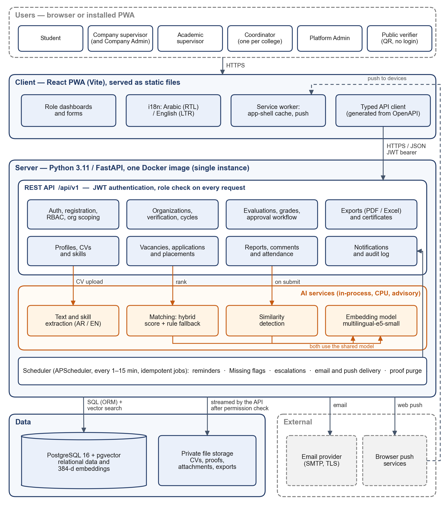

**Figure 4.1 – System architecture: components and their interactions**

### 4.2 Subsystem Decomposition

**Table 4.1 – Subsystems**

| **Subsystem** | **Responsibility** | **Main parts** | **Runs on** |
|:---|:---|:---|:---|
| Web client (PWA) | Screens for every role in Arabic and English; offline reading and drafts; push subscription | `frontend/src/pages`, `components`, `lib`, `api/client`, `public/sw.js` | Vercel (static files and CDN) |
| REST API | Authentication, authorization, validation, and the business rules of every workflow | 21 routers and their services under `backend/app` | Hugging Face Space (Docker) |
| AI services | Text and skill extraction, embeddings, fit score, similarity | `app/ai`, `app/matching/scoring.py`, `app/similarity/passages.py` | Same container (in process, CPU) |
| Scheduler | Reminders, Missing flags, escalations, notification delivery, retries, purges | `app/jobs`, `app/notifications/scheduled.py` | Same container |
| Database | Relational records, embeddings, audit log, settings | 49 tables, Alembic migrations | Supabase PostgreSQL |
| File storage | Uploaded and generated files | Storage adapter in `app/core/files.py` (`supabase` or `local`) | Supabase Storage (private bucket) or a Docker volume |
| CI/CD and operations | Tests, deploys, backups, keep-alive, security scans | `.github/workflows/*.yml` | GitHub Actions |

### 4.3 Backend Layers and Module Structure

The backend follows the layers of Figure 2.2. Each business module is a Python package under `backend/app/` with the same files:

- `router.py` – the endpoints: path, allowed roles (through the `auth(...)` dependency), request and response models, and a call to the service;
- `schemas.py` – Pydantic models of the requests and responses (where the module has its own);
- `service.py` – the business rules, scope checks, and state transitions; the only place that changes records.

The SQLAlchemy models of all modules are kept together in `app/models/` (nine files by area), because many workflows touch several areas in one transaction. Shared infrastructure is in `app/core/`: database session, settings, clock, error handling, translations, audit helper, scope rules, security, file checks and storage, and mail.

**Dependency rules:** a router calls only services and core helpers; a service may call other services, the AI services, models, and core; models depend only on the base class. Nothing below the router layer knows about HTTP, so the scheduler calls the same service functions as the API.

**Table 4.2 – Backend modules**

| **Module** | **Responsibility** | **SRS** |
|:---|:---|:---|
| `core` | Settings, database session, errors, translations, audit helper, scope rules, security, clock, files, mail | NFR-MNT-03, FR-AUD |
| `auth` | Registration, email confirmation, invitations, login, logout, sessions, password reset, lockout, consent | FR-AUT-02 – 04, FR-ORG-02, NFR-SEC-02/03, NFR-PRV-01 |
| `orgs` | Universities, colleges, companies, verification, role transfer, account deactivation | FR-ORG-01 – 09, FR-AUT-06 |
| `cycles` | Training cycles, weeks, grade components, rubric, enrolments | FR-CYC-01 – 03, FR-CYC-05 |
| `catalog` | Skill vocabulary, learning resources, majors, platform settings | FR-CYC-04, NFR-MNT-03 |
| `profiles` | Student profile, CV upload, skill extraction and confirmation | FR-PRF-02 – 05 |
| `vacancies` | Vacancies, applications, placements | FR-VAC-01 – 08 |
| `matching` | Eligibility, fit score, explanation, development plan | FR-MAT-01 – 07 |
| `reports` | Report slots, drafts, versions, attachments, reviews, comments | FR-REP-01 – 07, FR-WFL-01 |
| `similarity` | Passages, similarity checks, supervisor decisions | FR-SIM-01 – 03 |
| `attendance` | Weekly attendance and unlocks | FR-ATT-01 – 04 |
| `evaluations` | Periodic and final evaluations; student evaluation of the company and outcome survey | FR-EVL-01 – 05, FR-DSH-03 |
| `grades` | Grade entry, computation, approval workflow | FR-WFL-02 – 07 |
| `dashboard` | Pending actions per role, cycle and platform statistics, leniency alerts | FR-DSH-01 – 05 |
| `exports` | Grade sheet (Excel, PDF), term summary, training record | FR-EXP-01 – 03 |
| `certificates` | Issue, revoke, public verification | FR-CER-01 – 03 |
| `notifications` | In-app list, email and push delivery, push subscriptions, scheduled reminders | FR-NOT-01 – 06, FR-PWA-02 |
| `files` | Permission-checked download of any stored file | NFR-SEC-04 |
| `history`, `audit` | History of a record; audit log views for the coordinator and the Platform Admin | FR-AUD-02, FR-AUD-03 |
| `privacy` | Retention period and anonymization of closed cycles | NFR-PRV-04 |
| `jobs` | Scheduler set-up and the job runner | NFR-REL-03 |
| `ai` | Embedding model wrapper, text normalization, skill extractor | FR-PRF-04, FR-MAT, FR-SIM |

### 4.4 Component Interactions

Every request passes the same pipeline (implemented as FastAPI dependencies in `core/deps.py`). The order matters: role and gate failures are raised before the body is validated, so a caller without the right role always gets `401` or `403`, never `422`.

1. **Transport:** HTTPS is terminated by the hosting provider (NFR-SEC-01); CORS allows only the configured frontend origins.
2. **Authentication:** verify the JWT signature and expiry, load the session by its `sid`, reject it if revoked or idle for more than 30 minutes, and update `last_seen_at` at most once a minute.
3. **Consent gate:** until the privacy notice is acknowledged, only `GET /me`, `PATCH /me`, `POST /me/consent`, and logout answer (`403 CONSENT_REQUIRED`, NFR-PRV-01).
4. **Verification gate:** an account whose verification is pending or rejected reaches only its own data, its verification requests, and for students the profile, CV, and vacancy list (`403 VERIFICATION_REQUIRED`, FR-ORG-02).
5. **Role check:** each route declares its allowed roles.
6. **Service:** the service loads the record through a scope-filtered query, checks the state machine and limits, and writes the change.
7. **Audit and notifications:** the audit entry and the notifications are inserted in the same transaction as the change, so all are saved or none (FR-AUD-01, NFR-REL-04).
8. **Response:** JSON, or `application/problem+json` with a stable code and a message in the user's language (NFR-USA-05).

Figure 4.2 follows one report submission through the running system and shows the trust boundaries: the browser is untrusted, every request passes the authentication and scope gate, and only the API process reaches the database and the file storage. Notifications leave through the outbox and the scheduler.

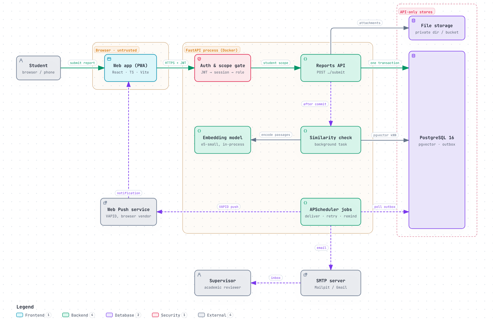

**Figure 4.2 – Runtime components and trust boundaries, following a report submission**

**Table 4.3 – Synchronous and background work**

| **Work** | **How it runs** | **Limit (SRS)** |
|:---|:---|:---|
| CV text and skill extraction | Synchronous in the upload request (thread pool) | ≤ 30 s (NFR-PER-03) |
| Profile and vacancy embedding | Synchronous when skills are confirmed or a vacancy is published; the `embed_missing` job fills any gap | < 1 s each |
| Ranking | Synchronous: one SQL query for the eligible vacancies and their vectors, scoring in Python | ≤ 5 s for 1,000 vacancies (NFR-PER-02) |
| Similarity check | A `pending` check is created in the submit transaction; a background task runs it at once, and the `similarity_retry` job picks up any check left pending | ≤ 2 min (NFR-PER-04) |
| Email and push delivery | Outbox rows written in the business transaction; the `deliver_notifications` job sends them | Every minute |
| Exports | Synchronous, streamed as a file | ≤ 60 s for 100 students (NFR-PER-05) |

### 4.5 Frontend Architecture

- **Routes by role:** after login the user lands on the dashboard of their role: `/student`, `/company`, `/academic`, `/coordinator`, or `/platform`. Each role has its own pages (for example `/student/vacancies`, `/company/trainees`, `/academic/grades`, `/coordinator/cycles/:cycleId`, `/platform/verifications`). Shared pages (`/placements/:placementId`, `/reports/:slotId`, `/notifications`, `/verification`) adapt to the caller's role, and public pages (`/login`, `/register`, `/verify/:code`) need no login. A route guard checks the role and the verification state before a page loads; the server checks again.
- **Data:** pages read and write through the typed `openapi-fetch` client; TanStack Query caches answers for the session and refreshes them after a change.
- **Layout and language:** `dir` and `lang` on the page follow the chosen language; spacing uses logical properties, so the whole layout mirrors. On phones the menu folds behind a "Main menu" button (NFR-USA-03).
- **AI results** appear in a panel labelled "Advisory", always with their reason (matched and missing skills, or the passages side by side).
- **Offline (CR-10):** the service worker caches the app shell; pages opened earlier in the session show their saved copy with an offline banner; submit buttons are disabled; report and evaluation drafts typed offline are saved when the connection returns. The idle limit is also applied on the device.

### 4.6 Deployment View

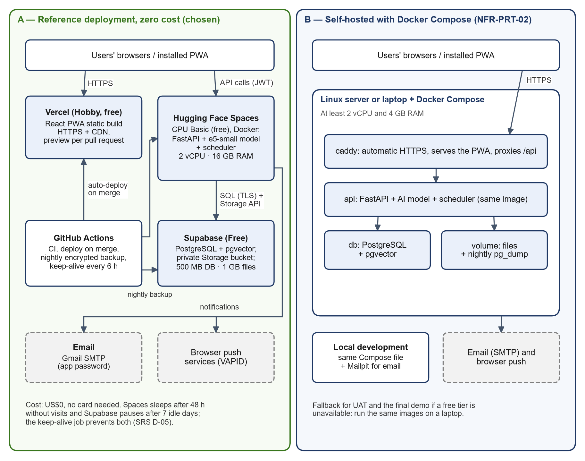

**Figure 4.3 – Deployment: the zero-cost reference deployment and the self-hosted option**

**Table 4.4 – Deployment nodes**

| **Node** | **Service and plan** | **Limits that matter** | **What runs** |
|:---|:---|:---|:---|
| Web client | Vercel Hobby | Non-commercial projects | Static PWA build with HTTPS, CDN, and a strict Content-Security-Policy |
| API container | Hugging Face Spaces, Docker, CPU Basic | 2 vCPU, 16 GB RAM, disk not persistent, sleeps after 48 h without visits | FastAPI, the embedding model, the scheduler; runs `alembic upgrade head` before starting |
| Database | Supabase Free | 500 MB, pauses after 7 days of low activity | PostgreSQL with `vector` and `pg_trgm`; Data API disabled; row level security on every table |
| File storage | Supabase Storage, private bucket | 1 GB | Reached only by the API with the service key |
| Email | Gmail SMTP with an app password | About 500 messages a day | Outgoing email |
| CI, backups, keep-alive | GitHub Actions | 2,000 minutes a month | `ci.yml`, `deploy-api.yml`, `backup.yml` (nightly, encrypted), `keepalive.yml` (every 6 hours), `security-scan.yml` |

The same image runs in four environments: local development with Docker Compose (database, API, Vite, and Mailpit for email), CI with a PostgreSQL service container, the reference deployment above, and self-hosting on any Linux server with at least 2 vCPU and 4 GB RAM (Caddy for HTTPS, API, database, and a file volume; NFR-PRT-02). All configuration comes from environment variables (database URL, JWT secret, storage, SMTP, VAPID keys, model name, `AI_ENABLED`, `SCHEDULER_ENABLED`, `ENV`); secrets never enter the repository.

### 4.7 Security Architecture

- **Authentication:** Argon2id password hashes; lockout for 15 minutes after 5 failures (`423 ACCOUNT_LOCKED`, even with the right password); single-use links of 32 random bytes stored only as SHA-256 hashes; a JWT of at most 12 hours with a session row for the 30-minute idle limit and logout (FR-AUT-03, NFR-SEC-02/03).
- **Authorization:** role per route, then record scope inside the query (Table 4.5).
- **Data protection:** private storage with streamed downloads; verification documents deleted 30 days after the decision; append-only audit log enforced by a trigger and privileges; request logs without bodies, tokens, or CV text; push payloads with a title and a link only; encrypted backups.

**Table 4.5 – Record scope by role (FR-AUT-05)**

| **Role** | **Scope rule applied in the query** |
|:---|:---|
| ST | Own profile, CVs, applications, placements, and everything under them |
| CS | Own vacancies and their applicants; placements they supervise and their reports (read only), attendance, and evaluations. The Company Admin: everything of the company |
| AS | Placements they supervise (always students of their college) and their reports, similarity checks, evaluations, and grades |
| CO | Records whose student belongs to the coordinator's college; the college's cycles, users, and student verification requests |
| PA | Organizations, account fields, coordinator and company verification, skills, settings, platform figures. No CV, report, evaluation, or grade |
| Public | Registration, the auth links, the certificate check, the university list, and the health check |

## 5. Detailed Design

### 5.1 Module Summary

Table 5.1 follows the template's module table: for each module, what it is responsible for, what goes in and out, and where its diagrams are.

**Table 5.1 – Modules: responsibilities, inputs and outputs**

| **Module Name** | **Responsibilities** | **Inputs / Outputs** | **Notes / Diagrams** |
|:---|:---|:---|:---|
| Authentication and Session (`auth`) | Register with documents, confirm email, accept invitations, log in and out, reset passwords, lock accounts, record consent | In: registration form and files, email and password, single-use tokens. Out: JWT access token and user, session row, emails, `401` / `423` errors | 5.3.1; Figure 5.4 (sequence) |
| Organizations and Verification (`orgs`) | Universities, colleges, companies; verification requests and decisions; invitations; role transfer; deactivation | In: organization data, decisions with reasons. Out: verified accounts and companies, enrolments, notifications | 5.3.2; Figure 5.9 (activity) |
| Training Cycles and Catalog (`cycles`, `catalog`) | Cycle dates, weeks, working days, deadlines, grade components, rubric; skill vocabulary, majors, settings | In: cycle definition, weights, criteria, settings. Out: cycle weeks, report deadlines, locked rubric | 5.3.3 |
| Profiles and Skill Extraction (`profiles`, `ai`) | Store CV versions, extract text and skills, confirm skills, embed the profile | In: PDF or DOCX up to 5 MB, confirmed skills. Out: extracted skills with evidence, profile embedding | 5.3.4; Figure 5.5 (sequence) |
| Vacancies and Placement (`vacancies`) | Publish and close vacancies, apply and withdraw, accept or decline, confirm and cancel placements | In: vacancy data, applications, decisions. Out: state changes, report slots and a draft grade on confirmation | 5.3.5; Figures 5.11, 5.12 (states) |
| Matching (`matching`) | Eligibility, fit score, explanation, development plan, fallback | In: student profile, eligible vacancies, weights. Out: ranked list with score parts, matched and missing skills, `advisory: true` | 5.3.6; Figures 5.5, 5.15 |
| Reports (`reports`) | Drafts, attachments, submission with server time, review, revision, comments, Missing flags | In: report fields and files, review decisions. Out: versions, On time or Late, review history, notifications | 5.3.7; Figures 5.3, 5.6, 5.13 |
| Similarity (`similarity`) | Split, embed, and compare passages; flag; record the supervisor's decision | In: submitted report version. Out: similarity check with score, sources, passage pairs | 5.3.8; Figures 5.3, 5.15 |
| Attendance (`attendance`) | Record weekly days, full-week shortcut, lock after the edit window, unlock | In: attended days, unlock reason. Out: weekly states and attendance percentage | 5.3.9 |
| Evaluations (`evaluations`) | Periodic and final evaluations on the rubric; reopen; student evaluation of the company; outcome survey | In: criterion scores 1–5, comments. Out: submitted evaluations, mean score, locked rubric | 5.3.10 |
| Grades (`grades`) | Enter scores, compute the total, check preconditions, submit, approve, return, reopen | In: component scores 0–100, decisions. Out: grade states, total, `409 PRECONDITIONS_UNMET` with the missing items | 5.3.11; Figures 5.7, 5.14 |
| Dashboards (`dashboard`) | Pending actions per role; cycle, company, and platform statistics; leniency alerts | In: caller and filters. Out: counts with links, rates, alerts | 5.3.12 |
| Exports and Certificates (`exports`, `certificates`) | Grade sheet, term summary, training record; certificate issue, revoke, public check | In: cycle or placement, language, certificate code. Out: Excel and PDF files, QR certificate, Valid / Revoked / Not found | 5.3.13 |
| Notifications and Jobs (`notifications`, `jobs`) | In-app notifications, email and push delivery, reminders, Missing flags, escalations, retries, purges | In: business events, time. Out: notifications, emails, push messages, job runs | 5.3.14; Figure 5.8 (sequence) |
| Files (`files`, `core/files`) | Check uploads by size and content, store under random keys, stream downloads after the permission check | In: uploaded file, file ID. Out: stored file record, file stream, `413` / `415` / `403` | 5.3.15 |
| Audit, History, Privacy (`audit`, `history`, `privacy`) | Show the audit log and the history of a record; anonymize closed cycles after the retention period | In: filters, anonymization request. Out: audit entries, history entries, anonymized records | 5.3.16 |

### 5.2 Class Diagrams

The two class diagrams show the domain model as built. Attributes are the main columns of the SQLAlchemy models; operations are the service functions that change the object, each of which is a checked state transition with an audit entry. Classes shown in grey in Figure 5.2 are defined in Figure 5.1.

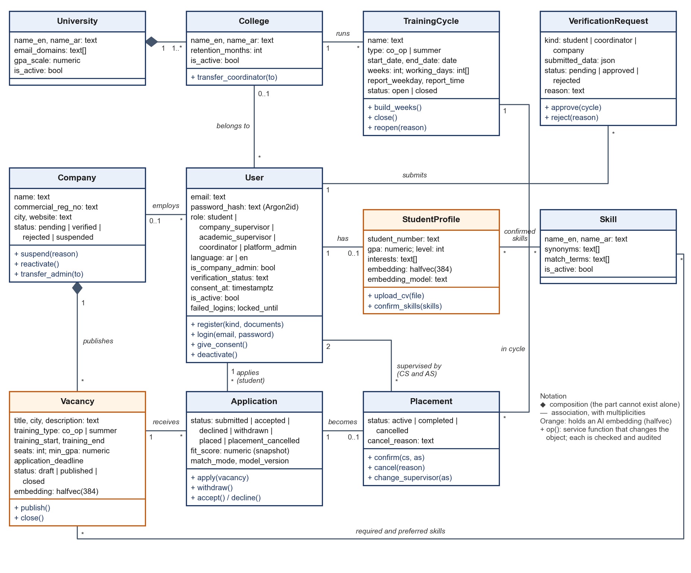

**Figure 5.1 – Class diagram: organizations, accounts, profiles, vacancies, and placement**

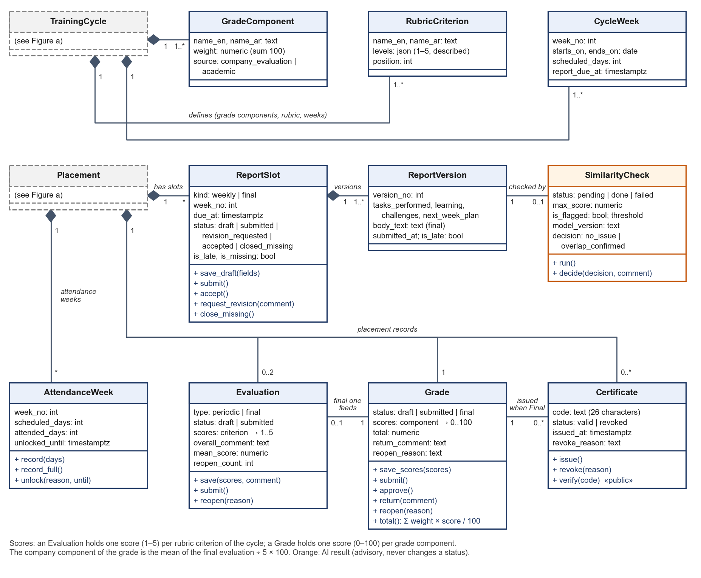

**Figure 5.2 – Class diagram: training records and grading**

The central class is **Placement**: it links one student's accepted **Application** to a **Vacancy** of a company, a **TrainingCycle** of the student's college, one company supervisor, and one academic supervisor. Confirming a placement creates its **ReportSlots** (one per week and one final) and its **Grade** in `draft`. All training records hang from the placement, so the scope rule of every role is one join to the placement. **User** carries one role; a student, an academic supervisor, and a coordinator belong to a **College**, and a company supervisor to a **Company**. The orange classes hold an embedding vector; their AI results are advisory.

Figure 5.3 zooms into one module, report review, at the level of the code: the service functions with their parameters, the records they change, the slot status enumeration, and the `Actor` that every service function checks. The other modules follow the same pattern.

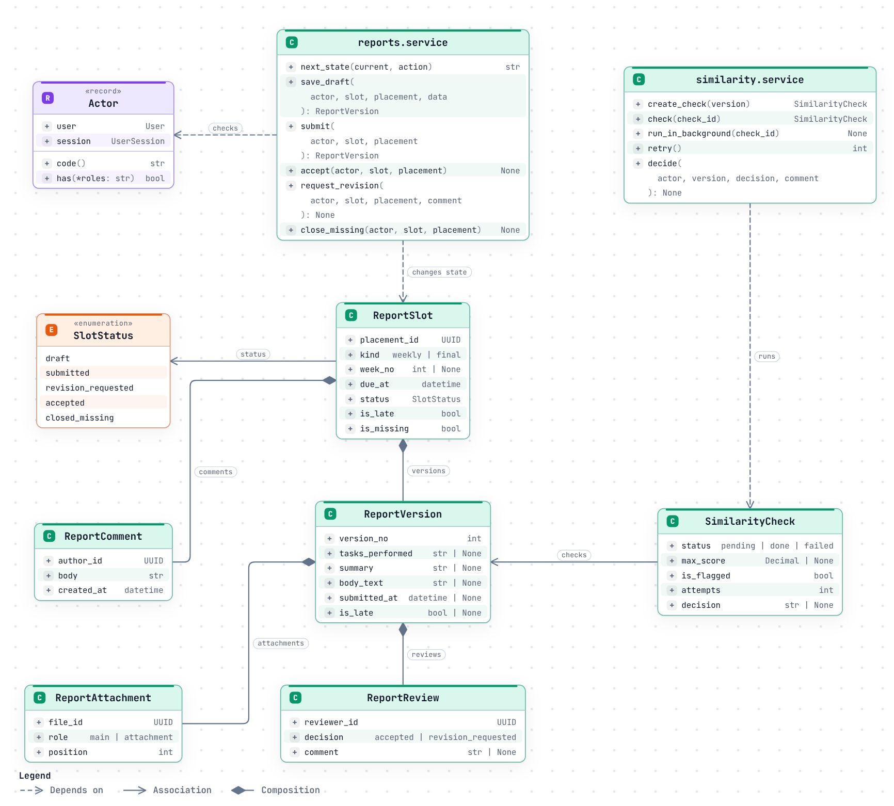

**Figure 5.3 – Class diagram of the report review module: services, records, and the slot status**

### 5.3 Module Descriptions

#### 5.3.1 Authentication and Session

**Purpose:** prove who the caller is and keep the session safe (FR-AUT-02 – 04, NFR-SEC-02/03, NFR-PRV-01).

**Inputs:** registration form with documents (`multipart/form-data`); email and password; single-use tokens from confirmation, invitation, and reset links; the bearer token on every request.

**Outputs:** an access token (JWT with `sub`, `role`, `sid`, `iat`, `exp`), the user with role, organization, language, `consent_required`, and `idle_timeout_minutes`; a `user_sessions` row; emails.

**Processing:**

1. **Register:** validate the form for the chosen kind (student, coordinator, company), limit registrations per IP address per hour, store the account with an Argon2id hash, the verification request and its documents, and email a confirmation link.
2. **Log in** (Figure 5.4): find the user; if `locked_until` is in the future answer `423`; on a wrong password increase `failed_logins` and lock for 15 minutes on the fifth failure; refuse inactive or unconfirmed accounts; otherwise reset the counter, create a session with `expires_at` at most 12 hours ahead, issue the JWT, and write an audit entry. An unknown email is checked against a dummy hash so its timing matches a wrong password.
3. **Every request:** the pipeline of Section 4.4 checks the session, the idle limit, consent, verification, and role.
4. **Logout and password reset** revoke the session (reset revokes all sessions of the user). "Forgot password" always answers `202`, so accounts cannot be discovered.

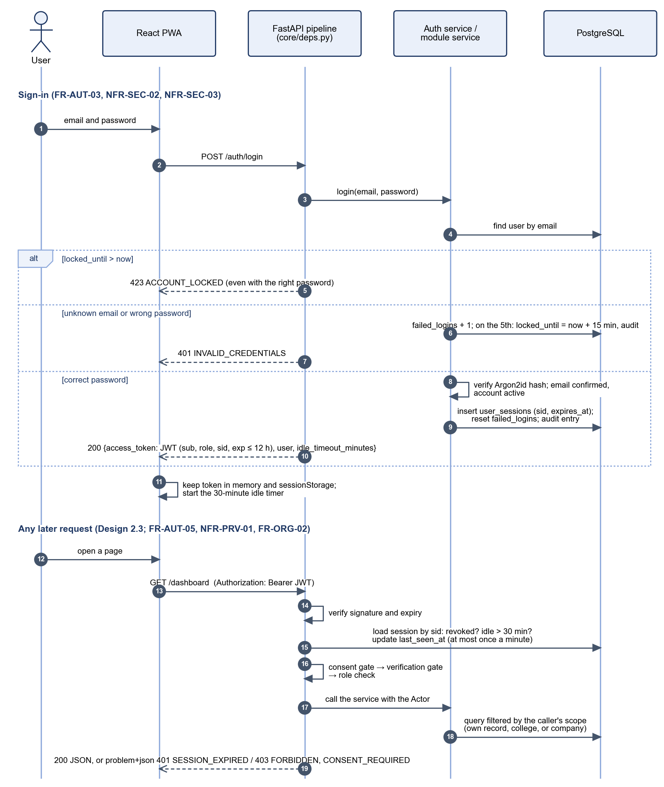

**Figure 5.4 – Sequence diagram: sign-in and an authorized request through the pipeline**

#### 5.3.2 Organizations and Verification

**Purpose:** let many universities and companies join safely (FR-ORG-01 – 09, FR-AUT-06).

**Inputs:** universities and colleges (Platform Admin), verification decisions with reasons, invitations, transfer and deactivation requests.

**Outputs:** verified users and companies, enrolments of approved students in a cycle, notifications, audit entries.

**Processing:** the Platform Admin decides coordinator and company requests; the college's coordinator decides student requests and chooses the open cycle to enrol the student in. Approval sets the user to `verified`; for a company it also sets the company to `verified` and makes the representative its Company Admin. A rejection needs a reason, and the applicant may submit a corrected request. Coordinators invite academic supervisors and Company Admins invite company supervisors by email with a single-use link. Suspending a company closes its published vacancies; running placements continue. Deactivating an account revokes all its sessions. The coordinator role and the Company Admin right can be transferred by the Platform Admin to another verified member, with a reason.

#### 5.3.3 Training Cycles and Catalog

**Purpose:** hold the configuration of each college's training and of the platform (FR-CYC-01 – 05, NFR-MNT-03).

**Processing:**

- **Weeks:** week *k* covers `start_date + 7(k−1)` to `start_date + 7k − 1`. Its report deadline is the day whose ISO weekday equals `report_weekday`, at `report_time` in Asia/Riyadh, stored in UTC. `scheduled_days` counts the cycle's working days inside the week and the cycle dates.
- **Grade components** must total 100%; the source of each is the company evaluation or the academic supervisor. **Rubric criteria** have five described levels. The rubric locks when the first evaluation is submitted.
- A **closed cycle** is read-only: every write to its records returns `409 CYCLE_CLOSED`; reopening needs a reason.
- The **skill vocabulary** (names in both languages, synonyms, learning resources), the majors, and the platform settings are maintained by the Platform Admin. Every value marked "default" in the SRS is a row of `system_settings` or a cycle field.

#### 5.3.4 Student Profile and Skill Extraction

**Inputs:** a CV (PDF or DOCX, at most 5 MB); the student's confirmed, removed, or added skills; interests.

**Outputs:** a CV version with its extracted text, skills found with an evidence snippet, confirmed student skills, and the profile embedding.

**Algorithm (rule-based, explainable):**

1. Check the file type by its first bytes and extract the text (`pypdf`, `python-docx`). Fewer than 50 letters: mark the CV `no_text` and ask for skills by hand (FR-PRF-05).
2. Normalize: lowercase Latin letters; for Arabic remove diacritics and tatweel, write every form of alef (أ, إ, آ) as a plain alef (ا), alef maqsura (ى) as ya (ي), and ta marbuta (ة) as ha (ه); collapse spaces and punctuation.
3. Scan the tokens with a dictionary of every skill name and synonym normalized the same way, as phrases of 1 to 4 tokens; the longest phrase wins at each position. The first token may drop an attached Arabic particle such as wa (و) or bi (ب), as in the word «والتواصل», but only when the rest completes a known phrase.
4. Store each match with a short evidence snippet. Only skills the student confirms become `student_skills`.
5. Embed the profile text (confirmed skills in both languages, interests, and the start of the CV text, prefixed `query: `) and store it with its model version.

#### 5.3.5 Vacancies, Applications, and Placement

**Processing and rules** (state machines in Figures 5.11 and 5.12):

- A company supervisor of a **verified** company creates a vacancy as `draft` or publishes it; publishing needs all required fields and a future deadline. A vacancy closes by hand, when its last seat is filled, or when its company is suspended; then its active applications become `withdrawn` with reason `vacancy_closed` and the students are notified.
- A student **applies** only when verified and enrolled in an open cycle, the vacancy is published, open to the student's university, before its deadline, the student is eligible (major, GPA, training type equal to the cycle's type, CR-06), has not applied before, and has fewer than `applications.max_active` active applications. The fit score at that moment is stored on the application as a snapshot.
- The company accepts or declines. The coordinator of the student's college **confirms the placement**, choosing the academic supervisor and the company supervisor. Confirmation, in one transaction: placement `active`, application `placed`, the student's other active applications `withdrawn`, report slots created, the grade created in `draft`, the vacancy closed if it was the last seat, notifications to the student and both supervisors.
- Cancelling a placement or changing its academic supervisor needs a reason.

#### 5.3.6 Matching

**Inputs:** the verified, enrolled student with confirmed skills; the published vacancies; the weights and calibration values from the settings.

**Outputs:** the ranked list of eligible vacancies with `fit_score`, its parts, matched and missing skills, `mode` (`semantic`, `basic`, or `mixed`), the model version, and `advisory: true`; one vacancy's development plan.

**Algorithm (FR-MAT-01 – 07):**

1. **Eligible vacancies:** published, open to the student's university, before the deadline, the student's major eligible, GPA ≥ `min_gpa`, and training type equal to the student's cycle type. Ineligible vacancies are left out and show their reason when browsing.
2. **Score parts:** `semantic = clamp((cos − floor) ÷ (ceiling − floor), 0, 1)` with floor 0.70 and ceiling 0.95, which spreads the narrow cosine range of the e5 model over 0–1; `required = |S ∩ R| ÷ |R|` (1 when no skill is required); `preferred = |S ∩ P| ÷ |P|`, and when the vacancy lists no preferred skill its weight moves to `required`.
3. **Fit score:** `fit = 100 × (0.5 · semantic + 0.4 · required + 0.1 · preferred)`, rounded to two decimals; ties are ordered by the required part, then by the earlier deadline.
4. **Fallback:** without an embedding or when the model is off, `fit = 100 × (w_r · required + w_p · preferred) ÷ (w_r + w_p)`, labelled "Basic matching" (FR-MAT-04).
5. **Explanation and plan:** matched skills `S ∩ R`, missing skills `R − S`; the plan lists each missing skill with its learning resources, or "No resource available yet".
6. **Advisory:** no code path changes an application because of a score (FR-MAT-07).

The scoring is a set of pure functions (`matching/scoring.py`) without database access, so the AI evaluation script and the unit tests use exactly the code that the API uses.

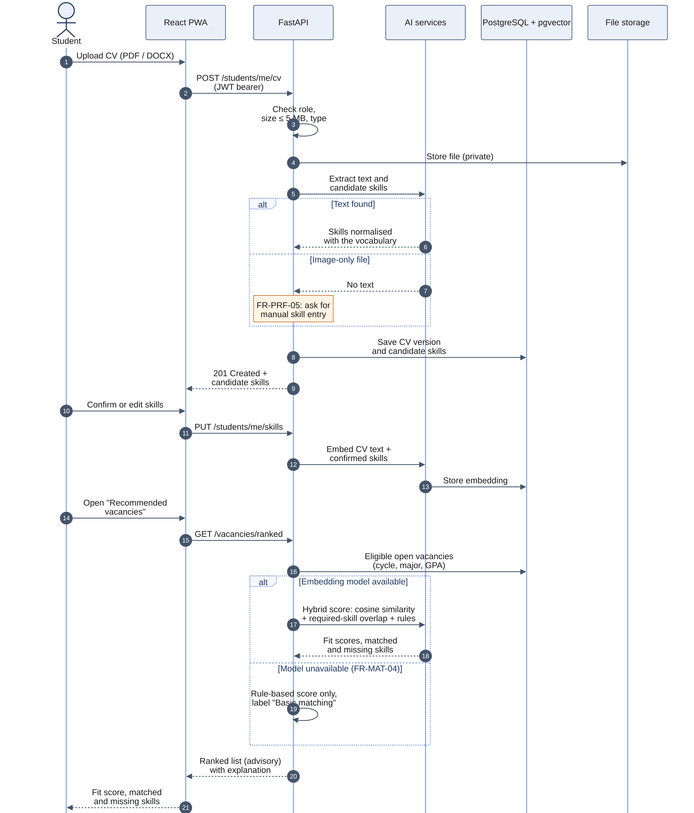

**Figure 5.5 – Sequence diagram: CV upload, skill confirmation, and ranked matching with fallback**

#### 5.3.7 Weekly and Final Reports

**Inputs:** the four text fields of a weekly report (tasks performed, learning, challenges, next week's plan) or the main document of the final report; up to the configured number of attachments; review decisions and comments.

**Outputs:** report versions, On time or Late status, the review history, comments, notifications, and a similarity check per submission.

**Processing:**

- Saving creates or updates the single draft version; it does not change the slot's state. Attachments are uploaded to the draft one by one.
- **Submit** checks the required fields and the attachment limits and changes the state in one transaction, so a failed upload never leaves a half-submitted report (NFR-REL-04). The submission time is the server's; it is On time when `submitted_at < due_at + 60 seconds`, so with a 23:59 deadline 23:59:30 is On time and 00:00 is Late (NFR-L10N-02).
- The academic supervisor accepts or requests a revision with a mandatory comment; a resubmission starts as a copy of the last submitted version. After the deadline, a slot without a submitted version can be closed as missing.
- The `flag_missing` job marks a slot Missing within 15 minutes after its deadline passes (FR-REP-04).

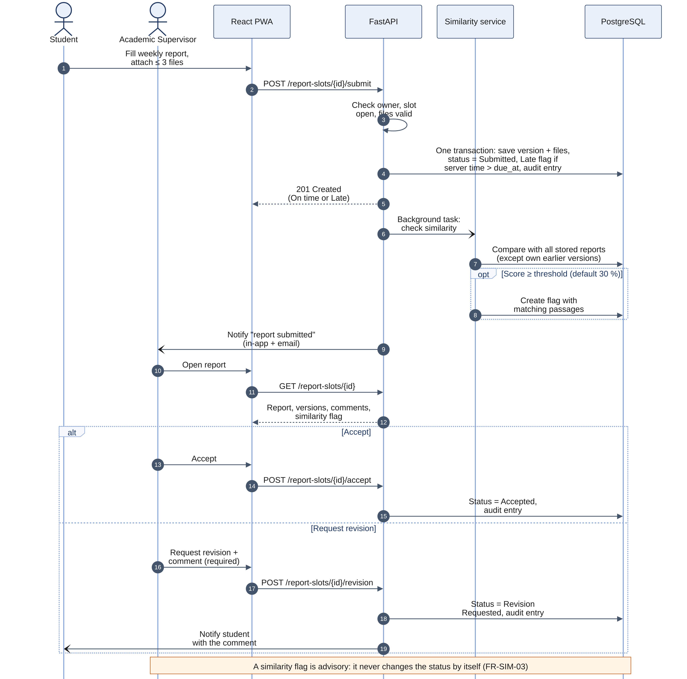

**Figure 5.6 – Sequence diagram: weekly report submission, similarity check, and review**

#### 5.3.8 Similarity Detection

**Inputs:** a submitted report version. **Outputs:** a similarity check (`pending`, `done`, or `failed`) with the highest score, the flag, the top 5 source reports with their passage pairs, and the model version; the supervisor's decision.

**Algorithm (FR-SIM-01 – 03, CR-09):**

1. **Passages:** split the body text into sentences (on `.`, `!`, `?`, `؟`, `؛`, and line breaks); a sentence shorter than 8 words joins the next one, and one longer than 25 words is cut into pieces of 25 words. Each passage is embedded and stored in `report_passages` with the university of its author.
2. **Candidates:** for each passage, the 5 nearest passages by cosine (HNSW index) from submitted versions of **other** report slots of the **same university**; earlier versions of the same slot are excluded.
3. **Confirm:** a passage overlaps a source report when one of that report's candidates reaches cosine ≥ 0.90 **and** at least 50% of the passage's word 5-grams appear in that report's candidates taken together.
4. **Score per source:** characters of the checked report covered by confirmed passages ÷ all its characters. A source at or above the threshold (default 30%) flags the check.
5. **Decision:** the academic supervisor records "No issue" or "Overlap confirmed" with a comment. Nothing else changes; the author of a source report is shown only to the coordinator of the author's college.

#### 5.3.9 Attendance

The company supervisor records the attended days of each week (or "Full attendance" in one click) from the week's start until `attendance.edit_days` after its end. Later edits need an unlock by the coordinator with a reason and an end date. Recorded days cannot exceed the scheduled days (`422 ATTENDED_EXCEEDS_SCHEDULED`). Each week shows a state (`upcoming`, `open`, `pending`, `overdue`, `recorded`) and the placement shows its attendance percentage: Σ attended ÷ Σ scheduled over recorded weeks (FR-ATT-01 – 04).

#### 5.3.10 Evaluations and Feedback

The company supervisor completes a periodic and a final evaluation on the cycle's rubric: every criterion rated 1–5 and an overall comment are required to submit. Submitting locks the rubric and stores the mean score. The coordinator may reopen a submitted evaluation once, with a reason; a final evaluation only while its grade is still `draft`. The student sees the periodic evaluation when submitted and the final one only when the grade is Final (FR-EVL-03). After training, the student evaluates the company on four 1–5 questions and answers the job-offer survey (FR-EVL-05, FR-DSH-03); company supervisors never see these answers.

#### 5.3.11 Grades and Approval

**Inputs:** component scores from the academic supervisor (0–100); approval, return, and reopen decisions from the coordinator.

**Outputs:** the grade state and total; `409 PRECONDITIONS_UNMET` with the list of missing items.

**Algorithm:** the company component equals the mean of the final evaluation's criterion scores ÷ 5 × 100. `total = Σ (weight × score) ÷ 100`, rounded half up to two decimals, recomputed on every change and stored on submission and approval (FR-WFL-02).

**Workflow (Figure 5.14):** the academic supervisor can submit only when the final evaluation is submitted, the final report is accepted, every weekly slot is accepted or closed as missing, and every academic component is entered. The coordinator approves (one by one or in bulk), which makes the grade Final and the placement `completed`, or returns it with a comment; a Final grade can be reopened with a reason. The student sees the grade only when Final (FR-WFL-06).

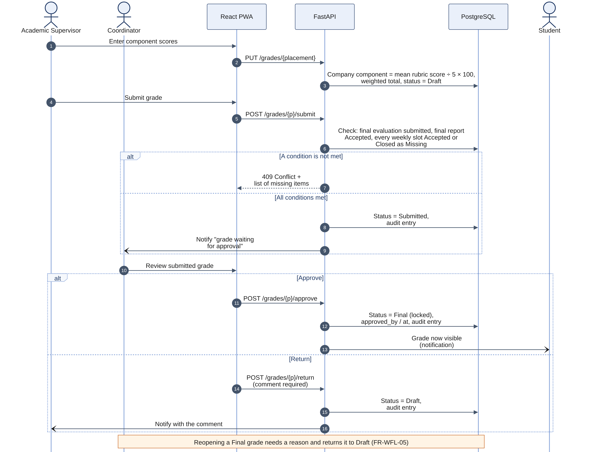

**Figure 5.7 – Sequence diagram: grade submission, preconditions, and approval**

#### 5.3.12 Dashboards and Statistics

Every count is a live query, so it always equals the database (FR-DSH-01). Each pending action opens its page with one click (NFR-USA-02).

**Table 5.2 – Pending actions by role**

| **Role** | **Pending actions** |
|:---|:---|
| ST | Reports due in 7 days or overdue; revisions requested; applications by status; evaluation of the company and survey after training |
| CS | Applicants to review; ended weeks without attendance; evaluations due or overdue |
| AS | Submitted reports to review; flagged similarity checks without a decision; grades whose preconditions are met |
| CO | Student verification requests; accepted applications without a placement; grades to approve; escalations (items 3 or more days overdue) |
| PA | Coordinator and company verification requests with their age; platform figures |

The coordinator's cycle statistics show placed and unplaced students, report submission and late rates, attendance, evaluation completion, the job-offer rate, and leniency alerts: a company with at least 5 final evaluations whose mean is at least 0.8 above the cycle mean (FR-DSH-04).

#### 5.3.13 Exports and Certificates

- **Excel grade sheet** (`openpyxl`), one row per placement. Cell values starting with `=`, `+`, `-`, or `@` are prefixed with `'` to prevent formula injection.
- **PDF** grade sheet, term summary, and training record (fpdf2 with HarfBuzz shaping; Noto Sans for Latin text with Noto Naskh Arabic as its fallback). In Arabic the text is right-aligned and table columns run from the right.
- **Certificate** (FR-CER-01 – 03): issued by the coordinator when the grade is Final; one A4 landscape page in English and Arabic with the student, university and college, cycle, company, training dates, issue date, a 26-character code, and a QR code for `https://<frontend>/verify/<code>`, without the grade. It is built once and stored. Revoking needs a reason. The public check accepts the code with or without dashes in any case and answers Valid, Revoked, or Not found; after an anonymization it still answers, without the name.

#### 5.3.14 Notifications and Scheduled Jobs

A service function calls `notify(users, event, params)` inside its transaction. This writes the in-app notification rows with their email and push status `pending` (the outbox). The `deliver_notifications` job sends the email in the recipient's language and the web push (title and link only), retrying a failed email up to 5 times (FR-NOT-01 – 06).

All jobs run inside the API process under APScheduler. Each job runs in one transaction under a transaction-level advisory lock, so two containers never run the same job at once, and a crash never leaves the lock held. Jobs select work **by state**, not by time window, so work missed during downtime is done on the next run (NFR-REL-03).

**Table 5.3 – Scheduled jobs**

| **Job** | **Every** | **Does** | **Idempotency** |
|:---|:---|:---|:---|
| `send_reminders` | 15 min | Reminds students of reports due within 24 hours (FR-NOT-02) | `reminder:{slot_id}` |
| `flag_missing` | 15 min, and 30 s after start | Marks reports Missing after the deadline and notifies the student and the AS (FR-REP-04, FR-NOT-03) | `missing:{slot_id}:{user_id}` |
| `escalate_overdue` | 15 min | Tells the coordinator about reports, attendance, and evaluations 3 or more days late (FR-NOT-04) | `escalation:{type}:{id}` |
| `embed_missing` | 15 min | Embeds profiles and vacancies that have no vector yet (for example after the model was off) | Selects rows without a vector |
| `similarity_retry` | 5 min | Runs checks still pending after 5 minutes, or failed fewer than 3 times | Attempt counter |
| `deliver_notifications` | 1 min | Sends pending emails and push messages | Status per channel |
| `purge_verification_documents` | Daily 03:00 | Deletes verification documents 30 days after the decision (FR-ORG-08) | `purged_at` |
| `cleanup` | Daily 03:30 | Deletes expired sessions and tokens and old job runs | – |

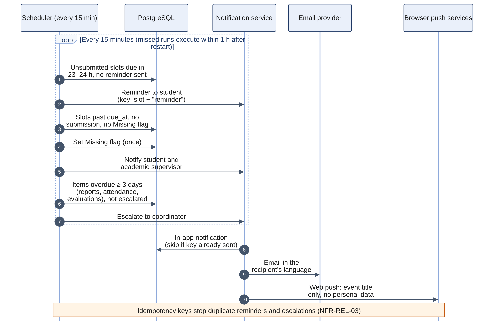

**Figure 5.8 – Sequence diagram: scheduled reminders, Missing flags, and escalation**

#### 5.3.15 Files

1. **Upload:** the body is read as a stream with a size cap from the settings; a larger file is refused with `413` before it is stored.
2. **Type check:** the type comes from the first bytes: PDF, PNG, and JPEG by their magic bytes; a DOCX must be a ZIP that contains `[Content_Types].xml` and `word/document.xml`. Anything else is refused with `415`, so an executable renamed to `.pdf` is rejected.
3. **Store:** the file is written under a random key in the private bucket (or the local volume), then its `files` row is inserted with its SHA-256 hash.
4. **Download:** `GET /files/{id}` finds the record that owns the file, applies that record's permission rule, and streams the file with `Cache-Control: private, no-store`; otherwise `403`, or `410` for a purged verification document (NFR-SEC-04).

#### 5.3.16 Audit, History, and Privacy

- **Audit:** every state change writes one `audit_log` row (who, role, action, entity, the student, college, company, and cycle concerned, old and new values, reason) in the same transaction. The table is append-only, enforced by a trigger and by privileges (FR-AUD-01, FR-AUD-02). The coordinator sees the entries of the college; the Platform Admin sees entries about accounts and organizations.
- **History** of a report, evaluation, or grade is the audit log filtered by that record (FR-AUD-03).
- **Anonymization** (NFR-PRV-04): once a cycle has been closed for longer than the college's `retention_months`, the coordinator sees the counts and confirms. Names and contact details of the cycle's students are replaced by placeholders; CV files, extracted text, skills, embeddings, report text and attachments, comments, and certificate files are removed. Statuses, scores, dates, majors, companies, and survey answers stay, so the statistics do not change. A student still in another open or retained cycle is skipped.

### 5.4 Behaviour Models

#### 5.4.1 Activity Diagrams

The two activity diagrams show the whole life cycle across the roles, from registration to the Final grade.

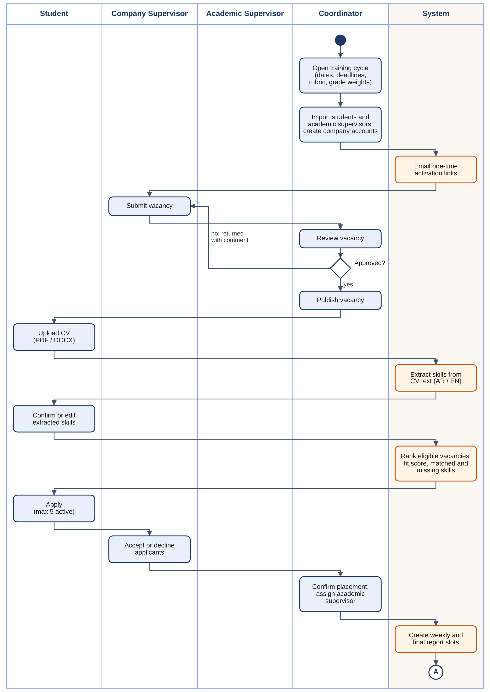

**Figure 5.9 – Activity diagram: registration, verification, cycle setup, and placement**

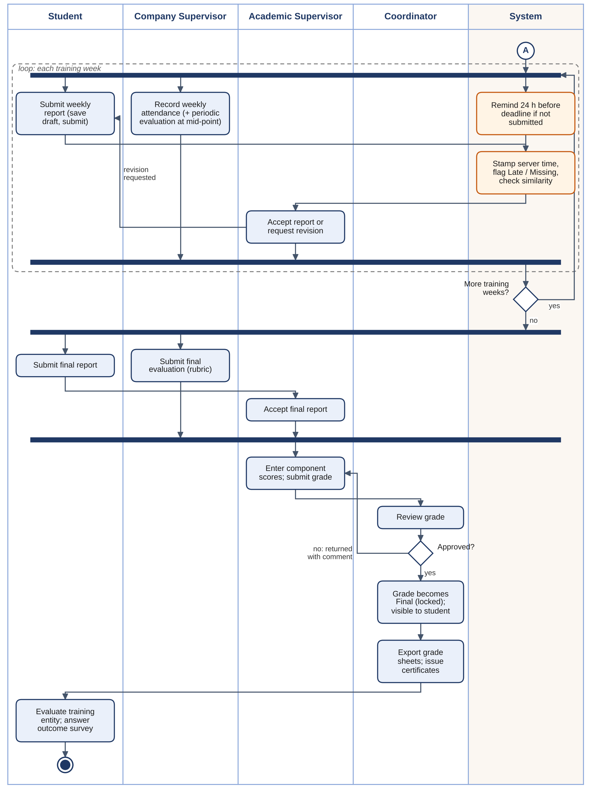

**Figure 5.10 – Activity diagram: weekly training loop, evaluations, and grade approval**

#### 5.4.2 State Machines

Every transition is one service function. A transition that is not listed returns `409 INVALID_TRANSITION` (FR-WFL-01).

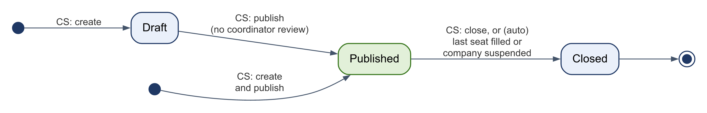

**Figure 5.11 – State machine: vacancy**

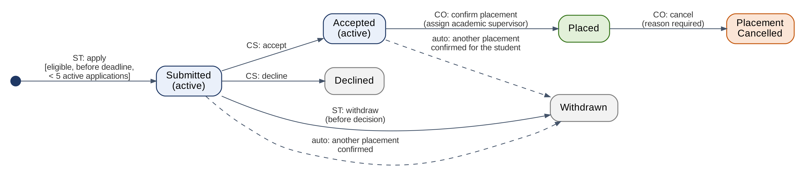

**Figure 5.12 – State machine: application and placement**

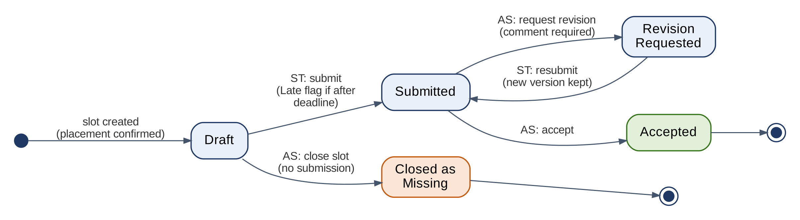

**Figure 5.13 – State machine: report slot**

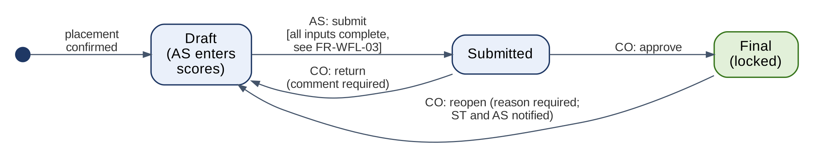

**Figure 5.14 – State machine: grade**

**Table 5.4 – Main transitions (the full tables with guards are in Section 5.1 of the design document)**

| **Record** | **From → To** | **Actor** | **Guard** |
|:---|:---|:---|:---|
| Vacancy | `draft` → `published` → `closed` | CS (own) or CA; system on last seat or suspension | Required fields; future deadline |
| Application | – → `submitted` → `accepted` / `declined` / `withdrawn` → `placed` | ST; CS or CA; CO | Eligibility and the active-application limit |
| Placement | `active` → `completed` / `cancelled` | system on Final grade; CO with a reason | – |
| Report slot | `draft` → `submitted` → `accepted` / `revision_requested` → `submitted`; `draft` → `closed_missing` | ST; AS (assigned) | Required fields; comment for a revision; deadline passed for missing |
| Evaluation | `draft` → `submitted` → `draft` (reopen once) | CS (assigned); CO | Every criterion and the comment |
| Grade | `draft` → `submitted` → `final`; `submitted` → `draft` (return); `final` → `draft` (reopen) | AS (assigned); CO | Preconditions met; comment or reason |
| Certificate | – → `valid` → `revoked` | CO | Grade Final; reason to revoke |
| Training cycle | `open` ↔ `closed` | CO | Reason to reopen |

#### 5.4.3 AI Pipelines

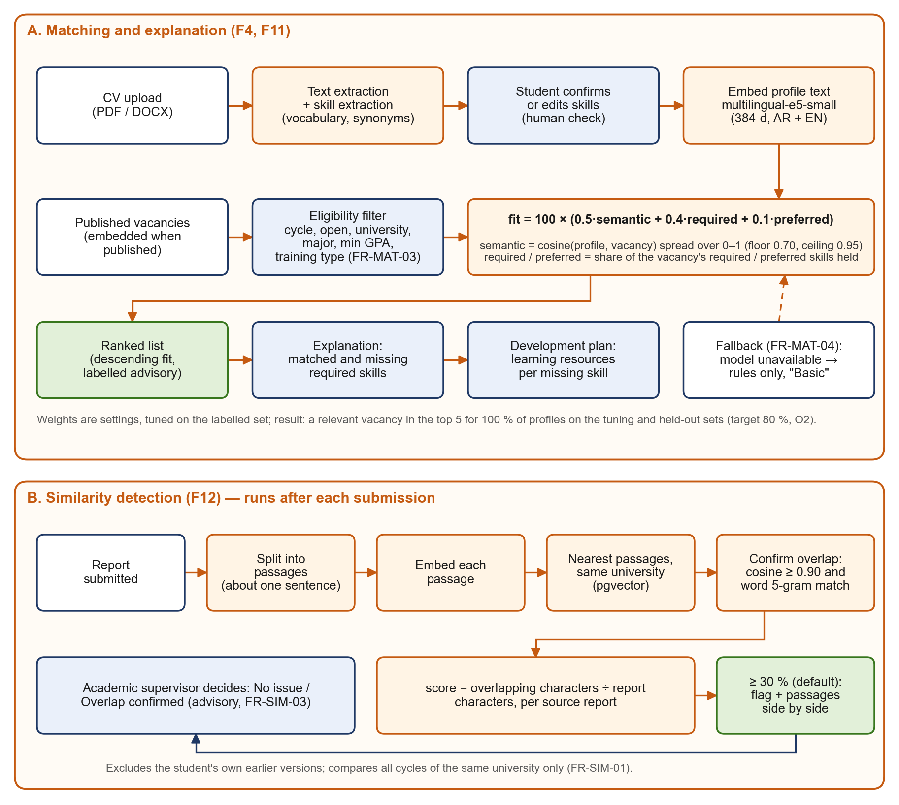

**Figure 5.15 – AI pipelines: matching with explanation, and similarity detection**

The model `intfloat/multilingual-e5-small` is baked into the Docker image at build time, so the container never downloads it at run time and no text leaves the container (NFR-PRV-02). Every stored AI result records its model as `<model name>@<revision>` (NFR-AI-02). The labelled sets and `ai-eval/evaluate.py` measure skill recall, the top-5 hit rate, and the similarity detection rates with the same service code as the API (NFR-AI-03).

### 5.5 Error Handling

All errors use `application/problem+json` (RFC 9457) with a stable `code`, a title, and a message in the user's language; `422` answers list each field with its own code. A few codes carry data, such as `missing` for `PRECONDITIONS_UNMET` and `locked_until` for `ACCOUNT_LOCKED`. Unexpected errors return `500 INTERNAL_ERROR` without internal details, and the request log keeps only the method, path, status, duration, and user ID.

**Table 5.5 – Representative error codes**

| **Status** | **Codes** | **Meaning** |
|:--:|:---|:---|
| 401 | `UNAUTHENTICATED`, `SESSION_EXPIRED`, `INVALID_CREDENTIALS` | No valid token or session; wrong login |
| 403 | `FORBIDDEN`, `CONSENT_REQUIRED`, `VERIFICATION_REQUIRED`, `EMAIL_NOT_CONFIRMED`, `ACCOUNT_INACTIVE` | Role, scope, consent, or verification does not allow the request |
| 409 | `INVALID_TRANSITION`, `PRECONDITIONS_UNMET`, `CYCLE_CLOSED`, `APPLICATION_LIMIT_REACHED`, `WEEK_LOCKED` | Conflict with the current state or a limit |
| 413, 415 | `FILE_TOO_LARGE`, `UNSUPPORTED_FILE_TYPE` | Upload refused |
| 422 | `VALIDATION_ERROR` with field errors such as `WEIGHTS_NOT_100` | Input is not valid |
| 423 | `ACCOUNT_LOCKED` | Five failed logins; locked for 15 minutes |
| 429 | `RATE_LIMITED` | Too many registrations from one address |

## 6. Data Design

### 6.1 Database Overview

All data is stored in one PostgreSQL database with the `vector` (pgvector) and `pg_trgm` extensions: **49 tables** in nine groups. Uploaded and generated files live in the private bucket; the database keeps their metadata in `files`.

**Conventions:**

- Table names are plural `snake_case`. Primary keys are `uuid` values, except link tables (composite keys), `audit_log`, `report_passages`, and `job_runs` (`bigint` identity), and `system_settings` (`key`).
- Every timestamp is `timestamptz` stored in UTC; deadlines are computed in Asia/Riyadh time and stored in UTC.
- Status and type values are `text` with a `CHECK` constraint; the API uses the same lowercase values.
- Business records are never deleted; foreign keys use `ON DELETE RESTRICT`. Only technical rows (sessions, push subscriptions, job runs) may be deleted.
- Mutable tables have `created_at` and `updated_at`; who changed what is kept in `audit_log`.
- **Organization scope:** a student, an academic supervisor, and a coordinator carry `users.college_id`; a company supervisor carries `users.company_id`. Academic records reach their college through `placements.student_id` and their company through `vacancies.company_id`.
- The schema is created and changed only by Alembic migrations (six migrations, one per increment step), run automatically when the container starts.

### 6.2 Entity-Relationship Diagrams

The data model is drawn in four ER diagrams in crow's-foot notation; orange columns hold vectors.

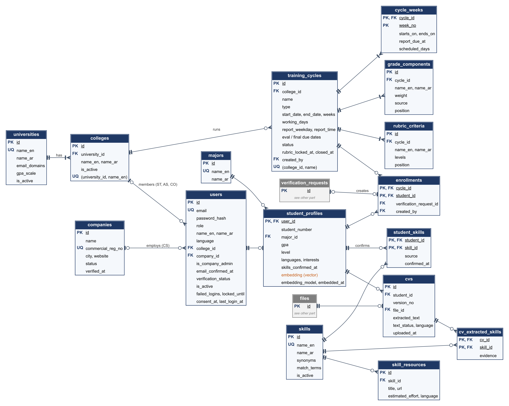

**Figure 6.1 – ERD: organizations, accounts, cycles, and student profiles**

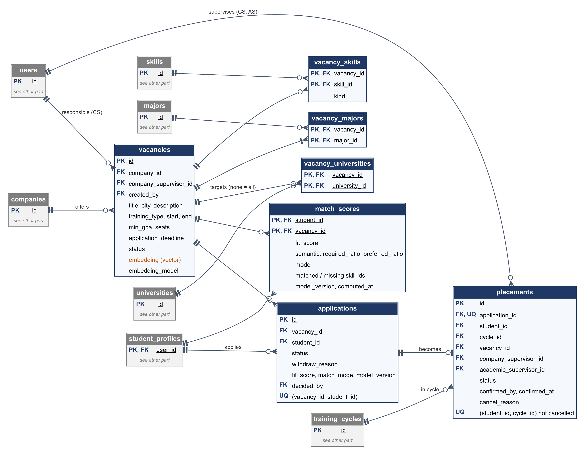

**Figure 6.2 – ERD: vacancies, matching, applications, and placements**

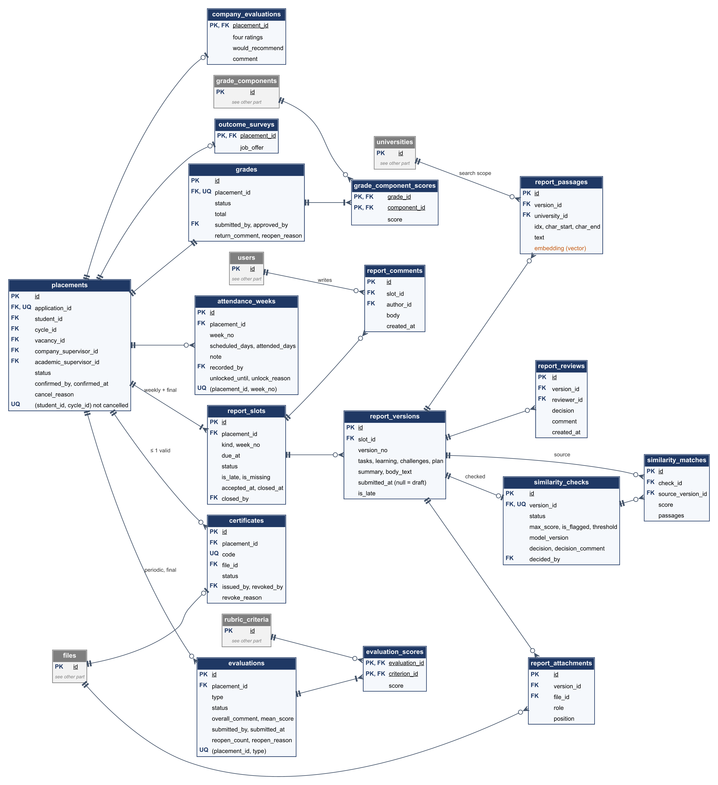

**Figure 6.3 – ERD: reports, similarity, attendance, evaluations, grades, and certificates**

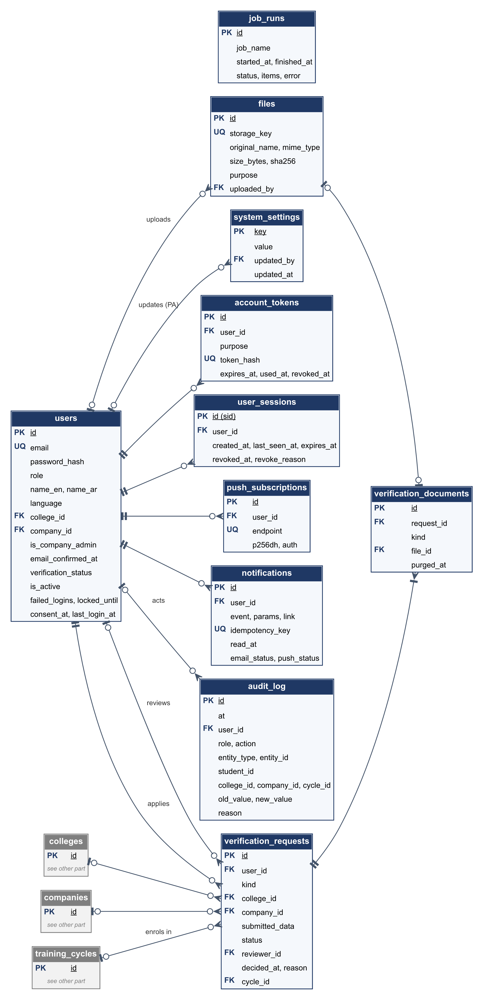

**Figure 6.4 – ERD: verification and platform services (tokens, sessions, files, notifications, audit, settings, jobs)**

### 6.3 Schema Summary

**Table 6.1 – The 49 tables by group**

| **Group** | **Tables** | **Purpose and main relationships** |
|:---|:---|:---|
| Organizations and accounts (8) | `universities`, `colleges`, `companies`, `users`, `verification_requests`, `verification_documents`, `account_tokens`, `user_sessions` | A university has colleges; a user belongs to a college or a company; a user has verification requests with documents, single-use tokens, and sessions |
| Cycles and configuration (5) | `training_cycles`, `cycle_weeks`, `grade_components`, `rubric_criteria`, `enrollments` | A college runs cycles; a cycle has weeks, grade components, rubric criteria, and enrolled students |
| Catalog and settings (4) | `skills`, `skill_resources`, `majors`, `system_settings` | Shared vocabulary with learning resources; majors; configurable defaults |
| Students and CVs (4) | `student_profiles`, `cvs`, `cv_extracted_skills`, `student_skills` | One profile per student with an embedding; CV versions; skills found and skills confirmed |
| Vacancies and placement (7) | `vacancies`, `vacancy_skills`, `vacancy_majors`, `vacancy_universities`, `applications`, `placements`, `match_scores` | A company has vacancies with required and preferred skills, eligible majors, and target universities; applications lead to at most one placement each; stored fit scores |
| Reports and similarity (8) | `report_slots`, `report_versions`, `report_attachments`, `report_reviews`, `report_comments`, `report_passages`, `similarity_checks`, `similarity_matches` | A placement has report slots; a slot has versions with attachments and reviews, and comments; a submitted version has passages and one similarity check with its matches |
| Attendance and evaluations (6) | `attendance_weeks`, `evaluations`, `evaluation_scores`, `company_evaluations`, `outcome_surveys`, `grade_component_scores` | Weekly attendance, rubric scores, the student's feedback, and the component scores of a grade |
| Grades and certificates (2) | `grades`, `certificates` | One grade per placement; certificates issued from a Final grade |
| Platform services (5) | `files`, `notifications`, `push_subscriptions`, `audit_log`, `job_runs` | File metadata, the notification outbox, push endpoints, the append-only audit log, and job history |

### 6.4 Main Table Definitions

The full data dictionary (every column, type, constraint, and rule) is in Section 4.3 of the design document. The four tables below carry the main workflow.

**Table 6.2 – `users`**

| **Column** | **Type** | **Constraints** | **Notes** |
|:---|:---|:---|:---|
| id | uuid | PK | |
| email | text | NN, UQ (lowercase) | Login name |
| password_hash | text | | Argon2id; empty until an invitation is accepted |
| role | text | NN, CHECK (5 roles) | student, company_supervisor, academic_supervisor, coordinator, platform_admin |
| college_id / company_id | uuid | FK; CHECK by role | college for students, academic supervisors, and coordinators; company for company supervisors |
| is_company_admin | bool | NN, default false; partial UQ (company_id) | One Company Admin per company |
| verification_status | text | NN, CHECK | pending, verified, rejected, not_required (invited users and the Platform Admin) |
| language | text | NN, CHECK (ar, en) | Language of the interface, emails, and exports |
| consent_at, email_confirmed_at | timestamptz | | Consent gate; login allowed after confirmation |
| failed_logins, locked_until | int, timestamptz | | Lockout (NFR-SEC-03) |
| is_active | bool | NN | Deactivation revokes all sessions |

**Table 6.3 – `placements`**

| **Column** | **Type** | **Constraints** | **Notes** |
|:---|:---|:---|:---|
| id | uuid | PK | |
| application_id | uuid | FK, UQ | The accepted application |
| student_id, cycle_id, vacancy_id | uuid | FK, NN | Partial UQ (student_id, cycle_id) where not cancelled |
| company_supervisor_id, academic_supervisor_id | uuid | FK, NN | Same company as the vacancy; same college as the student |
| status | text | NN, CHECK | active, completed, cancelled |
| confirmed_by, cancel_reason | uuid, text | | Coordinator; reason required to cancel |

**Table 6.4 – `report_slots`**

| **Column** | **Type** | **Constraints** | **Notes** |
|:---|:---|:---|:---|
| id | uuid | PK | |
| placement_id | uuid | FK, NN | UQ (placement_id, kind, week_no) |
| kind, week_no | text, int | NN, CHECK | weekly (with week) or final |
| due_at | timestamptz | NN | Copied from the cycle week or the final report deadline |
| status | text | NN, CHECK | draft, submitted, revision_requested, accepted, closed_missing |
| is_late, is_missing | bool | NN | Set from the server time and by `flag_missing` |

**Table 6.5 – `grades`**

| **Column** | **Type** | **Constraints** | **Notes** |
|:---|:---|:---|:---|
| id | uuid | PK | |
| placement_id | uuid | FK, UQ, NN | One grade per placement |
| status | text | NN, CHECK | draft, submitted, final |
| total | numeric(5,2) | | Σ weight × score ÷ 100, stored on submit and approval |
| submitted_by, approved_by | uuid | FK | Academic supervisor; coordinator |
| return_comment, reopen_reason | text | | Required by the return and reopen transitions |

### 6.5 Vector Data and Indexes

- `student_profiles.embedding`, `vacancies.embedding`, and `report_passages.embedding` are `halfvec(384)` with an HNSW index using cosine distance; each row also stores the model version.
- One embedding takes about 0.8 KB. At the demonstration size (about 400 students × 13 reports × 15 passages, about 78,000 passage vectors) the vectors and their index take about 140 MB, well under the 500 MB free database; the 10,000-report test of NFR-PER-04 fits in about 250 MB.
- Text search on vacancy titles uses `ILIKE` with a `pg_trgm` GIN index, because PostgreSQL has no built-in Arabic dictionary.
- Similarity search filters on `report_passages.university_id`, so reports of other universities are never compared (FR-SIM-01).

### 6.6 Data Structures in Memory

**Table 6.6 – Main in-memory structures**

| **Structure** | **Where** | **Fields** | **Use** |
|:---|:---|:---|:---|
| `Actor` | `core/deps.py` | user, session; role code; `is_ca`; `has(*roles)` | The authenticated caller passed to every service |
| `Weights` | `matching/scoring.py` | semantic 0.5, required 0.4, preferred 0.1, floor 0.70, ceiling 0.95 | Matching settings read from `system_settings` |
| `Fit` | `matching/scoring.py` | score, mode, semantic, required, preferred, matched, missing | One vacancy's result for one student |
| `Passage` | `similarity/passages.py` | text, start and end character | One sentence-sized piece of a report |
| `Match` | `ai/skills.py` | skill ID, evidence | One skill found in a CV |
| Skill index | `ai/skills.py` | normalized phrase → skill ID | Built from the vocabulary and rebuilt when it changes |

### 6.7 Derived Values, Integrity, Retention, and Backup

- **Derived values (not stored):** active applications of a student (`submitted` or `accepted`); eligibility and its reason; attendance percentage; dashboard counts and cycle statistics; the history of a record.
- **Integrity:** foreign keys with `ON DELETE RESTRICT`; `CHECK` constraints on every status; partial unique indexes (one open verification request per account, one non-cancelled placement per student and cycle); the grade weights total 100; scores within 0–100 and 1–5.
- **Row level security** is enabled with no policies on every table, and the Supabase Data API is disabled, so the public key reads nothing; the API connects with its own role.
- **Retention:** records stay for the life of the system, except verification documents (deleted 30 days after the decision) and the anonymization of closed cycles (5.3.16).
- **Backup:** `backup.yml` dumps the database and downloads the bucket every night, encrypts both with a key from GitHub secrets, and keeps them as workflow artifacts (database 30 days, files 7 days; NFR-REL-02).

## 7. External Interfaces

### 7.1 User Interface

The user interface is the React PWA in Arabic (right to left, the default) and English (left to right), usable from 360 px to 1920 px wide and installable on phones. It uses one design system: the IBM Plex Sans Arabic typeface for both languages, navy as the primary colour, status chips that always show text with their colour, AI results in an orange "Advisory" panel, and touch targets of at least 44 px. The clickable wireframes and the screen list are in Section 8 of the design document, and the user guide shows every role's screens.

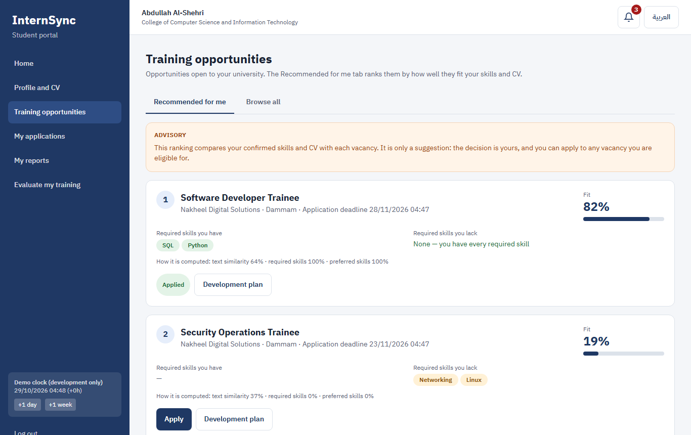

**Figure 7.1 – The student's ranked vacancies with the Advisory label, the score parts, and matched and missing skills (English; the Arabic page is the mirror image)**

### 7.2 REST API

The server offers one REST API under `/api/v1`, described by an OpenAPI 3.1 document generated from the code at `/api/v1/openapi.json`. The [API Specification](../Design/InternSync_API_Spec.md) lists every endpoint with its roles, payload, and errors.

**Table 7.1 – API conventions**

| **Topic** | **Rule** |
|:---|:---|
| Transport and format | HTTPS only; JSON in UTF-8; file uploads as `multipart/form-data`; `snake_case` field names |
| Authentication | `Authorization: Bearer <access_token>` from `POST /auth/login`; endpoints marked Public need no token |
| Language | Error messages and generated texts in the user's saved language, or `Accept-Language` before login |
| Identifiers and time | UUID strings (certificate codes: 26 base32 characters); ISO 8601 with offset, returned in UTC |
| Lists | `?page` and `?page_size` (at most 100); answer `{items, page, page_size, total}`; `?sort=field` or `-field` |
| State changes | Each transition is its own `POST /<resource>/{id}/<action>` endpoint and writes one audit entry |
| Errors | `application/problem+json` with a stable `code` (Section 5.5) |
| Downloads | `GET /files/{id}` streams the file after the permission check; export endpoints return the file directly |

**Table 7.2 – Endpoint groups**

| **Group** | **Main endpoints** | **Roles** |
|:---|:---|:---|
| Authentication and session | `POST /auth/register`, `/auth/login`, `/auth/logout`, `/auth/password/reset`; `GET /me`; `POST /me/consent` | Public; any |
| Organizations and verification | `/universities`, `/colleges/{id}`, `/companies/{id}`, `/verification-requests/{id}/approve`, `/users/{id}/deactivate` | PA, CO, CA |
| Cycles and catalog | `/cycles`, `/cycles/{id}/grade-components`, `/cycles/{id}/rubric`, `/skills`, `/majors`, `/settings` | CO, PA |
| Profile, vacancies, matching | `/students/me/cvs`, `/students/me/skills`, `/vacancies`, `/applications/{id}/accept`, `/placements`, `/students/me/matches` | ST, CS, CA, CO |
| Reports and similarity | `/report-slots/{id}/draft`, `/report-slots/{id}/submit`, `/report-slots/{id}/accept`, `/report-versions/{id}/similarity` | ST, AS, CO |
| Attendance, evaluations, grades | `/placements/{id}/attendance/{week}`, `/placements/{id}/evaluations/{type}/submit`, `/grades/{id}/submit`, `/grades/{id}/approve` | CS, AS, CO |
| Dashboards, exports, certificates | `/dashboard`, `/cycles/{id}/stats`, `/cycles/{id}/exports/grade-sheet`, `/placements/{id}/certificate`, `/public/certificates/{code}` | All roles; Public |
| Notifications, audit, files, system | `/notifications`, `/push/subscriptions`, `/audit`, `/files/{id}`, `/health`, `/version` | Any; CO, PA; Public |

An example: `POST /auth/login` with `{email, password}` returns `200` with `{access_token, token_type: "bearer", expires_at, idle_timeout_minutes: 30, user: {id, role, name_en, name_ar, language, consent_required, verification_status, is_company_admin, organization}}`, or `401 INVALID_CREDENTIALS`, `423 ACCOUNT_LOCKED` (with `locked_until`), `403 ACCOUNT_INACTIVE`, `403 EMAIL_NOT_CONFIRMED`.

### 7.3 Database Interface

The API reaches PostgreSQL through SQLAlchemy 2.0 and psycopg 3, over TLS through the Supabase session pooler, with its own database role that owns the tables. Each request uses one session and one transaction; jobs open their own. Vector search uses pgvector operators (`<=>` cosine distance) on the HNSW indexes.

### 7.4 File Storage Interface

The storage adapter has two implementations chosen by `STORAGE_BACKEND`: `supabase` (Supabase Storage REST API with the service key, private bucket) and `local` (a Docker volume outside any web root). Both offer the same operations: put a file under a random key, read it as a stream, and delete it. No browser ever receives a storage link.

### 7.5 Email and Web Push

- **Email:** Python `smtplib` over TLS to the SMTP provider (Gmail with an app password in the reference deployment; Mailpit locally). Templates are Jinja2, one per event and language. Messages: email confirmation, invitation, password reset, and notifications (FR-NOT-01, FR-NOT-06).
- **Web push:** the Web Push protocol through the browser vendors' push services, signed with VAPID keys (`pywebpush`). The browser registers a subscription (endpoint and keys) with `POST /push/subscriptions`. The payload holds the event title and a link only (NFR-PRV-03). On iOS the app must be installed to the home screen; email is the fallback (SRS D-04).

### 7.6 AI Model and Libraries

**Table 7.3 – Libraries and models used by the server**

| **Library or model** | **Purpose** | **Interface** |
|:---|:---|:---|
| `intfloat/multilingual-e5-small` via `sentence-transformers` | 384-dimension embeddings of profiles, vacancies, and passages | In-process call: text list → vectors; prefixes `query: ` and `passage: ` |
| `pypdf`, `python-docx` | Text of CVs and final reports | File bytes → text |
| `filetype` | Content-type detection | First bytes → type |
| `argon2-cffi`, `PyJWT` | Password hashes; access tokens | Hash and verify; encode and decode |
| `APScheduler` | Scheduled jobs | Interval and daily triggers |
| `fpdf2`, `uharfbuzz`, Noto fonts | PDF exports and certificates with Arabic shaping | Drawing calls → PDF bytes |
| `openpyxl`, `qrcode` | Excel grade sheet; certificate QR code | Rows → .xlsx; URL → image |
| `pywebpush`, `smtplib`, Jinja2 | Push and email delivery | Message → provider |

### 7.7 Public Certificate Verification

Each certificate carries a QR code for `https://<frontend>/verify/<code>`. Scanning it with any phone camera opens the public page, which calls `GET /api/v1/public/certificates/{code}` and shows Valid (with the student, university, college, company, cycle, and training dates), Revoked, or Not found, never the grade (FR-CER-02).

### 7.8 Hosting and CI Interfaces

- **GitHub Actions:** `ci.yml` (lint, tests with the coverage gate, permission matrix, frontend tests and build, i18n key check, API client check, dependency audits) on every pull request; `deploy-api.yml` pushes the image sources to the Hugging Face Space with `HF_TOKEN`; `backup.yml`; `keepalive.yml` calls `GET /api/v1/health?deep=true`, which runs `SELECT 1` and reports the scheduler's last run; `security-scan.yml` runs the OWASP ZAP scans.
- **Vercel** builds and deploys `frontend/` on each push to `main` and a preview for each pull request; it sends the security headers of `vercel.json`.

### 7.9 Communication Protocols

**Table 7.4 – Protocols**

| **Link** | **Protocol** | **Data** |
|:---|:---|:---|
| Browser ↔ web client host | HTTPS (TLS 1.2 or later) | Static files of the PWA |
| PWA ↔ API | HTTPS, REST, JSON, JWT bearer | API requests and answers; files as multipart or streams |
| API ↔ database | PostgreSQL wire protocol over TLS | SQL and vector queries |
| API ↔ file storage | HTTPS (Supabase Storage REST) or local file system | File bytes |
| API → email provider | SMTP with STARTTLS | Email messages |
| API → push services → browser | Web Push (RFC 8030) with VAPID | Encrypted payload with a title and a link |
| Phone camera → public page | QR code with an HTTPS URL | Certificate code |

### 7.10 Hardware Interfaces

InternSync has no direct hardware interface. Users work from desktops, laptops, and phones; a certificate is verified with any phone camera. The server needs no GPU: the model runs on the CPU of the free tier or of any Linux server with at least 2 vCPU and 4 GB RAM.

## 8. Appendices

### Appendix A – Glossary

**Table A.1 – Terms**

| **Term** | **Definition** |
|:---|:---|
| Co-op | Cooperative training: a supervised training period at a company that is part of the degree plan |
| Training cycle | One term's run of co-op or summer training of a college, with its dates, deadlines, rubric, and grade weights |
| Placement | Confirmed assignment of a student to a vacancy, a company supervisor, and an academic supervisor |
| Report slot | One expected report of a placement (one per week and one final), with its deadline and status |
| Fit score | Value from 0 to 100 that ranks a vacancy for a student; advisory |
| Similarity score | Share of a report's characters covered by passages that overlap one earlier report |
| Embedding | Vector of 384 numbers that represents the meaning of a text |
| HNSW | Hierarchical Navigable Small World: the index used for fast nearest-neighbour search on vectors |
| Advisory | An AI result shown to help a person decide; it never changes a status by itself |
| Scope | The set of records a user may reach: own records, the college, or the company |
| Outbox | Notification rows written in the same transaction as the business change and sent later by a job |
| Advisory lock | A PostgreSQL lock taken by a job so that only one container runs it at a time |
| Design entity | IEEE 1016: an element of the design that is structurally and functionally distinct and separately named |
| Design view | IEEE 1016: a subset of design information suited to one project activity |
| PWA | Progressive Web App: a web application that can be installed and partly used offline |
| RTL / LTR | Right to left (Arabic) / left to right (English) layout |
| JWT | JSON Web Token: a signed token that authenticates API requests |
| ORM | Object-relational mapping (SQLAlchemy) |
| CI/CD | Continuous integration and deployment (GitHub Actions) |
| PDPL | Saudi Personal Data Protection Law |
| VAPID | Voluntary Application Server Identification: keys that sign web push messages |
| ST, CS, CA, AS, CO, PA | Student, Company Supervisor, Company Admin, Academic Supervisor, Coordinator, Platform Admin |

### Appendix B – Requirements Traceability

The SRS has 125 requirements (90 functional and 35 non-functional). Each functional area maps to the design entities below; the per-requirement status with its tests is in the [requirements status](../Requirements_Status.md), generated from the test names.

**Table B.1 – Functional requirements to design entities**

| **SRS area** | **Requirements** | **Modules (4.3)** | **Tables (6.3)** | **SDD sections** |
|:---|:---|:---|:---|:---|
| Accounts and access | FR-AUT-01 – 06 | `auth`, `orgs`, `core` | users, user_sessions, account_tokens | 4.4, 4.7, 5.3.1 |
| Organizations and verification | FR-ORG-01 – 09 | `orgs`, `auth`, `cycles` | universities, colleges, companies, verification_requests, verification_documents, enrollments | 5.3.2 |
| Training cycles and configuration | FR-CYC-01 – 05 | `cycles`, `catalog` | training_cycles, cycle_weeks, grade_components, rubric_criteria, skills, majors, system_settings | 5.3.3 |
| Student profile and CV | FR-PRF-02 – 05 | `profiles`, `ai` | student_profiles, cvs, cv_extracted_skills, student_skills | 5.3.4 |
| Vacancies and placement | FR-VAC-01 – 08 | `vacancies` | vacancies, vacancy_skills, vacancy_majors, vacancy_universities, applications, placements | 5.3.5, 5.4.2 |
| Matching and explanation | FR-MAT-01 – 07 | `matching`, `ai` | match_scores, skill_resources | 5.3.6, 5.4.3 |
| Weekly and final reports | FR-REP-01 – 07 | `reports` | report_slots, report_versions, report_attachments, report_reviews, report_comments | 5.3.7, 5.4.2 |
| Attendance | FR-ATT-01 – 04 | `attendance` | attendance_weeks | 5.3.9 |
| Evaluations | FR-EVL-01 – 05 | `evaluations` | evaluations, evaluation_scores, company_evaluations | 5.3.10 |
| Approval workflow and grades | FR-WFL-01 – 07 | `grades`, `reports` | grades, grade_component_scores | 5.3.11, 5.4.2 |
| Similarity detection | FR-SIM-01 – 03 | `similarity`, `ai` | report_passages, similarity_checks, similarity_matches | 5.3.8, 5.4.3 |
| Notifications | FR-NOT-01 – 06 | `notifications`, `jobs` | notifications, push_subscriptions, job_runs | 5.3.14, 7.5 |
| Dashboards and statistics | FR-DSH-01 – 05 | `dashboard`, `evaluations` | (live queries), outcome_surveys | 5.3.12 |
| Exports | FR-EXP-01 – 03 | `exports` | files | 5.3.13 |
| Completion certificates | FR-CER-01 – 03 | `certificates` | certificates, files | 5.3.13, 7.7 |
| Language and PWA | FR-LOC-01 – 02, FR-PWA-01 – 03 | frontend, `core` (i18n), `notifications` | push_subscriptions | 4.5, 7.1, 7.5 |
| Audit trail | FR-AUD-01 – 03 | `core`, `audit`, `history` | audit_log | 5.3.16 |

**Table B.2 – Non-functional requirements to design decisions**

| **SRS area** | **Requirements** | **Design response** | **SDD sections** |
|:---|:---|:---|:---|
| Performance | NFR-PER-01 – 05 | Thread pool, one ranking query, HNSW indexes, streamed exports, background similarity | 3.3, 4.4, 6.5 |
| Security | NFR-SEC-01 – 05 | HTTPS, Argon2id, lockout, file checks and streamed downloads, ZAP and dependency audits | 4.7, 5.3.1, 5.3.15 |
| Reliability | NFR-REL-01 – 04 | Keep-alive, nightly encrypted backup, jobs by state under advisory locks, one transaction per transition | 4.6, 5.3.14, 6.7 |
| Maintainability | NFR-MNT-01 – 03 | CI with coverage gate, generated OpenAPI client, settings instead of constants | 2.3, 4.3, 5.3.3 |
| Portability | NFR-PRT-01 – 02 | Standard web app tested on four engines; one Docker Compose deployment | 4.6 |
| Privacy | NFR-PRV-01 – 04 | Consent gate, AI on the own server, scope rules and minimal payloads, anonymization | 4.4, 4.7, 5.3.16 |
| Usability | NFR-USA-01 – 05 | Design system, one-click pending actions, 3-screen tasks, messages next to the field | 4.5, 5.3.12, 7.1 |
| Localization | NFR-L10N-01 – 04 | Translation keys, mirrored layout, UTC storage with Riyadh deadlines, Arabic PDF shaping, bilingual model | 2.3, 5.3.7, 5.3.13 |
| AI quality | NFR-AI-01 – 03 | Advisory label with reason, model version stored, evaluation sets and script in the repository | 5.3.6, 5.3.8, 5.4.3 |

### Appendix C – Supporting Diagrams

The use case diagram below summarizes what each role does with the system; it comes from the SRS and is the starting point of the design. Table C.1 lists every figure of this SDD with its source in the diagram pack.

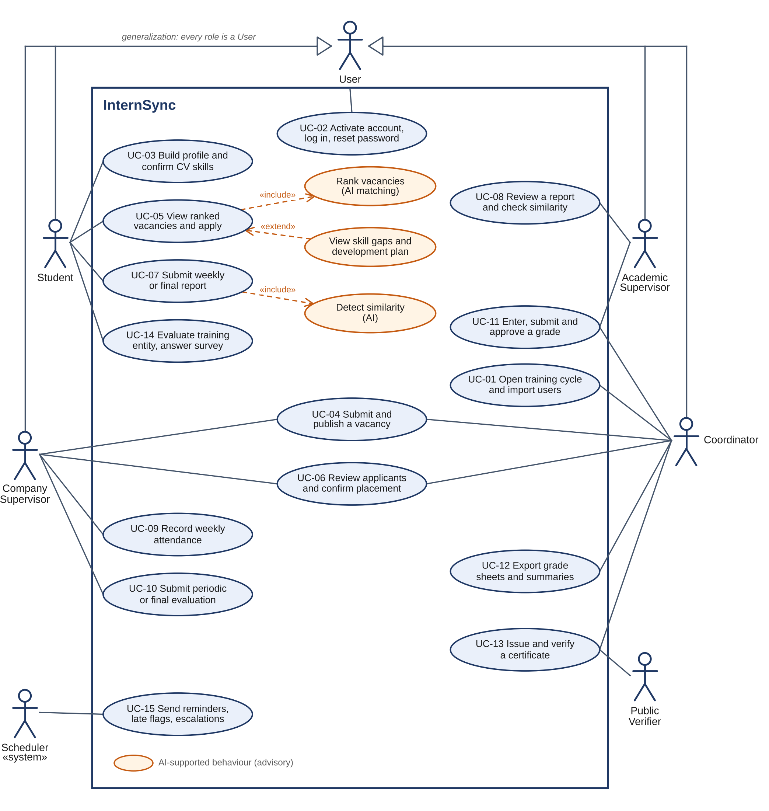

**Figure C.1 – Use case diagram (from SRS 3.2)**

**Table C.1 – Figures and their sources**

| **Figure** | **Diagram** | **UML type** | **Source file** |
|:--:|:---|:---|:---|
| 2.1 | System context | Context | `02_context.dot` |
| 2.2 | Layered architecture | Component (layers) | `12_layers.py` |
| 4.1 | System architecture | Component | `05_architecture.py` |
| 4.2 | Runtime components and trust boundaries | Component (runtime) | `figures/runtime_architecture.png` (Archify export) |
| 4.3 | Deployment | Deployment | `09_deployment.py` |
| 5.1, 5.2 | Domain model | Class | `13_class_diagrams.py` |
| 5.3 | Report review module | Class | `figures/class_report_review.png` (Archify export) |
| 5.4 | Sign-in and authorized request | Sequence | `14_seq_login.py` |
| 5.5 – 5.8 | CV and matching; weekly report; grade approval; scheduler | Sequence | `07a` – `07d` `.mmd` |
| 5.9, 5.10 | Life cycle across roles | Activity | `03_activity_lifecycle.py` |
| 5.11 – 5.14 | Vacancy, application, report slot, grade | State machine | `04a` – `04d` `.dot` |
| 5.15 | AI pipelines | Data flow | `08_ai_pipelines.py` |
| 6.1 – 6.4 | Data model | ER (crow's foot) | `06_erd.py` |
| C.1 | Use cases | Use case | `01_use_case.py` |

### Appendix D – References

**Standards**

- IEEE Std 1016-1998, *IEEE Recommended Practice for Software Design Descriptions*. IEEE, 1998.
- IEEE Std 830-1998, *IEEE Recommended Practice for Software Requirements Specifications*. IEEE, 1998.
- IEEE Std 610.12-1990, *IEEE Standard Glossary of Software Engineering Terminology*. IEEE, 1990.
- RFC 9457, *Problem Details for HTTP APIs*. IETF, 2023.
- RFC 7519, *JSON Web Token (JWT)*. IETF, 2015.
- RFC 8030, *Generic Event Delivery Using HTTP Push*, and RFC 8292, *Voluntary Application Server Identification (VAPID) for Web Push*. IETF, 2016 and 2017.
- OpenAPI Specification 3.1. OpenAPI Initiative, 2021.
- Web Content Accessibility Guidelines (WCAG) 2.1. W3C, 2018.
- Personal Data Protection Law (PDPL), Kingdom of Saudi Arabia, Royal Decree M/19, 2021.

**Books**

- I. Sommerville, *Software Engineering*, 10th ed. Pearson, 2016.
- R. S. Pressman and B. R. Maxim, *Software Engineering: A Practitioner's Approach*, 9th ed. McGraw-Hill, 2019.
- L. Bass, P. Clements, and R. Kazman, *Software Architecture in Practice*, 4th ed. Addison-Wesley, 2021.
- M. Fowler, *Patterns of Enterprise Application Architecture*. Addison-Wesley, 2002.

**Articles**

- L. Wang et al., "Multilingual E5 Text Embeddings: A Technical Report," arXiv:2402.05672, 2024.
- Y. A. Malkov and D. A. Yashunin, "Efficient and Robust Approximate Nearest Neighbor Search Using Hierarchical Navigable Small World Graphs," *IEEE Transactions on Pattern Analysis and Machine Intelligence*, vol. 42, no. 4, 2020.
- A. Z. Broder, "On the Resemblance and Containment of Documents," *Proceedings of Compression and Complexity of Sequences*, IEEE, 1997.
