# InternSync – User Guide

**Version 1.0 · Oct 29, 2026 · for the system as delivered in Increment 4**

This guide shows how each of the five roles uses InternSync. The screenshots come from the demo data in English. They are taken again by `npx playwright test -c playwright.guide.config.ts` in `frontend/` after any change. Every screen also exists in Arabic, right to left.

## 1. Getting Started (all roles)

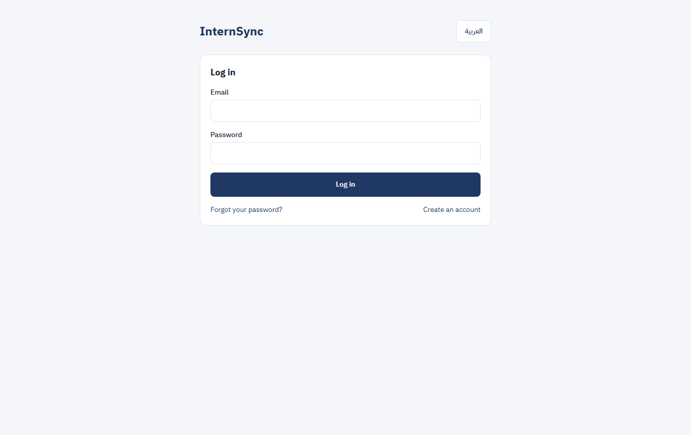

1. **Open the app.**
   - In the local demo it is at http://localhost:5173.
   - On a phone, open the address and choose "Add to Home Screen" to install InternSync as an app.
2. **Choose your language** with the button at the top: العربية or English. The choice is saved with your account.
3. **Sign in** with your email and password. A new account first shows the privacy notice, which you accept once.
4. **New accounts:**
   - Students, coordinators, and companies register from "Create an account" and are verified:
     - students by their college's coordinator;
     - coordinators and companies by the Platform Admin.
   - Supervisors are invited by email.
5. **Home** lists what needs your attention, with a count and a link for each item. The bell at the top shows your notifications; they also arrive by email and, if you allow it, as phone notifications.
6. **Session:** you are signed out after 30 minutes without activity, and when you choose "Log out".
7. **On a phone,** the menu is folded behind the "Main menu" button at the top.

**Without a connection** the app still opens:

- Pages you opened earlier in the same window show their saved copy, with its time.
- Text you type into a report or an evaluation is kept on the device and saved as a draft when the connection returns.
- Submitting needs the connection.
- Signing out deletes everything kept on the device.

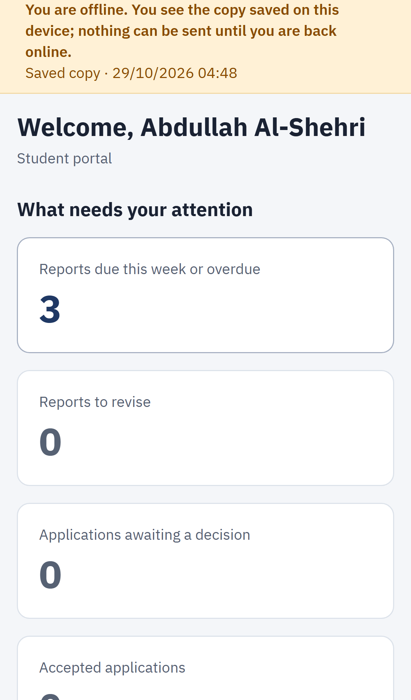

## 2. Student

**Before the training**

1. **Profile and CV:** enter your academic data and upload your CV (PDF or Word). The system suggests the skills it finds; confirm or correct them.
2. **Training opportunities, "Recommended" tab:**
   - the vacancies open to you, ranked by fit;
   - the skills you match and the ones you miss;
   - a development plan for the missing skills.

   The ranking is advisory; apply to the ones you choose (at most 5 active applications).

   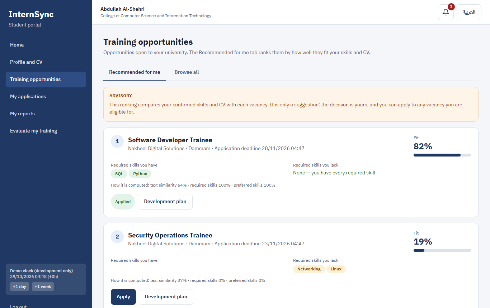
3. **My applications:** follow each application. When a company accepts you, the coordinator confirms the placement and assigns your academic supervisor.

**During the training**

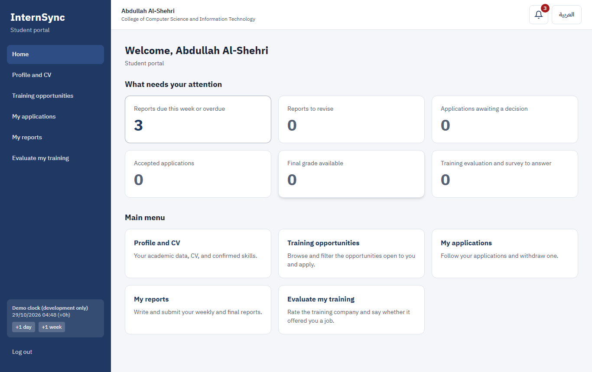

1. **My reports:**
   - Open the week's report.
   - Fill in the four parts and add up to 3 attachments.
   - Choose "Submit" before the deadline (the time is Riyadh time). "Save draft" keeps your text without sending it.
   - A report sent after the deadline is marked Late.
2. **Revisions:** if your supervisor asks for a revision, you see the comment; correct the report and submit it again.
3. **Attendance and evaluations:** your attendance and the periodic evaluation appear in the same place. The final evaluation and the grade appear when the grade is Final.

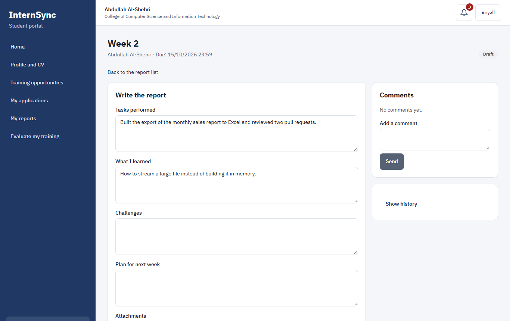

**After the training**

1. **Evaluate my training:** rate the company on four points, say whether you would recommend it, and say whether it offered you a job. Only the coordinator sees your answers, never the company.
2. **Certificate:** once your grade is Final, the coordinator issues your completion certificate. Open it from your grade.

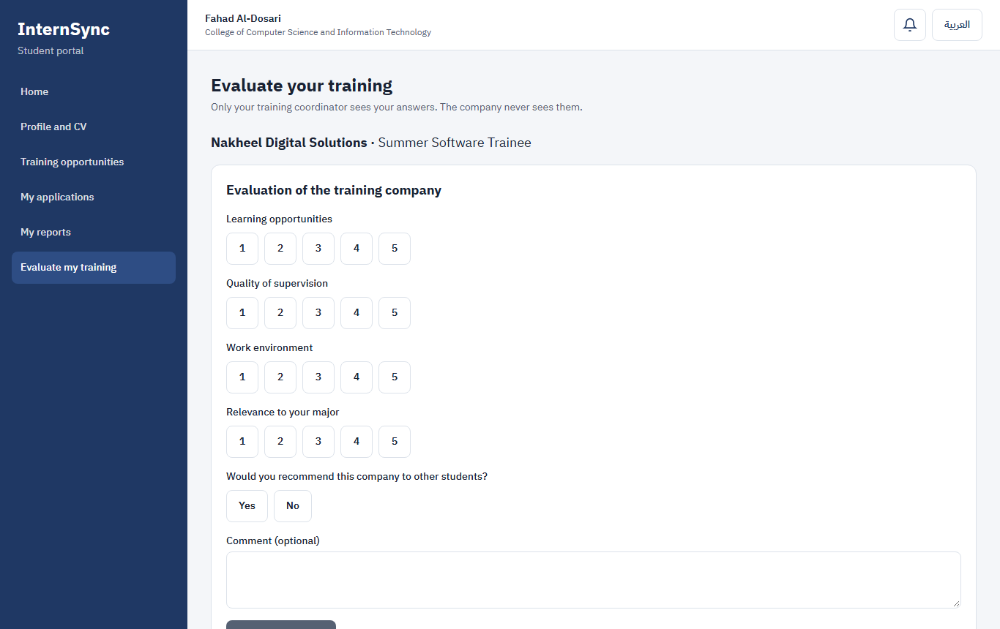

## 3. Company Supervisor and Company Admin

1. **Vacancies:** create a vacancy with its skills, majors, seats, and deadline, and publish it. The Company Admin also manages the company's supervisors (Team).
2. **Applicants:** review applicants with their fit and skills, and accept or decline.
3. **Trainees:**
   - Open a trainee to see their reports (read only).
   - Record each week's attendance ("Full attendance" is one click).
   - Fill in the periodic and final evaluations on the cycle's rubric (1 to 5 per criterion, with a comment).
   - A submitted evaluation is locked; only the coordinator can reopen it, once.

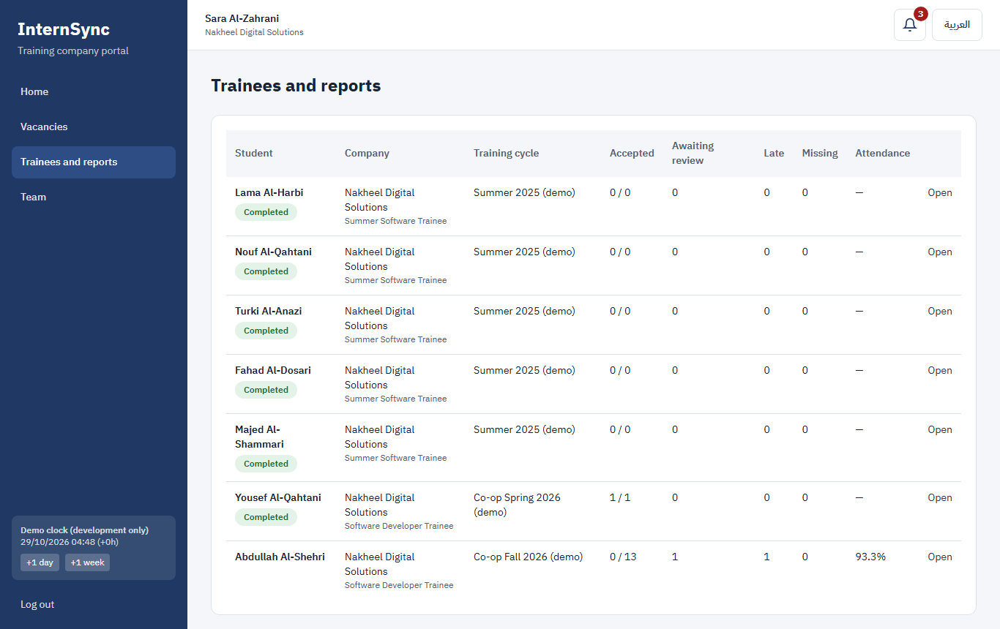

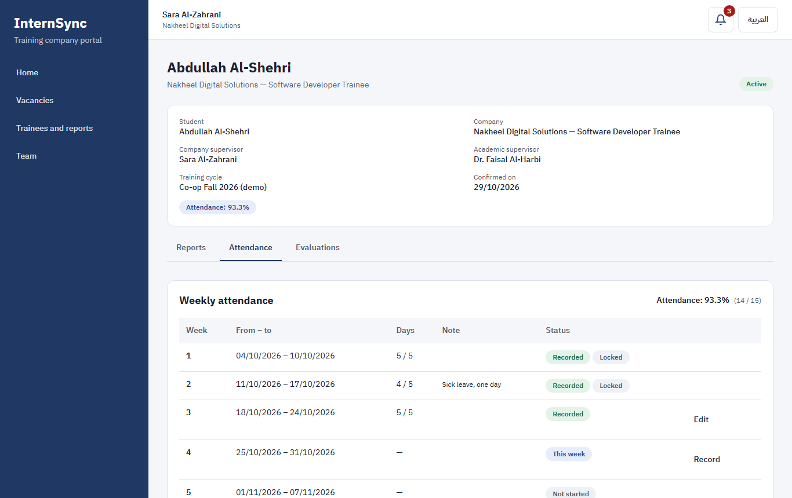

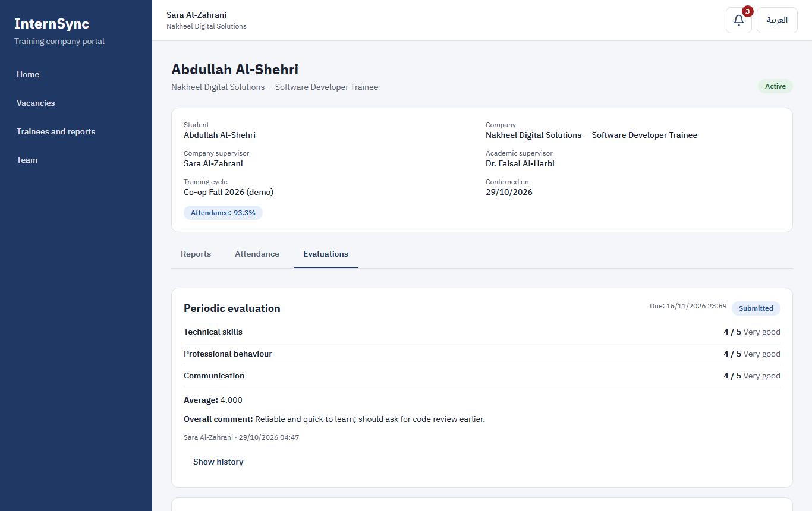

## 4. Academic Supervisor

1. **My students:** open a submitted report and choose "Accept the report" or "Request a revision" with a comment. You can also comment without a decision.
2. **Similarity:**
   - A flagged report shows the overlap with an earlier report of your university, the passages side by side, and the Advisory label.
   - Record your decision ("No issue" or "Overlap confirmed") with a comment; the report's status does not change by itself.
3. **Grades:**
   - The checklist shows what is missing.
   - When everything is in, enter your components and submit the grade to the coordinator.

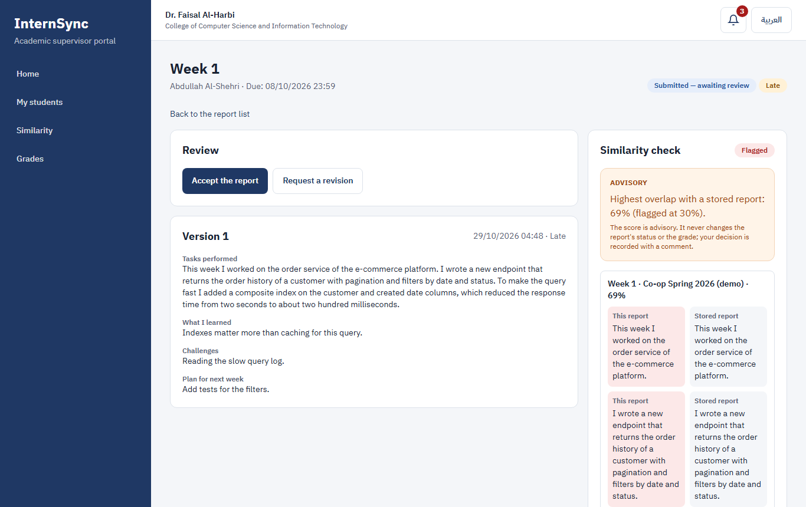

## 5. Coordinator

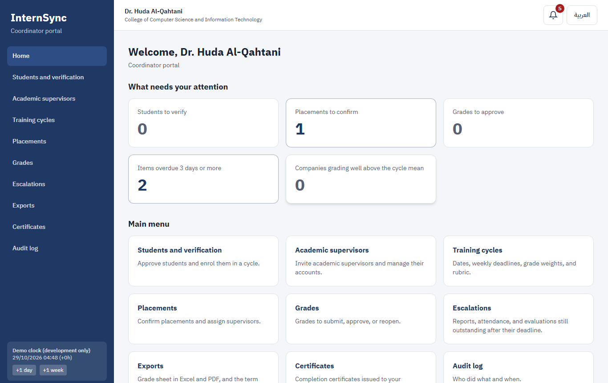

1. **Students and verification:** approve students, which enrols them in a cycle.
2. **Training cycles:**
   - Create a cycle with its weeks, report deadline, grade weights, and rubric.
   - Close it at the end.
   - The **Statistics** tab shows:
     - submissions, attendance, and evaluations per company;
     - the leniency alert for a company whose final evaluations are well above the cycle mean;
     - the job-offer rate;
     - the students' evaluation of the companies.

   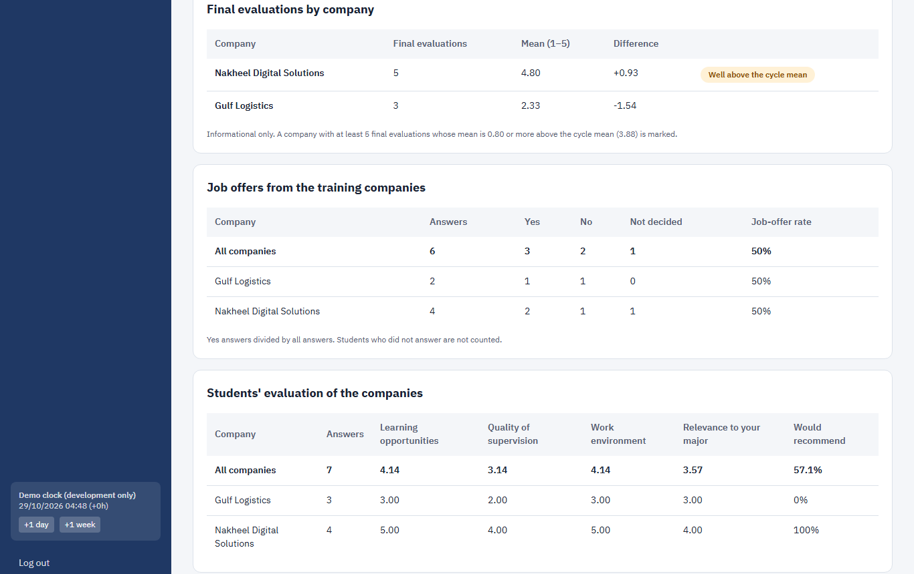
3. **Placements:** confirm accepted applications and assign the academic supervisor.
4. **Grades:** approve submitted grades (one by one or together), return them with a comment, or reopen a Final grade with a reason.
5. **Certificates:**
   - On a student's grade page, issue the certificate once the grade is Final. The PDF has a QR code that opens the public check.
   - Revoke it with a reason if needed.
   - The Certificates page lists all of them.

   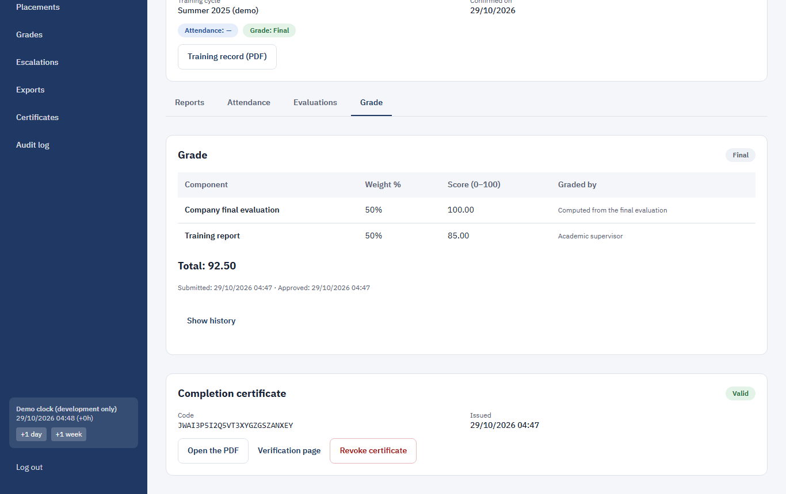
6. **Escalations:** reports, attendance weeks, and evaluations still outstanding 3 days after their deadline.
7. **Exports:** the grade sheet in Excel or PDF, the term summary, and a student's training record, in your language.

   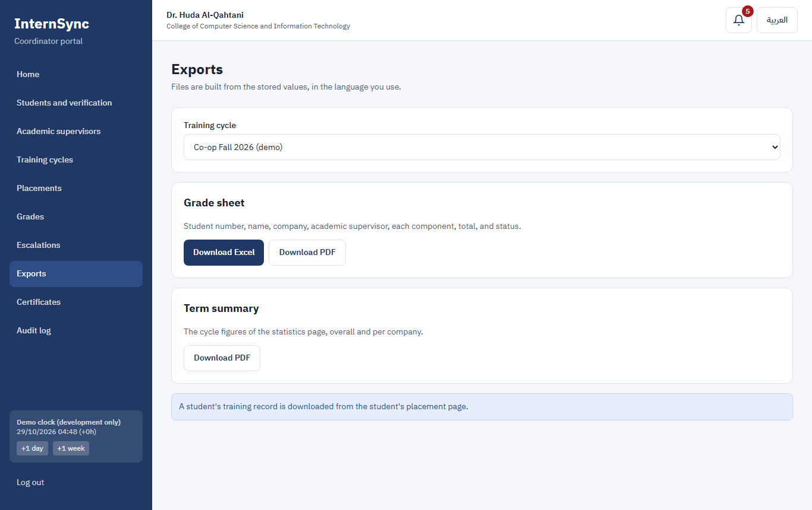
8. **Data retention:**
   - On the cycle page, set how many months personal data is kept after a cycle closes.
   - After that period, "Anonymize personal data" removes the names, contact details, CVs, and report texts of the cycle's students. The statistics stay. The counts are shown before you confirm.
9. **Audit log:** who did what and when, for your college.

## 6. Platform Admin

1. **Verification requests:** approve or reject coordinators and companies, with a reason for a rejection.
2. **Universities and companies:**
   - Add universities and colleges.
   - Suspend a company.
   - Transfer a college's coordinator role or a company's admin right to another person, with a reason.
3. **Skills, majors, settings:** the skill dictionary, the majors, and the system settings (limits, deadlines, thresholds).
4. **Audit log:** entries about accounts and organizations. The Platform Admin never sees CVs, reports, evaluations, or grades.

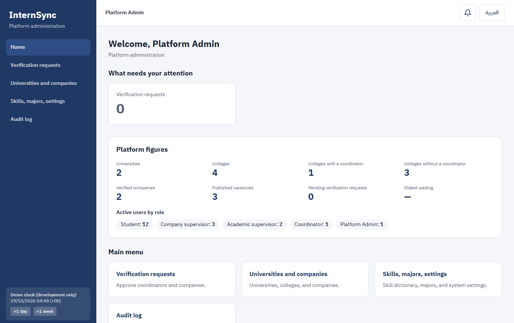

## 7. Checking a Certificate (anyone, no account)

Scan the QR code on the certificate, or open `/verify` and type the code (with or without the dashes). The page shows Valid, Revoked, or Not found, with the student, university, college, cycle, company, and training dates. It never shows the grade.

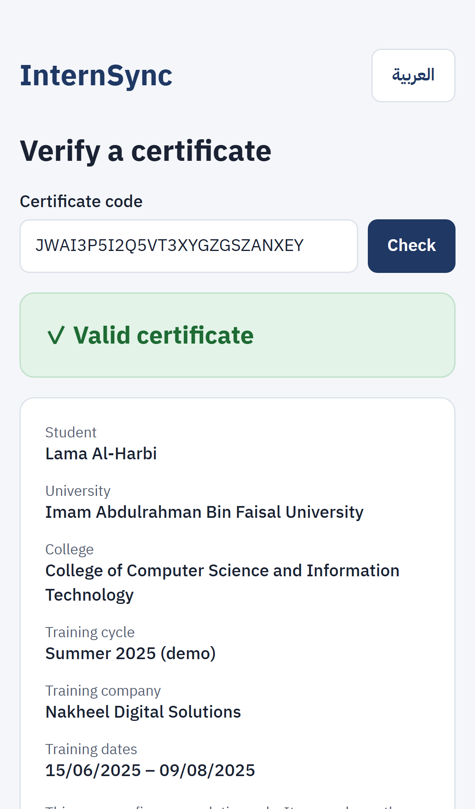

## 8. Questions

| **Question** | **Answer** |
|:---|:---|
| I forgot my password | "Forgot your password?" on the sign-in page sends a link valid for 60 minutes |
| My account is locked | After 5 wrong passwords the account is locked for 15 minutes |
| The deadline passed while I was offline | The time the report reaches the server counts; a report sent after the deadline is marked Late, and your supervisor decides |
| Why is a vacancy not shown to me? | It may not be open to your university or major, or your GPA or training type may not match; the vacancy page says why |
| Does the AI decide anything? | No. Fit scores, skill suggestions, and similarity flags are advisory; a person decides |
| Who sees my evaluation of the company? | The coordinator of your college only |
